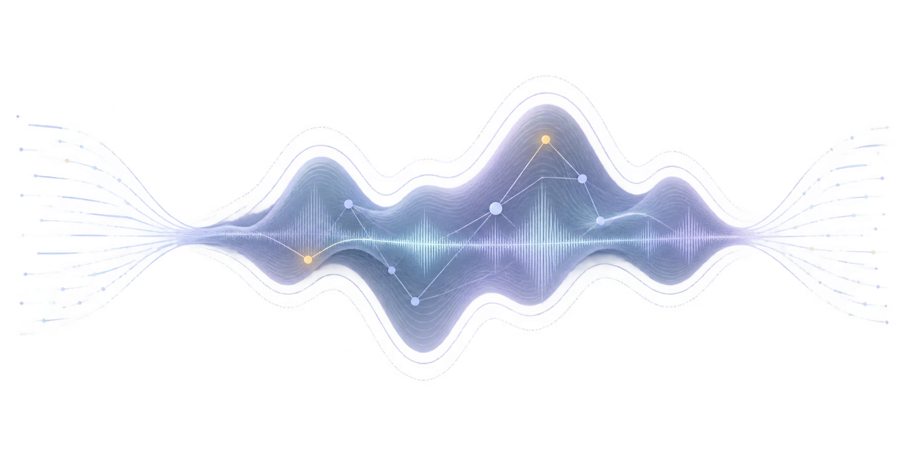

# Speech Generation Wiki



A living systematic review of synthetic speech research, covering **text-to-speech (TTS)**,
**voice conversion (VC)**, and **spoken conversational agents**.

This repository contains the wiki's published knowledge base: paper pages, structured concept
claims, and reader-oriented research reviews. Browse the
[live site](https://msamribeiro.github.io/speech-generation-wiki-site) for the rendered version.

## How the Knowledge Base Is Organized

The repository offers three complementary ways to read concept-level research:

1. **Overview** — a concise account of the current state, method landscape, trade-offs, and open
   questions for readers surveying many concepts.
2. **In Depth** — a detailed review of what the integrated literature collectively shows, where
   findings disagree, and which conclusions remain uncertain.
3. **Claim YAML** — the complete machine-readable record of paper-level claims, evidence roles,
   method families, caveats, and reassessment state.

The two Markdown formats are editorial projections of the same claim YAML. They select and explain
decision-relevant conclusions rather than reproducing the full graph.

```text
papers/{id}.md
    ↓ integration
_claims/{concept}.yaml
    ↓ rendering
concepts/{concept}.md
concepts/{concept}-in-depth.md
```

Concept conclusions describe the literature integrated into this corpus. They should not be read
as claims of exhaustive field coverage.

> **Work in progress:** concept integration and synthesis currently cover research through
> Q4 2025. The paper catalog contains later work that has been ingested but not yet incorporated
> into concept conclusions. Coverage will advance chronologically until it catches up with current
> research, then continue on a rolling basis.

## Start Reading

- [Home](index.md) — project summary and completed concept integrations
- [Start Here](start.md) — reading paths for surveys, deep dives, papers, and structured evidence
- [Field Overview](overview.md) — cross-concept synthesis of completed integrations
- [Concept Catalog](concepts/index.md) — Overview / In Depth links and integration status
- [Paper Catalog](papers/index.md) — all ingested paper pages

All 23 tracked concepts have completed claim integration through Q4 2025 and have both rendering
depths. The catalog reports each concept's current paper count and last render date.

## Current Coverage and Planned Analysis

The completed Q4 2025 boundary is a pipeline milestone, not the intended endpoint. Q3 and Q4 2025
now have immutable snapshots and quarterly reports. Later 2026 papers already appear in the paper
catalog, while the next integration cycle will begin after the active ingestion frontier is ready.

The wiki is also planned to extend beyond concept synthesis:

- **Time-based reports** now preserve Q3 and Q4 2025 as immutable historical assessments; future
  reports will extend the sequence as later integration cycles close.
- **Venue reports** will synthesize research from venues such as Interspeech, NeurIPS, ICLR, and
  ACL when enough relevant papers are available to support more than a paper listing.
- **Citation analysis** will identify highly cited and influential papers in the corpus and track
  movement across periodic snapshots.

## Repository Structure

```text
index.md                       Reader-facing landing page
start.md                       Intent-based reading guide
overview.md                    Cross-concept field overview
log.md                         Append-only content operations log

papers/
  index.md                     Full paper catalog
  {id}.md                      One reviewed paper page
  assets/{id}/                 Selected paper figures

_claims/
  {concept}.yaml               Structured concept claim graph and source of truth

concepts/
  index.md                     Concept catalog and integration status
  {concept}.md                 Concept Overview
  {concept}-in-depth.md        Concept In Depth review

venues/                        Venue reports generated on demand
reports/                       Snapshot-backed quarterly and future trend reports
```

The former Evidence Dossier format is retired. Readers or agents that need exhaustive
paper-to-claim structure should use `_claims/` directly.

## Paper Pages

Each full paper page includes:

- a paper card with venue, year, authors, source link, and one-sentence contribution;
- a method summary and selected architecture figure when appropriate;
- key results with paper-local metric provenance;
- an assessment of novelty and field significance;
- two to five generalized claims with source-section citations;
- limitations, open questions, and links to related concepts and papers.

Foundational papers included mainly for citation context may use a shorter Tier 2 page.

## Coverage

The corpus draws from arXiv, Interspeech, ACL, EMNLP, NAACL, NeurIPS, ICLR, ASRU, workshops, and
technical reports from industry labs. Its main rolling window begins in 2025, with earlier
foundational work added through citation discovery. See the [paper catalog](papers/index.md) for
the current set; static counts in documentation may lag active ingestion.

## Pipeline and Companion Repositories

This repository is the content output of a staged evidence pipeline:

```text
Fetch → Filter → Parse → Ingest → Integrate → Reconcile → Render
                                             └→ Snapshot → Report
```

- [speech-generation-wiki-infra](https://github.com/msamribeiro/speech-generation-wiki-infra)
  contains acquisition scripts, parsed-source infrastructure, metadata, schemas, health checks,
  and shared Claude Code/Codex workflows.
- [speech-generation-wiki-site](https://github.com/msamribeiro/speech-generation-wiki-site)
  contains the Quartz configuration that publishes this repository to GitHub Pages.

Automated content preserves generation provenance in page frontmatter. Claim status and evidence
relationships are changed in `_claims/` through integration and then rendered into Markdown;
rendered concept pages are replaceable outputs rather than the source of truth.

## Reporting Errors or Contributing

When reporting a factual issue, identify the paper or concept page and, where possible, the source
section, table, or figure. Do not edit a rendered concept page to change an evidence assessment:
corrections to claims, roles, or support relationships must flow through the corresponding
`_claims/{concept}.yaml` record in the pipeline.
