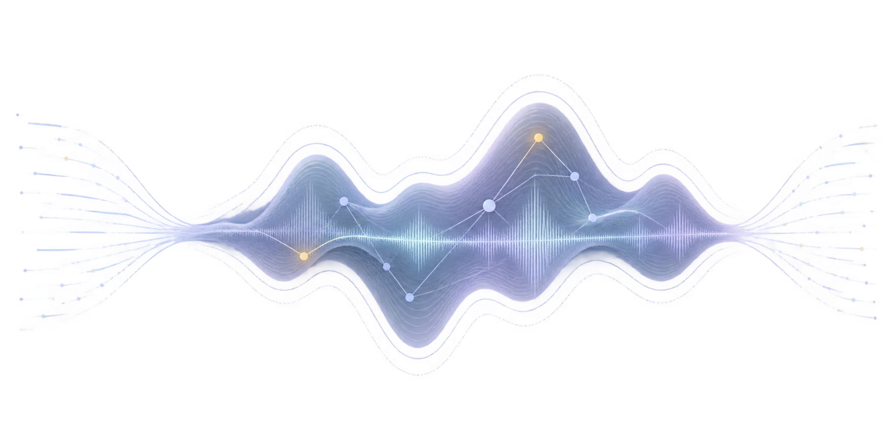

> [!abstract]
> A living systematic review and knowledge graph of speech generation research. It brings together
> 1061 paper summaries across **text-to-speech (TTS)**, **voice conversion (VC)**, **spoken
> conversational agents**, and evaluation, and connects them through 23 concept guides. The wiki
> shows what the current evidence supports, where findings disagree, and how the field changes over
> time.

There are four main ways to use the wiki:

- Read the [[overview|Field Overview]] for the main findings across the field.
- Use the [[concepts/index|concept catalog]] to study one method or capability.
- Open the [[reports/index|quarterly reports]] to see what changed during a fixed period.
- Search the [[papers/index|paper catalog]] when you want the underlying evidence.

→ [[start|Choose the best place to start]]

> [!warning]
> **Coverage and dates.** The wiki includes earlier foundational papers, but its quarter-by-quarter
> record begins with Q3 2025. The current field overview and concept pages cover research published
> through Q1 2026. The paper catalog also includes newer publications. They are listed for
> discovery but are not yet reflected in the current summaries.

## Start with the field

The [[overview|Field Overview]] connects all 23 concepts. It explains the main choices around
speech representations, speed, control, voice transfer, evaluation, and spoken interaction. You
do not need to start with a specific architecture.

To see what changed during the latest completed period, read
[[reports/quarterly/2026-Q1|Speech Generation — Q1 2026]]. The report separates publication
activity from changes in the evidence through March 31, 2026.

## Explore a concept

All 23 concepts have a short Overview and a detailed In Depth page. Together they cover
generation architectures, speech representations, control, multilingual and zero-shot synthesis,
streaming, spoken agents, and evaluation.

→ [[concepts/index|Browse all 23 concepts]]

## Browse the papers

The corpus contains 1061 paper pages from arXiv, Interspeech, ACL, EMNLP, NAACL, ICLR, NeurIPS,
ASRU, workshops, and industry technical reports. Search by title, author, system, benchmark, venue,
or paper ID.

→ [[papers/index|Browse all 1061 papers]]

## How to read the dates

The field overview is the current synthesis and will change as new research is added. Quarterly
reports preserve the evidence at each quarter boundary. The Q1 materials cover evidence published
through March 31, 2026. The retrospective assessment was completed on November 28, 2026.

Paper counts show coverage and research activity. They do not prove that a finding is strong,
widely accepted, or widely used.
