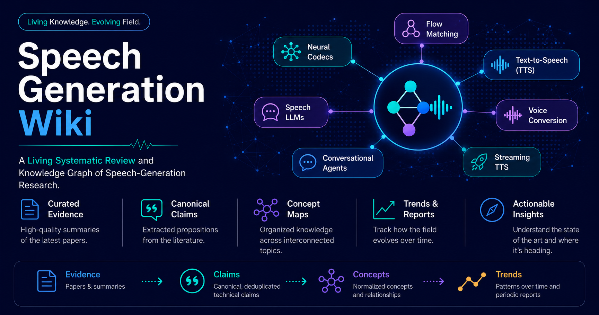

> [!abstract]
> A living systematic review of synthetic speech, covering **text-to-speech (TTS)**,
> **voice conversion (VC)**, and **spoken conversational agents**. The wiki contains 957 paper
> pages and integrates research across 23 concepts.

The wiki offers four complementary ways to read the research:

- The [[overview|Field Overview]] gives a gentle introduction to the current evidence across the
  whole field.
- The [[concepts/index|concept catalog]] provides focused Overview and In Depth guides to individual
  methods and capabilities.
- [[reports/index|Quarterly reports]] preserve what changed within a fixed publication period.
- The [[papers/index|paper catalog]] and structured claim records provide the underlying evidence.

→ [[start|Choose the best place to start]]

> [!warning]
> **Current synthesis boundary.** The integrated concepts and field overview use research published
> through Q3 2025. The paper catalog contains later work that has been ingested but is not yet part
> of these conclusions. Q4 2025 is the next integration and reconciliation cycle.

## Start with the field

The [[overview|Field Overview]] connects all 23 concepts. It explains the recurring choices around
speech representations, generation speed, control, voice transfer, evaluation, and spoken
interaction without requiring readers to begin with one architecture.

To understand what specifically changed during the latest completed period, read
[[reports/quarterly/2025-Q3|Speech Generation — Q3 2025]]. The report separates publication
activity from changes in assessed knowledge and is frozen to its Q3 evidence boundary.

## Explore a concept

Twenty-one concepts have both a concise Overview and a detailed In Depth page. These include
generation architectures, neural codecs and speech representations, speaker and style control,
multilingual and zero-shot synthesis, streaming and spoken agents, and evaluation.

The `singing` and `fine-tuning` evidence is already included in the field overview and Q3 report;
their standalone rendered pairs remain pending.

→ [[concepts/index|Browse all 23 concepts]]

## Browse the papers

The corpus contains 957 paper pages from arXiv, Interspeech, ACL, EMNLP, NAACL, ICLR, NeurIPS,
ASRU, workshops, and industry technical reports. Search by title, author, system, benchmark, venue,
or paper ID.

→ [[papers/index|Browse all 957 papers]]

## How to read the dates

The field overview is a replaceable account of the latest integrated evidence. Quarterly reports
are immutable historical views derived from reviewed snapshots. The current Q3 materials were
assessed retrospectively on 2026-09-12 using evidence published through 2025-09-30; they do not
claim that the assessment itself was made at the end of that quarter.

Paper counts show corpus coverage and research attention. They do not by themselves establish
evidence strength, consensus, or adoption.
