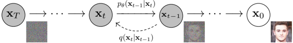

> [!abstract] NeurIPS · 2020 · Conference
> **Ho et al.** (UC Berkeley) · [→ Paper](https://papers.nips.cc/paper_files/paper/2020/hash/4c5bcfec8584af0d967f1ab10179ca4b-Abstract.html) · [→ Preprint](https://arxiv.org/abs/2006.11239) · Demo: ? · Code: ✓
>
> Shows that diffusion probabilistic models can generate high-quality samples when the reverse process is parameterized to predict the added Gaussian noise and trained with a simple unweighted denoising loss, a choice the paper derives from a link between diffusion models, denoising score matching and annealed Langevin dynamics.

## Problem

Diffusion probabilistic models (Sohl-Dickstein et al., 2015) define a generative model as a learned reverse of a fixed Markov chain that gradually adds Gaussian noise to data. They are simple to define and efficient to train, but the authors know of no prior demonstration that they can produce high-quality samples. Score-based models (NCSN) had reached competitive image quality through denoising score matching and annealed Langevin sampling. However, their sampler coefficients were set by hand after training, and nothing in training directly optimized the sampler. The paper asks whether a diffusion model, trained by variational inference, can match the sample quality of GANs and autoregressive models.

## Method

The forward (diffusion) process adds Gaussian noise over T = 1000 steps with variances fixed to a linear schedule from β₁ = 10⁻⁴ to β_T = 0.02. The marginal q(x_t | x_0) has a closed form, so training samples a random timestep and noises the data in one step. The forward process has no learned parameters, and its last step leaves almost no signal (D_KL(q(x_T | x_0) ‖ N(0, I)) ≈ 10⁻⁵ bits per dimension). The reverse process is a Markov chain of Gaussians. Its variances are fixed, untrained constants (σ_t² = β_t or the posterior variance β̃_t, which give similar results).

The central design choice is the parameterization of the reverse-process mean. The network ε_θ(x_t, t) predicts the noise ε that produced x_t, instead of the forward-process posterior mean μ̃_t. With this choice, each term of the variational bound reduces to a weighted noise-prediction squared error. That error resembles denoising score matching over many noise levels, and the sampler (Algorithm 2) resembles annealed Langevin dynamics with ε_θ acting as a learned gradient of the data density. Training on the true bound therefore fits a Langevin-like sampler by variational inference.

The paper then drops the per-timestep weights and trains on an unweighted objective, L_simple = E‖ε − ε_θ(√ᾱ_t x_0 + √(1 − ᾱ_t) ε, t)‖² with t uniform over 1..T (Algorithm 1). Compared with the true bound, this down-weights the small-t terms that train denoising at very low noise, so the network concentrates on harder, high-noise denoising. The last step uses a discretized Gaussian decoder, so the bound is a lossless codelength on 8-bit image data.

The denoiser is a U-Net in the style of an unmasked PixelCNN++ (Wide ResNet blocks, group normalization), with self-attention at 16 × 16 resolution. The timestep enters every residual block through a Transformer sinusoidal embedding, and parameters are shared across time. Model sizes are 35.7M parameters for CIFAR10 and 114M for the 256 × 256 datasets, plus a roughly 256M-parameter LSUN Bedroom variant (§Appendix B). The paper also reads the bound as a progressive lossy code (Algorithms 3 and 4). It shows that a masking-noise diffusion whose length equals the data dimension reduces to an autoregressive model, so Gaussian diffusion acts as autoregressive decoding with a generalized bit ordering (§4.3).

## Key Results

All experiments are on images. The paper has no speech or audio experiment.

- **CIFAR10, unconditional (Table 1):** the L_simple model reaches FID 3.17 and IS 9.46. That FID is the lowest among the unconditional models in Table 1, just ahead of StyleGAN2 + ADA (v1) at 3.26. The class-conditional StyleGAN2 + ADA (v1) is lower at 2.67, and the unconditional StyleGAN2 + ADA has a higher IS (9.74 vs 9.46). FID is computed against the training set; against the test set it is 5.24 (§4.1).
- **Objective and parameterization ablation (Table 2):** ε-prediction with L_simple gives FID 3.17 and IS 9.46. On the true bound with fixed isotropic variance, ε-prediction (FID 13.51) and μ̃-prediction (FID 13.22) are close. μ̃-prediction trained on unweighted mean squared error was unstable and produced out-of-range scores. Learned diagonal variances were worse for μ̃-prediction (FID 23.69) and unstable for ε-prediction.
- **Likelihood (Table 1):** test NLL is ≤ 3.75 bits/dim for L_simple and ≤ 3.70 for the true-bound model. Both beat the original diffusion model (≤ 5.40) but trail Gated PixelCNN (3.03) and Sparse Transformer (2.80). The train-test gap is at most 0.03 bits/dim.
- **LSUN 256 × 256 (Table 3):** FID 4.90 on Bedroom (large model; 6.36 small), 7.89 on Church and 19.75 on Cat. These are better than ProgressiveGAN on Bedroom (8.34) and Cat (37.52), worse on Church (6.42), and worse than StyleGAN and StyleGAN2 on all three.
- **Rate-distortion (§4.3, Table 4):** the best-sample CIFAR10 model has a rate of 1.78 bits/dim and a distortion of 1.97 bits/dim, an RMSE of 0.95 on the 0-255 scale. More than half of the lossless codelength describes imperceptible distortion.

Baseline scores in Tables 1 and 3 are cited from prior papers rather than re-run; Table 3 states that its baselines come from StyleGAN2 or the original authors.

## Novelty Assessment

The diffusion model itself, with its forward process and variational bound, comes from Sohl-Dickstein et al. (2015). The new parts are the ε-prediction parameterization of the reverse mean, the explicit derivation that links it to denoising score matching and Langevin sampling, and the unweighted L_simple objective that turns training into plain noise regression. Each is simple. Together they make the difference between a model with no reported sample quality and one with the lowest unconditional CIFAR10 FID in Table 1. The paper also brings in design choices that are not original but matter in practice: a U-Net denoiser, sinusoidal time embedding in every block, a small fixed variance schedule, and a forward process that fully destroys signal. Appendix C contrasts these with NCSN. The progressive-coding and autoregressive interpretations are conceptual contributions; the lossy-compression scheme is a proof of concept, not a working codec.

## Field Significance

> [!important]
> Foundational: the paper turns diffusion models from a theoretical construction into a practical generator by reducing training to noise-prediction regression at random noise levels and sampling to a fixed Langevin-like chain. That recipe is data-agnostic: it needs only a denoising network and a noise schedule, and it can serve as the generative backbone for continuous speech representations such as mel-spectrograms or waveforms. The paper also lays out the cost of the approach, a 1000-step sampler.

## Claims

- **supports:** Training a diffusion model to predict the added noise with an unweighted denoising loss gives better sample quality than predicting the posterior mean or optimizing the exact variational bound.
  > *Evidence:* On unconditional CIFAR10, ε-prediction with L_simple reaches FID 3.17 / IS 9.46, against FID 13.51 for ε-prediction on the true bound and 13.22 for μ̃-prediction on the true bound; μ̃-prediction trained on unweighted MSE was unstable. *(§4.2, Table 2)*
- **supports:** Fixing the reverse-process variances of a diffusion model gives more stable training and better samples than learning them.
  > *Evidence:* With μ̃-prediction, a learned diagonal variance gives FID 23.69 against 13.22 with a fixed isotropic variance; with ε-prediction, the learned-variance run was unstable and produced out-of-range scores. *(§4.2, Table 2)*
- **complicates:** Diffusion training objectives that maximize sample quality do not maximize likelihood, and diffusion likelihoods trail autoregressive models.
  > *Evidence:* The L_simple model has the best FID but a slightly worse codelength than the true-bound model (≤ 3.75 vs ≤ 3.70 bits/dim test), and both trail Sparse Transformer (2.80) and Gated PixelCNN (3.03). *(§4.1, §4.3, Table 1)*
- **refines:** Diffusion models generate coarse-to-fine, spending most of their codelength on perceptually minor detail.
  > *Evidence:* The best-sample model spends 1.78 bits/dim on rate and 1.97 bits/dim on distortion (RMSE 0.95 on a 0-255 scale); distortion falls steeply at low rate, and progressive generation shows large-scale features first and details last. *(§4.3, Figure 5, Figure 6, Table 4)*
- **complicates:** High-quality diffusion sampling needs many sequential network evaluations, which makes inference slow.
  > *Evidence:* All models sample with T = 1000 steps; on a TPU v3-8, a batch of 256 CIFAR10 images takes 17 s and a batch of 128 images at 256 × 256 takes 300 s. *(§4, §Appendix B)*

## Limitations and Open Questions

The paper contains no speech or audio experiment, so its value for speech generation is a transfer of method, not measured evidence. Every result is on unconditional image generation (CIFAR10, LSUN, CelebA-HQ). The paper's conclusion names other data modalities as future work. Conditioning on text, speakers or other side information is not addressed.

- **Sampling cost.** The 1000-step ancestral sampler is slow (§Appendix B), and the paper does not study fewer steps beyond noting that shorter diffusions are possible (§4.3).
- **Likelihood.** Codelengths are not competitive with autoregressive and flow models (Table 1), and the objective with the best samples gives up some likelihood.
- **Limited tuning and single runs.** Hyperparameters were tuned on CIFAR10 and transferred to the other datasets. Final models were trained once, and scores are reported at the minimum FID reached during training (§Appendix B), with no variance across seeds.
- **Compression is a proof of concept.** The progressive lossy code relies on minimal random coding, which is not tractable for high-dimensional data (§Extra information).
- **LSUN quality.** On LSUN, the models trail StyleGAN and StyleGAN2 on all three categories (Table 3).

## Wiki Connections

- [[diffusion-tts|Diffusion TTS]] — Defines the noise-prediction diffusion formulation (fixed Gaussian forward process, ε-prediction, L_simple, ancestral sampling) that diffusion-based speech generators adapt to mel-spectrograms and waveforms.
- [[2105.06337|Grad-TTS]] — Builds a diffusion decoder for text-to-speech on mel-spectrograms, reuses the U-Net design that this paper uses for 32 × 32 images (with fewer channels and resolutions), and cites its weighted-variational-bound view of diffusion training.
- [[interspeech-2025-0063|RLHF Fine-Tuning of Diffusion TTS]] — Fine-tunes a pretrained diffusion TTS model (WaveGrad 2) with reinforcement learning, including reward-weighted versions of the DDPM denoising loss introduced here.
- [[interspeech-2025-1747|FasterVoiceGrad]] — Speeds up VoiceGrad, a DDPM-based non-parallel voice conversion model, to one-step conversion, addressing the multi-step sampling cost of DDPM-style models.
- [[2509.18470|Discrete-Time Diffusion-Like Models for Speech Synthesis]] — Takes this paper's discrete-time DDPM formulation as the starting point for discrete-time diffusion-like speech synthesis.
- [[2207.12598|Classifier-Free Guidance]] — Keeps this paper's ε-prediction parameterization and discrete-time ancestral sampler and adds guidance for conditional generation.
- [[2210.02747|Flow Matching]] — Trains the same U-Net with the DDPM loss as a baseline when comparing flow matching against diffusion objectives.
