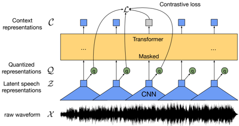

> [!abstract] NeurIPS · 2020 · Conference
> **Baevski et al.** (Facebook AI) · [→ Paper](https://papers.nips.cc/paper_files/paper/2020/hash/92d1e1eb1cd6f9fba3227870bb6d7f07-Abstract.html) · [→ Preprint](https://arxiv.org/abs/2006.11477) · Demo: ? · Code: ✓
>
> wav2vec 2.0 pre-trains a convolutional encoder and Transformer on raw unlabeled audio by masking latent frames and identifying the true quantized latent among distractors, learning the discrete units and the contextual representations jointly in one model; fine-tuned with CTC, it reaches 4.8/8.2 WER on LibriSpeech test-clean/other from only 10 minutes of transcribed speech.

## Problem

Speech recognition systems of the time needed hundreds to thousands of hours of transcribed speech, which does not exist for most of the world's languages, while unlabeled audio is plentiful. Earlier self-supervised approaches to speech either ran as a two-step pipeline (first learn a fixed quantization of the audio, as in vq-wav2vec, then train a BERT-style contextual model over the discrete units, as in Discrete BERT) or trained masked Transformers to reconstruct filterbank features. The paper asks whether a single end-to-end model trained only on unlabeled audio, then fine-tuned on small amounts of labeled data, can match or beat semi-supervised self-training methods that need far more labels and several rounds of pseudo-labeling.

## Method

The model has three parts. A **feature encoder** of seven temporal convolution blocks (512 channels, strides 5,2,2,2,2,2,2, kernel widths 10,3,3,3,3,2,2) maps the normalized raw waveform to latent speech representations at 49 Hz (about a 20 ms stride, 25 ms receptive field). A **context network** following the Transformer encoder design reads these latents; a convolutional layer (kernel 128, 16 groups) replaces absolute positional embeddings as a relative positional signal. A **quantization module** discretizes the encoder output with product quantization: G = 2 codebooks of V = 320 entries each, chosen with a straight-through hard Gumbel softmax whose temperature is annealed during training, giving a theoretical maximum of 102.4k codewords (§2, §4.2).

Pre-training masks spans of latent frames before the Transformer: a proportion p = 0.065 of time steps are sampled as span starts and the following M = 10 steps are replaced by a shared learned vector, masking about 49% of frames with a mean span of 299 ms. Inputs to the quantizer are not masked. The objective is a contrastive loss: for each masked step, the Transformer output must pick out the true quantized latent among K = 100 distractors drawn from other masked steps of the same utterance, using cosine similarity with temperature 0.1. A codebook diversity loss (weight 0.1), which maximizes the entropy of the averaged codeword distribution, keeps codebook usage even (§3.1, §3.2, §4.2). The key design choice is that the Transformer reads **continuous** latents while the contrastive **targets** are quantized.

Two sizes share the encoder: BASE (12 blocks, dimension 768, 95M parameters) and LARGE (24 blocks, dimension 1,024, 317M parameters). Pre-training uses either the 960 h of LibriSpeech audio (LS-960) or 53.2k h of LibriVox audio (LV-60k), on up to 128 V100 GPUs for as long as 5.2 days. For speech recognition, a randomly initialized linear layer over the Transformer predicts characters and is trained with CTC; the feature encoder stays frozen, only the output layer trains for the first 10k updates, and a SpecAugment-like masking of the latents regularizes fine-tuning. Decoding uses either a 4-gram LM or a Transformer LM with weights tuned by Bayesian optimization on dev-other (§3.3, §4.2 to §4.4).

## Key Results

**Low-resource fine-tuning (Table 1, §5.1).** With LV-60k pre-training and a Transformer LM, LARGE reaches 4.8/8.2 WER on test-clean/other from 10 minutes of labels (48 recordings), 2.9/5.8 from 1 hour, 2.6/4.9 from 10 hours and 2.0/4.0 from the 100 h clean subset. The §5.1 prose gives 5.2/8.6 for the 10-minute setting, but Table 1, the abstract, the introduction and the conclusion of the proceedings PDF all give 4.8/8.2; this page uses the table. At equal unlabeled data (LS-960) and with the same 4-gram LM, joint learning clearly beats the two-stage Discrete BERT (the authors summarize the gain as about a third of the WER): BASE reaches 9.1/15.6 against 16.3/25.2 with 10 minutes of labels, and 3.4/8.0 against 4.5/12.1 with 100 hours.

**Comparison with self-training (Table 1).** On the 100 h subset, the strongest prior result in the table is Noisy Student at 4.2/8.6 test-clean/other; LARGE with LS-960 pre-training reaches 2.3/5.0, a relative reduction of 45%/42% in the authors' like-for-like setup. With only 1 hour of labels and the same LS-960 audio, LARGE still gets 3.9/7.6, below Noisy Student's 100 h numbers on both test sets, which is the basis of the "100 times less labeled data" result.

**Full 960 h labels (Table 2, §5.2).** LARGE with LV-60k gets 1.8/3.3 test-clean/other. Its 3.3 on test-other is the lowest in Table 2 (Noisy Student 3.4, Conformer 3.9), but on test-clean Noisy Student is lower (1.7) and Conformer and ContextNet are close (1.9). The same LARGE architecture trained from scratch on labeled data only gets 2.1/4.6, so pre-training helps even when all labels are used. The authors point out that their recipe works against several handicaps: a CTC Transformer rather than seq2seq, character outputs decoded with a word LM, and no data balancing.

**TIMIT (Table 3, §5.3).** LARGE (LS-960) fine-tuned without an LM reaches 7.4/8.3 PER on dev/test, the lowest in Table 3 (vq-wav2vec 9.6/11.6, wav2vec 12.9/14.7).

**Ablation (Table 4, §5.4).** In a reduced setup (BASE, 10 h fine-tuning, three seeds, WER on the combined dev sets), continuous inputs with quantized targets get 7.97 WER (std 0.02), continuous inputs and targets 8.58, quantized inputs with continuous targets 11.18, and quantized inputs and targets 12.18. With continuous targets, training accuracy on the contrastive task rises from 62% to 78.0%, but downstream WER gets worse.

All evaluations are English ASR or phoneme recognition. The paper generates no speech, so its relevance to speech generation is as a source of pre-trained speech representations.

## Novelty Assessment

The new element is architectural and in the objective: masked prediction over continuous latents, with a contrastive target defined over a product quantizer that is learned **jointly** with the encoder and Transformer. The components themselves have precedents (the convolutional encoder and contrastive loss from wav2vec, Gumbel product quantization from vq-wav2vec, span masking from BERT-style models), but the single-stage combination, together with the ablation showing that quantization belongs on the target side only, is new. The evidence is strong within its scope: the low-resource gains over Discrete BERT and self-training are large and on standard LibriSpeech and Libri-light splits. The high-resource comparison is closer, and the paper is open that it does not beat the best prior test-clean result. Fine-tuning configurations were chosen on dev-other over three seeds and two learning rates, which is standard practice but worth knowing when reading small differences.

## Field Significance

> [!important]
> Foundational: introduces a single-stage self-supervised framework that learns contextual speech representations and a discrete unit inventory directly from raw audio, and shows that such pre-training can replace most of the labeled data that speech recognition needed. Its released BASE and LARGE encoders provide general-purpose speech representations whose contextual features and learned units can serve as content representations for systems beyond recognition.

## Claims

- **supports:** Self-supervised pre-training on unlabeled speech drastically reduces the amount of transcribed data needed to reach strong downstream speech-recognition accuracy.
  > *Evidence:* With LV-60k pre-training, LARGE fine-tuned on 10 minutes of labels reaches 4.8/8.2 WER on LibriSpeech test-clean/other, and with LS-960 pre-training and 1 hour of labels it reaches 3.9/7.6, below Noisy Student's 4.2/8.6 trained on 100 labeled hours. *(§5.1, Table 1)*
- **supports:** Learning discrete speech units jointly with contextual representations in one end-to-end model works better than two-stage pipelines that quantize first and contextualize afterwards.
  > *Evidence:* At equal unlabeled data (LS-960) and the same 4-gram LM, BASE gets 9.1/15.6 test WER with 10 minutes of labels against Discrete BERT's 16.3/25.2, and 3.4/8.0 against 4.5/12.1 with 100 hours. *(§5.1, Table 1)*
- **refines:** In masked self-supervised speech learning, discretization helps as a prediction target but hurts as model input, because continuous targets let the model solve the task with speaker and background detail rather than general content.
  > *Evidence:* Continuous inputs with quantized targets get 7.97 dev WER, against 8.58 for continuous/continuous, 11.18 for quantized inputs with continuous targets and 12.18 for quantized/quantized; continuous targets raise contrastive training accuracy from 62% to 78.0% while lowering downstream accuracy. *(§5.4, Table 4)*
- **supports:** The benefit of self-supervised speech pre-training grows with both the amount of unlabeled audio and model capacity.
  > *Evidence:* With 10 minutes of labels, moving from LS-960 to LV-60k pre-training improves LARGE from 6.8/10.8 to 4.8/8.2 test WER, and with the same LS-960 data and Transformer LM, LARGE improves on BASE from 6.9/12.9 to 6.8/10.8, with the largest gains on test-other. *(§5.1, Table 1)*
- **complicates:** The advantage of self-supervised pre-training narrows sharply when abundant labeled data is available.
  > *Evidence:* With all 960 labeled hours, LARGE with LV-60k reaches 1.8/3.3 test WER against 2.1/4.6 for the same architecture trained from scratch, and Noisy Student self-training remains lower on test-clean (1.7). *(§5.2, Table 2)*

## Limitations and Open Questions

All experiments use English read audiobook speech (LibriSpeech, LibriVox) plus TIMIT, and the only downstream tasks are character-level ASR and phoneme recognition. The paper says nothing about how the representations behave on other languages, conversational or noisy speech, or non-recognition tasks such as generation or speaker modeling. The ablation also suggests that the targets are designed to discard speaker and background information, which is useful for recognition but an open question for uses that need those attributes.

The proceedings version refers to appendices for the masking analysis, results without an LM or with an n-gram LM, an analysis of how the learned discrete units relate to phonemes, an error analysis, and further ablations (Appendices A to F), but these appendices are not part of the proceedings PDF, so this page reports none of their numbers. The ablation in Table 4 uses a reduced training setup and is not repeated at full scale. Pre-training is compute-heavy (LARGE on LV-60k trains on 128 V100 GPUs for 5.2 days), and the authors expect further gains from seq2seq models, word-piece outputs and combining pre-training with self-training, none of which they test.

## Wiki Connections

- [[self-supervised-speech|Self-Supervised Speech]] — proposes the masked contrastive framework with jointly learned quantized targets that produces the wav2vec 2.0 BASE and LARGE speech encoders.
- [[1810.04805|BERT]] — adapts BERT's masked prediction to speech by masking spans of latent audio frames before a Transformer context network.
- [[1711.00937|VQ-VAE]] — cited as prior work on learning discrete latent units; wav2vec 2.0 learns its discrete speech units with Gumbel-softmax product quantization trained jointly with the encoder and Transformer.
- [[2503.01710|Spark-TTS]] — a later TTS system whose BiCodec semantic tokenizer uses features averaged from layers of XLSR-53, a multilingual wav2vec 2.0 model, to produce content tokens.
- [[2508.14049|MahaTTS]] — a later multilingual TTS system that clusters XLS-R wav2vec 2.0 features with k-means to obtain its semantic token vocabulary.
- [[2510.11646|BridgeCode]] — a later autoregressive zero-shot TTS system that builds its dense continuous feature space and its sparse tokens on a frozen wav2vec 2.0 encoder.
- [[2204.02152|UTMOS]] — a later automatic MOS predictor whose strong learners fine-tune a pre-trained wav2vec 2.0 BASE model to score synthetic speech.
- [[2511.09690|Omnilingual ASR]] — a later system that scales wav2vec 2.0 pre-training to 7B-parameter encoders over 1,600+ languages.
