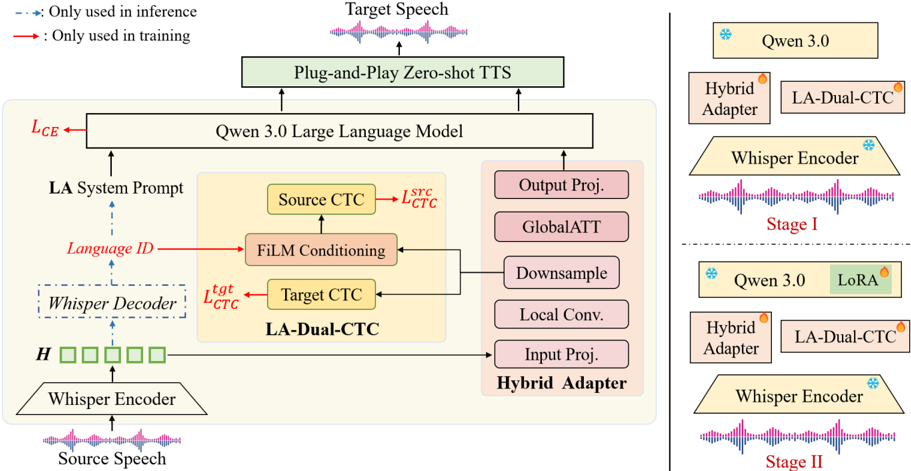

> [!abstract] ACL 2026 (Findings) · 2026 · Conference
> **Yu Pan et al.** (Kyushu University / University of Luxembourg / The University of Tokyo / Tencent / ByteDance) · [→ Paper](https://aclanthology.org/2026.findings-acl.1004) · [→ Preprint](https://arxiv.org/abs/2506.11160) · Demo: ? · Code: ?
>
> A cascaded speech-to-speech translation system that pairs a Whisper-to-Qwen3 speech-to-text translation frontend, with a new "local-then-global" adapter and source-language conditioning at both the acoustic and prompt level, with an unmodified off-the-shelf zero-shot TTS backend.

## Problem

Speech-to-speech translation (S2ST) systems either map source speech straight to target speech (Translatotron, [[2308.11596|SeamlessM4T]]) or compose a speech-to-text translation (S2TT) frontend with a TTS backend. End-to-end models must learn understanding, translation and generation jointly and need scarce speech-to-speech parallel data. Earlier compositional systems such as DASpeech and ComSpeech still train on source-target speech pairs or join pretrained modules through shallow CTC vocabulary adaptors. The authors argue that none of these systems explicitly model the identity of the source language, at either the acoustic or the linguistic level, although word order and syntax differ strongly across source languages.

## Method

S2ST-Omni has two independently optimized modules: an S2TT frontend that emits English text, and a TTS backend that voices that text. The frontend uses a frozen [[2212.04356|Whisper]] Large-v3 encoder, a frozen [[2505.09388|Qwen3]]-4B LLM adapted with LoRA, and three new components.

- **Hybrid speech adapter ("local-then-global").** Whisper features (1280-d) are projected to 1024-d, passed through two depthwise-separable convolution blocks (kernel 7) for local acoustic patterns, downsampled 2x with a strided convolution (kernel 5), then passed through two Transformer blocks (4 heads) for long-range context. A final projection maps the result into the LLM embedding space. The authors contrast this with Conformer-style adapters, which mix attention into every layer, and MLP-only adapters, which have no temporal modeling.
- **Language-Aware Prompting (LAP).** A templated prompt names the source language ("The following is [LANG] speech. Translate it accurately into English."). The language label comes from the dataset during training and from Whisper's own language-ID decoder at inference.
- **Language-Aware Dual-CTC (LA-Dual-CTC).** Two auxiliary CTC heads read the downsampled adapter features before the global-attention layers. The source-transcript head is conditioned on a language embedding through gated FiLM modulation (learnable scalar gate initialized at 0.5). The English-target head is unconditioned. SentencePiece vocabularies are 8k (multilingual source) and 4k (English target).

Training is a two-stage progressive fine-tuning (PFT) schedule. Stage I trains only the adapter and CTC heads for 150k steps with LLM cross-entropy plus CTC losses (weights 0.1 source, 0.2 target). Stage II adds LoRA (rank 8, alpha 32) on the Qwen3 query and value projections for another 150k steps, lowers the adapter and CTC learning rates, and down-weights the CTC losses (0.01 and 0.05). The TTS backend receives only the English text, with no task-specific coupling. Main experiments use [[2506.21619|IndexTTS2]], an autoregressive zero-shot TTS model the paper does not train. Total and adapter parameter counts are not reported.

## Key Results

All results are on the CVSS-C Fr→En, Es→En and De→En test sets (Table 1). ASR-BLEU transcribes the synthesized speech with a wav2vec 2.0 ASR model and scores it with SacreBLEU.

| System | Fr BLEU | Fr ASR-BLEU | Es BLEU | Es ASR-BLEU | De BLEU | De ASR-BLEU | Avg BLEU | Avg ASR-BLEU |
|---|---|---|---|---|---|---|---|---|
| Translatotron 2 | 28.82 | 26.07 | 25.82 | 22.93 | 18.66 | 16.91 | 24.43 | 21.97 |
| UnitY | not reported | 27.77 | not reported | 24.95 | not reported | 18.74 | not reported | 23.82 |
| ComSpeech | 30.72 | 28.15 | 26.51 | 24.80 | 19.41 | 18.16 | 25.55 | 23.70 |
| StreamSpeech | 32.60 | 28.45 | 30.35 | 27.25 | 23.36 | 20.93 | 28.77 | 25.54 |
| Hibiki | not reported | 30.50 | not reported | not reported | not reported | not reported | not reported | not reported |
| S2ST-Omni | **35.83** | **33.20** | **37.85** | **35.90** | **33.34** | **31.25** | **35.67** | **33.45** |

- S2ST-Omni has the highest BLEU and ASR-BLEU of all listed systems in every direction and on both averages. BLEU is reported for only three baselines (Translatotron 2, ComSpeech, StreamSpeech). Hibiki reports only Fr→En ASR-BLEU. Translatotron, S2UT and DASpeech, which also appear in Table 1, are lower still.
- The BLEU margin over StreamSpeech is smallest on Fr→En (+3.23) and largest on De→En (+9.98), with Es→En in between (+7.50) (Table 1).
- COMET is reported for three systems only. S2ST-Omni scores 81.94 / 83.39 / 80.73 (Fr/Es/De), against 76.66 / 74.80 / 65.51 for StreamSpeech and 70.13 / 66.96 / 57.96 for ComSpeech (Table 3).
- **Adapter ablation (Table 2).** A Conformer adapter lowers average BLEU/ASR-BLEU to 34.69/32.16, and an MLP adapter to 32.37/29.66.
- **Language-awareness ablation (Table 4).** Removing LAP gives 35.25/32.89 and removing LA-Dual-CTC gives 35.16/32.72. Removing both drops performance to 33.68/30.95, a larger loss than either single removal.
- **Training-schedule ablation (Table 5).** Dropping Stage II LoRA gives 33.33/30.63. Single-stage joint training gives 34.37/31.81.
- **TTS backend swap (Table 6).** With the frontend fixed, average ASR-BLEU ranges from 33.45 ([[2506.21619|IndexTTS2]]) through 32.56 ([[2509.02020|FireRedTTS-2]]), 32.36 ([[2505.17589|CosyVoice 3]]) and 32.34 ([[2506.13053|ZipVoice]]) to 32.09 (VoxCPM1.5). IndexTTS2 leads in every direction. The other four backends trade places by direction: CosyVoice 3 edges FireRedTTS-2 on Fr→En (31.56 vs 31.55) and ZipVoice edges CosyVoice 3 on De→En (30.46 vs 30.36).
- **Latency (Table 7).** The S2TT frontend takes 703.8 ms per utterance on one RTX A5000: Whisper encoding 118.4 ms, language-ID decoding 22.8 ms, adapter 6.8 ms, LLM 555.8 ms. TTS latency and end-to-end latency are not reported. Whisper language-ID accuracy is 99.67% (Fr), 99.80% (Es) and 99.76% (De) (§Limitations).

## Novelty Assessment

The architectural contributions sit inside the speech-to-text adapter: the local-then-global hybrid adapter, the FiLM-gated source-language CTC head placed on intermediate adapter features, and language-named prompts. Each is a modest, well-ablated variation on known techniques (CTC auxiliary losses, FiLM conditioning, Whisper-plus-LLM adapters, two-stage LoRA schedules). The S2ST system itself is an engineering integration: a speech LLM translation frontend followed by an existing TTS model, with nothing in the speech-generation path trained or modified.

The large gap over prior S2ST baselines is hard to attribute to the proposed components. S2ST-Omni starts from Whisper Large-v3 and a 4B-parameter LLM, while the baselines are smaller systems trained on CVSS. Its ablations, which hold these backbones fixed, attribute 0.4 to 3.3 average BLEU to individual components or component pairs, much smaller than the 6.9 BLEU gap to StreamSpeech. The paper also does not state whether baseline numbers were re-run or copied from prior work, and Hibiki is a simultaneous system while S2ST-Omni translates full utterances.

## Field Significance

Moderate. The paper adds evidence that a pretrained speech LLM translation frontend followed by a text-to-speech backend can beat end-to-end and earlier compositional S2ST systems on CVSS-C ASR-BLEU. It also shows that, for intelligibility-based S2ST scores, the choice among current zero-shot TTS backends matters much less than translation quality. Its adapter and language-conditioning components are incremental, though their ablations are controlled.

## Claims

- **supports:** Cascaded speech-to-speech translation built on a pretrained speech LLM frontend and an off-the-shelf TTS backend can exceed end-to-end and earlier compositional systems on translation-quality metrics of the synthesized speech.
  > *Evidence:* S2ST-Omni (Whisper Large-v3 + Qwen3-4B frontend, IndexTTS2 backend) reaches 33.45 average ASR-BLEU on CVSS-C Fr/Es/De→En, against 25.54 for StreamSpeech and 23.82 for UnitY; Fr→En ASR-BLEU is 33.20 against 30.50 for Hibiki. *(§4.2, Table 1)*
- **supports:** In cascaded speech-to-speech translation, ASR-based translation scores of the output speech depend much more on the translation frontend than on which modern TTS backend synthesizes the text.
  > *Evidence:* With the frontend fixed, five zero-shot TTS backends span only 32.09 to 33.45 average ASR-BLEU, while the gap to the strongest prior S2ST baseline is about 8 points. *(§4.4, Table 6)*
- **supports:** Explicit source-language conditioning improves multilingual speech-to-text translation in speech LLMs, and acoustic-level and prompt-level conditioning are complementary.
  > *Evidence:* Removing language-aware prompting or the FiLM-conditioned source CTC head alone lowers average ASR-BLEU by 0.56 or 0.73; removing both lowers it by 2.50 (33.45 to 30.95). *(§4.3.2, Table 4)*
- **refines:** Speech-to-LLM adapters benefit from local temporal modeling before global attention on a downsampled sequence, rather than per-frame projection alone or interleaved convolution and attention in every layer.
  > *Evidence:* Replacing the hybrid local-then-global adapter lowers average BLEU from 35.67 to 34.69 with a Conformer adapter and to 32.37 with an MLP adapter. *(§4.3.1, Table 2)*
- **complicates:** Gains reported by speech LLM translation systems over smaller end-to-end S2ST baselines mix the effect of large pretrained backbones with the effect of the proposed components.
  > *Evidence:* The component ablations, which keep Whisper and Qwen3 fixed, move average BLEU by 0.4 to 3.3 points, while the gap to StreamSpeech is 6.9 points; the evaluation uses automatic metrics only, with no human judgments of naturalness or speaker similarity. *(§4.3, Tables 1, 2, 4, 5; §Limitations)*

## Limitations and Open Questions

> [!warning]
> The baseline comparison is not controlled: S2ST-Omni uses Whisper Large-v3 and Qwen3-4B pretrained backbones plus a separate modern TTS model, while the baselines are smaller S2ST systems trained on CVSS, and the paper does not state whether baseline scores were re-run. No human evaluation of translation adequacy, naturalness or speaker similarity is reported.

- Evaluation covers three high-resource source languages into English on a single benchmark (CVSS-C). Low-resource, many-to-many and out-of-domain settings are untested (§Limitations).
- The system is offline. Frontend latency is 703.8 ms per utterance, with the LLM taking 555.8 ms, and TTS and end-to-end latency are not measured (§4.5).
- The design depends on Whisper's language identification at inference. The authors report 99.67-99.80% accuracy but do not measure the effect of wrong language IDs on translation.
- Source speaker voice is not preserved by design. The backend synthesizes from text only, and speaker similarity is not measured.
- Large backbones (Whisper Large-v3, Qwen3-4B) limit deployment on edge devices (§Limitations).

## Wiki Connections

- [[speech-to-speech|Speech-to-Speech]] — Proposes a cascaded S2ST system (speech LLM translation frontend plus a plug-and-play TTS backend) and evaluates it on CVSS-C Fr/Es/De→En.
- [[spoken-language-model|Spoken Language Model]] — Adapts a Qwen3 LLM to consume Whisper speech features through a new hybrid adapter, LoRA, and source-language conditioning.
- [[2212.04356|Whisper]] — Supplies the frozen speech encoder and, at inference, the language-ID decoder that drives the language-aware components.
- [[2505.09388|Qwen3]] — Serves as the translation LLM backbone, kept frozen except for LoRA on attention projections.
- [[2506.21619|IndexTTS2]] — Used unmodified as the main TTS backend for all reported ASR-BLEU results.
- [[2509.02020|FireRedTTS-2]] — Evaluated as an alternative TTS backend in the backend-swap study.
- [[2505.17589|CosyVoice 3]] — Evaluated as an alternative TTS backend in the backend-swap study.
- [[2506.13053|ZipVoice]] — Evaluated as an alternative TTS backend in the backend-swap study.
- [[2509.24650|VoxCPM]] — Its VoxCPM1.5 release is the lowest-scoring backend in the swap study, still above StreamSpeech.
- [[2308.11596|SeamlessM4T]] — Cited as a representative end-to-end S2ST model whose joint optimization the compositional design avoids; not evaluated.
