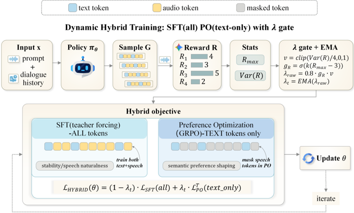

> [!abstract] ACL 2026 (Findings) · 2026 · Conference
> **Yifu Chen et al.** (Zhejiang University / Alibaba Group / Beijing University of Technology) · [→ Paper](https://aclanthology.org/2026.findings-acl.114) · [→ Preprint](https://arxiv.org/abs/2604.14932) · Demo: ? · Code: ?
>
> A single-stage post-training recipe for end-to-end spoken dialogue models that applies GRPO only to text tokens, keeps supervised fine-tuning on all tokens as an acoustic anchor, and sets the mixing weight per step from rollout reward statistics.

## Problem

End-to-end spoken dialogue models emit both text and speech tokens from one shared backbone. Reinforcement learning from AI feedback has improved text and vision models, so a natural step is to apply sequence-level preference optimization to the whole mixed output. The authors find that this transfer is unreliable: semantic scores can rise while speech quality drifts, with reduced naturalness and unstable prosody and timbre.

They attribute the failure to three coupled effects. Text and speech gradients are weakly correlated and very unequal in magnitude, so text dominates shared-parameter updates. A single sequence-level reward spread over many dense speech tokens gives speech weak, high-variance credit. Acoustic rewards from audio judges are also noisier than semantic rewards, and weak base models rarely sample good acoustic rollouts, so preference signals on speech are thin. Prior work handled this by blocking audio-token gradients or using text-only objectives, or by optimizing semantic quality and expressiveness separately; a joint recipe was missing.

## Method

The paper treats any dialogue model's output as a text sequence plus a speech sequence and partitions the log-likelihood by token type. This lets the same recipe apply to interleaved models (one mixed stream), parallel models (coupled text and speech streams), and Thinker-Talker models. Experiments cover two of these: VITA-Audio ([[2505.03739|VITA-Audio]], interleaved) and Kimi-Audio ([[2504.18425|Kimi-Audio]], parallel). Neither the backbone size nor the speech tokenizer is reported in this paper.

Before the method, four diagnostic observations motivate the design (§3.3):

- Teacher-forced SFT produces larger, coherent token-level probability shifts than GRPO or DPO, which act locally under trust-region constraints (Figure 2).
- Five audio-capable LLM judges agree with human 1-5 ratings much better on semantic quality than on acoustic quality, especially in within-prompt ranking (Figure 3, Tables 5-6).
- Text and speech gradients have near-zero mean cosine similarity with high variance, and preference objectives put most gradient energy on text (Figure 4).
- Under repeated sampling, human-rated semantic variance exceeds acoustic variance on both backbones (1.066 vs 0.387 on VITA-Audio, 0.911 vs 0.509 on Kimi-Audio), so rollouts discriminate poorly on acoustics (Figure 5, Appendix B).

The resulting objective is a weighted sum of two losses: (1 − λ_t) times SFT cross-entropy on all tokens, plus λ_t times a GRPO loss masked to text tokens only. Speech tokens therefore receive only dense supervised gradients, while preference gradients shape the text channel. At each step the policy samples G = 4 spoken replies. The generated speech is decoded to audio and scored on a 1-5 scale by Gemini-2.5-Pro acting as the reward model.

The weight λ_t comes from two gates computed on the group's rewards. A direction gate is a sigmoid of (max reward − 3), so preference updates are suppressed when no rollout reaches acceptable quality. An information gate is the reward variance divided by 4 (the maximum variance on a 1-5 scale), clipped to [0, 1]. Their product is scaled by λ_max = 0.8, so at least 20% SFT always remains, and the result is smoothed with an EMA (α = 0.9). The authors report that λ_t starts near 0.1-0.2 and settles between 0.35 and 0.55 by convergence (Appendix H.2).

Training uses a 13,510-sample audio-instruction mixture drawn from public reasoning, knowledge, safety and instruction data plus self-built style control (emotion, volume, pace), style understanding and expressive dialogue sets (Appendix E, Table 7). Runs use 4 A100 GPUs, learning rate 1e-6, batch size 1, KL coefficients of 0.01 for text and speech, sampling temperature 0.9 and top-p 0.9.

## Key Results

Evaluation uses VoiceBench ([[2410.17196|VoiceBench]]) and OpenAudioBench for semantic quality (IQ), both scored on the model's text output by GPT-4o-mini and GPT-4o judges, and VStyle ([[2509.09716|VStyle]]) for expressiveness (EQ), scored on the speech output by Gemini-2.5-Pro. Baselines are the base model, teacher-forced SFT, full-token and text-token DPO, full-token and text-token GRPO, and a two-stage SFT-then-GRPO recipe. The Kimi-Audio comparison omits the text-token DPO, text-token GRPO and two-stage baselines.

**Semantic quality (Table 1).** On VITA-Audio, the OpenAudioBench average rises from 55.0 (base) to 57.6, the highest in the table; text-token GRPO is next at 56.2. The method leads on 6 of 9 VoiceBench sub-tasks (for example AlpacaEval 4.22 vs 4.09 for text-token GRPO, OBQA 77.1 vs 75.4). It trails text-token DPO on BBH (59.9 vs 60.3) and IFEval (32.5 vs 32.8), and trails SFT on AdvBench (97.1 vs 99.2). It ties text-token GRPO on OpenAudioBench Llama (74.6) and Trivia (44.4). On Kimi-Audio, the OpenAudioBench average rises from 69.1 to 70.8, the highest in the table, and the method leads 8 of 9 VoiceBench sub-tasks. It falls slightly below the base model on AdvBench (99.5 vs 100.0) and OpenAudioBench Trivia (61.8 vs 62.1), and below full-token GRPO on OpenAudioBench Web (71.1 vs 71.5).

The baselines show the failure modes the method targets. Teacher-forced SFT lowers most IQ scores relative to the base model on both backbones (OpenAudioBench average 50.7 vs 55.0 on VITA-Audio), which the authors call an alignment tax. Full-token DPO collapses OpenAudioBench on VITA-Audio (35.1 average, with Alpaca at 20.1) and lowers AdvBench to 65.0. The two-stage SFT-then-GRPO recipe ends below the base model (47.4).

**Expressiveness (Table 2).** The VStyle average rises from 2.55 to 2.91 on VITA-Audio and from 2.56 to 2.90 on Kimi-Audio, the highest average on each backbone. SFT remains strongest on style instruction following on both backbones (2.29 vs 2.25 on VITA-Audio; 2.58 vs 2.52 on Kimi-Audio). Full-token DPO degrades expressiveness sharply (VStyle average 1.22 on VITA-Audio, 1.70 on Kimi-Audio). Full-token GRPO on VITA-Audio also lands below the base model (2.43).

**Ablations (VITA-Audio, Table 3).** With a fixed 0.5/0.5 mix, restricting GRPO to text tokens beats all-token GRPO (IQ 52.60 vs 48.70; EQ 2.60 vs 2.48). Weighting fixed toward SFT (0.7/0.3) raises EQ to 2.72 but lowers IQ to 49.94. Dynamic weighting over all tokens gives 48.84 / 2.50. Removing the EMA drops the full method from 55.24 / 2.92 to 53.15 / 2.53. Here IQ is the mean over four VoiceBench reasoning sub-tasks and EQ the VStyle average. Heavier smoothing (α = 0.99) lowers IQ to 50.95 (Table 8). Group size 8 raises IQ to 57.19 but leaves EQ at 2.90 (Table 9).

**Human evaluation (Table 4).** A blind side-by-side test against the VITA-Audio base model, with 3 raters per item, gives win/tie/loss rates of 63.8/16.2/20.0% for helpfulness, 66.2/13.8/20.0% for naturalness and 68.8/13.7/17.5% overall, all with sign-test p < 0.001. The Table 4 caption reports 80 items, while Appendix G.1 describes an evaluation set of 40 items (20 from VoiceBench, 20 from VStyle); the reported percentages are multiples of 1/80. No human comparison is made against the stronger GRPO or DPO baselines, or on Kimi-Audio.

## Novelty Assessment

Mixing SFT and RL in one training loop with adaptive weights is established for text LLMs (the paper cites SRFT, UFT, CHORD, LUFFY and others), and text-only preference objectives for speech dialogue already exist. The new elements are the modality split (SFT on every token, GRPO restricted to text tokens) and a simple rollout-statistics gate (best-sample threshold times normalized reward variance, with EMA smoothing). The contribution is a training-objective design plus a diagnostic analysis, not a new model architecture.

The diagnostic section is the more transferable part. The gradient-geometry, judge-agreement and rollout-diversity analyses give concrete evidence for why sequence-level preference optimization destabilizes speech tokens. The judge-agreement study compares five Gemini and GPT-4o audio judges against human ratings on two backbones. The gains are modest in absolute terms (about +2.6 and +1.7 OpenAudioBench points over the base models), and the evaluation leans heavily on LLM judges.

## Field Significance

Moderate — The paper provides a working recipe and a mechanistic account of why preference optimization over mixed text-speech outputs degrades speech in end-to-end dialogue models, tested on interleaved and parallel backbones. Its judge-versus-human study offers direct evidence that current audio judges rank acoustic quality much less reliably than semantic quality, which bears on any RL pipeline that uses them as rewards.

## Claims

- **supports:** Applying a single sequence-level preference objective to all text and speech tokens of an end-to-end spoken dialogue model can degrade both expressiveness and semantic quality, while restricting preference gradients to text tokens avoids most of this damage.
  > *Evidence:* Full-token DPO drops the VStyle average to 1.22 on VITA-Audio (base 2.55) and the OpenAudioBench average to 35.1 (base 55.0); with a fixed 0.5/0.5 SFT/GRPO mix, text-token scope beats all-token scope on both the IQ (52.60 vs 48.70) and EQ (2.60 vs 2.48) summaries. *(§4.2, Tables 1-2; §4.3.1, Table 3)*
- **supports:** Dense supervised fine-tuning on speech tokens can serve as an anchor that preserves or improves speech expressiveness during preference-based post-training of speech LMs.
  > *Evidence:* SFT alone raises VStyle averages on both backbones (2.59 on VITA-Audio, 2.71 on Kimi-Audio) while lowering IQ; the hybrid that keeps SFT on all tokens and applies GRPO to text reaches the highest VStyle average on each backbone (2.91 and 2.90). *(§4.2, Tables 1-2)*
- **complicates:** Audio LLM judges agree with human raters substantially less on acoustic or paralinguistic quality than on semantic quality, which limits their reliability as reward models for speech generation.
  > *Evidence:* Across five judges, Intra-ID Spearman agreement with humans on VITA-Audio samples is 0.383-0.699 for semantics but 0.092-0.294 for acoustics; on Kimi-Audio samples it is 0.455-0.700 vs 0.195-0.505. *(§3.3, Figure 3; Appendix A, Tables 5-6)*
- **refines:** Mixing supervised and preference losses for spoken dialogue post-training works better when the preference weight follows rollout reward quality and spread than with a fixed ratio, provided the weight is smoothed over steps.
  > *Evidence:* The dynamic text-token variant reaches IQ 55.24 / EQ 2.92 versus 52.60 / 2.60 for the fixed 0.5/0.5 mix; removing the EMA drops it to 53.15 / 2.53, and α = 0.99 lowers IQ to 50.95. *(§4.3.1, Table 3; Appendix H.1, Table 8)*
- **complicates:** Supervised fine-tuning on a small multi-domain audio-instruction corpus can impose an alignment tax on the reasoning and knowledge ability of spoken dialogue models.
  > *Evidence:* Teacher-forced SFT lowers the OpenAudioBench average from 55.0 to 50.7 on VITA-Audio and from 69.1 to 64.9 on Kimi-Audio; the authors attribute this to gradient interference from heterogeneous supervision. *(§4.2, Table 1)*

## Limitations and Open Questions

> [!warning]
> Gemini-2.5-Pro is both the training reward model and the official VStyle judge, so the expressiveness gains are scored by the same model that was optimized against. The paper's own agreement study shows this judge has weak acoustic agreement with humans (Pearson 0.29 on VITA-Audio samples). The IQ benchmarks score only the text channel, so the only direct evidence on spoken output is one human side-by-side test on VITA-Audio against the base model.

- The authors acknowledge that the study uses only sequence-level rewards; denser token- or frame-level feedback for speech tokens (for example PPO with frame-level rewards) was not tried for lack of resources *(§Limitations)*.
- The authors note that audio judges are less reliable and less calibrated than text judges, and that both the motivating observations and the final results may change with a better-calibrated audio judge *(§Limitations)*.
- Ablations, EMA sensitivity and group-size studies are reported only on VITA-Audio. Thinker-Talker architectures are discussed but not evaluated.
- No objective speech measures (WER, speaker similarity, UTMOS or similar) are reported, so intelligibility and timbre stability are not checked independently of LLM judges.
- The human evaluation item count is stated as 80 in the Table 4 caption and as 40 in Appendix G.1.
- Backbone parameter counts, speech tokenizers and total training compute are not reported.

## Wiki Connections

- [[rlhf-speech|RLHF Speech]] — Applies GRPO and DPO post-training to end-to-end spoken dialogue models and shows that confining preference gradients to text tokens, anchored by SFT, avoids acoustic drift.
- [[spoken-language-model|Spoken Language Model]] — Post-trains two speech LMs that consume spoken user input and emit text and speech tokens from a shared backbone.
- [[speech-to-speech|Speech-to-Speech]] — Targets end-to-end spoken dialogue, with expressiveness of the generated speech evaluated on VStyle and by human raters.
- [[subjective-evaluation|Subjective Evaluation]] — Reports a blind side-by-side human preference test on helpfulness and naturalness, plus human 1-5 ratings used to validate automatic judges.
- [[evaluation-metrics|Evaluation Metrics]] — Measures how well five audio LLM judges agree with human semantic and acoustic ratings, showing acoustic judgments are markedly less reliable.
- [[2505.03739|VITA-Audio]] — Interleaved text-speech backbone on which all main results, ablations and the human study are run.
- [[2504.18425|Kimi-Audio]] — Parallel-stream backbone used to show the recipe transfers across architectures.
- [[2410.17196|VoiceBench]] — Supplies nine of the semantic-quality and safety sub-tasks, scored on text outputs.
- [[2509.09716|VStyle]] — Expressiveness benchmark scored on speech outputs by Gemini-2.5-Pro, which is also the training reward model.
- [[2505.09558|WavReward]] — Prior reward-modeling work for spoken dialogue from the same group, cited as an expressiveness-oriented reward approach.
- [[2603.14889|SDiaReward]] — Related spoken dialogue reward model from the same group, cited among EQ-oriented reward methods.
- [[2512.04552|RRPO]] — Cited as evidence that speech RL is vulnerable to reward hacking through spurious acoustic cues.
- [[iclr-2026-CcmDDh070o|ParaS2S]] — Cited paralinguistic-aware alignment work that relies on reward modeling for expressive spoken dialogue.
