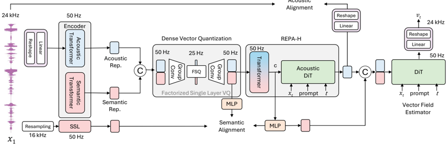

> [!abstract] ACL 2026 (Findings) · 2026 · Conference
> **Sang-Hoon Lee et al.** (Ajou University / KT Corp.) · [→ Paper](https://aclanthology.org/2026.findings-acl.1622) · Demo: ✓ · Code: ?
>
> FlowTokenizer trains a neural audio codec end to end with a conditional flow matching (CFM) diffusion-transformer decoder instead of a GAN decoder, and adds hierarchical representation alignment (REPA-H) and a factorized single-codebook quantizer (DVQ). The result is a streamable 24 kHz codec at 25 tokens per second (400 bps) with low WER for its token rate.

## Problem

GAN-trained neural audio codecs lose intelligibility at very low token rates (12.5 to 25 Hz): heavy compression and quantization cause mispronunciations and degraded quality. Residual vector quantization (RVQ) recovers capacity, but it multiplies the token count and complicates use with speech LLMs. Single-codebook codecs such as BigCodec, WavTokenizer, StableCodec and X-codec2 avoid RVQ, but the authors report high WER for these designs at 25 tokens per second (TPS). CFM had been used for waveform generation from fixed mel or RVQ features (e.g. [[iclr-2025-tQ1PmLfPBL|PeriodWave]]), but not as the training objective of a codec with its own learned quantizer. The authors also find that a vanilla DiT decoder trained with CFM alone does not preserve content at low bitrate and reconstructs high frequencies poorly.

## Method

**Input and encoder.** A WaveNeXt-style linear reshape turns 24 kHz waveform into 50 Hz frames of 480 samples, with no STFT look-ahead. A causal Transformer acoustic encoder processes these frames. In parallel, a semantic encoder built on MMS (a large multilingual wav2vec 2.0 model, run on 16 kHz input at 50 Hz; Table 6 lists 7 MMS layers) extracts semantic features. The acoustic and semantic features are concatenated and downsampled to 25 Hz by a causal convolution before quantization.

**Dense vector quantization (DVQ).** X-codec2 also concatenates semantic and acoustic features, but it then mixes them with a linear projection before FSQ. DVQ instead uses group convolutions, so the acoustic and semantic halves each keep their own FSQ dimensions. FSQ uses 8 dimensions with 4 levels each, giving one codebook of 65,536 entries at 25 Hz (400 bps). The four semantic dimensions alone give a 256-entry auxiliary "semantic token" that downstream LMs can predict.

**Decoder and REPA-H.** The decoder has a 6-block causal semantic Transformer, a 6-block acoustic DiT, and a 12-block DiT that estimates the CFM vector field on 50 Hz frames. A linear reshape maps the output back to waveform. Like Voicebox, the decoder takes a masked waveform prompt alongside the noisy input, the quantized condition and the time step. REPA-H aligns the decoder in two stages:
- *Semantic alignment:* the causal Transformer predicts the MMS features under an L1 plus cosine loss. This replaces the original REPA design, which distills into early DiT layers.
- *Acoustic alignment:* the acoustic DiT output is reshaped to waveform and trained with DAC-style multi-resolution mel losses over 7 window sizes.

A "disentangled alignment training" schedule runs the semantic and acoustic branches without conditioning dropout. It then runs a second full forward pass with dropout, and the CFM loss reaches the alignment branches only through a stop-gradient. The authors introduce this schedule to fix early-training instability and fp16 NaN losses.

**Adversarial fine-tuning.** After 1M steps of CFM pre-training (pre-training loss weights: semantic 0.05, acoustic 0.005), sampling is fixed at four Euler steps (t = 0, 0.25, 0.5, 0.75). The whole model is then fine-tuned for 0.1M steps with LS-GAN and feature-matching losses against MPD, MSSB-CQTD and MS-STFTD discriminators, plus mel and semantic REPA losses. This follows the authors' earlier adversarial flow-matching acceleration work. Training takes about 4 days on eight H100 GPUs. The codec has 578M parameters. Self-generated waveform prompts allow chunked streaming decoding (Appendix A.1).

**Downstream TTS.** To test the tokens in a TTS model, the authors train a Qwen2.5-0.5B autoregressive LM on FlowTokenizer tokens using Emilia-en and HiFiTTS-2. It has an extra head that predicts the DVQ semantic token (auxiliary semantic token loss) and uses tokenizer-level classifier-free guidance (scale 0.3, dropping only the prompt).

## Key Results

**LibriTTS, 24 kHz (Table 1).** FlowTokenizer without a prompt (25 TPS, one codebook, 400 bps) reaches CER 2.57 / WER 5.87. The closest low-rate baselines are:
- [[2410.00037|Mimi]] at 25 TPS (2 codebooks, 225 bps): CER 12.6 / WER 21.41.
- StableCodec ([[2411.19842|TAAE]]) at 25 TPS (one codebook, 16 kHz): CER 8.62 / WER 16.19.
- [[2408.16532|WavTokenizer]] at 40 TPS (480 bps): CER 13.83 / WER 23.53.

Higher-rate systems still win on WER:
- [[2210.13438|EnCodec]] (600 TPS, 8 codebooks): WER 3.55.
- DAC (600 TPS): CER 1.09 / WER 2.91.
- [[2308.16692|SpeechTokenizer]] (400 TPS): WER 4.46.
- X-codec2 ([[2502.04128|Llasa]], 50 TPS, 16 kHz): CER 2.45 / WER 5.20.
- [[2409.05377|BigCodec]] (80 TPS, 16 kHz): WER 5.44. BigCodec's CER of 2.61 is slightly worse than FlowTokenizer's 2.57.

With a 3 s ground-truth prompt, FlowTokenizer improves to CER 1.86 / WER 4.68. This beats X-codec2 and BigCodec on both metrics. It beats SpeechTokenizer at 400 TPS on CER but not on WER.

The crowdsourced MOS (20 raters per sample, 208 samples) gives FlowTokenizer 3.80 ± 0.02. This is the highest point estimate in Table 1, above ground truth (3.72), DAC at 600 TPS (3.76), WavTokenizer at 75 TPS (3.75) and Mimi at 100 TPS (3.74). Each system was rated at its native sampling rate, and the low-rate Mimi, DAC and SpeechTokenizer configurations were not MOS-rated.

The signal-level metrics tell a different story. FlowTokenizer's PESQ is 1.556, below WavTokenizer at 40 TPS (1.604), Mimi at 50 TPS (1.657), DAC at 100 TPS (1.632) and StableCodec at 25 TPS (1.893). It beats only Mimi at 25 TPS (1.239) and SpeechTokenizer at 50 TPS (1.118). Its M-STFT of 1.621 is worse than every 24 kHz baseline except Mimi at 25 TPS (1.916); WavTokenizer at 40 TPS (1.627) is essentially level. Its pitch error of 69.368 is worse than most baselines. Its UTMOS of 4.000 is below both StableCodec configurations (4.134 and 4.131).

**LibriSpeech test-clean (Table 2).** Most baseline numbers here (marked †) are copied from the X-codec2 paper rather than re-run. Among 24 kHz systems below 1,000 bps, FlowTokenizer has the lowest WER (3.38; 2.91 with a prompt). The comparison points are WavTokenizer at 900 bps (3.98) and 480 bps (11.2), Mimi at 550 bps (4.84) and Mimi at 225 bps (8.35). FlowTokenizer's UTMOS of 4.09 is the highest among the 24 kHz systems. The 16 kHz StableCodec (4.23 at 700 bps), X-codec2 (4.13 at 800 bps) and BigCodec (4.11 at 1,040 bps) are higher.

Speaker similarity is the clear weak point. FlowTokenizer reaches SPK-SIM 0.41 (0.60 with a prompt). The comparisons are X-codec2 0.82, BigCodec 0.84, WavTokenizer 0.48 at 480 bps and Mimi 0.73 at 1,100 bps. Against WavTokenizer at 480 bps it also trails on PESQ-WB (1.56 vs 1.62) and PESQ-NB (1.94 vs 2.06). The authors attribute the low speaker similarity to training on only ~500 h of LibriTTS (§3.3).

**Ablations (Table 3).** These rows are on LibriTTS.
- Removing REPA entirely raises WER from 5.87 to 29.49.
- Semantic REPA alone gives WER 11.87 with a causal-Transformer semantic decoder and 15.17 with DiT distillation.
- The DiT-distillation variant scores higher on PESQ (1.671), pitch and UTMOS (4.151) than full REPA-H. The paper reads this as a trade-off between content and acoustic quality.
- Replacing DVQ with plain FSQ raises WER to 7.35.
- Without adversarial fine-tuning, WER is 6.00 but M-STFT degrades to 2.137 and UTMOS to 3.535.
- The same architecture trained only adversarially for 1M steps has better PESQ (1.688), M-STFT (1.576) and UTMOS (4.132), but WER 19.30.

Band-wise mel L1 drops in every band from no REPA to REPA to REPA-H, for example 1.75 to 1.68 to 1.17 at 18 to 24 kHz (Table 10).

**Tokens and speed (Tables 4, 7, 9).**
- An ASR probe on DVQ tokens gives WER 5.54, versus 6.77 on the semantic half alone, 30.81 on the acoustic half alone, and 4.44 on continuous MMS features.
- Streaming decoding with self-generated prompts gives WER 3.50 versus 3.38 for parallel decoding on LibriSpeech.
- Real-time factor is ×44.1 on an A100. EnCodec reaches ×64.3, DAC ×60.2 and Mimi ×45.5.

**TTS (Table 5, Seed-TTS-eval English).** The Qwen2.5-0.5B LM on FlowTokenizer tokens reaches WER 2.29 / SIM 0.676. This compares with 2.57 / 0.652 for the same backbone on [[2412.10117|CosyVoice 2]] tokens and 3.22 / 0.572 for Llasa-1B on X-codec2 tokens. Adding the auxiliary semantic token loss gives WER 1.98, and tokenizer CFG gives 1.92 / 0.687. The paper does not say whether the baseline rows were trained on the same data, so this is not a controlled comparison.

## Novelty Assessment

The paper makes three distinct changes. It replaces the GAN decoder of a learned-quantizer codec with CFM pre-training. It adds a second, acoustic stage to REPA together with a stability-oriented training schedule. And it introduces DVQ, which keeps the semantic and acoustic halves separate inside one FSQ codebook. The individual parts are established: CFM waveform decoding, REPA from image diffusion, X-codec2-style semantic concatenation, FSQ, WaveNeXt reshaping, and the authors' own adversarial flow-matching fine-tuning. The novelty lies in combining them into an end-to-end codec and in the ablation evidence that each part matters.

The final model is still a GAN-fine-tuned system, and the one-step GAN baseline gets better acoustic scores than the full model. The ablations therefore show that CFM pre-training mainly buys intelligibility and training efficiency, not acoustic fidelity. The gain is concentrated in WER/CER at very low token rates. On signal fidelity (PESQ, M-STFT, pitch) and speaker similarity, FlowTokenizer trails several baselines. The LibriSpeech comparison relies on copied baseline numbers, and the downstream TTS comparison is not controlled for training data.

## Field Significance

Moderate. The paper shows that a codec trained with a flow-matching DiT decoder and SSL representation alignment can keep content intelligible at 25 TPS with one codebook, where GAN codecs at similar rates lose it. It also gives ablation evidence that representation alignment matters for this setting. Its trade-offs are equally informative: low speaker similarity and weak signal-level fidelity after training on 500 h. The result is a promising but narrowly validated alternative to GAN codec training, not a uniform improvement.

## Claims

- **supports:** Aligning a diffusion or flow-matching codec decoder's intermediate representations with self-supervised speech features is critical for preserving linguistic content at very low token rates.
  > *Evidence:* Removing REPA raises LibriTTS WER from 5.87 to 29.49 and CER from 2.57 to 17.59; semantic REPA alone reaches WER 11.87 to 15.17 depending on decoder structure. *(§3.4, Table 3)*
- **complicates:** Low-bitrate codecs that prioritise semantic intelligibility can trade away speaker similarity and signal-level fidelity, so WER and perceptual MOS alone overstate overall reconstruction quality.
  > *Evidence:* At 400 bps FlowTokenizer has the lowest WER among sub-1,000 bps 24 kHz codecs but SPK-SIM 0.41 against 0.82 to 0.84 for 16 kHz single-codebook codecs and 0.48 for WavTokenizer at 480 bps. Its PESQ (1.556) and M-STFT (1.621) on LibriTTS trail most baselines even though its crowdsourced MOS is 3.80. *(§3.2, §3.3, Tables 1 and 2)*
- **refines:** Generative pre-training (flow matching) followed by adversarial fine-tuning can preserve content better than training the same codec architecture adversarially alone, while adversarial training contributes acoustic detail and few-step sampling.
  > *Evidence:* The same architecture trained only adversarially for 1M steps reaches WER 19.30 against 5.87 for CFM pre-training plus adversarial fine-tuning, though with better PESQ and M-STFT. Removing the adversarial fine-tuning stage degrades M-STFT from 1.621 to 2.137 and UTMOS from 4.000 to 3.535. *(§3.4, Table 3)*
- **supports:** Keeping semantic and acoustic sub-dimensions separate inside a single scalar-quantized codebook preserves recoverable linguistic content better than projecting concatenated features into a shared latent.
  > *Evidence:* Replacing DVQ with plain FSQ raises WER from 5.87 to 7.35. An ASR probe gives WER 5.54 on full DVQ tokens, 6.77 on the semantic sub-token alone and 30.81 on the acoustic sub-token alone. *(§3.4, §3.5, Tables 3 and 4)*
- **supports:** Auxiliary prediction of a coarse semantic token alongside the full codec token can reduce WER in LLM-based TTS.
  > *Evidence:* A Qwen2.5-0.5B TTS LM on FlowTokenizer tokens drops from WER 2.29 to 1.98 on Seed-TTS-eval English with the auxiliary semantic token loss, and to 1.92 with tokenizer CFG, with SIM 0.676 to 0.687. *(§3.6, Table 5)*

## Limitations and Open Questions

> [!warning]
> The codec is trained on only ~500 h of LibriTTS read English speech. The authors acknowledge that this limits speaker consistency (SPK-SIM 0.41 on LibriSpeech without a prompt). Robustness to other languages, noisy speech, music or general audio is untested, even though the semantic encoder (MMS) was chosen for multilingual extension.

- Most baseline numbers on LibriSpeech are copied from the X-codec2 paper, not re-run under one protocol. The 16 kHz and 24 kHz systems are also not directly comparable, and the 25 TPS StableCodec baseline is a parallel CTC variant because no streaming model was released.
- MOS is crowdsourced on Amazon Mechanical Turk and rated at each system's native sampling rate. The low-rate Mimi, DAC and SpeechTokenizer configurations were not rated, so the subjective comparison omits the hardest low-bitrate baselines.
- The model is large for a codec (578M parameters), and it still needs four sampling steps and a waveform prompt for its strongest results. Using the 3 s prompt is a ground-truth prompt and is not available in a pure compression setting.
- The REPA-H loss weights need careful tuning. The authors report that semantic REPA can interfere with vector-field estimation (§2.1).
- The TTS experiment is a short demonstration. Training data parity with the CosyVoice 2 and Llasa rows is not stated.
- Code availability is not stated.

## Wiki Connections

- [[neural-codec|Neural Audio Codec]] — Proposes a single-codebook 25 Hz, 400 bps codec trained with a flow-matching decoder and a factorized FSQ quantizer (DVQ).
- [[flow-matching|Flow Matching]] — Uses conditional flow matching with a DiT decoder as the codec's primary training objective, with four-step fixed sampling after fine-tuning.
- [[self-supervised-speech|Self-Supervised Speech]] — Builds its semantic encoder branch on MMS (wav2vec 2.0) and uses MMS features as the representation-alignment target for the decoder.
- [[gan-vocoder|GAN Vocoder]] — Adversarial fine-tuning with MPD, MSSB-CQTD and MS-STFTD discriminators is part of the method, and a GAN-only variant is ablated against it.
- [[autoregressive-codec-tts|Autoregressive Codec TTS]] — Trains a Qwen2.5-0.5B TTS LM on the codec tokens with an auxiliary semantic-token loss and evaluates it on Seed-TTS-eval.
- [[subjective-evaluation|Subjective Evaluation]] — Runs a crowdsourced MOS test with 20 raters per sample and noise-sample attention checks across codecs.
- [[2502.04128|Llasa]] — X-codec2 is the closest design precedent for semantic-acoustic concatenation, and DVQ is positioned as a fix for its linear projection; it is also a codec and TTS baseline.
- [[2408.16532|WavTokenizer]] — Single-codebook 24 kHz baseline at 40 and 75 TPS that FlowTokenizer beats on WER but trails on PESQ and speaker similarity at low rate.
- [[2410.00037|Moshi]] — Mimi is the streaming RVQ baseline at 25 to 100 TPS, and its limited-context attention is reused for streaming decoding.
- [[2411.19842|TAAE]] — StableCodec is a low-rate Transformer codec baseline that scores higher on UTMOS and PESQ but much worse on WER at 25 TPS.
- [[2409.05377|BigCodec]] — Single-codebook 16 kHz baseline at 80 TPS with higher speaker similarity and PESQ.
- [[2210.13438|EnCodec]] — High-rate RVQ GAN baseline at 600 TPS used as a reference for signal-level fidelity and synthesis speed.
- [[iclr-2025-tQ1PmLfPBL|PeriodWave]] — Same authors' flow-matching waveform generator, whose objective evaluation protocol and CFM waveform modeling this codec builds on.
- [[neurips-2025-1cURNMriee|StreamFlow]] — Same authors' streaming flow-matching decoder from discrete tokens, cited as prior CFM waveform generation from pre-defined tokens.
