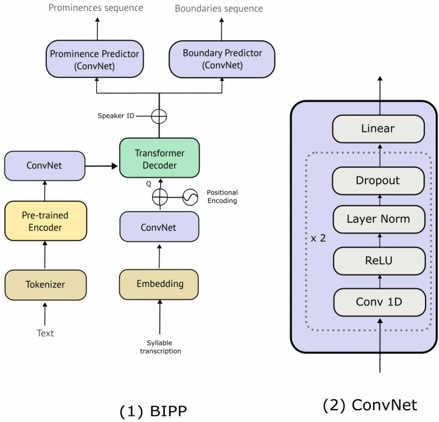

> [!abstract] LREC 2026 · 2026 · Conference
> **Pauline Mas et al.** (Voxygen / IRISA) · [→ Paper](https://aclanthology.org/2026.lrec-1.437) · Demo: ✗ · Code: ✗
>
> Proposes BIPP, a text-only front-end that predicts continuous syllable-level prominence and boundary strength for French TTS by querying frozen CamemBERT embeddings with the phonetised syllable sequence, and shows it predicts these prosodic labels more accurately overall than predictors trained jointly inside FastSpeech2. Evaluation covers label-prediction accuracy only: no speech is synthesised from the predictions and there is no listening test.

## Problem

Prior work showed that interpretable prosodic annotations give a TTS model better prosodic rendering and a handle for control, but only when the annotations come from an oracle. The ToBI front-end of Zou et al. (2021) needs expert-labelled training data. Suni et al. (2020) fed wavelet-derived prominence and boundary labels into Tacotron, but those labels were computed from reference audio. The authors state that no prior system predicts these continuous prominence and boundary values from text alone, which is what a TTS system has at inference time. A second question is whether the semantic and syntactic knowledge in a pretrained masked language model helps with the prediction, compared with predictors learned only from audio-text pairs inside a TTS model.

## Method

**Prosodic targets.** The targets come from the wavelet prosody toolkit (Suni et al., 2017). Frame-level F0, energy and duration are normalised and summed into a single signal, which is then decomposed with a continuous wavelet transform using a Ricker mother wavelet. Lines of maximum amplitude give a prominence strength per unit and lines of minimum amplitude give a boundary strength. Instead of the toolkit's discretised 0 to 2 labels, the authors keep both descriptors continuous and compute them per syllable rather than per word (§2). Labelling needs no human annotation.

**BIPP (BERT-Informed Prosody Predictor).** BIPP is a standalone predictor that outputs a (prominence, boundary) pair per syllable (§3.1). The text goes through a frozen French CamemBERT. Its last-layer embedding (which beat max-pooling over all hidden layers in preliminary experiments) passes through two convolution layers to form the keys and values. The phonetised syllable sequence goes through an embedding layer and a two-layer convolutional encoder (output dimension 256), and with positional encoding added it forms the query of a transformer decoder with 2 attention heads. Cross-attention lets each syllable attend to CamemBERT subword tokens without an explicit syllable-to-token alignment. A speaker embedding is added to the decoder output, and two parallel ConvNet heads regress the prominence and boundary sequences. Training uses the sum of two MSE losses and takes about 60k steps. Parameter count is not reported.

**Auto-regressive BIPP.** This ablation variant swaps the syllable query for the prosodic targets themselves. During training the targets are projected into CamemBERT's embedding space and revealed to the decoder step by step. At inference each value is predicted from earlier predictions. The comparison asks whether the syllable sequence is what steers attention to the relevant parts of the text representation (§3.1).

**FastSpeech2 baseline.** The baseline modifies [[2006.04558|FastSpeech 2]] by adding prominence and boundary predictors, built like the existing variance predictors, in parallel and upstream of the duration predictor, so that the prosodic events can inform the duration, pitch and energy predictions (§3.2, Figure 2). It is trained jointly on audio-text pairs for 500k steps and can either predict prosodic events or accept them as input. In this paper only its predicted prosodic values are evaluated. Its acoustic output is not assessed.

**Data.** All models use 9 speakers (5 female, 4 male) from the Mufasa corpus of open-source French audiobooks. Samples are dropped when the text disagrees with a [[2212.04356|Whisper]] transcription or when the phonetised text disagrees with the phonetised recognition output. That leaves 57,242 samples (about 56 h). Of these, 10k random samples (about 11 h) are split evenly into development and test sets, and about 47k samples (about 45 h) are used for training (§4, Table 1). The data are unbalanced across speakers, ranging from 2,600 to 10,093 samples per speaker.

## Key Results

All results measure prediction against the wavelet-derived reference values on the held-out test split. No speech is synthesised from any prediction and no listening test is run, so these numbers say nothing directly about TTS quality or controllability.

**Global prediction (Table 2).** BIPP is best on both metrics for both event types. For prominence, BIPP has MSE 0.491 and mean directional accuracy (MDA) 0.802, against 0.704 and 0.348 for the FastSpeech2 predictors. For boundaries, BIPP has MSE 0.601 and MDA 0.680, against 1.079 and 0.293. The auto-regressive BIPP falls between the two on boundaries (MSE 0.839, MDA 0.538). On prominence it has the worst MSE of the three (0.985) but a better MDA than FastSpeech2 (0.534). The authors read this as tracking the curve's direction while missing its amplitude.

**Salient events (Table 4).** Reference and predicted sequences are binarised at the 90th percentile ("high") and the 80th percentile ("medium") of the value distribution (Table 3). Peaks are rare, so accuracy exceeds about 80% to 90% for every model and the authors treat it as uninformative.
- *High-threshold boundaries:* BIPP reaches 60.5% precision and 41.9% recall, against 18.0% and 11.0% for FastSpeech2. It also leads on recall MSE (0.207 vs. 0.334).
- *High-threshold prominence:* the ranking flips on detection. FastSpeech2 is ahead on precision (23.3% vs. 20.0%) and recall (16.8% vs. 14.6%), while BIPP has better recall MSE (0.163 vs. 0.210) and accuracy (93.7% vs. 91.2%). All models are weak on this sub-task.
- *Medium-threshold boundaries:* BIPP leads on all four metrics, with 81.1% precision and 47.2% recall against 53.7% and 37.9%.
- *Medium-threshold prominence:* BIPP leads on recall MSE (0.267 vs. 0.352), accuracy (85.1% vs. 80.8%) and precision (58.6% vs. 56.6%), but trails FastSpeech2 on recall (43.3% vs. 51.3%).

The auto-regressive BIPP is generally last on detection metrics, though its recall MSE matches or beats FastSpeech2 on boundaries.

**Fairness of comparison.** All three systems use the same data split and target definition. However, BIPP has access to a large frozen pretrained text model that the FastSpeech2 baseline lacks, and the baseline's predictors are trained under a joint acoustic objective rather than dedicated to the labelling task. The comparison therefore mixes two factors: pretrained semantic features and a standalone versus jointly trained predictor. The paper does not separate them, for example with a FastSpeech2 baseline that has access to CamemBERT or a BIPP without it.

## Novelty Assessment

The new piece is modest but real: a predictor of continuous wavelet-based prominence and boundary strength from text alone, where cross-attention from a syllable-level query into frozen subword LM embeddings removes the need to align syllables with tokens. The underlying parts (the wavelet labelling toolkit, CamemBERT, transformer decoder cross-attention, and FastSpeech2 variance predictors) all exist already. The auto-regressive ablation gives a clear internal finding that the query sequence matters. The contribution is a component-level design for a TTS front-end. The authors leave integration into a TTS system to future work, so whether better label prediction leads to better synthesised prosody is untested.

## Field Significance

low — The paper provides evidence, for French single-style audiobook speech, that a frozen pretrained text encoder queried at syllable level predicts interpretable continuous prosodic labels better overall than predictors trained inside a FastSpeech2-style TTS model, especially for boundary strength. Because nothing is synthesised and no listeners are involved, it supports the feasibility of a text-only front-end for prosody-label-conditioned TTS rather than showing any gain in synthesis.

## Claims

- **supports:** Pretrained text-encoder representations, queried with a phonetic syllable sequence, improve text-only prediction of interpretable continuous prosodic labels over predictors trained jointly inside an acoustic TTS model.
  > *Evidence:* BIPP (frozen CamemBERT keys and values, syllable query) reaches prominence MSE 0.491 and MDA 0.802 versus 0.704 and 0.348 for FastSpeech2's jointly trained predictors, and boundary MSE 0.601 and MDA 0.680 versus 1.079 and 0.293, on a held-out French audiobook test split. *(§5.1, Table 2)*
- **refines:** Prosodic phrasing boundaries are more predictable from text than prominence, consistent with boundaries tracking syntactic structure while prominence depends more on semantic, pragmatic and speaker-intention factors.
  > *Evidence:* BIPP's advantage on salient events is large for boundaries (high-threshold precision 60.5% vs. 18.0%, recall 41.9% vs. 11.0%) but disappears for high prominence peaks, where FastSpeech2 is slightly ahead on precision (23.3% vs. 20.0%) and recall (16.8% vs. 14.6%) while BIPP keeps a lower recall MSE (0.163 vs. 0.210). *(§5.2.1, §5.3, Table 4a, Table 4b)*
- **complicates:** Text-only prosody predictors trained with regression losses tend to be conservative and under-predict rare high-salience prosodic events, so overall error metrics can hide poor modelling of the emphatic peaks that matter most for expressiveness.
  > *Evidence:* Peaks above the 90th percentile are rare and accuracy exceeds 90% for all models, yet high-threshold prominence precision and recall stay at or below 23.3% and 16.8% for every system. The authors describe BIPP as predicting peaks less often than FastSpeech2 and as failing to reach the highest reference values. *(§5.1, §5.2.1, §5.3, Table 4a, Figure 5)*
- **complicates:** For attention-based prosody predictors over language-model embeddings, the query sequence matters: conditioning on the input's phonetic or syllabic structure works much better than auto-regressively conditioning on previously predicted prosodic values.
  > *Evidence:* Auto-regressive BIPP, which replaces the syllable query with the history of its own predictions, has the worst prominence MSE (0.985) and falls behind syllable-query BIPP on every global metric for both event types. *(§3.1, §5.1, Table 2)*

## Limitations and Open Questions

> [!warning] No synthesis or perceptual evaluation
> Evaluation is label-prediction accuracy only, measured against wavelet-derived reference values. Prominence and boundary predictions are never fed into a TTS model to generate speech, and there is no listening test or acoustic evaluation of synthesised audio. The motivating claim, that predicted labels would improve prosodic rendering or controllability in TTS, is left to future work (§6).

- **Single language and style.** Experiments use only French read audiobook speech from 9 speakers. The authors frame BIPP as suited to "homogeneous speaking styles" and acknowledge that it misses very salient events. Generalisation to expressive or conversational speech, or to other languages, is untested.
- **Confounded comparison.** BIPP's gain over the FastSpeech2 predictors cannot be split between its access to a frozen pretrained language model and its being a standalone predictor rather than one trained jointly. No ablation isolates CamemBERT's contribution beyond the auto-regressive variant, which changes the query rather than removing the language model.
- **Reference labels are themselves model output.** The targets come from an unsupervised wavelet decomposition of F0, energy and duration. Error is measured against these derived labels, not against human prosodic annotation, and their perceptual validity for French is not assessed here.
- **Peak thresholds and metric details.** Salient-event thresholds are percentile-based (80% and 90%), and the per-speaker breakdown is not reported, although the speaker distribution is unbalanced.
- **Reproducibility.** No code, model release or parameter counts are reported.
- **Open question.** Would the more conservative but better-placed BIPP predictions lead to more varied prosody in synthesised speech, as the conclusion speculates about reducing TTS monotony, and would they work as a manual control interface?

## Wiki Connections

- [[prosody-control|Prosody Control]] — Builds a text-only predictor of interpretable continuous prominence and boundary-strength labels, meant as the front-end for a TTS model conditioned on these labels and as a possible manual prosody-control interface, though control of synthesised speech is not tested here.
- [[transformer-enc-dec-tts|Transformer Encoder-Decoder TTS]] — Trains a FastSpeech2-style model with prominence and boundary predictors added upstream of its variance adaptor and finds them weaker label predictors than a standalone pretrained-text-encoder model, though its synthesised output is not evaluated.
- [[2006.04558|FastSpeech 2]] — Serves as the baseline after modification: prominence and boundary predictors are added upstream of its duration, pitch and energy variance predictors and trained jointly, and BIPP outperforms them on most label-prediction metrics.
- [[2212.04356|Whisper]] — Used as a data-cleaning tool: samples whose text or phonetisation disagrees with Whisper's transcription are removed before computing prosodic targets.
