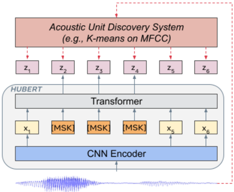

> [!abstract] arXiv · 2021 · Preprint
> **Wei-Ning Hsu et al.** (Facebook AI) · [→ Paper](https://arxiv.org/abs/2106.07447) · [→ Peer-reviewed version](https://doi.org/10.1109/taslp.2021.3122291) · Demo: ✗ · Code: ✓
>
> HuBERT learns self-supervised speech representations by predicting offline k-means cluster labels for masked frames of raw audio, then re-clustering its own features to refine the targets, and matches or beats wav2vec 2.0 on LibriSpeech ASR from 10 minutes to 960 hours of labeled data.

*A [peer-reviewed version](https://doi.org/10.1109/taslp.2021.3122291) appeared in IEEE/ACM Transactions on Audio, Speech, and Language Processing (2021). This page, including its metrics and claims, summarizes the arXiv preprint.*

## Problem

Self-supervised learning works well for text and images, but speech poses three specific problems. An utterance contains many sound units, which breaks the one-instance-one-class assumption behind many vision methods. There is no lexicon of discrete units during pre-training, so a BERT-style predictive loss has no targets. And unit boundaries are unknown, which complicates masked prediction. The main prior answer, [[2006.11477|wav2vec 2.0]], uses a contrastive loss that needs careful negative sampling, an auxiliary diversity loss and a Gumbel-softmax temperature schedule, and it quantizes only the CNN encoder output. DiscreteBERT predicts discrete targets for masked regions but feeds quantized units as input, which loses information before the Transformer sees it.

## Method

HuBERT (Hidden-Unit BERT) separates unit discovery from representation learning. An offline clustering model assigns a categorical label to every 20 ms frame. In the first iteration this is k-means with 100 clusters on 39-dimensional MFCCs (13 coefficients plus first and second derivatives). A BERT-style Transformer encoder then sees the frame features with spans masked and predicts the cluster label of each frame through a cosine-similarity softmax over learned codeword embeddings (temperature 0.1).

The loss weighting is the central design choice. The total loss is a weighted sum of a cross-entropy term over masked frames and one over unmasked frames, with weight α on the masked term. With α = 0 the model only mimics the clustering model, like a hybrid acoustic model. With α = 1 (the setting used) it must infer the labels of unseen frames from context, so it learns both an acoustic model of the unmasked input and the long-range structure of the sequence. The authors argue this makes HuBERT depend on the consistency of the targets rather than their correctness.

Two extensions improve the targets. Cluster ensembles predict labels from several k-means models at once (one projection per model), including product quantization over subspaces of spliced MFCCs. Iterative refinement re-clusters the hidden features of the previous HuBERT model: the second BASE iteration uses k-means with 500 clusters on layer 6 of the first iteration model, and the LARGE and X-LARGE models train on 500-cluster labels from layer 9 of the second BASE iteration, which makes them third-iteration models.

The backbone follows wav2vec 2.0: a seven-layer, 512-channel convolutional waveform encoder (320x downsampling of 16 kHz audio) feeds a Transformer encoder. BASE has 12 layers (95M parameters), LARGE 24 layers (317M) and X-LARGE 48 layers with 1280-dimensional embeddings (964M) (Table I). Masking selects 8% of frames as span starts with span length 10. BASE trains for 250k plus 400k steps on 32 GPUs over LibriSpeech 960 h; LARGE and X-LARGE train for 400k steps on 128 and 256 GPUs over 60k hours of Libri-Light. For ASR, the projection layer is replaced with a softmax over characters and the model is fine-tuned with CTC, keeping the CNN encoder frozen. Decoding uses wav2letter++ beam search with a 4-gram or Transformer language model, with decoding weights tuned by Bayesian optimization.

## Key Results

All results are English ASR word error rates on LibriSpeech. No speech generation is evaluated.

- **Low-resource fine-tuning (Table II).** With 10 minutes of labels, HuBERT LARGE reaches 4.7 / 7.6 WER on test-clean / test-other against 4.8 / 8.2 for wav2vec 2.0 LARGE with the same Libri-Light data and Transformer LM. X-LARGE lowers this to 4.6 / 6.8. At the LARGE scale HuBERT is lower or equal on every subset at 10 min, 1 h and 10 h; at 100 h it is 0.1 higher on test-clean (2.1 vs. 2.0).
- **Scaling to 1B parameters.** X-LARGE improves over LARGE on dev-other and test-other at every fine-tuning size. The largest relative reductions are 19% on dev-other at 100 h (3.7 to 3.0) and 13% on test-other at 10 h (4.6 to 4.0). On dev-clean at 10 min, X-LARGE is slightly worse than LARGE (4.4 vs. 4.3).
- **Full 960 h fine-tuning (Table III).** HuBERT X-LARGE reaches 1.8 / 2.9 on test-clean / test-other. HuBERT LARGE ties wav2vec 2.0 LARGE on test-other (3.3) and is 0.1 higher on test-clean (1.9 vs. 1.8). The pre-trained Conformer XXL is lower on test-clean (1.5) but higher on test-other (3.1) than X-LARGE. Systems that add self-training on top of pre-training remain lower than HuBERT (Conformer XXL with Noisy Student: 1.4 / 2.6).
- **BASE scale.** The comparison with wav2vec 2.0 BASE (both on LS-960 with a 4-gram LM) is mixed. HuBERT BASE is lower on dev-other and test-other at 10 min (15.0 vs. 15.7; 15.3 vs. 15.6) and 10 h, but higher on test-clean at 10 min (9.7 vs. 9.1) and 1 h (6.1 vs. 5.5).
- **Against DiscreteBERT**, which uses the same masked-unit objective with quantized inputs, HuBERT BASE has much lower WER in every setting (10 min test-other: 15.3 vs. 25.2).

The ablations (Table V, BASE models at 100k steps, dev-other WER after 10 h fine-tuning) isolate the loss design. With MFCC k-means targets (C = 100), masked-only loss gives 17.86, the equally weighted loss 29.57 and unmasked-only loss 96.37. Better targets narrow the gap: with layer-9 features of the second iteration, the three settings give 10.75, 11.59 and 13.79. Clustering quality rises from a PNMI of 0.243 to 0.704 across those teachers. With forced-aligned supervised chenone targets (PNMI 0.809), the equally weighted loss is lower than masked-only (9.16 vs. 10.38). Cluster ensembles also help: three product k-means codebooks give 16.73 against 17.64 to 19.26 for each codebook alone (Table VI). Longer pre-training lowers WER steadily, to 11.68 at 800k steps (Table VII).

Comparisons with the literature use numbers reported in prior papers, not re-runs. HuBERT's decoding weights are tuned per setting with Bayesian optimization, and the LM type is matched to the comparator rows in the tables.

## Novelty Assessment

The training objective is new. Predicting offline cluster labels with a masked-only cross-entropy loss replaces the contrastive loss, negative sampling, diversity loss and learned quantizer of wav2vec 2.0. The backbone is not new: it copies the wav2vec 2.0 encoder, and the BERT and SpanBERT masking scheme. The idea of discrete targets for masked speech comes from DiscreteBERT, and iterative refinement mirrors iterative pseudo-labeling in semi-supervised ASR. The DeepCluster method in vision is the acknowledged inspiration.

The contribution is therefore a training-objective and target-design change, backed by careful ablations. The paper shows that crude MFCC k-means units are enough to start, and that re-clustering the model's own features removes most of the gap to supervised targets. The gains over wav2vec 2.0 are modest (often 0.1 to 0.6 WER at LARGE scale) and depend on scale and subset; the clearest advantage is on the harder "other" subsets.

## Field Significance

> [!important]
> Foundational — HuBERT introduces masked prediction of offline-clustered hidden units as a self-supervised speech objective, with iterative re-clustering of its own features. Its layer-wise k-means analysis shows that clustering intermediate features yields discrete units with much higher phonetic mutual information than MFCC clusters, which makes its features and units usable as discrete speech tokens beyond ASR.

## Claims

- **supports:** Restricting a self-supervised prediction loss to masked frames makes speech representation learning robust to low-quality discrete targets.
  > *Evidence:* With k-means targets on MFCCs (C = 100), masked-only loss gives 17.86 dev-other WER after 10 h fine-tuning, against 29.57 for equal weighting and 96.37 for unmasked-only loss; the same pattern holds for C = 50 and C = 500. *(§V-D, Table V)*
- **refines:** The advantage of masked-only prediction shrinks as discrete targets become more phonetic, and reverses with supervised targets.
  > *Evidence:* The gap between masked-only and unmasked-only loss falls from 78.51 WER points (MFCC k-means, PNMI 0.243) to 3.04 points (second-iteration layer-9 k-means, PNMI 0.704); with supervised chenone targets (PNMI 0.809), equal weighting (9.16) beats masked-only loss (10.38). *(§V-D, Table V)*
- **supports:** Clustering the intermediate layers of a self-supervised speech model yields discrete units far more aligned with phones than clustering spectral features, and re-training on those units improves the representation further.
  > *Evidence:* k-means PNMI rises from about 0.25 to 0.29 on MFCCs to about 0.56 to 0.69 on layer 6 of the first BASE iteration (Table IV); training on second-iteration units cuts dev-other WER from 17.86 to 10.75 under masked-only loss. *(§V-B, §V-C, Table IV, Table V, Figure 2)*
- **supports:** Feeding continuous waveform features rather than pre-quantized units into a masked-unit predictor avoids an information bottleneck in speech pre-training.
  > *Evidence:* HuBERT BASE and DiscreteBERT share a masked unit-prediction objective, but DiscreteBERT takes quantized units as input; with 10 min of labels on LS-960 and a 4-gram LM, test-other WER is 15.3 vs. 25.2, and a comparable DiscreteBERT result with 13.5k MFCC k-means units is 26.6 dev-other WER (no step count given), against 11.68 to 17.86 for HuBERT with 100 units across 100k to 800k steps. The unit inventories also differ, so the comparison does not isolate the input type alone. *(§III, §V-A, §V-F, Table II, Table VII)*
- **complicates:** Gains from replacing contrastive with predictive self-supervised objectives in speech depend on model scale and test condition.
  > *Evidence:* HuBERT LARGE is lower than or equal to wav2vec 2.0 LARGE on test-other at all fine-tuning sizes, but HuBERT BASE is higher than wav2vec 2.0 BASE on test-clean at 10 min (9.7 vs. 9.1) and 1 h (6.1 vs. 5.5), and HuBERT LARGE is 0.1 higher on test-clean at 100 h and 960 h. *(§V-A, Table II, Table III)*

## Limitations and Open Questions

The evaluation covers English ASR on read audiobook speech only. LibriSpeech and Libri-Light both come from LibriVox, so pre-training, fine-tuning and test data share one domain. The paper does not test the representations on generation, other languages, noisy speech or non-ASR tasks; the conclusion names generation and other downstream tasks only as future work.

- Training is multi-stage and costly: k-means fitting, a full pre-training run per iteration, and 128 to 256 GPUs for the large models. The authors list a single-phase procedure as future work.
- LARGE and X-LARGE run only one iteration, on labels from the BASE model, so the effect of iterating at large scale is untested.
- Ablations use BASE models at 100k steps with fixed fine-tuning and decoding settings; it is not shown that every conclusion carries over to the main configurations.
- Baseline numbers are copied from prior papers, while HuBERT's decoding weights are tuned per setting, so small differences (0.1 to 0.3 WER) may reflect decoding choices.
- At 960 h, methods that combine pre-training with self-training remain lower than HuBERT. The paper expects HuBERT plus self-training to close this gap, but does not test it.

## Wiki Connections

- [[self-supervised-speech|Self-Supervised Speech]] — introduces masked prediction of offline-clustered hidden units, with iterative re-clustering, as a self-supervised speech pre-training objective.
- [[2006.11477|wav2vec 2.0]] — HuBERT copies its encoder architecture and masking setup, replaces its contrastive objective with masked cluster prediction, and uses it as the main baseline.
- [[1810.04805|BERT]] — HuBERT adapts the BERT masked-prediction objective and Transformer encoder from text tokens to continuous speech with discovered units.
- [[2104.00355|Speech Resynthesis from Discrete Units]] — a later corpus paper that resynthesizes and converts speech from discrete units extracted from HuBERT, among other self-supervised encoders.
- [[2308.16692|SpeechTokenizer]] — a later corpus codec that distills HuBERT representations into its first RVQ layer and compares its PNMI against HuBERT k-means units.
- [[2305.11000|SpeechGPT]] — a later corpus speech LM that expands an LLM vocabulary with HuBERT discrete units for speech input and output.
