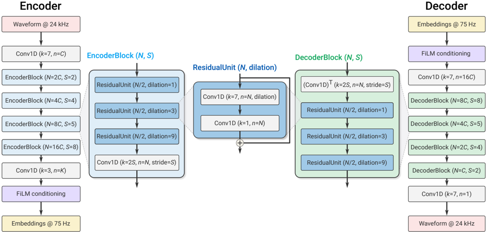

> [!abstract] arXiv · 2021 · Preprint
> **Neil Zeghidour et al.** (Google) · [→ Paper](https://arxiv.org/abs/2107.03312) · [→ Peer-reviewed version](https://doi.org/10.1109/taslp.2021.3129994) · Demo: ✓ · Code: ✗
>
> SoundStream trains a convolutional encoder, a residual vector quantizer and a convolutional decoder jointly, end to end, with adversarial and reconstruction losses, so that one streamable model compresses speech, music and general audio at 3 to 18 kbps and can switch bitrate at inference through quantizer dropout.

*A [peer-reviewed version](https://doi.org/10.1109/taslp.2021.3129994) appeared in IEEE/ACM Transactions on Audio, Speech, and Language Processing (2022). This page, including its metrics and claims, summarizes the arXiv preprint.*

## Problem

Traditional codecs such as Opus and EVS rely on hand-engineered signal processing and introduce audible artefacts at low bitrates. Earlier neural codecs (WaveNet- or VQ-VAE-based speech coders, LPCNet, Lyra) target speech only and mostly keep a fixed front end: Lyra, for example, learns a decoder on quantized mel-spectrogram features rather than learning the encoder. Prior end-to-end neural codecs also enforce one bitrate during training, so each target bitrate needs its own model. A plain vector quantizer cannot reach medium bitrates either: at 6 kbps and 75 frames per second, each frame gets 80 bits, which would require a codebook of 2^80 entries (§III-C).

## Method

SoundStream processes single-channel 24 kHz audio with three jointly trained blocks (§III). The **encoder** follows the streaming SEANet encoder without skip connections: a 1D convolution followed by four convolution blocks, each with three dilated residual units (dilations 1, 3, 9) and a strided down-sampling convolution, using strides (2, 4, 5, 8). This gives one embedding every 320 samples (75 Hz, 13.3 ms per frame). All convolutions are causal, with ELU activations and no normalization, so the architectural latency is set only by the total stride. The **decoder** mirrors the encoder with transposed convolutions for up-sampling and ends with a single-filter convolution that outputs the waveform (§III-A, §III-B).

![SoundStream model architecture. A convolutional encoder produces a latent representation of the input audio samples, which is quantized using a variable number nq of residual vector quantizers (RVQ). During training, the model parameters are optimized using a combination of reconstruction and adversarial losses. An optional conditioning input can be used to indicate whether background noise has to be removed from the audio. When deploying the model, the encoder and quantizer on a transmitter client send the compressed bitstream to a receiver client that can then decode the audio signal.](assets/2107.03312/figure-2.png)

The **residual vector quantizer (RVQ)** extends the VQ-VAE quantizer to a cascade of N_q vector quantizers: the first quantizes the embedding, and each later stage quantizes the residual left by the previous ones, with the bit budget split evenly across stages (e.g. 8 quantizers with 1024-entry codebooks give 80 bits per frame at 6 kbps). Codebooks are updated by exponential moving average, initialized with k-means on the first batch, and dead codes are replaced by randomly sampled input frames (§III-C). **Quantizer dropout** samples the number of active quantizers n_q uniformly from 1 to N_q for each training example. Because RVQ outputs sum to an embedding of fixed dimension, one model then serves every bitrate from 3 to 18 kbps by truncating the cascade at inference, without architectural change.

Training combines a hinge **adversarial loss** from two discriminators: the multi-resolution waveform discriminator of MelGAN (three scales), and a new single-scale **STFT discriminator** that operates on the real and imaginary parts of the complex STFT (window 1024, hop 256) through 2D residual blocks. It also uses a discriminator **feature-matching loss** and a multi-scale mel-spectrogram reconstruction loss (L1 on magnitude plus L2 on log magnitude, window sizes 2^6 to 2^11), weighted 1 / 100 / 1 (§III-D, §III-E). For **joint compression and enhancement**, FiLM layers at the encoder or decoder bottleneck take a (possibly time-varying) one-hot denoise flag. Training tuples pair noisy inputs with either the noisy input or its clean speech as the target, depending on the flag, so denoising can be switched on and off at inference with no added latency (§III-F). The default model has 8.4M parameters and runs in real time on a single Pixel 4 CPU thread (encoder RTF 2.4×, decoder RTF 2.3×; Table I).

## Key Results

**Subjective comparison (§V-A, Figures 5 and 6).** A crowd-sourced MUSHRA-inspired test (hidden reference, no low-pass anchor, 20 ratings per clip on 200 clips of clean, noisy and reverberant speech and music, native English listeners on headphones, with post-screening) is the main evaluation. Per-system MUSHRA scores appear only as bar charts, so this page reports no MUSHRA numbers. The authors report that SoundStream at 3 kbps scores significantly above Opus at 6 kbps and EVS at 5.9 kbps (the lowest rates those codecs support), and above Lyra at 3 kbps. EVS needs at least 9.6 kbps and Opus at least 12 kbps to match it (3.2× to 4× more bits). At medium and high rates the bit-rate advantage narrows to 2.2× to 2.6× and 1.3× to 1.6×. By content type, music at 3 kbps scores significantly above Opus at 12 kbps and EVS at 5.9 kbps (Figure 6).

**Objective quality and bitrate scalability (§V-B, §V-C, Figure 7).** ViSQOL stays above 3.7 at 3 kbps. The empirical entropy of the quantizer symbols points to a possible further 7% to 20% rate saving through entropy coding, which the codec does not use (it is constant-bitrate). A model trained at 18 kbps without quantizer dropout loses quality when truncated to lower rates, and quantizer dropout closes that gap. The bitrate-scalable model is reported to marginally exceed bitrate-specific models at 9 and 12 kbps (Figure 7c), and in the MUSHRA test it is slightly worse than the bitrate-specific model at 3 kbps and on par at 6 and 12 kbps.

**Ablations (§V-D, Tables I to III, all at 6 kbps).**
- Replacing the learned encoder with a fixed mel-filterbank (as in Lyra) drops ViSQOL from 3.96 to 3.33. That is below the learned-encoder model at half the bitrate (3.76 at 3 kbps).
- Capacity (Table I): halving channels to C = 16 (2.4M params) gives ViSQOL 3.98 vs. 4.01 for the default, with RTF rising to 7.5× / 7.1×. A smaller encoder (C_enc = 8) keeps quality (3.99) at an encoder RTF of 18.6×, while a smaller decoder (C_dec = 8) lowers it to 3.90. All differences are close to the ±0.03 confidence intervals except the C_dec = 8 drop.
- RVQ depth vs. codebook size (Table II): 8 × 1024 gives 4.01, 16 × 32 gives 3.98, and 80 × 2 (eighty 1-bit quantizers) gives 3.92. Very deep RVQs train without optimization failure, at a modest quality cost.
- Latency (Table III): strides giving 7.5 ms, 13 ms and 26 ms latency all reach ViSQOL 4.01. Longer frames raise RTF (encoder 1.6× → 4.1×).

**Joint compression and denoising (§V-E, §V-F, Figure 8, Table IV).** Switchable denoising at the encoder or the decoder side gives similar ViSQOL and matches a fixed always-denoise model. Encoder-side and fixed denoising lower the cross-entropy rate estimate compared with decoder-side denoising. On unseen noisy VCTK, the single joint model scores ViSQOL 2.93 / 3.18 / 3.42 / 3.58 at 0 / 5 / 10 / 15 dB SNR. That is below both cascades with a separate SEANet denoiser at every SNR (3.02 to 3.05 at 0 dB; 3.63 to 3.64 at 15 dB). The gap (best cascade minus joint model) shrinks from 0.12 at 0 dB to 0.06 at 15 dB, and the joint model needs half the compute and adds no latency.

The baselines are standard production codecs (Opus, EVS) plus Lyra. No other end-to-end neural general-audio codec at these bitrates was compared, and ablations rely on ViSQOL rather than listening tests.

## Novelty Assessment

The contribution is architectural. The building blocks have precedents: the SEANet-style convolutional encoder/decoder, the MelGAN waveform discriminator and multi-scale spectral losses, VQ-VAE codebook learning, and multi-stage vector quantization from classical speech coding. The paper's own additions are:
- training a residual vector quantizer end to end with the encoder and decoder, which the authors describe as the first such use in a neural network;
- quantizer dropout for a single bitrate-scalable model;
- a complex-STFT discriminator;
- FiLM-conditioned switchable denoising inside the codec bottleneck.

The learned-encoder ablation against a mel front end and the RVQ depth/codebook trade-off give direct evidence for the design choices. The weaker parts are the subjective evaluation, reported only in plots and against non-neural codecs plus Lyra, and the absence of released code.

## Field Significance

> [!important]
> Foundational — SoundStream introduces end-to-end residual vector quantization with quantizer dropout. This yields a single streamable neural codec whose stacked discrete codes represent speech, music and general audio at low bitrates, and the paper demonstrates its quality against Opus and EVS in listening tests. The RVQ code hierarchy it defines can serve as a discrete audio token space for downstream generative models, beyond its role as a transmission codec.

## Claims

- **supports:** Learning the analysis front end jointly with the quantizer and decoder improves rate-quality trade-offs over neural codecs that quantize fixed spectral features.
  > *Evidence:* Replacing the learned encoder with a fixed mel-filterbank while still learning quantizer and decoder drops ViSQOL from 3.96 to 3.33 at 6 kbps, below the learned-encoder model at 3 kbps (3.76). *(§V-D "Advantage of learning the encoder")*
- **supports:** Residual vector quantization makes high-rate discrete audio representations tractable by replacing one exponentially large codebook with a cascade of small codebooks over successive residuals.
  > *Evidence:* At 6 kbps (80 bits per frame) a flat VQ would need 2^80 codes; RVQ with 8 × 1024, 16 × 32 or 80 × 2 codebooks reaches ViSQOL 4.01, 3.98 and 3.92 respectively, with fewer, larger codebooks most efficient. *(§III-C, §V-D, Table II)*
- **supports:** Randomly truncating the quantizer cascade during training lets one neural codec serve a range of bitrates at little or no quality cost relative to bitrate-specific models.
  > *Evidence:* Quantizer dropout removes the quality loss seen when an 18 kbps model without dropout is truncated, matches bitrate-specific models in MUSHRA at 6 and 12 kbps and is slightly worse only at 3 kbps. *(§V-C, Figure 5, Figure 7c)*
- **supports:** Adversarially trained neural codecs can exceed traditional transform and parametric codecs at several times lower bitrate in human listening tests, including on non-speech audio.
  > *Evidence:* SoundStream at 3 kbps is rated above Opus at 6 kbps and EVS at 5.9 kbps; EVS and Opus need 3.2× to 4× the bitrate to match it, and music at 3 kbps beats Opus at 12 kbps. *(§V-A, Figures 5 and 6)*
- **complicates:** Folding speech enhancement into a codec trades a small amount of output quality for lower latency and compute compared with a cascaded denoiser and codec.
  > *Evidence:* The joint model scores ViSQOL 2.93 vs. 3.02 to 3.05 for SEANet cascades at 0 dB, with the gap narrowing to 0.05 to 0.06 at 15 dB, while using half the compute and adding no architectural latency. *(§V-F, Table IV)*

## Limitations and Open Questions

The headline result is subjective, but MUSHRA scores are reported only as bar charts with confidence intervals and no numeric table. The comparison set is limited to Opus, EVS and Lyra, so there is no comparison with other learned general-audio codecs at these bitrates. All ablations and the joint-denoising study use ViSQOL alone. The authors report that ViSQOL correlates strongly with their subjective evaluations, but give no correlation figures.

- The §V-D prose quotes ViSQOL values (3.96 for the default model, 3.94 for the smaller encoder, 3.84 for the smaller decoder) that sit about 0.05 below the Table I entries for the same configurations (4.01, 3.99, 3.90); both appear in the source PDF. This page reports Table I values, except that the mel-filterbank ablation exists only in the prose, so it is quoted with its prose reference (3.96).
- The codec runs at constant bitrate; the 7% to 20% entropy-coding saving is an empirical-entropy estimate, not an implemented bitstream.
- The demonstrated enhancement is limited to background-noise suppression; the paper argues that the training data determines the kind of enhancement but tests no other kind.
- Training data are English read speech (LibriTTS), synthetic noise mixtures and one music dataset. Listeners were native English speakers, so cross-lingual and conversational speech behaviour is not evaluated.
- No code or trained models accompany the preprint; reproduction depends on the architectural description.

## Wiki Connections

- [[neural-codec|Neural Audio Codec]] — Introduces an end-to-end convolutional codec with a residual vector quantizer and quantizer dropout, providing a bitrate-scalable stack of discrete codes at 75 Hz.
- [[gan-vocoder|GAN Vocoder]] — The decoder is trained with a MelGAN-style multi-scale waveform discriminator plus a new complex-STFT discriminator and feature-matching loss, carrying GAN vocoder training into a codec.
- [[subjective-evaluation|Subjective Evaluation]] — Main results come from a crowd-sourced MUSHRA-inspired test with hidden reference, headphone-using native listeners and rater post-screening.
- [[1711.00937|VQ-VAE]] — SoundStream extends the VQ-VAE learnable vector quantizer (with EMA codebook updates) into a multi-stage residual quantizer trained end to end.
- [[2010.05646|HiFi-GAN]] — Cited as part of the class of adversarial waveform generators on which the SoundStream decoder and loss design is based.
- [[1904.02882|LibriTTS]] — Provides the clean speech training and test data, and the speech component of the synthetic noisy mixtures.
- [[2104.00355|Speech Resynthesis from Discrete SSL Units]] — Contrasted as a very-low-bitrate codec built on speech-specific speaker, phonetic and pitch embeddings, whereas SoundStream makes no assumption about the signal type.
- [[2006.11477|wav2vec 2.0]] — Its product quantization is contrasted with RVQ, whose embedding dimension does not change with bitrate.
- [[2210.13438|EnCodec]] — Later work that names SoundStream as its most closely related model, adopts its convolutional encoder-decoder with RVQ, and compares against it.
- [[2209.03143|AudioLM]] — Later work that uses SoundStream codes as the fine-grained acoustic tokens for language modelling of audio.
- [[2305.09636|SoundStorm]] — Later work that generates SoundStream RVQ tokens in parallel, exploiting the codec's residual token structure.
