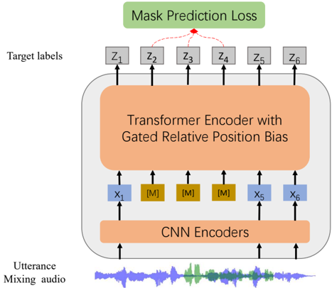

> [!abstract] arXiv · 2022 · Preprint
> **Sanyuan Chen et al.** (Microsoft) · [→ Paper](https://arxiv.org/abs/2110.13900) · [→ Peer-reviewed version](https://doi.org/10.1109/jstsp.2022.3188113) · Demo: ✗ · Code: ✓
>
> WavLM extends HuBERT-style masked unit prediction with a denoising task, in which the model must predict the targets of the main speaker from inputs mixed with noise or a second utterance, and with gated relative position bias, producing one self-supervised speech encoder that improves speaker verification, diarization and separation while keeping ASR performance on par with HuBERT and wav2vec 2.0.

*A [peer-reviewed version](https://doi.org/10.1109/jstsp.2022.3188113) appeared in the IEEE Journal of Selected Topics in Signal Processing (2022). This page, including its metrics and claims, summarizes the arXiv preprint.*

## Problem

Self-supervised speech models such as [[2006.11477|wav2vec 2.0]] and [[2106.07447|HuBERT]] were designed and tuned for ASR. The authors identify two gaps for other tasks. First, their pre-training sees only single-speaker audio and does not push the model to discriminate speakers, so multi-speaker tasks gain little: in the authors' experiments a separation model on HuBERT features improves only marginally over one trained from scratch. Second, pre-training relies on Libri-Light audiobooks, whose clean read speech mismatches the acoustics of many downstream tasks. The goal is one pre-trained model that serves the full stack of speech tasks (content, speaker, semantics, paralinguistics and generation) rather than a family of task-specific models.

## Method

WavLM keeps the wav2vec 2.0 / HuBERT backbone: a seven-block convolutional feature encoder (512 channels, about 25 ms receptive field at a 20 ms stride) feeds a Transformer encoder whose masked frames are trained to predict offline k-means pseudo-labels, as in HuBERT. It makes three changes.

**Masked speech denoising and prediction.** For a fraction of each batch (20% of utterances), the input is corrupted before masking by mixing in either a DNS-challenge noise clip (energy ratio sampled from -5 to 20 dB) or a crop of another utterance from the same batch (-5 to 5 dB). The mixed region covers less than half the utterance, so the original speaker remains the main speaker. The pseudo-labels are always computed from the clean utterance, so the model must identify the main speaker and predict that speaker's content from the corrupted input (Algorithm 1). The authors argue that this implicitly teaches speaker identity, enhancement and overlap handling. The noise-mixing probability is 0 for WavLM Base (utterance overlap only) and 10% for Base+ and Large.

**Gated relative position bias.** The Transformer adds a bucketed relative position bias to the attention logits, shared across layers (320 buckets, log-spaced up to an 800-frame offset). Two sigmoid gates computed from the query rescale this bias, so the position term depends on the content of the current frame. It replaces the purely convolutional relative position embedding of wav2vec 2.0 and HuBERT while keeping the convolutional layer at the bottom; the parameter count barely changes (94.70M vs. 94.68M at Base size).

**More diverse pre-training data.** Base+ and Large train on "Mix 94k hr": 60k hours of Libri-Light, a 10k-hour cleaned subset of GigaSpeech (podcasts, YouTube and audiobooks) and 24k hours of English VoxPopuli (European Parliament recordings). The paper also rescales attention scores before the softmax to avoid fp16 overflow when training large models.

WavLM Base and Base+ have 12 layers with 768-dimensional states (94.70M parameters); WavLM Large has 24 layers with 1024-dimensional states (316.62M). Base trains for 400k steps on LibriSpeech 960 h with labels from layer 6 of the first-iteration HuBERT Base. Base+ and Large use labels from layer 9 of the released second-iteration HuBERT Base, so WavLM does not run its own re-clustering iterations; the authors report that first-iteration HuBERT labels gave a slightly better second-iteration WavLM than labels from a first-iteration WavLM (0.2 lower WER on LibriSpeech dev-other). Section V-A gives 1M steps for Base+ and 700k for Large, while Appendix Table VII lists 1.2M steps for Base+.

Downstream, the model is used either frozen with a learned weighted sum of all layer outputs (SUPERB, diarization, separation) or fine-tuned (speaker verification after 20 frozen epochs; ASR with a CTC head).

## Key Results

**SUPERB (Table I, frozen upstream).** WavLM Large reaches an overall score of 74.6, against 72.2 for HuBERT Large and 70.4 for wav2vec 2.0 Large; WavLM Base+ (73.4) is above both Large baselines. The overall score is the authors' own aggregate, not an official SUPERB number. WavLM Large is better than HuBERT Large on 14 of the 15 tasks. The exception is voice conversion, the only generation task with a speaker-similarity target, where HuBERT Large is slightly ahead (MCD 7.22 vs. 7.30, ASV acceptance 99.25 vs. 99.00, with WER tied at 9.0). At Base size, the paper states that WavLM Base beats HuBERT Base on all tasks; the table shows ties on SE PESQ (2.58) and VC WER (8.0) and a lower VC ASV score (98.00 vs. 98.50). The largest Base-size gain is speaker diarization, where DER falls from 5.88 to 4.55 (22.6% relative).

**Ablations at Base size (Table I).** Removing the denoising task raises diarization DER from 4.55 to 6.03 and lowers separation SI-SDRi from 10.37 to 9.91, but slightly improves ASR WER (6.08 vs. 6.21) and ST BLEU (21.03 vs. 20.74). Removing the gated relative position bias hurts content tasks most (PR 5.22 vs. 4.84; ASR 6.80 vs. 6.21), while speaker identification, ASV and QbE scores are marginally better without it. The overall score moves only from 72.0 to 71.7 and 71.9 respectively.

**Speaker verification (Table II).** With an ECAPA-TDNN downstream model, WavLM Large features give EERs of 0.617 / 0.662 / 1.318% on Vox1-O / E / H, against 1.01 / 1.24 / 2.32% reported for Fbank ECAPA-TDNN and 0.808 / 0.822 / 1.678% for HuBERT Large. Adding large-margin fine-tuning and quality-aware score calibration lowers WavLM Large to 0.383 / 0.480 / 0.986%, the lowest EER on all three trial lists in Table II (HuBERT Large with the same additions: 0.585 / 0.654 / 1.342%). The text reports that this is below the VoxSRC 2021 winning system (0.461 / 0.634 / 0.993%).

**Speaker diarization (Table III, CALLHOME, estimated speaker count).** WavLM Large with EEND-vector clustering reaches 10.35% DER, the lowest value in every speaker-count column of Table III. This compares with 11.84% for EEND-EDA clustering (12.6% relative), 12.40% with HuBERT Large features and 13.31% for the authors' Fbank reproduction of the same back-end. The VBx row (13.28%) uses oracle speech segments.

**Speech separation (Table IV, LibriCSS).** With frozen WavLM Large features concatenated to the STFT input of a Conformer separator, the WER of the separated speech averages 6.0%, against 8.3% for the rerun Conformer baseline (27.7% relative) and 8.1% with HuBERT Base features. WavLM Large has the lowest WER in every overlap condition of Table IV; at 40% overlap the reduction is 32.5% (12.6% to 8.5%). Unfreezing WavLM Base+ during separation training raises average WER from 7.4% to 8.2%.

**ASR (Tables V and VI).** On full 960 h fine-tuning with a Transformer LM, WavLM Large reaches 1.8 / 3.2 WER on test-clean / test-other, against 1.8 / 3.3 for wav2vec 2.0 Large and 1.9 / 3.3 for HuBERT Large. In low-resource settings, WavLM Large matches or slightly improves on HuBERT Large at 1 h and 10 h, and is 0.1 worse on test-other at 100 h (4.0 vs. 3.9). The Large-scale comparisons are not controlled: WavLM uses Mix 94k hr, the baselines Libri-Light 60k.

**Layer analysis (Figures 2 and 3).** The learned layer weights put speaker tasks (SID, ASV, SD, and the separate verification, diarization and separation systems) on the bottom layers for Base models and the middle layers for Large, and content and semantic tasks on the top layers.

## Novelty Assessment

The new element is the training objective: denoising on utterance-overlap and noise mixtures inside a masked unit-prediction framework, with targets taken from the clean signal. The gated relative position bias is borrowed from text pre-training work ([15] in the paper) and applied to speech; data scaling with more diverse public corpora is an engineering choice. The architecture and pseudo-label pipeline are otherwise HuBERT's, and Base+ and Large reuse HuBERT's own second-iteration labels.

The Base-size comparison is fair (same data, parameters and label source family) and the ablation isolates each change, though only at Base size and only on SUPERB. The headline speaker-task gains (diarization, separation, verification) are large and consistent with the mechanism. ASR gains are small and, at Large size, confounded by the different pre-training data. The paper does not separate the contributions of more data and more training steps for Base+.

## Field Significance

> [!important]
> Foundational — WavLM shows that a single self-supervised speech encoder, trained with masked prediction on artificially overlapped and noisy inputs, can serve speaker, multi-speaker and content tasks at once, with large gains on verification, diarization and separation and no loss on ASR. The released Base+ and Large models provide general-purpose speech features whose lower layers carry speaker information and upper layers carry content.

## Claims

- **supports:** Training a masked-prediction self-supervised speech model on artificially overlapped and noisy inputs, with targets from the clean signal, improves the representation for multi-speaker tasks.
  > *Evidence:* Removing the denoising task from WavLM Base raises SUPERB diarization DER from 4.55 to 6.03 and lowers separation SI-SDRi from 10.37 to 9.91; on LibriCSS, frozen HuBERT Base features give 8.1% average WER against 7.4% for WavLM Base+ and 6.0% for WavLM Large. *(§V-B2, Table I; §V-E4, Table IV)*
- **complicates:** Pre-training objectives that strengthen speaker and multi-speaker information in self-supervised speech representations can slightly reduce content-task performance.
  > *Evidence:* WavLM Base without the denoising task has lower SUPERB ASR WER (6.08 vs. 6.21) and higher ST BLEU (21.03 vs. 20.74) than the full WavLM Base. *(§V-B2, Table I)*
- **supports:** Adding non-audiobook, acoustically diverse audio to self-supervised speech pre-training improves out-of-domain and speaker-related downstream tasks.
  > *Evidence:* WavLM Base+ (Mix 94k hr) improves on WavLM Base (LibriSpeech 960 h) in OOD-ASR WER (38.32 vs. 42.81), ASV EER (4.07 vs. 4.69) and emotion recognition accuracy (68.65 vs. 65.94); Base+ also trains longer and uses different pseudo-labels, so data is not the only change. *(§V-A, §V-B2, Table I)*
- **refines:** Self-supervised speech encoders place speaker information in lower or middle layers and content information in top layers, so speaker-sensitive downstream uses benefit from intermediate-layer features rather than the final layer.
  > *Evidence:* Learned SUPERB layer weights favour bottom layers (Base) or middle layers (Large) for SID, ASV and SD and top layers for PR, ASR, IC and SF; the separately trained verification, diarization and separation systems also weight the bottom layers most. *(§V-B3, Figure 2; §V-E5, Figure 3)*
- **complicates:** Gains in self-supervised speech representations on recognition and speaker tasks do not automatically carry over to voice conversion built on those representations.
  > *Evidence:* On the SUPERB voice-conversion task, WavLM Large is slightly behind HuBERT Large (MCD 7.30 vs. 7.22, ASV 99.00 vs. 99.25, WER tied at 9.0), although it leads on the other 14 tasks; WavLM Base also has a lower VC ASV score than HuBERT Base (98.00 vs. 98.50). *(§V-B2, Table I)*

## Limitations and Open Questions

Speech generation is evaluated only through SUPERB's frozen-upstream probes (voice conversion, enhancement and separation), and there WavLM's advantage over HuBERT is small or absent. The paper does not test WavLM features as a target or conditioning signal for TTS or as a vocoder input.

- Pre-training and evaluation are English-only; VoxPopuli is restricted to its English portion.
- The denoising and position-bias ablations exist only at Base size and only on SUPERB. The mixing proportion (20%) and noise probability (0 or 10%) are not ablated.
- Base+ and Large change several factors at once relative to Base and to the HuBERT and wav2vec 2.0 Large baselines: pre-training data, training steps and pseudo-label source. The step count for Base+ is given as 1M in §V-A and 1.2M in Appendix Table VII.
- The SUPERB overall score is computed by the authors from per-task scores, and baseline SUPERB numbers are taken from the SUPERB papers rather than rerun.
- Diarization and separation work best with the upstream frozen; fine-tuning it on simulated mixtures overfits and hurts results on real recordings. How to adapt the encoder to such tasks remains open.
- WavLM depends on HuBERT for its pseudo-labels and never runs its own clustering iteration.

## Wiki Connections

- [[self-supervised-speech|Self-Supervised Speech]] — introduces a masked speech denoising and prediction objective and releases Base+ and Large encoders trained on 94k hours of diverse public English audio.
- [[2106.07447|HuBERT]] — WavLM extends HuBERT's masked unit-prediction framework, reuses its second-iteration pseudo-labels, and uses it as the main baseline throughout.
- [[2006.11477|wav2vec 2.0]] — shares the convolutional feature encoder and Transformer backbone; serves as a baseline on SUPERB and LibriSpeech ASR.
- [[2005.07143|ECAPA-TDNN]] — used as the speaker verification downstream model and as the Fbank baseline that WavLM Large features improve on.
- [[2106.06909|GigaSpeech]] — supplies the 10k-hour podcast and YouTube subset that diversifies WavLM's pre-training data.
- [[neurips-2025-7Z3wQSu3mH|FocalCodec]] — a later low-bitrate speech codec that builds its encoder on the first 6 layers of a frozen WavLM Large.
- [[interspeech-2025-2043|MKL-VC]] — a later training-free voice conversion method that keeps WavLM Large as the feature encoder of a kNN-VC-style pipeline.
- [[2603.05299|WavSLM]] — a later speech language model that distills WavLM Large layer-6 representations into a single-stream token model.
- [[2025.coling-main.518|ProsodyFlow]] — a later TTS system that extracts prosody features from a frozen WavLM Base+ encoder.
