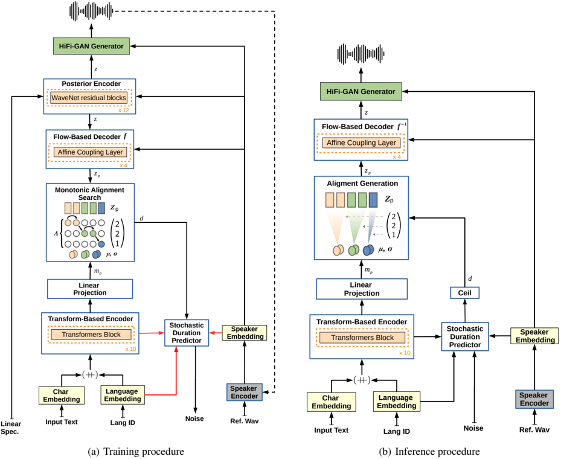

> [!abstract] ICML · 2022 · Conference
> **Edresson Casanova et al.** (Universidade de São Paulo / Coqui / Sopra Banking Software / Defined.ai / Federal University of Technology – Paraná / Mercado Livre) · [→ Paper](https://proceedings.mlr.press/v162/casanova22a.html) · [→ Preprint](https://arxiv.org/abs/2112.02418) · Demo: ✓ · Code: ✓
>
> Extends VITS with language embeddings and external speaker embeddings in every module so that one end-to-end model performs zero-shot multi-speaker TTS and zero-shot voice conversion across languages, including a language represented in training by a single speaker.

## Problem

Zero-shot multi-speaker TTS (synthesizing an unseen speaker's voice from a few seconds of reference audio) still left a similarity gap between seen and unseen speakers. Prior systems such as SC-GlowTTS and Attentron were trained and evaluated on VCTK only, with 109 speakers and little variety in recording conditions, so they generalized poorly to voices or channels unlike the training data. They also needed many training speakers per language, which rules out low-resource languages. Multilingual TTS and code-switching work existed, but no prior zero-shot multi-speaker system was trained multilingually (§1).

## Method

YourTTS keeps the VITS design ([[2106.06103|VITS]]): a conditional VAE whose posterior encoder (non-causal WaveNet residual blocks) maps a linear spectrogram to a latent z. A flow-based decoder of 4 affine coupling layers maps z to a prior aligned with the text encoder by Monotonic Alignment Search. A HiFi-GAN version 1 generator, with the VITS discriminator modifications, decodes z to waveform, and the whole stack trains end to end with a stochastic duration predictor (§2). The modifications are:

- **Raw characters, not phonemes.** The text encoder reads characters, so languages without a good open-source grapheme-to-phoneme converter can be used.
- **Language embeddings.** A 4-dimensional trainable language embedding is concatenated to every character embedding. The transformer text encoder grows to 10 blocks with 196 hidden channels.
- **Speaker conditioning everywhere.** External speaker embeddings from a pretrained H/ASP speaker encoder (trained on VoxCeleb 2) condition all coupling layers of the flow decoder and the posterior encoder through global conditioning. They are also summed with the text-encoder output before the duration predictor and with the decoder output before the vocoder.
- **Speaker Consistency Loss (SCL).** Adapted from cross-lingual speaker adaptation work, SCL maximizes the cosine similarity between speaker-encoder embeddings of generated and ground-truth audio, weighted by α = 9. It is applied in a 50k-step fine-tuning stage after each base run (§2, §3.3).

Because the text encoder receives no speaker information, its predicted distribution is pushed to be speaker independent. Zero-shot voice conversion therefore runs through the posterior encoder, the flow decoder (forward, then inverted with the target speaker's embedding) and the HiFi-GAN generator, with no text (§5).

Four training runs build on one another from a model initialized on LJSpeech (1M steps). System 1 uses VCTK (English). System 2 adds the single-speaker TTS-Portuguese Corpus (about 10 h, denoised with FullSubNet). System 3 adds the M-AILABS French set (5 speakers). System 4 continues from System 3 + SCL with 1,151 extra English speakers from LibriTTS. Batches are language-balanced through weighted sampling. All audio is 16 kHz (§3.2, §3.3). Model size is not reported.

## Key Results

Evaluation uses crowdsourced MOS and Sim-MOS (SMOS) with 95% confidence intervals, and SECS (speaker-encoder cosine similarity, from the Resemblyzer encoder), on unseen speakers only. English MOS used 276 raters and English Sim-MOS 200; Portuguese used 90 (§4).

**Zero-shot TTS (Table 1).**

| System | VCTK SECS | VCTK MOS | VCTK Sim-MOS | LibriTTS SECS | LibriTTS MOS | LibriTTS Sim-MOS | MLS-PT SECS | MLS-PT MOS | MLS-PT Sim-MOS |
|---|---|---|---|---|---|---|---|---|---|
| Ground truth | 0.824 | 4.26 | 4.19 | 0.931 | 4.22 | 4.22 | 0.9018 | 4.61 | 4.41 |
| Attentron ZS (reported) | 0.731 | 3.86 | 3.30 | - | - | - | - | - | - |
| SC-GlowTTS (reported) | 0.804 | 3.78 | 3.99 | - | - | - | - | - | - |
| Sys. 1 | 0.864 | 4.21 | 4.16 | 0.754 | 4.25 | 3.98 | - | - | - |
| Sys. 2 + SCL | 0.864 | 4.19 | 4.17 | 0.773 | 4.23 | 4.01 | 0.745 | 4.09 | 2.98 |
| Sys. 3 | 0.851 | 4.21 | 4.10 | 0.761 | 4.21 | 4.01 | 0.761 | 4.01 | 3.19 |
| Sys. 3 + SCL | 0.855 | 4.22 | 4.06 | 0.778 | 4.17 | 3.98 | 0.766 | 4.11 | 3.17 |
| Sys. 4 + SCL | 0.843 | 4.23 | 4.10 | 0.856 | 4.18 | 4.07 | 0.798 | 3.97 | 3.07 |

(Selected rows; all nine YourTTS rows are in Table 1. Baseline values are given in parentheses in the paper.)

- On VCTK, every YourTTS run beats the reported SC-GlowTTS and Attentron numbers on SECS, MOS and Sim-MOS. MOS (4.19 to 4.24 across runs) is close to ground truth (4.26). The baseline numbers are carried over rather than re-run, so the comparison depends on matching test conditions.
- SECS for every YourTTS run on VCTK exceeds the ground-truth SECS (0.824). The authors attribute this to VCTK breathing noise that the speaker encoder handles poorly (§4.1).
- On LibriTTS, adding about 1.2k speakers (System 4) gives the highest SECS (0.856, against 0.754 to 0.778 for the other runs) and the highest Sim-MOS (4.07). MOS is highest for the VCTK-only System 1 (4.25), which the authors attribute to VCTK's higher recording quality (§4.2).
- In Portuguese, where training saw one male speaker, the best Sim-MOS is 3.19 ± 0.10 (System 3) and the best MOS 4.11 ± 0.07 (System 3 + SCL); confidence intervals overlap across runs. For System 4, Sim-MOS is 3.29 for male test speakers and 2.84 for female ones (§4.3). Adding French raised Portuguese MOS and SECS relative to the bilingual run.

**Zero-shot voice conversion (Table 2).** With System 4, English-to-English conversion reaches MOS 4.20 ± 0.05 and Sim-MOS 4.07 ± 0.06. The paper compares this with AutoVC (MOS 3.54, Sim-MOS 1.91) and NoiseVC (MOS 3.38, Sim-MOS 3.05) as reported by Wang & Borth on 10 unseen VCTK speakers; YourTTS used 8 speakers, so the sets differ (§5.1). Portuguese-to-Portuguese reaches MOS 3.64 and Sim-MOS 3.43, with female-to-female similarity (3.35) below male-to-male (3.80). Cross-lingual en-pt reaches MOS 4.17 / Sim-MOS 3.59. The pt-en direction drops to MOS 3.40, with Portuguese-male-to-English-female at MOS 2.95 (§5.2).

**Speaker adaptation (Table 3).** Fine-tuning System 4 for 1,500 steps on 20 to 61 seconds of Common Voice speech raises similarity for all four speakers. For the Portuguese female speaker (20 s), Sim-MOS rises from 2.77 (zero-shot) to 4.43 and SECS from 0.743 to 0.930. MOS falls from 3.59 to 3.48. For the Portuguese male speaker (31 s), Sim-MOS rises from 3.35 to 4.19 while MOS falls from 4.03 to 3.74. With 61 s (English male), MOS rises from 4.11 to 4.17, matching ground truth (§6).

**SCL.** The proceedings report that SCL raised SECS in most comparisons with Sim-MOS differences inside the confidence intervals (§4.4). The arXiv v4 erratum (preprint only) states that the SCL gradient was never propagated. Every "+ SCL" row is therefore the same model trained 50k steps longer, and differences between paired rows cannot be credited to SCL.

## Novelty Assessment

The backbone, posterior encoder, flow decoder, vocoder, duration predictor and alignment search all come unchanged from VITS. The speaker-embedding approach to zero-shot cloning follows SC-GlowTTS and earlier Tacotron 2 work. The new elements are combining language embeddings with external speaker conditioning in every VITS module, and using raw characters for multilingual training. The paper presents itself as the first multilingual approach to zero-shot multi-speaker TTS, and shows zero-shot TTS and voice conversion in a target language represented by one training speaker. The SCL contribution does not survive the erratum, since the loss never affected training.

The evaluation is broad for its time: three test domains, crowdsourced MOS and Sim-MOS with hundreds of raters, cross-lingual VC, and few-shot adaptation. Its weak point is that all baseline numbers are copied from other papers, including a VC comparison on a different speaker subset. Each run also continues training from the previous one, so data and step count are confounded.

## Field Significance

> [!tip]
> High: YourTTS shows that one end-to-end VAE/GAN model can perform zero-shot TTS, zero-shot voice conversion and cross-lingual transfer to a language with a single training speaker. It provides open code and checkpoints for every experiment, making it a reproducible multilingual zero-shot baseline built on [[2106.06103|VITS]].

## Claims

- **supports:** Multilingual training can transfer zero-shot speaker cloning to a language whose training data contains only one speaker.
  > *Evidence:* Trained with a single male Portuguese speaker alongside multi-speaker English data, YourTTS reaches Portuguese zero-shot MOS up to 4.11 and Sim-MOS up to 3.19 on unseen MLS speakers, and Portuguese-to-Portuguese voice conversion at MOS 3.64 and Sim-MOS 3.43. *(§4.3, Table 1; §5.1, Table 2)*
- **complicates:** Zero-shot similarity drops for speaker groups that are missing from the target-language training data, even when the model can still generate them.
  > *Evidence:* With no female Portuguese training speaker, System 4 Sim-MOS is 3.29 for male and 2.84 for female Portuguese test speakers. Portuguese female-to-female VC Sim-MOS (3.35) trails male-to-male (3.80), and Portuguese-male-to-English-female VC drops to MOS 2.95. *(§4.3; §5.1, §5.2, Table 2)*
- **refines:** Adding many more training speakers improves zero-shot similarity on out-of-domain speakers, but can lower naturalness when the added data has lower recording quality.
  > *Evidence:* Adding 1,151 LibriTTS speakers raises LibriTTS SECS to 0.856 (others 0.754 to 0.778) and Sim-MOS to 4.07. The VCTK-only model keeps the highest LibriTTS MOS (4.25 against 4.18). *(§4.2, Table 1)*
- **supports:** Fine-tuning a multi-speaker model on under a minute of speech closes most of the similarity gap for voices poorly served by zero-shot cloning, at a naturalness cost when data is shorter.
  > *Evidence:* With 20 s of a Portuguese female speaker, Sim-MOS rises from 2.77 to 4.43 while MOS falls from 3.59 to 3.48. With 31 s of a male speaker, Sim-MOS rises from 3.35 to 4.19 while MOS falls from 4.03 to 3.74. With 61 s, MOS rises from 4.11 to 4.17. *(§6, Table 3)*
- **complicates:** Speaker-encoder cosine similarity can exceed ground truth and disagree with human similarity ratings, because models can copy recording characteristics of the reference.
  > *Evidence:* All YourTTS runs score higher SECS on VCTK (0.843 to 0.864) than ground truth (0.824). Fine-tuned models exceed ground-truth SECS (0.930 against 0.873 for the Portuguese female speaker). On MLS Portuguese, SECS and Sim-MOS pick different best systems. *(§4.1, §4.3, Table 1; §6, Table 3)*

## Limitations and Open Questions

The Speaker Consistency Loss results do not hold. The arXiv v4 erratum (not in the proceedings) reports that an implementation bug blocked the SCL gradient. Every "+ SCL" run is the base model trained 50k steps longer, so the paper's discussion of SCL effects in §4.4 measures extra training only. SCL's effect on this architecture is untested in this paper.

- Baseline comparisons (SC-GlowTTS, Attentron, AutoVC, NoiseVC) use numbers reported in other papers, not re-run systems. The VC comparison uses 8 VCTK speakers against the baselines' 10.
- Training runs are sequential continuations, so data composition, language count and training steps are confounded across Systems 1 to 4.
- The stochastic duration predictor sometimes produces unnatural durations, and character input causes mispronunciations, especially in Portuguese (§7).
- French was used in training but never evaluated, and subjective tests cover only English and Portuguese.
- The speaker adaptation study uses four speakers, one per language and gender.

## Wiki Connections

- [[zero-shot-tts|Zero-Shot TTS]] — Clones unseen speakers from one reference clip through external speaker embeddings, evaluated on VCTK, LibriTTS and MLS Portuguese with MOS, Sim-MOS and SECS.
- [[multilingual-tts|Multilingual TTS]] — Trains one model on English, Portuguese and French with language embeddings and evaluates zero-shot synthesis in English and Portuguese.
- [[voice-conversion|Voice Conversion]] — Performs text-free zero-shot and cross-lingual voice conversion through the VITS posterior encoder, flow and vocoder, with MOS and Sim-MOS per gender pair.
- [[speaker-adaptation|Speaker Adaptation]] — Fine-tunes on 20 to 61 seconds of Common Voice speech and measures the similarity gain and naturalness cost against zero-shot mode.
- [[gan-vocoder|GAN Vocoder]] — Uses a speaker-conditioned HiFi-GAN generator trained end to end inside the VAE, as in VITS.
- [[subjective-evaluation|Subjective Evaluation]] — Reports crowdsourced MOS and Sim-MOS with confidence intervals from up to 276 native raters, including bilingual raters for cross-lingual VC.
- [[2106.06103|VITS]] — The base model; YourTTS keeps its VAE, flow, alignment and duration components and adds language and speaker conditioning.
- [[2010.05646|HiFi-GAN]] — Supplies the version 1 generator used as the waveform decoder.
- [[1904.02882|LibriTTS]] — Provides the 1,151 extra training speakers for System 4 and the out-of-domain English test speakers.
- [[2012.03411|MLS]] — Supplies the Portuguese test speakers for zero-shot TTS and voice conversion.
- [[1912.06670|Common Voice]] — Provides the four speakers used in the speaker adaptation study.
- [[2406.04904|XTTS]] — Later Coqui system that compares against YourTTS and adapts its Speaker Consistency Loss.
- [[2409.09098|AccentBox]] — Conditions a pretrained YourTTS on accent embeddings in place of its language embeddings for zero-shot accent generation.
- [[2604.09111|PS-TTS]] — Trains a cross-lingual YourTTS on Korean and English as the TTS backbone for dubbing.
