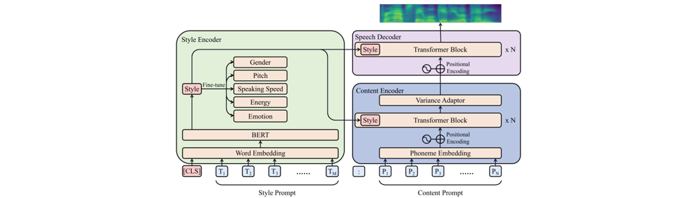

> [!abstract] arXiv · 2023 · Preprint
> **Guo et al.** (University of Science and Technology of China / Renmin University of China / Microsoft Azure Speech / Microsoft Research Asia) · [→ Paper](https://arxiv.org/abs/2211.12171) · [→ Peer-reviewed version](https://doi.org/10.1109/icassp49357.2023.10096285) · Demo: ✓ · Code: ?
>
> Frames TTS controlled by a free-form natural-language style description as a task, and supplies a first system (PromptTTS), a paired description-speech dataset (PromptSpeech) and an attribute-accuracy evaluation for it.

*A [peer-reviewed version](https://doi.org/10.1109/icassp49357.2023.10096285) appeared at ICASSP 2023. This page, including its metrics and claims, summarizes the arXiv preprint.*

## Problem

Controllable TTS before this paper exposed style through acoustic handles: word-level prosody tags, sentence-level speaking-rate values, pitch contours, explicit pitch values, or style tokens learned from a reference clip. Each handle asks the user either to know acoustic quantities or to find a reference recording with the wanted style. Text and image generation had moved to natural-language prompts (GPT-3, DALL-E 2), but no TTS system or dataset supported a prompt such as "A lady whispers to her friend slowly: everything will go fine, right?" (§1).

## Method

The input is one prompt with two parts separated by a colon: a style prompt (a natural-language description) and a content prompt (the text to speak) (§1, Table 1). PromptTTS has three modules (§2.1):

- **Style encoder.** A pre-trained 12-layer BERT (110M parameters) reads the style prompt with a prepended `[CLS]` token. The `[CLS]` hidden vector is the style representation. BERT is fine-tuned with P-tuning v2 on an auxiliary classification task that predicts the five style factors (gender, pitch, speaking speed, volume, emotion) from the style prompt, so that it attends to style keywords (§2.2, §4.1).
- **Content encoder.** The content prompt is converted to phonemes with a G2P tool and passed through 4 Transformer blocks. The style representation is prepended to the input of every Transformer block, not only added to the input embedding. A FastSpeech 2 variance adaptor (duration, pitch and energy predictors) sits on top, so these predictions are conditioned on style (§2.3, §4.1).
- **Speech decoder.** Transformer blocks with the same architecture as the content encoder take the concatenated style and content representations, again with the style vector prepended to each block, and output a mel-spectrogram. A pre-trained HiFi-GAN converts it to waveform (§2.4, §4.1). Hidden size is 256; total parameter count is not reported.

The acoustic model is therefore a non-autoregressive FastSpeech 2-style Transformer whose new element is a language-model text encoder for style descriptions feeding a per-block style vector.

**PromptSpeech dataset (§3).** The synthesized version uses speech from a commercial TTS API (Microsoft Azure) with five style factors: gender (2 classes), emotion (5 classes), and pitch, speed and volume, each binned into high/normal/low from signal-processing measurements. Experts wrote style prompts per category, and SimBERT paraphrasing augmented them. A real version applies the same process to LibriTTS speech, with four factors (no emotion). Splits: 155,092 / 5,032 (synthesized) and 26,588 / 1,305 (real) training/test samples (Table 2).

**Evaluation (§4.3).** Style control is scored as accuracy between the factor category requested in the prompt and the category measured on the output. Pitch, speed and volume use signal-processing tools; gender and emotion use trained classifiers whose accuracy on PromptSpeech is 99.97% / 98.80% (synthesized) and 98.26% gender (real) (Table 3).

**Baseline (§4.2).** A two-stage cascade: a BERT classifier (also P-tuning v2) predicts explicit style-factor values from the prompt, and those values become a style embedding for a FastSpeech 2-style synthesizer.

## Key Results

Style accuracy (Table 4). PromptTTS scores above the two-stage baseline on every factor in both versions:

| Version | System | Gender | Pitch | Speed | Volume | Emotion | Mean |
|---|---|---|---|---|---|---|---|
| Synthesized | Two-stage | 97.84 | 73.58 | 82.79 | 81.92 | 88.16 | 84.86 |
| Synthesized | PromptTTS | 99.57 | 82.60 | 86.55 | 87.35 | 91.78 | 89.57 |
| Real | Two-stage | 97.36 | 81.14 | 89.05 | 89.39 | - | 89.24 |
| Real | PromptTTS | 99.16 | 82.69 | 92.57 | 89.73 | - | 91.04 |

Averaged over the two versions, PromptTTS reaches 90.31% against 87.05% for the baseline (+3.25 points, §4.4.1). The margin is largest on the synthesized pitch factor (+9.02) and smallest on real volume (+0.34). Pitch remains the hardest factor for both systems (82.60% and 82.69%).

Cascade analysis (Table 6). Measured separately, the baseline's stage one (classifying factors from the prompt) has mean accuracy 90.46% (synthesized) and 92.74% (real), and its stage two (synthesis from ground-truth factors) 93.66% and 96.28%. Averaged over versions this gives 91.60% for stage one and 94.97% for stage two (the §4.4.3 prose lists the two averages in the opposite order). The authors attribute PromptTTS's advantage to avoiding error propagation across the two stages through a shared latent space; this explanation is not tested by a separate ablation.

Style-encoder ablation (Table 5). Without fine-tuning the BERT encoder, mean accuracy collapses to 46.84% (synthesized) and 51.95% (real); synthesized emotion falls to 15.94% and gender to 38.21%. P-tuning v2 and standard fine-tuning are close: P-tuning v2 has the higher mean in both versions (89.57 vs. 89.30; 91.04 vs. 90.43), but standard fine-tuning is higher on synthesized pitch (83.40 vs. 82.60), and real gender is tied at 99.16.

Speech quality (Table 7, MOS with 95% CI). PromptTTS scores 4.00 ± 0.08 against 3.95 ± 0.07 for the two-stage system on the synthesized version, and 3.80 ± 0.07 against 3.78 ± 0.08 on the real version. CMOS against the two-stage system is +0.057 and +0.025 (positive favours PromptTTS). The confidence intervals overlap, so quality is at parity rather than improved. The gap to GT mel + HiFiGAN resynthesis is 0.22 MOS on synthesized speech (4.22 vs. 4.00) and 0.60 on real speech (4.40 vs. 3.80). Rater count and listening-test protocol are not reported.

The comparison is fair in that both systems share the PromptSpeech data, the FastSpeech 2-style synthesizer family and the HiFi-GAN vocoder. The only baseline is one the authors built, since no prior system addressed the task.

## Novelty Assessment

The new element is the task formulation plus the conditioning path: a fine-tuned BERT embedding of a free-form style description, injected into every Transformer block of a FastSpeech 2-style encoder and decoder, so style control needs neither a reference clip nor explicit acoustic values. The synthesizer itself (phoneme encoder, variance adaptor, mel decoder, HiFi-GAN) is FastSpeech 2 essentially unchanged, and the prepend-to-every-block trick follows P-tuning v2. The dataset is a substantive contribution: PromptSpeech is the first released corpus pairing speech with style descriptions. It is built from commercial TTS output for the five-factor version, with expert-written templates and SimBERT paraphrases, so the prompts cover only a small categorical attribute space (at most 2 × 5 × 3 × 3 × 3 combinations). The style-accuracy metric is a practical proxy, but it reuses the same binning and classifiers as dataset construction and is not checked against human perception of prompt adherence.

## Field Significance

> [!tip]
> High — The paper opens natural-language-description-conditioned TTS as a task with a concrete system, a released paired dataset and a measurable attribute-accuracy protocol, so later instruction-conditioned systems have a reference point to compare against. Its control is limited to five coarse categorical attributes on mostly synthetic speech, so it demonstrates the interface more than open-vocabulary style generation.

## Claims

- **supports:** Natural-language style descriptions can steer several speech attributes (speaker gender, pitch, speaking rate, loudness and emotion) at the same time, without reference audio or explicit acoustic values.
  > *Evidence:* PromptTTS reaches mean style-factor accuracy of 89.57% on the five-factor synthesized PromptSpeech test set and 91.04% on the four-factor LibriTTS-derived test set, with gender above 99% in both. *(§4.4.1, Table 4)*
- **supports:** Conditioning synthesis directly on a learned embedding of the description beats a cascade that first predicts explicit attribute values and then synthesizes from them.
  > *Evidence:* The end-to-end model outperforms the two-stage cascade on every factor in both versions (mean +4.71 synthesized, +1.80 real). Each cascade stage alone falls short of perfect accuracy (stage means 90.46/93.66 synthesized, 92.74/96.28 real), so their errors compound. *(§4.4.1, §4.4.3, Tables 4 and 6)*
- **refines:** A general-purpose pre-trained text encoder does not reliably capture speech-style attributes from descriptions until it is adapted to attribute prediction; the adaptation method matters little once some fine-tuning is applied.
  > *Evidence:* Without fine-tuning, mean accuracy falls from 89.57% to 46.84% (synthesized) and from 91.04% to 51.95% (real); P-tuning v2 and standard fine-tuning differ by at most 0.61 points in mean accuracy. *(§4.4.2, Table 5)*
- **complicates:** Better adherence to style descriptions does not by itself raise perceived speech quality, and description-conditioned models trained on real multi-speaker speech remain well below resynthesized ground truth.
  > *Evidence:* MOS is 4.00 vs. 3.95 (synthesized) and 3.80 vs. 3.78 (real) against the cascade, with overlapping 95% intervals and CMOS of +0.057 and +0.025. The gap to GT mel + HiFiGAN is 0.22 MOS on synthesized and 0.60 on real speech. *(§4.4.4, Table 7)*

## Limitations and Open Questions

The main five-factor results rely on speech produced by a commercial TTS API, with three of the factors defined by binning signal-processing measurements into high/normal/low. The prompts come from expert templates expanded by paraphrasing. Control is therefore over a small closed set of categories, not open-ended descriptions, and only the four-factor real version uses natural recordings. Emotion is evaluated only on synthetic speech.

- The style-accuracy metric uses the same signal-processing binning and dataset-trained classifiers that define the labels. It shows consistency with the dataset's own categories, not human-judged adherence to the description.
- The MOS test reports confidence intervals but not the number of raters, their background or the test design.
- The only baseline is the authors' own cascade; no external controllable-TTS system (for example a reference-audio style-transfer model) is compared.
- Speaker identity is not controllable beyond gender, and the paper does not test descriptions of factors or phrasings outside the training templates; the authors list zero-shot control of unseen factors as future work (§5).
- Code availability is not stated; the dataset and audio samples are released.

## Wiki Connections

- [[instruction-conditioned-tts|Instruction-Conditioned TTS]] — Introduces TTS conditioned on a free-form natural-language style description, with a system, a paired dataset and an attribute-accuracy evaluation for the task.
- [[transformer-enc-dec-tts|Transformer Encoder-Decoder TTS]] — The acoustic model is a non-autoregressive FastSpeech 2-style Transformer encoder and decoder with a style vector prepended to every block.
- [[prosody-control|Prosody Control]] — Controls pitch, speaking speed and volume through the description and measures each with signal-processing-based accuracy.
- [[emotion-synthesis|Emotion Synthesis]] — Controls five emotion categories through the description on the synthesized PromptSpeech version, scored with an emotion classifier.
- [[subjective-evaluation|Subjective Evaluation]] — Reports MOS and CMOS listening scores against ground truth, vocoder resynthesis and the cascade baseline (rater details not reported).
- [[2006.04558|FastSpeech 2]] — Supplies the variance adaptor and Transformer encoder-decoder backbone that PromptTTS conditions on the style representation, and the style-embedding synthesizer used in the cascade baseline.
- [[1810.04805|BERT]] — The style encoder is a pre-trained BERT whose `[CLS]` vector, after fine-tuning, is the style representation.
- [[2010.05646|HiFi-GAN]] — The pre-trained vocoder for PromptTTS, the cascade baseline and the GT mel resynthesis condition.
- [[1904.02882|LibriTTS]] — Source of the natural speech in the real version of PromptSpeech.
- [[2310.00704|UniAudio]] — Lists PromptSpeech among its training data and its test set among its evaluation sets.
- [[2025.acl-long.911|DNASpeech]] — Builds its DNA-TTS baseline as an incremental extension of FastSpeech 2 and PromptTTS with a context encoder.
- [[2506.16381|InstructTTSEval]] — Evaluates PromptTTS among open-source systems on complex natural-language instruction following.
- [[interspeech-2025-0948|PromptEVC]] — Extends natural-language prompt control from TTS systems such as PromptTTS to emotional voice conversion.
