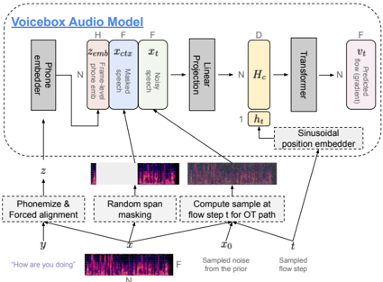

> [!abstract] NeurIPS · 2023 · Conference
> **Le et al.** (Meta FAIR) · [→ Paper](https://papers.nips.cc/paper_files/paper/2023/hash/2d8911db9ecedf866015091b28946e15-Abstract-Conference.html) · [→ Preprint](https://arxiv.org/abs/2306.15687) · Demo: ✓ · Code: ?
>
> Voicebox trains a single non-autoregressive flow-matching model on text-guided speech infilling over 50K to 60K hours of unfiltered audiobook speech, and shows that this one objective covers zero-shot TTS, cross-lingual voice transfer, transient noise removal, content editing and diverse sampling through in-context prompting alone.

## Problem

Before Voicebox, most speech generators were task-specific and trained on tens to hundreds of hours of curated audio such as VCTK. Style-controllable TTS relied on labels or low-dimensional speaker and style embeddings. These compress the conditional distribution of speech too much to render noisy, reverberant or highly varied audio. Text-guided infilling models (A3T, SpeechPainter) learned from context instead of labels, but used regression objectives that assume a deterministic mapping from text and context to audio, which holds only for short segments. VALL-E showed in-context zero-shot TTS at scale, but its autoregressive codec-token design can only condition on past context, needs one autoregressive pass plus seven non-autoregressive passes, and ties duration and audio modelling together.

## Method

Voicebox frames every task as **text-guided speech infilling**: given a transcript and an audio sample with a contiguous span masked out, generate the masked span. Style (voice, emotion, noise, channel) is inferred from the unmasked audio; content comes from the transcript. No speaker, emotion or noise labels are used.

The system has two parts, both non-autoregressive Transformers with convolutional positional embeddings and a symmetric bidirectional ALiBi attention bias:

- **Audio model** (24 layers, 16 heads, 1024/4096 dims, 330M parameters). It is a continuous normalizing flow trained with conditional flow matching on the optimal-transport path (Lipman et al.). Audio is an 80-dim log Mel spectrogram at 100 Hz. At each frame the model concatenates the noisy sample `x_t`, the masked context `x_ctx` and an embedding of the frame-level phone label, projects the result, and appends a sinusoidal flow-step embedding as an extra token. It regresses the vector field. The loss is computed only on masked frames, a choice the ablation supports (Appendix B.3).
- **Duration model** (8 or 10 layers, 28M/34M parameters). It predicts per-phone durations for masked phones from the durations of context phones and the phone sequence. The authors test a flow-matching variant and an L1-regression variant; regression is the default. This resembles the FastSpeech 2 duration predictor but adds duration context.

Frame-level phone transcripts come from Montreal Forced Aligner alignments. Two additions help: "ghost silences" (zero-length silence tokens between words, so the duration model decides where pauses go) and word-position-dependent phone suffixes, so word boundaries survive when no silence separates words. During training, the whole audio (or duration) sequence is masked with probability 0.3 (0.2); otherwise a random contiguous span covering 70-100% (10-100%) of the sequence is masked.

At inference an ODE solver (midpoint, step 0.0625, NFE = 32 by default) integrates the learned vector field from Gaussian noise. The paper extends classifier-free guidance to flow matching: the conditioner (phones plus audio context) is dropped with probability 0.2 during training, and at inference conditional and unconditional vector fields are mixed with strength α. A 13M-parameter HiFi-GAN V1 variant, retrained on the 60K-hour English data at 16 kHz, converts Mel frames to waveform.

Tasks are posed by building the context differently. Zero-shot TTS treats the reference clip and target as one utterance with the target masked. Content editing re-samples durations and audio only for new phones. Transient noise removal regenerates the corrupted span from the original transcript. Diverse sampling masks the whole utterance. Alignment-preserved style transfer keeps the target's frame-level phones and takes style from a prompt. Two models are trained: VB-En on 60K hours of ASR-transcribed English audiobooks, and VB-Multi on 50K hours of audiobooks in six languages, of which English is over 90% (Appendix B.2).

The paper also proposes reproducible model-based metrics. These are WER from public ASR (HuBERT-L for English, Whisper large-v2 for multilingual) and speaker similarity against the original prompt (SIM-o) rather than its vocoder resynthesis (SIM-r). The third is Fréchet Speech Distance (FSD), a Fréchet distance on layer-6 wav2vec 2.0 features. QMOS and SMOS listening tests are supplementary.

## Key Results

**English zero-shot TTS** (filtered LibriSpeech test-clean, 3 s prompt, Table 2). In the cross-sentence setting VB-En reaches WER 1.9% versus 5.9% for VALL-E and 7.7% for YourTTS, and SIM-r 0.681 versus 0.580 for VALL-E. Its SIM-o is 0.662 against 0.337 for YourTTS; VALL-E's SIM-o is not reported in this setting. Human ratings favour VB-En over YourTTS (QMOS 3.78 vs 3.27, SMOS 3.71 vs 3.19); VALL-E was not in the listening test. In the continuation setting VB-En (α = 0.7) reaches WER 2.0% versus 3.8% for VALL-E and SIM-o 0.593 versus 0.452. VB-En outperforms every baseline on every reported metric in both settings. VALL-E numbers come from its paper or personal communication, not from a reproduction on the same samples. VB-En's WER (1.9%) is below the ground-truth recordings' WER (2.2%), so WER here mainly confirms intelligibility and does not separate near-ceiling systems.

**Cross-lingual zero-shot TTS** (filtered MLS, 36 prompt-target language pairs, Table 4). Averaged over prompt languages, VB-Multi beats YourTTS on the three target languages YourTTS supports. English WER is 4.4% vs 7.5%, French 5.5% vs 11.4% and Portuguese 5.7% vs 13.9%. SIM-o is 0.492 vs 0.356, 0.491 vs 0.350 and 0.459 vs 0.299. VB-Multi also beats YourTTS on WER and SIM-o in every matched prompt-language row of those columns. VB-Multi never saw a speaker produce more than one language within an utterance during training. Prompts in English give the highest WER in every non-English target column (for example 8.3% for Polish targets vs 4.0% with a Polish prompt). Appendix B.2 shows this English-to-other degradation grows with prompt length. The authors attribute it to English dominating the training mix.

**Transient noise removal** (noise over 50% of the utterance at −10 dB SNR, Table 3). VB-En reaches WER 2.0%, SIM-o 0.612 and QMOS 3.87, against 11.5% / 0.148 / 3.10 for A3T and 32.5% / 0.368 / 2.86 for Demucs. A3T and Voicebox know the transcript and noise location; Demucs does not. Appendix Table B6 shows the similarity gain over Demucs holds at −10 dB but is roughly a tie at 10 dB SNR.

**Diverse sampling and synthetic ASR data** (Tables 5 and 6). On LibriSpeech test-other text, VB-En reaches FSD 155.7 (regression durations) and 159.8 (flow-matching durations). The closest baseline, YourTTS, scores 277.9. Both VB-En scores sit below the ground-truth set's 171.1. An RNN-T ASR model trained only on 281K Voicebox utterances (flow-matching durations) reaches 3.1% / 8.3% WER on real test-clean / test-other without an LM. A model trained on real 960 h data reaches 2.6% / 6.3%, and the best baseline-synthesised data (YourTTS) gives 25.0% / 54.6%. Regression durations give more regular speech that ASR recognises more easily (lower WER in Table 5). The same regularity makes them worse ASR training data (7.1% / 17.6%).

**Efficiency and objective ablations.** At NFE = 2 without guidance, Voicebox generates 10 s of audio in about 0.31 s, about 20 times faster than the authors' re-implementation of VALL-E. At NFE = 64 it is 4% slower (Figure 3a). Cross-sentence WER stays near 2.0 across all NFE and guidance settings (§5.4). In a reduced 1K-hour setup (Tables 7 and 8), flow matching with the OT path reaches WER 2.5% / SIM-o 0.424 after 50K updates. Score matching with a diffusion path reaches only 5.1% / 0.349 after 150K updates. At NFE = 8 the OT path gives 2.2% / 0.481 against 3.0% / 0.359 for flow matching with a diffusion path and 42.3% / 0.076 for score matching. Against a regression objective, flow matching keeps similar WER (2.1% vs 2.0%) but raises SIM-r from 0.520 to 0.597 and lowers FSD from 278.8 to 242.5 (Table B3, masked loss for both).

## Novelty Assessment

The core contribution is architectural and objective-level. Voicebox uses conditional flow matching with an OT path to train a large, general-purpose, text-conditioned speech generator, and recasts many speech tasks as one infilling problem solved by in-context prompting. The individual parts come from earlier work: flow matching from Lipman et al., the duration model from FastSpeech 2, the HiFi-GAN vocoder, forced-alignment phone inputs, and classifier-free guidance from diffusion. Infilling as a training task also has precedents (A3T, SpeechPainter). What is new is the combination: a stochastic flow-matching infiller over arbitrary span lengths, trained label-free on in-the-wild audiobook scale, with guidance adapted to vector fields. Controlled ablations back the key choices: OT path against diffusion paths, flow matching against regression, masked against full loss.

The evaluation is strong on breadth but uneven on comparability. VALL-E's numbers are borrowed or re-implemented rather than produced on shared samples. YourTTS and A3T were trained on much smaller data, so part of the gap reflects data scale, and Appendix B.4 confirms large scale effects. The FSD and SIM-o proposals are useful methodological contributions. FSD is validated on controlled speaker-diversity and SNR manipulations, not against human judgments. Training data, model weights and code are not reported as released, which limits reproducibility.

## Field Significance

> [!important]
> Foundational: Voicebox demonstrates that a single non-autoregressive flow-matching model, trained only on text-guided infilling, can exceed autoregressive codec-LM zero-shot TTS in intelligibility and speaker similarity while sampling up to 20 times faster at low step counts. It also shows the same model handling editing, denoising and cross-lingual transfer. It provides a reference recipe (OT-path conditional flow matching, masked infilling over Mel frames, classifier-free guidance for vector fields) and a metric set (ASR WER, SIM-o, FSD) for comparing generative speech models.

## Claims

- **supports:** Conditional flow matching with an optimal-transport path trains faster and samples in fewer steps than diffusion-path or score-matching objectives for speech generation.
  > *Evidence:* In a controlled 1K-hour ablation, the OT-path model reaches WER 2.5% / SIM-o 0.424 after 50K updates. Score matching with a diffusion path reaches only 5.1% / 0.349 after 150K updates. At NFE = 8 the OT path gives 2.2% / 0.481 against 3.0% / 0.359 for a flow-matching diffusion path and 42.3% / 0.076 for score matching. *(§5.5, Tables 7 and 8; §B.5)*
- **supports:** Training a single generative model on text-guided speech infilling at large data scale lets one model perform zero-shot TTS, editing, denoising and diverse sampling through in-context prompting, without task-specific training or style labels.
  > *Evidence:* The same VB-En model beats task-specific baselines: on zero-shot TTS, WER 1.9% vs 5.9% for VALL-E; on transient noise removal, WER 2.0% vs 11.5% for A3T and 32.5% for Demucs; on diverse sampling, FSD 155.7 vs 277.9 for YourTTS. *(§5.1-5.3, Tables 2, 3, 5)*
- **refines:** Stochastic generative objectives, rather than regression, are what let infilling models reproduce speaker similarity and output diversity; intelligibility alone does not separate the two.
  > *Evidence:* With identical architecture and data, flow matching and regression give similar WER (2.1% vs 2.0%). Flow matching raises SIM-r from 0.520 to 0.597 and lowers FSD from 278.8 to 242.5; masking the loss to infilled frames adds further similarity gains. *(§B.3, Table B3)*
- **complicates:** Speech that is easier for ASR to transcribe is not necessarily better speech or better training data; ASR-based WER can reward overly regular prosody.
  > *Evidence:* The regression duration model yields lower WER on generated speech than the flow-matching duration model (3.1% vs 5.6%, Table 5). Yet ASR trained on its output performs far worse on real speech (7.1% / 17.6% vs 3.1% / 8.3% on test-clean / test-other without an LM, Table 6). VB-En's zero-shot WER also falls below the ground-truth recordings' WER (1.9% vs 2.2%). *(§5.1, §5.3, Tables 2, 5, 6)*
- **complicates:** Cross-lingual zero-shot TTS trained on language-imbalanced data degrades intelligibility when the prompt is in the dominant language, and longer prompts make it worse.
  > *Evidence:* With English making up over 90% of VB-Multi's training data, English prompts give the highest WER in every non-English target column (e.g. 8.3% vs 4.0% for Polish targets). Appendix B.2 shows WER rising with prompt length mostly for English-to-other directions, while speaker similarity keeps improving. *(§5.1, Table 4; §B.2, Figures B3 and B4)*

## Limitations and Open Questions

The training data is read audiobook speech only (60K English hours; 50K multilingual hours dominated by English). Transfer to conversational speech with laughter, backchannels and disfluencies is untested, and the paper names it as a likely weakness (§D). The model depends on a phonemizer and forced aligner for frame-level phone transcripts. Word-based phonemizers miss context-dependent pronunciation such as French liaison, and this caps language coverage. The model also cannot take different attributes from different references (for example emotion from one clip and voice from another) (§6).

Comparisons to VALL-E use reported numbers, personal communication and a re-implementation for timing rather than shared samples, and VALL-E is absent from the listening tests. MOS studies include only YourTTS and ground truth in the zero-shot setting. FSD is validated on controlled diversity and noise manipulations rather than against human ratings. Training data, weights and code are not reported as released. Appendix B.1 shows a classifier separates Voicebox output from original audio with accuracy 1.000, but mostly through vocoder artefacts. Against vocoder-resynthesised audio, accuracy falls to 0.907 with 90% of phones infilled and 0.704 with 30% (Table B2).

## Wiki Connections

- [[flow-matching|Flow Matching]] — Voicebox applies OT-path conditional flow matching to large-scale text-conditioned speech generation and ablates it against diffusion paths and score matching.
- [[zero-shot-tts|Zero-Shot TTS]] — Evaluates prompt-based cloning of unseen LibriSpeech test-clean speakers in cross-sentence and continuation settings, outperforming VALL-E and YourTTS.
- [[multilingual-tts|Multilingual TTS]] — VB-Multi is trained on six languages and evaluated across all 36 prompt-target language pairs on MLS.
- [[subjective-evaluation|Subjective Evaluation]] — Reports QMOS and SMOS listening tests for zero-shot TTS and noise removal alongside its proposed model-based metrics.
- [[2301.02111|VALL-E]] — The main zero-shot TTS baseline; Voicebox contrasts bidirectional non-autoregressive flow matching with VALL-E's autoregressive codec-token generation and reports lower WER, higher similarity and faster low-NFE sampling.
- [[2112.02418|YourTTS]] — Baseline for English and cross-lingual zero-shot TTS and for diverse sampling, outperformed on every matched comparison.
- [[2210.02747|Flow Matching for Generative Modeling]] — Supplies the conditional flow-matching objective and the OT path that Voicebox adopts for speech.
- [[2207.12598|Classifier-Free Diffusion Guidance]] — Voicebox extends classifier-free guidance from diffusion scores to flow-matching vector fields.
- [[2010.05646|HiFi-GAN]] — An adapted HiFi-GAN V1 retrained on the 60K-hour English data is the Mel-to-waveform vocoder.
- [[2312.15821|Audiobox]] — A later Meta system that extends the Voicebox infilling recipe from Mel frames to EnCodec dense latents and reports higher similarity than Voicebox.
- [[2406.18009|E2 TTS]] — Takes Voicebox's Transformer backbone and flow-matching objective and replaces frame-aligned phone input with characters plus filler tokens, removing the forced aligner.
- [[2025.acl-long.313|F5-TTS]] — Continues the aligner-free E2/Voicebox flow-matching line with a DiT backbone and Sway Sampling.
