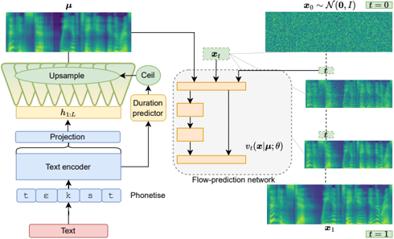
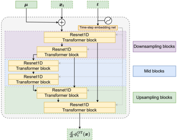

> [!abstract] arXiv · 2024 · Preprint
> **Shivam Mehta et al.** (KTH Royal Institute of Technology) · [→ Paper](https://arxiv.org/abs/2309.03199) · [→ Peer-reviewed version](https://doi.org/10.1109/icassp48485.2024.10448291) · Demo: ✓ · Code: ✓
>
> Matcha-TTS trains a small non-autoregressive mel-spectrogram acoustic model with optimal-transport conditional flow matching (OT-CFM) and a 1D convolution-plus-Transformer U-Net decoder. On LJ Speech it reaches the highest MOS of the TTS systems tested at 10 ODE solver steps and the lowest WER at 2 to 10 steps, while using less training memory than Grad-TTS, FastSpeech 2 and VITS.

*A [peer-reviewed version](https://doi.org/10.1109/icassp48485.2024.10448291) appeared at ICASSP 2024. This page, including its metrics and claims, summarizes the arXiv preprint.*

## Problem

Diffusion probabilistic models (DPMs) such as [[2105.06337|Grad-TTS]] give high-quality probabilistic acoustic models, but sampling requires many sequential network evaluations to solve the underlying SDE/ODE, so synthesis is slow. Earlier attempts to speed them up mostly relied on distillation. Grad-TTS also uses a 2D convolutional U-Net decoder, which treats mel spectrograms as images, assumes translation invariance along the frequency axis, and needs more memory. Encoders in Glow-TTS, VITS and Grad-TTS use relative position embeddings, which the authors argue treat inputs outside a short window as a bag of words. The only prior public CFM acoustic model, [[2306.15687|Voicebox]], is large (330M parameters), trained on 60k hours of proprietary data, uses external alignments, and has no public code or checkpoints.

## Method

Matcha-TTS keeps the Grad-TTS text encoder and duration predictor design (same hyperparameters) but replaces relative position embeddings with rotary position embeddings (RoPE). Alignment is learned jointly with synthesis via monotonic alignment search (MAS) and the Grad-TTS prior loss; a deterministic duration predictor is trained with log-domain MSE. Predicted durations are rounded up and used to upsample encoder outputs into µ, a frame-level estimate of the mean acoustic features. Inputs are IPA phones from Phonemizer with the espeak-ng backend.

The decoder is a flow-prediction network trained with OT-CFM, following [[2210.02747|Flow Matching for Generative Modeling]]. Each training mel frame x1 is paired with a Gaussian sample x0, and the network regresses the constant vector field x1 − (1 − σmin)x0 along the straight path between them (σmin = 1e-4). µ conditions the vector-field network but, unlike Grad-TTS, is not used as the mean of the starting noise. At inference a first-order Euler solver integrates the learned ODE from noise to mel spectrogram, so the number of steps equals the number of function evaluations (NFE); a sampling temperature of 0.667 is used. A pre-trained HiFi-GAN (LJ_V1) vocoder converts mel spectrograms to waveforms.

The decoder is a 1D U-Net inspired by the Stable Diffusion image U-Net: 1D convolutional residual blocks downsample and upsample the input, each followed by a Transformer block whose feedforward layers use snake beta activations (from BigVGAN). The trained configuration uses two downsampling, two mid and two upsampling blocks, each with one Transformer layer (hidden size 256, 2 heads, attention dimension 64). The decoder Transformers use no position embeddings, relying on the encoder's phone-level positional information and on the convolutions to localise frames within a phone. The flow-matching time step is embedded as in Grad-TTS. The full acoustic model has 18.2M parameters and was trained on LJ Speech for 500k updates on 2 GPUs (batch size 32, learning rate 1e-4).

## Key Results

All systems are evaluated on the LJ Speech single-speaker test split. Baselines are official pre-trained checkpoints of Grad-TTS, VITS and FastSpeech 2 (the FairSeq checkpoint, since there is no official FastSpeech 2 release). The acoustic models all share the same HiFi-GAN vocoder. An ablation, GCFM, trains the Grad-TTS architecture with the OT-CFM objective to separate the effect of the training objective from that of the new architecture. *(§4.1)*

**Naturalness and intelligibility (Table 1).** The MOS test used 80 crowdsourced native English listeners and 800 ratings per condition. MAT-10 scores the highest MOS of any TTS condition (3.84), ahead of VITS (3.71), GCFM-4 (3.57), GRAD-10 (3.49), FastSpeech 2 (3.29) and GRAD-4 (3.20); vocoded natural speech scores 4.13. MAT-10 vs. VITS is significant, but MAT-4 (3.77) and MAT-2 (3.65) are not significantly different from VITS, and MAT-10 vs. MAT-4 is not significant. MAT has the lowest Whisper-medium WER of the TTS conditions at every step count tested (2.09 / 2.15 / 2.34 % for 10 / 4 / 2 steps, vs. 2.52 % for VITS, 2.70 % for GCFM-4, 3.44 % for GRAD-10 and 4.18 % for FastSpeech 2). *(§4.2, Table 1)*

**Objective vs. architecture.** At 4 steps, the OT-CFM objective alone raises Grad-TTS from 3.20 to 3.57 MOS (GRAD-4 → GCFM-4) and lowers WER from 3.69 to 2.70 %; the new architecture adds a further gain to 3.77 MOS and 2.15 % WER (GCFM-4 → MAT-4). All three pairwise MOS differences are significant. GRAD-10 is much better than GRAD-4, whereas MAT-10 and MAT-4 are statistically tied, so MAT reaches its quality with fewer steps. *(§4.2, Table 1)*

**Speed and memory.** MAT needs 4.8 GiB of GPU RAM to train at batch size 32 (fp16), the lowest of all systems (FastSpeech 2 6.0, Grad-TTS 7.8, VITS 12.4). Its 18.2M parameters are slightly more than Grad-TTS (14.8M) but fewer than FastSpeech 2 (41.2M) and VITS (36.3M). Test-set RTF including vocoding is 0.015 for MAT-2 and 0.019 for MAT-4, the same as GRAD-4 and GCFM-4 at 4 steps. That is much faster than VITS (0.074) but slower than FastSpeech 2 (0.010), which is the fastest TTS system (the 0.001 vocoded-speech top line excludes acoustic modelling). On 180 GPT-2-generated sentences of varying length, MAT-2 synthesis time becomes competitive with FastSpeech 2 on long utterances, while GRAD-4 and GCFM-4 are much slower, and the gap to Grad-TTS grows with length. The authors attribute this mainly to the new decoder architecture. *(§4.2, Table 1, Figure 3)*

The comparisons are reasonably fair: baselines use their own official or public checkpoints, the vocoder is shared, and the CFM ablation is retrained with MAT's optimiser settings. The authors caution that their MOS values should not be compared with MOS values in other papers.

## Novelty Assessment

The contribution is architectural and has two parts. First, it applies OT-CFM as the training objective of a compact acoustic model that learns its own alignments. Flow matching itself comes from Lipman et al., and Voicebox had already used CFM for speech at large scale, so the novelty lies in the pure-TTS, small-data, alignment-free setting and in a public implementation. Second, the 1D U-Net decoder with Transformer blocks and snake beta activations, plus RoPE in the encoder (which the authors believe is a first for SDE/ODE-based TTS), are new design choices. The rest of the pipeline (MAS alignment, prior loss, duration predictor, HiFi-GAN vocoder) is inherited from Grad-TTS and Glow-TTS. The GCFM ablation is the paper's strongest evidence because it separates the gains from the objective and from the architecture. The main weakness is scope: one single-speaker dataset (LJ Speech), a 2 to 10 step range, and no comparison with other few-step methods such as distilled or consistency-based diffusion TTS.

## Field Significance

> [!tip]
> High: demonstrates, with an ablation that separates objective from architecture, that OT-CFM training lets a small acoustic model reach diffusion-level or better naturalness in 2 to 10 Euler steps without external alignments or large data. With public code and checkpoints, it provides a lightweight, reproducible flow-matching TTS backbone and decoder design that other systems can reuse.

## Claims

- **supports:** Flow-matching training with optimal-transport paths lets an ODE-based acoustic model reach high naturalness with far fewer solver steps than score-matching diffusion.
  > *Evidence:* Retraining the Grad-TTS architecture with OT-CFM raises 4-step MOS from 3.20 to 3.57 and lowers WER from 3.69 % to 2.70 % (GRAD-4 vs. GCFM-4); MAT-10 and MAT-4 are statistically tied (3.84 vs. 3.77) while GRAD-10 clearly beats GRAD-4. *(§4.2, Table 1)*
- **supports:** Decoder architecture is a separate lever from the generative objective for both quality and long-utterance synthesis speed in iterative TTS.
  > *Evidence:* With the same OT-CFM objective and 4 steps, the 1D convolution-plus-Transformer U-Net decoder (MAT-4) beats the Grad-TTS 2D U-Net (GCFM-4) on MOS (3.77 vs. 3.57, significant) and WER (2.15 % vs. 2.70 %), and in Figure 3 its synthesis time scales much better with utterance length than GCFM-4 or GRAD-4. *(§4.2, Table 1, Figure 3)*
- **refines:** Treating mel spectrograms as 1D sequences rather than 2D images reduces the memory cost of probabilistic acoustic models without hurting quality.
  > *Evidence:* MAT needs 4.8 GiB of GPU RAM for training at batch size 32, against 7.8 GiB for the similarly sized 2D-U-Net Grad-TTS (14.8M vs. 18.2M parameters) and 12.4 GiB for VITS, while scoring higher MOS. *(§2.1, §4.2, Table 1)*
- **complicates:** Few-step probabilistic acoustic models narrow but do not close the speed gap with deterministic non-autoregressive models on short inputs.
  > *Evidence:* Test-set RTF is 0.015 for MAT-2 and 0.019 for MAT-4 against 0.010 for FastSpeech 2; MAT-2 only becomes competitive with FastSpeech 2 on longer utterances. *(§4.2, Table 1, Figure 3)*

## Limitations and Open Questions

All experiments use one single-speaker English dataset (LJ Speech), so the paper does not show whether the speed and quality gains carry over to multi-speaker, multilingual, zero-shot or spontaneous speech. The authors list multi-speaker modelling and diverse data such as spontaneous speech as future work. *(§5)*

- Duration modelling stays deterministic (log-MSE regression on MAS alignments), so only the frame-level acoustics are probabilistic; probabilistic duration modelling is left to future work. *(§3.2, §5)*
- The model still depends on a separately trained HiFi-GAN vocoder (13.9M parameters), and RTF figures include vocoding time.
- Only a first-order Euler solver with NFE ≤ 10 is tested; higher-order solvers and larger step counts are not compared.
- There is no comparison with other few-step methods for diffusion TTS (distillation, consistency models such as CoMoSpeech, rectified flows), which the paper discusses but does not evaluate.
- Single-step results (NFE = 1) are not reported, so the lower limit of the step count is not established.
- MOS differences between MAT-2/MAT-4 and VITS are not statistically significant, so the naturalness advantage over VITS holds only at 10 steps.

## Wiki Connections

- [[flow-matching|Flow Matching]] — trains a mel-spectrogram TTS decoder with OT-CFM and isolates the objective's contribution with a retrained Grad-TTS ablation.
- [[transformer-enc-dec-tts|Transformer Encoder-Decoder TTS]] — proposes a non-autoregressive encoder-decoder with a RoPE Transformer encoder and a 1D convolution-plus-Transformer U-Net decoder.
- [[subjective-evaluation|Subjective Evaluation]] — runs a crowdsourced MOS test (80 native English listeners, 800 ratings per condition) with pairwise t-tests, and cautions against comparing MOS across papers.
- [[2105.06337|Grad-TTS]] — the main baseline and the source of the encoder, duration predictor, MAS prior loss and time-step embedding; Matcha-TTS replaces its score-matching objective and 2D U-Net decoder.
- [[2210.02747|Flow Matching for Generative Modeling]] — supplies the OT-CFM objective and notation that Matcha-TTS uses to train its decoder.
- [[2306.15687|Voicebox]] — the only earlier public CFM speech model, which the paper contrasts as 18 times larger, trained on proprietary data and dependent on external alignments.
- [[2106.06103|VITS]] — a baseline that MAT-10 beats significantly on MOS, while MAT-2 and MAT-4 are statistically tied with it.
- [[2006.04558|FastSpeech 2]] — the fastest baseline by RTF; MAT matches its speed only on longer utterances but scores clearly higher MOS and lower WER.
- [[interspeech-2025-0554|RapFlow-TTS]] — a later corpus paper that trains a Matcha-TTS backbone with velocity-consistency constraints to reach 2-step synthesis.
- [[neurips-2025-SoRe80Tg48|Shallow Flow Matching]] — a later corpus paper that validates its coarse-to-fine flow-matching method on several backbones, including Matcha-TTS.
- [[2605.26812|CFMDCTCodec]] — a later corpus codec that adapts the Matcha-TTS 1D U-Net as its velocity estimator.
