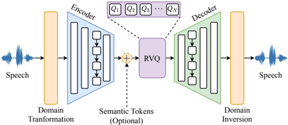

> [!abstract] arXiv · 2024 · Preprint
> **Du et al.** (Alibaba Group (DAMO Academy)) · [→ Paper](https://arxiv.org/abs/2309.07405) · [→ Peer-reviewed version](https://doi.org/10.1109/icassp48485.2024.10447523) · Demo: ✓ · Code: ✓
>
> An open-source neural speech codec toolkit with single-stage training recipes for SoundStream- and Encodec-style models, released academic and general-purpose checkpoints, and two in-toolkit extensions: frequency-domain codecs (FreqCodec) and semantic-token-augmented residual vector quantization.

*A [peer-reviewed version](https://doi.org/10.1109/icassp48485.2024.10447523) appeared at ICASSP 2024. This page, including its metrics and claims, summarizes the arXiv preprint.*

## Problem

Neural speech codecs had become a source of discrete tokens for generative speech models (codec language models for TTS, speech-text models that listen and speak), but the open-source codec toolkits available at the time were built for telecommunication-style compression. The authors compare four of them (Encodec, EnCodec Trainer, Descript's audio codec and AudioDec) and find few released models, missing or multi-stage training recipes, at most three discriminator types, and no support for low frame rates, frequency-domain modelling or semantic augmentation (Table 1). The paper targets a reproducible, trainable toolkit that plugs into downstream speech-text work, specifically the FunASR ecosystem.

## Method

FunCodec is a PyTorch model library plus Kaldi-style all-in-one recipes for training from scratch, fine-tuning and batched GPU inference, with seven released checkpoints on Hugging Face and ModelScope (§3, Table 1). Every model follows the same pipeline: a domain transformation, an encoder, a residual vector quantizer (RVQ), a mirrored decoder, and a domain inversion back to waveform (§3.1).

For time-domain models the transformation is the identity and the encoder/decoder are the SEANet networks of SoundStream and Encodec. The frequency-domain variant, FreqCodec, applies an STFT (window 512, shift 160 at 16 kHz) and represents each frame either as log magnitude plus phase angle or as log magnitude plus the real and imaginary parts normalized by magnitude ("normalized phase"). Its encoder is a stack of 2D convolution blocks that downsample time by a per-block stride and frequency by 4, followed by an LSTM and a linear projection; depthwise and grouped convolutions are used to cut parameters and FLOPs (§3.1, Table 2).

The RVQ initializes each codebook by k-means over the first mini-batch, updates codes by exponential moving average (decay 0.99), and reassigns codes used fewer than twice per batch. Structured quantizer dropout lets one model run at several bitrates. As an optional extension, semantic tokens (frame-aligned phoneme labels in the experiments; HuBERT embeddings are named as an alternative) are combined with the encoder output in one of three ways: concatenated after quantization, added after quantization, or subtracted before quantization and added back afterwards ("residual"), so the RVQ codes only the acoustic remainder (§3.2).

Training combines a time-domain L1 loss, L1 plus L2 losses on multi-resolution Mel and log-compressed power spectra (window sizes 2^5 to 2^11), hinge adversarial and feature-matching losses from any combination of multi-scale, multi-period and multi-scale STFT discriminators, and a commitment loss over the whole RVQ and each sub-quantizer (§3.3). Loss weights are fixed (1.0, 1.0, 1/9, 100/9, 1.0), the discriminator is updated only when its loss exceeds the codec's, and training runs 300,000 codec updates on 3.2 s RMS-normalized segments (§4.2). The authors single out the log-compressed power spectrum loss as an addition that improves mid- and high-frequency quality. Low-frame-rate variants FunCodec-2x and FunCodec-4x double and quadruple the encoder stride (640 and 1280 samples instead of 320). The academic models train on LibriTTS. The general-purpose models train on an in-house corpus of 27.68 million English and Mandarin utterances (about 25,000 hours), all at 16 kHz (§4.1).

## Key Results

Quality is measured with ViSQOL (1 to 5) at a fixed token rate (TKR, tokens per second of 16 kHz speech); no human listening test is reported.

**Reproduction and low-frame-rate models (Table 3, LibriTTS).** At equal stride 320, FunCodec scores 4.29 / 4.12 / 3.86 / 3.43 at 400 / 200 / 100 / 50 TKR, above the authors' own reproductions of non-causal SoundStream (4.28 / 4.06 / 3.76 / 3.31) and Encodec (4.24 / 4.05 / 3.73 / 3.30); the paper attributes the gap to the added power-spectrum loss. FunCodec-2x gives the highest score at 200, 100 and 50 TKR (4.16, 3.94, 3.64). FunCodec-4x is highest only at 400 TKR (4.31) and the lowest of all rows at 200, 100 and 50 TKR (3.94, 3.43, 2.91). The 2x setting was therefore chosen for the general-purpose models. All baselines here are in-toolkit re-implementations, not the official released checkpoints.

**General-purpose models against released codecs (Figure 3).** On LibriSpeech, AISHELL-1/2, WenetSpeech and GigaSpeech test sets, at token rates normalized to 100 and 200 tokens per 16 kHz second, the authors report that FunCodec scores above Encodec, Descript's codec and two AudioDec models for both English and Mandarin. The results are bar charts with no numbers in the text. Every model scores poorly on WenetSpeech, which the authors attribute to noisy recording conditions. The released baselines differ in training data and native sampling rate, so this comparison is not controlled.

**Frequency vs. time domain (Table 4, LibriTTS).** At 400 TKR the magnitude plus normalized-phase FreqCodec (M3) scores 4.36, the highest in the table, against 4.29 for the time-domain model (M1), and magnitude plus angle (M2) scores 4.32. At 100 TKR the time-domain M1 is highest (3.86), with M3 at 3.85, so the frequency-domain advantage holds only at the higher token rate. Grouped convolutions shrink the model sharply: M7 has 0.83M parameters and 1.03G FLOPs (vs. 14.85M and 3.72G for M1) at 4.25 / 3.80 ViSQOL, and the smallest model, M6 (0.52M, 0.34G), drops to 4.21 / 3.65.

**Semantic augmentation (Table 5).** Adding phoneme labels raises ViSQOL at 100 TKR from 3.86 to 3.87 (concat), 3.93 (residual) and 3.92 (addition), and at 50 TKR from 3.43 to 3.69 (concat), 3.60 (residual) and 3.59 (addition). The authors conclude that the residual combiner suits speech codecs best, but that holds only at 100 TKR. At 50 TKR concatenation is clearly ahead.

**Downstream ASR (Table 6, LibriSpeech, 100 TKR).** An ASR model on codec embeddings with SpecAugment reaches error rates of 3.59 / 9.67 on test-clean / test-other, against 3.01 / 7.00 for fbank input. On raw codec indices with SpecAugment it reaches 4.48 / 12.81. The gap to fbank widens on the noisier "other" sets. TTS use is shown only through VALL-E samples on the demo page; there is no quantitative TTS evaluation.

## Novelty Assessment

The main contribution is engineering: a unified, single-stage training framework for existing GAN-trained RVQ codecs (SoundStream, Encodec), combining known components (multiple discriminator families, k-means codebook initialization, quantizer dropout), plus released checkpoints and batched inference. Two parts add new structure. FreqCodec is a codec whose encoder runs 2D convolutions over STFT magnitude and normalized-phase inputs with grouped convolutions for efficiency (earlier frequency-domain codecs the paper cites used the MDCT domain). The residual semantic combiner removes the semantic tokens from the encoder output before quantization so the RVQ codes only acoustic detail. Both are evaluated only with ViSQOL on LibriTTS and show modest effects. The low-frame-rate result (doubling the stride beats the base model at equal token rate) is a useful practical finding from a straightforward stride change, not a new mechanism.

## Field Significance

Moderate. FunCodec provides open training recipes and released 16 kHz checkpoints for RVQ speech codecs, with controlled same-toolkit comparisons that isolate stride, spectral loss, input domain and semantic augmentation at fixed token rates. Its experiments indicate that a lower frame rate with more quantizers can beat a higher frame rate at the same token budget, and that injecting phoneme information into the RVQ helps most at low token rates. Later corpus work reuses its models, for example [[interspeech-2025-0347|PeriodCodec]], which builds on the FunCodec-2x configuration, and [[2025.acl-long.1498|the discrete-token inconsistency study]], which reproduces its RVQ-GAN architecture.

## Claims

- **supports:** At a fixed token budget, a neural codec with a lower frame rate and more quantizers per frame can reconstruct speech better than one with a higher frame rate, up to a point beyond which temporal resolution becomes the bottleneck.
  > *Evidence:* Halving the frame rate (stride 640) gives higher ViSQOL than stride 320 at 200, 100 and 50 tokens/s (4.16 vs 4.12, 3.94 vs 3.86, 3.64 vs 3.43), while quartering it (stride 1280) degrades sharply at low token rates (2.91 at 50 tokens/s). *(§5.1, Table 3)*
- **supports:** Injecting explicit linguistic information into the quantization path of a speech codec improves reconstruction quality at low token rates.
  > *Evidence:* Adding force-aligned phoneme labels raises ViSQOL at 50 tokens/s from 3.43 to between 3.59 and 3.69 depending on the combiner, with smaller gains at 100 tokens/s (3.86 to between 3.87 and 3.93). *(§5.4, Table 5)*
- **complicates:** Which semantic-token combination strategy works best for a speech codec depends on the bitrate regime.
  > *Evidence:* The residual combiner is best at 100 tokens/s (3.93 vs 3.87 concat, 3.92 addition), but concatenation is best at 50 tokens/s (3.69 vs 3.60 residual, 3.59 addition), despite the authors' general preference for the residual method. *(§5.4, Table 5)*
- **refines:** Spectral-domain codec encoders can match time-domain quality at much lower parameter and compute cost, with the quality advantage of the spectral input appearing mainly at higher bitrates.
  > *Evidence:* A magnitude plus normalized-phase FreqCodec scores 4.36 vs 4.29 ViSQOL at 400 tokens/s but 3.85 vs 3.86 at 100 tokens/s against the time-domain model; a grouped-convolution variant with 0.83M parameters and 1.03G FLOPs (vs 14.85M and 3.72G) reaches 4.25 / 3.80. *(§5.3, Table 4)*
- **complicates:** Discrete codec tokens retain most speech content for recognition but are more sensitive to acoustic conditions than continuous spectral features.
  > *Evidence:* ASR on codec embeddings with SpecAugment reaches error rates of 3.59 / 9.67 on LibriSpeech test-clean / test-other vs 3.01 / 7.00 for fbank, and raw codec indices fall further behind (4.48 / 12.81). *(§5.5, Table 6)*

## Limitations and Open Questions

All quality comparisons use one objective metric, ViSQOL. There is no listening test, no intelligibility or speaker-similarity measure of the reconstructions, and no bitrate in kbps: token rates are reported, but codebook sizes are not, so bitrate equivalence has to be inferred. The Table 3 baselines are the authors' own re-implementations of SoundStream and Encodec, so the reported advantage over them is mostly the effect of the added power-spectrum loss inside one codebase, not a comparison against the original systems.

The comparison against released codecs (Figure 3) is shown only as bar charts. It mixes models trained on different data at different native sampling rates, with test audio resampled to match each model, so the reported margin cannot be checked numerically from the paper.

The semantic augmentation experiments use force-aligned phoneme labels, which need transcripts and an aligner at encoding time. HuBERT embeddings are proposed as an alternative but not evaluated. Downstream TTS use is shown only through VALL-E demo samples, with no reported numbers. Table 6 does not name its error-rate unit.

Ablations isolating the discriminator combinations, k-means initialization or the fixed loss weights are not reported, and the authors describe a loss balancer as still in progress (§4.2).

## Wiki Connections

- [[neural-codec|Neural Audio Codec]] — Provides an open toolkit, released 16 kHz checkpoints and fixed-token-rate comparisons of frame rate, input domain and semantic augmentation for RVQ speech codecs.
- [[2107.03312|SoundStream]] — Re-implemented in the toolkit as a time-domain baseline (causal and non-causal), and its SEANet encoder-decoder and STFT discriminator are reused.
- [[2210.13438|EnCodec]] — Re-implemented as a time-domain baseline and also compared as a released model on the multi-corpus generalization test.
- [[2306.06546|Descript Audio Codec (Improved RVQGAN)]] — Compared as a released toolkit (Table 1) and as an open-source model in the generalization comparison (Figure 3).
- [[2301.02111|VALL-E]] — Motivates codec tokens for generative TTS, and FunCodec tokens drive the VALL-E TTS samples on the demo page.
- [[2010.05646|HiFi-GAN]] — Source of the multi-period discriminator included among the toolkit's adversarial losses.
- [[1904.02882|LibriTTS]] — Training and test corpus for the academic models and all ablations.
- [[interspeech-2025-0347|PeriodCodec]] — Builds a pitch-controllable singing codec on the FunCodec-2x configuration.
- [[2025.acl-long.1498|Inconsistency in Discrete Speech Tokens]] — Reproduces the FunCodec RVQ-GAN architecture as its codec backbone and measures FunCodec's token consistency as a baseline.
