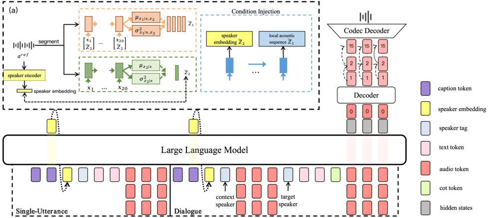

> [!abstract] arXiv · 2026 · Preprint
> **Xiaosu Su et al.** (Hello Group Inc. / University of Chinese Academy of Sciences) · [→ Paper](https://arxiv.org/abs/2604.08363) · Demo: ✓ · Code: ✗
>
> Extends caption-driven voice design from single utterances to multi-turn dialogue within one codec-token autoregressive model, pairing speaker-level captions with a per-turn chain-of-thought control sequence and an FHVAE-inspired conditioning module that lets a designed timbre be fixed and reused.

## Problem

Voice design (synthesising a target voice from a natural language description, with no reference audio) has so far been studied almost entirely for isolated utterances. Dialogue adds two requirements that single-utterance systems do not address: the speaker's timbre must stay stable across turns, while expression must change turn by turn according to context. The authors also identify a reuse problem: once a satisfying voice has been designed, existing pipelines such as VoiceSculptor's design-then-clone approach render it to a reference clip and clone from it, which entangles the target timbre with the transient emotion and prosody of that one clip. Finally, the main public benchmark (InstructTTSEval) scores single utterances with an LLM judge, does not cover dialogue, and is in the authors' view poorly matched to flatter, natural conversational speech.

## Method

CapTalk is a roughly 1.5B-parameter text-audio autoregressive model built on Qwen-architecture Transformers. A speech tokenizer (not named) converts 16 kHz speech into discrete tokens at 12.5 Hz with 16 codebooks. A backbone Transformer models an interleaved text-speech sequence and predicts the first codebook of each frame; a lightweight decoder Transformer predicts the remaining 15 codebooks from the backbone hidden state, the first-codebook token, and two acoustic latents (*z*₂, *z*₁) from the conditioning module (§3.1, Eq. 1).

The two settings share one backbone but differ in their input sequences. Single-utterance generation uses `[caption, speaker embedding, target text, audio]`, where the caption is an utterance-level description. Dialogue generation uses `[speaker caption, speaker embedding, dialogue context, target text, CoT tokens, audio]`, where the caption is speaker-level and the CoT ("chain-of-thought") sequence is a fixed-order set of five turn-level attributes: emotion, tone, pitch, energy, and speaking rate. Pitch, energy, and rate are discretised as deviations from each speaker's own median (seven levels from "extremely low" to "extremely high"), extracted with RMVPE F0, voiced RMS, and characters per voiced second; emotion and tone labels come from Qwen3-Omni (§3.2, §4.2). The training loss combines first-codebook and decoder cross-entropy, a small text loss, and (for dialogue) a CoT cross-entropy loss, so the model predicts its own CoT at inference (§3.2, Eq. 3, Eq. 5).

The hierarchical variational timbre conditioning module is inspired by FHVAE. A speaker encoder with global temporal pooling produces an utterance-level embedding *e*_spk from a reference utterance. Short segments of the same utterance are encoded into a pooled segment latent *z*₂ and a frame-level latent *z*₁. The prior on *z*₂ is a Gaussian whose mean is a projection of *e*_spk, so the KL term pulls segment-level latents toward the utterance-level speaker representation, retaining stable timbre and attenuating segment-local affect; *z*₁ uses a standard normal prior (§3.3, Eq. 7 to 14). At training time *e*_spk comes from reference speech; a prediction head regresses it from the caption's last hidden states with a stop-gradient L2 loss, so at inference the model either predicts *e*_spk from the caption (caption-guided generation) or fixes a previously obtained *e*_spk to reuse a designed voice (§3.3). No reference audio is needed at inference.

Training data: 300 h of public acted-style speech plus 5000 h of internal conversational speech for single-utterance training, and full two-speaker sessions from an internal corpus (up to 32,171 sessions, 6270.68 h) for dialogue, windowed at 20 turns. All captions are generated by Qwen3-Omni in the three InstructTTSEval styles (Acoustic-Parameter Specification, Descriptive-Style Directive, Role-Play), and all three variants are used as separate training instances (§4.1). Language is Mandarin Chinese, as implied by the ZH benchmark and Appendix D examples.

## Key Results

**Single-utterance, automatic.** On InstructTTSEval-ZH, CapTalk scores the highest average (73.73) against Qwen3TTS-12Hz-1.7B-VD (72.77), Ming-omni-tts-0.5B (70.33), VoiceSculptor (62.26), and Fish Speech S2 Pro (41.00). Its margin comes from the Role-Play split (61.7 vs. 55.2 for Qwen3-TTS-VD); Qwen3-TTS-VD is better on APS (87.1 vs. 84.1) and DSD (76.0 vs. 75.4) (Table 1). The benchmark itself uses an LLM judge.

**Single-utterance, human.** With 25 annotators rating 45 cases on 1 to 5 scales, CapTalk is best on overall description consistency (4.24), role-intent (4.17), control stability (4.38), and MOS naturalness (4.20 vs. 3.91 for Ming-omni-tts and 3.82 for Qwen3-TTS-VD), but is lower on identity (3.98 vs. 4.22) and notably on timbre consistency (3.59 vs. 4.15 for Qwen3-TTS-VD and 4.03 for Ming-omni-tts) (Table 2, Appendix B.2.2).

**Dialogue.** On 400 validation turns judged by Gemini, predicted CoT attributes are rated plausible at 0.785 (emotion), 0.7675 (tone), 0.8375 (pitch), 0.825 (energy), and 0.9125 (speed); single-attribute edits produce the intended change at success rates between 0.7675 and 0.8675 (Table 3). Human verification of CoT plausibility used only 30 samples with 15 annotators, and its numbers are not separately reported. In a pairwise test without vs. with CoT on 15 dialogues (20 annotators), the CoT model is preferred for context coherence 65.5% of the time (Gemini: 72%) (Table 4). Against Fish Speech S2 Pro on 40 dialogues, CapTalk gives similar cross-turn WavLM speaker similarity (0.808 vs. 0.806) and higher human context coherence (4.18 vs. 3.61) and MOS (4.12 vs. 3.80) (Table 7).

**Scaling and ablation.** 1500 h of conversational data underperforms 300 h of acted data on InstructTTSEval (56.4 vs. 67.76 AVG); 5000 h of conversational data reaches 67.5, and adding the 300 h acted set gives 73.73 (Table 5). Dialogue CoT metrics rise monotonically from 3373 h to 6270.68 h (Table 6). An explicit caption reconstruction loss lowers the AVG from 67.5 to 66.9 and is disabled (Table 8).

**Timbre reuse.** Fixing the predicted *e*_spk across utterances yields 0.92 cross-utterance WavLM similarity versus 0.42 when *e*_spk is re-predicted per utterance (Table 10). The authors use this to argue that the low human timbre score reflects one-to-many sampling from captions rather than a timbre-modelling weakness.

Fairness caveats: baselines are evaluated as released systems trained on different data; the dialogue comparison includes only one external system; there is no ablation that removes the hierarchical variational module itself.

## Novelty Assessment

The main new elements are (1) treating dialogue as a voice design problem, with speaker-level captions for stable identity and a separately predicted per-turn CoT attribute sequence for expression, and (2) a timbre-conditioning module that adapts the FHVAE idea of an utterance-conditioned prior over segment latents to a codec-LM TTS, so a caption-predicted speaker embedding can be frozen and reused. The backbone itself (Qwen-style backbone predicting codebook 0 plus a small depth decoder for the rest) follows existing codec-LM designs, and the caption pipeline reuses Qwen3-Omni and the InstructTTSEval caption styles. The CoT control sequence is a structured label sequence rather than free-form reasoning. The evaluation protocol for dialogue (plausibility of predicted attributes, single-attribute controllability, with/without-CoT preference) is a useful addition but relies heavily on Gemini and Qwen3-Omni judges with small human checks. Overall the contribution is a moderately novel architectural combination plus a new task framing, not a new modelling paradigm.

## Field Significance

Moderate. The paper moves natural-language voice design into multi-turn dialogue and offers a concrete mechanism for separating a reusable designed timbre from turn-level expression. Its Appendix C analysis also points out an evaluation issue specific to voice design: per-sample human timbre ratings mix caption-conditioned diversity with designed-voice consistency, and the two should be measured separately. Evidence is limited by internal data, the lack of an ablation on the conditioning module, and a dialogue evaluation that depends mostly on automatic judges.

## Claims

- **supports:** Splitting stable speaker description from per-turn expressive control, using a persistent speaker-level caption plus an explicit per-turn attribute plan, improves the context coherence of synthesized dialogue turns.
  > *Evidence:* Removing the five-attribute CoT sequence (emotion, tone, pitch, energy, speed) lowered human pairwise preference for context coherence from 65.5% to 34.5% over 15 dialogues with 20 annotators, and Gemini preference from 72% to 28%. *(§5.1.2, Table 4)*
- **complicates:** In caption-conditioned voice design, per-sample human timbre ratings confound one-to-many caption sampling with a model's ability to keep a designed voice consistent, so voice design evaluation needs separate measures for diversity and for reuse consistency.
  > *Evidence:* CapTalk had the lowest human timbre-consistency score among the top systems (3.59 vs. 4.15), yet fixing the caption-predicted speaker embedding gave 0.92 cross-utterance WavLM similarity against 0.42 when the embedding was re-predicted per utterance, which is the setting raters saw. *(§5.1.1, Table 2; Appendix C, Table 10)*
- **refines:** For description-driven voice design, training-data style composition matters as much as hours: large natural conversational corpora give broad coverage, but small amounts of acted speech remain necessary for strongly expressive and role-play descriptions.
  > *Evidence:* 300 h of acted data outperformed 1500 h of conversational data on InstructTTSEval-ZH (67.76 vs. 56.4 AVG); 5000 h conversational reached 67.5, and adding the 300 h acted set raised the AVG to 73.73 and the Role-Play score from 55.1 to 61.7. *(§5.2.1, Table 5)*
- **complicates:** LLM-judged instruction-following benchmarks for voice design only partly agree with human listening tests, especially on natural, less exaggerated conversational speech.
  > *Evidence:* Qwen3TTS-12Hz-1.7B-VD led on the automatic APS and DSD splits of InstructTTSEval-ZH, while CapTalk ranked first on the human overall-consistency and MOS scores; the authors motivate their human protocol by the benchmark's reliance on automatic judges and its single-utterance, acted-style focus. *(§4.3, Table 1, Table 2)*
- **complicates:** Adding an explicit caption reconstruction objective to a caption-conditioned codec language model does not necessarily improve instruction following.
  > *Evidence:* Adding a caption_loss term lowered the InstructTTSEval-ZH AVG from 67.5 to 66.9 (APS 79.1 to 77.2, RP 55.1 to 54.4), with only DSD improving slightly (68.3 to 69.1), so it was disabled in the final model. *(§5.3, Table 8)*

## Limitations and Open Questions

> [!warning] No direct ablation of the hierarchical variational module
> The paper's central architectural claim (that the FHVAE-inspired conditioning preserves timbre while keeping expression adaptive) is never tested by removing or replacing the module. The supporting evidence is a fixed-vs-resampled embedding comparison (Table 10) and a single-baseline dialogue SIM comparison with a 0.002 margin (Table 7), neither of which isolates the module's contribution.

- All training data except 300 h of public speech are internal, the tokenizer is unnamed, and code is not released; the authors plan to release only caption annotations and a data subset.
- Captions and emotion and tone labels all come from Qwen3-Omni, and the authors acknowledge that caption quality limits conditioning accuracy (Appendix A).
- Dialogue evaluation relies mainly on Gemini judgments; the human CoT check uses 30 samples and the with/without-CoT human test uses 15 dialogues.
- The cross-system dialogue comparison covers only Fish Speech S2 Pro.
- Evaluation is Mandarin-only; generalisation to other languages is untested.
- Training data are dominated by casual conversational speech, which the authors note limits expressive range (Appendix A).

## Wiki Connections

- [[instruction-conditioned-tts|Instruction-Conditioned TTS]] — Extends natural-language voice design to multi-turn dialogue with utterance-level and speaker-level captions in three description styles.
- [[autoregressive-codec-tts|Autoregressive Codec TTS]] — Uses a Qwen-based backbone that predicts the first of 16 codebooks at 12.5 Hz, with a depth decoder predicting the rest.
- [[prosody-control|Prosody Control]] — Introduces discretised speaker-relative pitch, energy, and speaking-rate tokens in a per-turn CoT sequence, with measured single-attribute controllability.
- [[emotion-synthesis|Emotion Synthesis]] — Controls turn-level emotion and tone through explicit CoT labels that the model predicts from dialogue context or accepts as edits.
- [[subjective-evaluation|Subjective Evaluation]] — Adds a seven-aspect 1 to 5 human rating protocol for voice design and shows per-sample timbre ratings conflate caption sampling diversity with reuse consistency.
- [[2601.10629|VoiceSculptor]] — Main conceptual foil: its design-then-clone pipeline motivates CapTalk's timbre-reuse module, and it is a single-utterance baseline.
- [[2601.15621|Qwen3-TTS]] — Its voice design variant is the strongest single-utterance baseline, leading on APS and DSD but trailing on Role-Play.
- [[2603.08823|Fish Audio S2]] — Only external system in the multi-turn dialogue comparison, where CapTalk scores higher on context coherence and MOS.
- [[2506.16381|InstructTTSEval]] — Provides the ZH benchmark and the three caption styles (APS, DSD, RP) used for both training data and evaluation.
- [[2509.17765|Qwen3-Omni]] — Used to generate all captions and to extract emotion and tone labels for training and controllability evaluation.
- [[2509.02020|FireRedTTS-2]] — Cited prior work on long conversational speech generation that CapTalk extends with caption-based speaker design.
- [[2509.13989|Instruction-Perception Gap]] — Cited evidence that automatic judgments of instruction-guided TTS diverge from human perception, motivating the human evaluation protocol.
