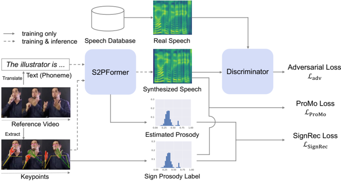

> [!abstract] arXiv · 2026 · Preprint
> **Toranosuke Manabe et al.** (Keio University) · [→ Paper](https://arxiv.org/abs/2604.10413) · Demo: ? · Code: ✗
>
> Defines sign-to-speech prosody transfer, in which the utterance-level prosody of a sign language video conditions a TTS system, and trains it without any paired sign-speech data by forcing the synthesized pitch and energy to reconstruct the signer's hand and face motion statistics under an adversarial naturalness objective.

## Problem

Converting sign language to speech is currently done as a cascade: sign-to-text translation followed by ordinary TTS. The intermediate text strips out the non-manual and kinematic cues (speed and amplitude of hand movement, facial expression) that carry emphasis and emotion in signing, so the resulting speech is flat. Learning a direct mapping is blocked by data: How2Sign, the only ASL dataset paired with English speech, has noisy multi-speaker YouTube audio and its signers (six of eleven with hearing difficulties) did not reproduce the prosody of the source speech, so there is no prosodically aligned sign-speech corpus to supervise on (§2.4). The paper therefore asks whether prosody can be transferred from sign to speech using only unpaired unimodal data. The work was accepted to ICPR 2026 according to the arXiv comment.

## Method

The task is formulated as global (utterance-level) prosody transfer, analogous to cross-lingual prosody transfer for dubbing, rather than word-level alignment (§2.3). Training (SignRecGAN) uses sign-language videos with their English translations from OpenASL and, separately, real studio speech from VCTK; no sign video is ever paired with a recording.

The generator, S2PFormer, is a FastSpeech2 acoustic model pretrained on VCTK and kept frozen (phoneme embedding, encoder, variance predictor, variance adaptor, decoder), extended with three trainable modules (§3.1):

- **Visual backbone.** MMPose keypoints are encoded with the GloFE keypoint extractor (CTR-GCN graph convolution over keypoints plus MS-TCN multi-scale temporal convolution).
- **Adaptive Prosody Mixer (AdaPM).** A mixture-of-experts style module with zero-initialized "sign attention" and "MoE attention" Transformer-decoder blocks. It runs the frozen variance predictor on both the phoneme latents and the sign-attended latents and mixes the two pitch/energy/duration predictions with learned weights, so the sign branch can shift prosody without overwriting the text path. A regularizer |1 − w_sign| keeps the sign weight from collapsing to zero.
- **Prosody estimator.** Takes the predicted pitch and energy and predicts the sign "prosody label."

The sign prosody label is a set of four normalized histograms of squared velocity and acceleration of representative hand and face keypoints over the clip (§3.2). Three objectives tie sign and speech together without paired data:

- **SignRec loss:** cross-entropy between the estimator's predicted histograms and the true sign histograms, so the synthesized pitch/energy must carry enough information to reconstruct the sign motion statistics (§3.2).
- **ProMo loss:** a margin-clipped L1 between speaker-standardized speech energy and video-standardized hand motion, and between speech pitch and facial motion speed, encoding sign-linguistics priors (hand displacement ~ intensity, peak velocity ~ pitch) (§3.3).
- **Naturalness loss:** an LSGAN discriminator on mel-spectrograms that distinguishes VCTK speech from synthesized speech, plus an intonation regularizer that penalizes pitch/energy variance below that of the two-stage output and a speaker-likeness regularizer that keeps mean pitch/energy within ±3σ of the speaker's statistics (§3.4).

At inference the model takes the translated text (phonemes) and the sign keypoints and produces a mel-spectrogram. The vocoder, model size, and loss weights are not given in the main text (hyperparameters are deferred to an appendix not present in the parsed paper). Training uses 3 RTX A5000 GPUs with AdamW (§4.1).

## Key Results

All evaluations are on OpenASL test clips, comparing against the two-stage baseline (speech synthesized from the translated text alone, with no sign input). Because no ground-truth speech exists for the sign videos, "Real Speech" in Table 1 is a reference for VCTK-like speech statistics, not a target for each clip.

**Objective (Table 1, §4.2).** Expressiveness is measured as the standard deviation of predicted pitch and energy, with values closer to real speech (28.9 / 25.4) treated as better. The full model reaches 33.7 / 22.5 versus 17.6 / 20.1 for the two-stage baseline, i.e. closer to real speech on both. This comes at a modest naturalness cost: WER 0.325 vs 0.293 and UTMOS 3.44 vs 3.52 for the baseline (real speech: 0.04 / 4.07).

**Ablation (Table 1, §4.3).** With only the adversarial naturalness loss, pitch/energy variability overshoots (48.4 / 44.6). Adding SignRec alone (44.2 / 39.7, WER 0.448, UTMOS 2.95) or ProMo alone (45.3 / 28.6, WER 0.623, UTMOS 3.03) also overshoots and degrades intelligibility badly; only the combination of all three lands near real-speech variability with acceptable naturalness. Note that the adversarial-only variant actually has the lowest WER of any synthesized system (0.212), so the full model's naturalness advantage over the single-addition ablations does not extend to the adversarial-only variant on WER, only on UTMOS.

**Subjective (Table 2, §4.4).** A CMOS test with 17 participants on a five-grade scale, against the two-stage baseline, gives prosody-match scores of 3.12 (Short), 3.19 (Medium), 3.19 (Long), 3.00 (Neutral), and 3.17 ± 0.11 overall; Medium, Long, and Total are marked statistically significant. Naturalness CMOS is 2.92 ± 0.11 overall and not significantly different from the baseline. Neutral clips (lowest facial velocity) show no significant prosody difference, which the authors read as the model not adding spurious prosody when the signer is calm.

**Qualitative (§4.5, §4.6).** Prominence analysis with the Wavelet Prosody Toolkit shows emphasis placed on content words ("annoying", "a lot") and not on function words, even though training only supervises utterance-level statistics.

## Novelty Assessment

The task itself is new: no prior work transfers sign prosody into synthesized speech, and the paper is explicit that existing sign-to-speech systems are cascades. The architectural contributions are a zero-initialized, MoE-style residual branch on a frozen FastSpeech2 (an adapter pattern familiar from controllable generation) and, more distinctively, the training recipe that replaces paired supervision with a cycle-style reconstruction of hand/face motion histograms from synthesized pitch and energy, plus hand-designed cross-modal priors. Individually these components are standard (LSGAN, reconstruction losses, histogram targets, keypoint backbones); their combination for an unpaired cross-modal prosody problem is the contribution.

The evidence base is thin. The only baseline is the system's own text-only path; expressiveness is measured as raw pitch/energy variance, which rewards variability whether or not it matches the signer (the ablations show variance can overshoot without the reconstruction terms); and the "Real Speech" reference values come from studio speech unrelated to the test videos. The CMOS gain is significant but small (3.17 on a five-point scale centered at 3), and there is no objective measure of sign-speech prosodic correspondence beyond the training losses themselves.

## Field Significance

Moderate — The paper opens a new non-text input condition for expressive TTS and demonstrates that a frozen TTS model can be steered by visual prosody cues using only unpaired unimodal data, via a reconstruction-from-prosody objective. Its quantitative evidence for genuine sign-to-speech prosodic correspondence is limited to variance statistics and a small CMOS effect, so it is best read as a feasibility study for the task rather than an established method.

## Claims

- **supports:** Prosody can be transferred into TTS from a non-speech modality without paired data by requiring the synthesized prosody to reconstruct statistics of the source modality, combined with an adversarial naturalness objective.
  > *Evidence:* SignRecGAN trains on OpenASL sign videos and VCTK speech with no sign-speech pairs; the full model raises pitch/energy standard deviation from 17.6/20.1 (text-only two-stage) to 33.7/22.5, closer to real speech (28.9/25.4), and listeners rate it significantly better matched to the sign prosody (CMOS 3.17 ± 0.11 overall). *(§3.2, §4.2, §4.4, Table 1, Table 2)*
- **complicates:** Increasing prosodic variability in synthesized speech is not by itself evidence of better prosody transfer; without cross-modal grounding, auxiliary objectives tend to overshoot variability and degrade intelligibility.
  > *Evidence:* Adversarial-only, adversarial + SignRec, and adversarial + ProMo variants all exceed real-speech pitch variability (48.4, 44.2, 45.3 vs 28.9), and the single-addition variants have WER 0.448 and 0.623; only the combination of all three losses lands near real-speech variability. *(§4.3, Table 1)*
- **complicates:** Injecting external prosody cues into a pretrained TTS model trades a small amount of naturalness for expressiveness, even when the backbone is frozen.
  > *Evidence:* With the FastSpeech2 backbone frozen and the sign branch zero-initialized, the full model still has higher WER (0.325 vs 0.293) and lower UTMOS (3.44 vs 3.52) than the text-only baseline; naturalness CMOS is 2.92 ± 0.11, not significantly different. *(§3.1, §4.2, §4.4, Table 1, Table 2)*
- **refines:** Supervising only utterance-level prosody statistics can still yield linguistically plausible word-level emphasis when combined with adversarial training on natural speech.
  > *Evidence:* Wavelet-based prominence analysis shows the model emphasizing content words ("annoying", "a lot") and not function words ("and"), although the SignRec target is a clip-level motion histogram. *(§4.6, Figure 7)*

## Limitations and Open Questions

> [!warning]
> There is no ground-truth speech for the sign videos, so expressiveness is measured as pitch/energy variance against unrelated studio speech, and the only baseline is the model's own text-only path. Whether the transferred prosody actually corresponds to what the signer expressed rests on a single 17-listener CMOS test with a small effect size.

- Global prosody only: the method summarizes a clip into histograms and cannot align emphasis to specific signs or words by design; the word-level emphasis observed is emergent and only shown qualitatively (§2.3, §4.6).
- The ProMo priors (hand movement to energy, facial speed to pitch) are hand-picked from sign-linguistics literature and fixed; their validity across signers and sign languages is untested.
- The main text does not state whether the text input at test time comes from OpenASL reference translations or from a sign-to-text model, so the effect of translation errors in a full cascade is not characterized. Long or rare-word texts were filtered out of the WER test (§4.1).
- Single, older backbone (FastSpeech2 on VCTK) and English/ASL only; whether the recipe carries over to modern zero-shot TTS models is open.
- Code is announced as available upon acceptance; the vocoder, model size, loss weights, and user-study protocol are deferred to an appendix not included in the parsed text.

## Wiki Connections

- [[prosody-control|Prosody Control]] — AdaPM injects sign-derived pitch, energy, and duration predictions into the variance predictor path, an explicit external-reference prosody control mechanism with a visual rather than acoustic reference.
- [[transformer-enc-dec-tts|Transformer Encoder-Decoder TTS]] — The generator is a frozen non-autoregressive FastSpeech2 extended with trainable visual and mixing branches, showing a parameter-preserving way to add new conditioning to this family.
- [[subjective-evaluation|Subjective Evaluation]] — Uses a 17-participant CMOS test split by utterance length plus a neutral control category to assess prosody match and naturalness against the cascade baseline.
- [[2006.04558|FastSpeech 2]] — Serves as the frozen pretrained backbone whose variance predictor and adaptor carry the sign-derived prosody.
- [[2204.02152|UTMOS]] — Used as the automatic naturalness metric in the objective evaluation.
- [[2212.04356|Whisper]] — Whisper large-v3 transcribes synthesized speech for the WER intelligibility measure.
