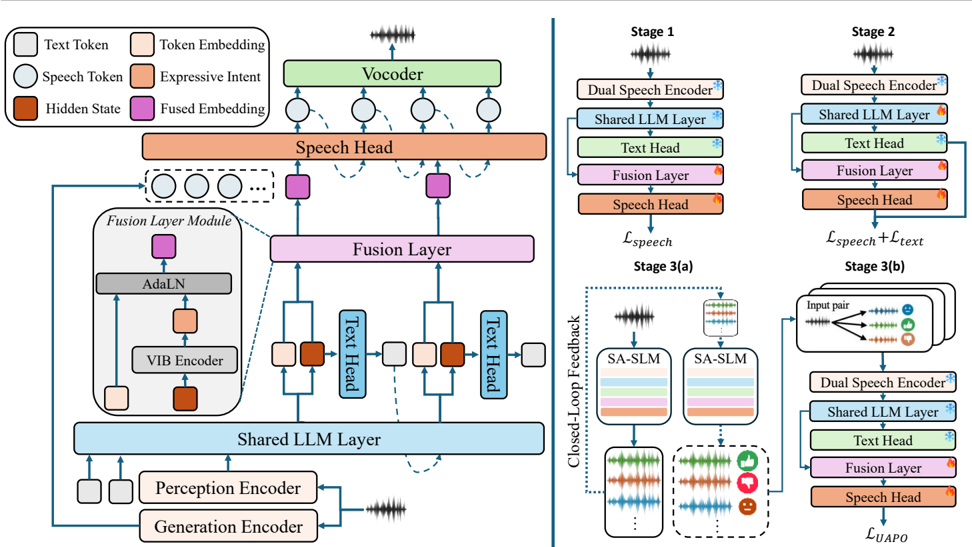

> [!abstract] arXiv · 2026 · Preprint
> **Kuang Wang et al.** (CUHK-Shenzhen / Tencent Ethereal Audio Lab) · [→ Paper](https://arxiv.org/abs/2604.11424) · Demo: ✓ · Code: ?
>
> SA-SLM adds a variational information bottleneck with an Ornstein-Uhlenbeck prior between a speech LM's hidden states and its speech head, so that a slow-varying "expressive intent" latent modulates speech-token generation, then refines delivery with preference optimization driven by the model's own rubric-based judgments of its speech rollouts.

## Problem

End-to-end speech LMs built for spoken dialogue understand the user well but tend to deliver their replies as flat, read-aloud text. The authors call this the semantic understanding-acoustic realization gap and attribute it to two causes. First, modular "thinker-talker" systems feed raw LLM hidden states (or their sum with token embeddings) to the speech head, but those states fluctuate token by token to track lexical content, whereas expressive delivery needs a stable, utterance-level signal. Second, training is open-loop: speech generation is supervised against external targets (emotion labels, style prompts, reference audio) with no feedback on whether the generated audio actually carries the intent the model formed. Prior expressive speech LMs address the first problem with discrete emotion tokens or auxiliary emotion heads, and the second mostly not at all; RL for speech has largely been confined to TTS with offline DPO on human-labelled pairs.

## Method

SA-SLM follows the modular multi-head design of Qwen2.5-Omni: the Thinker of Qwen2.5-Omni-3B (Whisper perception encoder plus Qwen2.5-3B LLM with a text head) produces the text reply, and a separate autoregressive speech head, initialized from CosyVoice2, generates speech tokens that a vocoder renders. Two architectural changes target the transmission problem. A VIB encoder maps each LLM hidden state to a diagonal Gaussian and samples an intent latent; its KL term is taken against a discrete-time Ornstein-Uhlenbeck prior whose mean is the (stop-gradient) previous latent mean scaled by α = 0.95, so the penalty on the difference between consecutive means acts as a causal low-pass filter that suppresses token-level lexical variation. The latent then modulates the text token embedding through zero-initialized AdaLN, and the modulated sequence conditions the speech head. Separately, a generation encoder (the 25 Hz S3 tokenizer from CosyVoice2) encodes the raw user speech and passes it straight to the speech head, bypassing the LLM, so that acoustic properties of the user's turn (for example, how angry they sound) can shape the reply's delivery. The speech loss is token-level cross-entropy plus a β-weighted sum of the per-step KL terms, with β held at 0 for the first 10% of steps and then annealed to 0.5.

Training runs in three stages. Stage 1 trains only the speech head and fusion layer on InstructS2S-200K (about 2,000 hours of TTS-synthesized multi-turn QA). Stage 2 also unfreezes the last LLM layer and trains with a combined text and speech loss on about 800 hours of expressive speech (Genshin Dataset, about 603 h; EmoVoice-DB, about 192 h), where the user questions are generated with Qwen3-235B and voiced with CosyVoice2. Stage 3 uses only user-side speech from EmoNet: for each input the model samples 32 speech rollouts, CosyVoice2 voices the same text reply as a context-unaware anchor, and the SLM itself writes rubrics for emotion, prosody, and naturalness and scores every rollout and the anchor on a {0, 0.5, 1} scale per dimension, with its own transcription gating any rollout above 20% WER to zero reward. Rollouts scoring above the anchor form the winning set and those below form the losing set, and the speech head is updated offline with Utility-Anchored Preference Optimization (UAPO), which uses length-normalized log-probability as the utility and ranks winners above the anchor and the anchor above losers.

## Key Results

On EchoMind (an empathy-oriented spoken dialogue benchmark with seven emotion categories), SA-SLM reports the best expressiveness numbers among open-source systems (Table 2): F0 variance 63.44 versus 49.76 for Qwen3-Omni-30B, EmoAlign 35.61% versus 25.03%, and an LLM-judge overall score of 4.33 versus 4.25. GPT-4o-Audio remains ahead on every expressiveness measure (overall 4.41, F0-Var 70.44, EmoAlign 45.04%). The expressiveness gains come with an intelligibility cost relative to the strongest baselines: SA-SLM's WER of 4.56% is above Qwen3-Omni-30B (2.76%), Qwen2.5-Omni-7B (3.75%), and the CosyVoice2 TTS baseline (3.8%), though below GPT-4o-Audio (7.63%). The CosyVoice2 baseline driven by oracle emotion labels still reaches higher EmoAlign (39.07%) than SA-SLM, which wins only on the judge's prosody and naturalness scores. Audiobox-Aesthetics averages are essentially tied across most systems (5.54 to 5.64 for open models).

The fusion ablation after Stages 1 and 2 (Table 3, full grid in Table 6) shows that adding raw hidden states to token embeddings raises WER from 3.61% (token embeddings only) to 8.29% for an overall judge gain of 0.03, plain AdaLN on hidden states gives 6.50% WER, and VIB+AdaLN gives 4.74% WER with the best overall score (4.31 versus 4.17). Replacing the acoustic generation encoder with LLM-side semantic features pushes WER to 9.62% to 15.40% across fusion variants. Stage 3 self-reward moves the overall score from 4.31 to 4.33 and WER from 4.74% to 4.56%; swapping in a 30B reward model gives 4.38 and 4.21% (Table 4). A linear probe for emotion category reaches 18.1% on token embeddings, 41.4% on hidden states, and 64.5% on the VIB latent (Figure 4). MMAU accuracy (39.60 versus 39.51 for the Qwen2.5-Omni-3B base) indicates that expressive training does not erode audio understanding, though the 3B base is itself far below the 7B and 30B baselines on this benchmark (Table 5).

The judge-score differences between SA-SLM and the strongest baselines are small (0.08 on a 1-5 scale), no variance or significance testing is reported, and every "subjective" score comes from a single LLM judge rather than human listeners.

## Novelty Assessment

The architectural contribution is real but narrow: a VIB bottleneck with a temporally correlated (OU) prior inserted on the hidden-state pathway of an existing thinker-talker speech LM, plus a direct acoustic path from user speech to the speech head. Both pieces are justified by ablations on the same test set, and the OU prior as a low-pass filter on LLM states is a specific, reusable idea. The self-reward stage combines known ingredients (LLM-as-judge rubric rewards, a TTS anchor in the spirit of prospect-theoretic baselines, and an existing preference loss, UAPO), and its measured gain is the smallest of the paper's contributions (+0.02 judge overall). The backbone, speech head, tokenizer, and most training data are reused or synthesized with existing systems. The "only 800 hours" framing counts Stage 2 data only and excludes the roughly 2,000 hours of Stage 1 synthetic speech and all of Qwen2.5-Omni's and CosyVoice2's pretraining.

## Field Significance

Moderate — The paper gives controlled evidence, within one thinker-talker speech LM, that how LLM hidden states are passed to the speech generator matters for both expressiveness and intelligibility, and that a temporally smoothed bottleneck outperforms direct addition or plain AdaLN conditioning. It also demonstrates a label-free preference loop in which a speech LM scores its own spoken replies, though with a small measured gain and only LLM-judge evaluation.

## Claims

- **supports:** In thinker-talker speech LMs, injecting raw LLM hidden states into the speech generator degrades intelligibility while yielding little expressive benefit, because those states vary at the token rate rather than the utterance rate.
  > *Evidence:* Element-wise addition of hidden states to token embeddings raises WER from 3.61% to 8.29% for an overall judge gain of 4.17 to 4.20, and plain AdaLN gives 6.50% WER; a VIB latent with an Ornstein-Uhlenbeck prior gives 4.74% WER and the best overall score (4.31). *(§5.1, Table 3; §Appendix B.2, Table 6)*
- **supports:** A temporally smoothed information bottleneck on language-model states can extract emotion information that is more linearly separable than either token embeddings or the raw hidden states.
  > *Evidence:* Linear-probe emotion accuracy rises from 18.1% (token embeddings) to 41.4% (LLM hidden states) to 64.5% (VIB latent), with matching t-SNE clustering. *(§5.3, Figure 4)*
- **supports:** Expressive spoken reply generation benefits from conditioning the speech decoder on acoustic features of the user's speech rather than on semantic features routed through the language model.
  > *Evidence:* Across all fusion strategies, replacing the acoustic generation encoder with perception-pathway semantic features raises WER to 9.62% to 15.40%, while removing context entirely lowers expressiveness (VIB+AdaLN overall 4.21 versus 4.31). *(§5.1, Table 3; §Appendix B.2, Table 6)*
- **complicates:** Self-generated rubric rewards from a speech LM can improve its own expressive delivery without labels, but the gain is small and bounded by the critic's capacity.
  > *Evidence:* 3B self-reward UAPO raises the LLM-judge overall score from 4.31 to 4.33 and lowers WER from 4.74% to 4.56%, while a 30B reward model reaches 4.38 and 4.21% and converges faster with lower variance. *(§5.2, Table 4, Figure 3)*
- **complicates:** Expressiveness gains in end-to-end speech LMs often come with an intelligibility cost relative to the best general-purpose systems, and label-driven TTS can still produce better text-speech emotion agreement.
  > *Evidence:* SA-SLM's WER (4.56%) exceeds Qwen3-Omni-30B (2.76%) and a CosyVoice2 baseline (3.8%), and that CosyVoice2 baseline with oracle emotion labels attains higher EmoAlign (39.07% versus 35.61%). *(§4.3, Table 2)*

## Limitations and Open Questions

> [!warning]
> All conversation-level "subjective" scores, including the headline comparison with GPT-4o-Audio, come from a single LLM judge (Gemini-2.5-Flash); there is no human listening test, and the key margins (0.02 to 0.08 on a 1-5 scale) are reported without variance or significance testing.

- The Stage 3 reward is produced by the model being trained, and the evaluation judge is a different LLM scoring similar dimensions (emotion, prosody, naturalness), so improvements may partly reflect alignment with LLM-judge preferences rather than human perception.
- Under the Stage 1-2 ablation, VIB+AdaLN has lower F0 variance (58.37) than the token-only baseline (60.42) or plain AdaLN (62.24) with acoustic grounding (Table 6), so the large F0-Var lead in Table 2 (63.44) is not explained by the VIB module alone and is not decomposed by stage.
- Evaluation is limited to one empathy-oriented benchmark (EchoMind) for expressiveness; the Stage 2 user questions are synthesized text voiced by CosyVoice2, and the Genshin Dataset is game voice acting, so behaviour on natural conversational speech is untested.
- The architecture has only been tested on a 3B backbone whose audio understanding (MMAU 39.6) is far below the larger baselines it outscores on expressiveness; whether the same gains hold on stronger backbones is open.
- The 30B "oracle" reward model's identity is not specified, and code availability is not stated (a project page with demos is linked).

## Wiki Connections

- [[spoken-language-model|Spoken Language Model]] — Modifies how a thinker-talker speech LM that consumes user speech passes its internal state to the speech generator.
- [[speech-to-speech|Speech-to-Speech]] — An end-to-end spoken dialogue system that maps user speech to a spoken reply, evaluated on empathetic dialogue.
- [[emotion-synthesis|Emotion Synthesis]] — Targets contextually appropriate emotional delivery via a learned intent latent and emotion-rubric rewards rather than explicit emotion labels.
- [[rlhf-speech|RLHF Speech]] — Uses self-generated rubric rewards against a TTS anchor and UAPO preference optimization to align speech delivery.
- [[autoregressive-codec-tts|Autoregressive Codec TTS]] — The speech head is a CosyVoice2-initialized autoregressive speech-token LM that the paper fine-tunes and ablates.
- [[disentanglement|Disentanglement]] — The OU-prior VIB objective explicitly separates slow-varying expressive intent from token-level lexical content, with ablation and probe evidence.
- [[2503.20215|Qwen2.5-Omni]] — Provides the 3B Thinker backbone and the additive fusion baseline that SA-SLM replaces.
- [[2412.10117|CosyVoice 2]] — Initializes the speech head and S3 tokenizer, voices synthetic questions and the reward anchor, and serves as the oracle-label TTS baseline.
- [[2509.17765|Qwen3-Omni]] — The strongest open-source baseline, which SA-SLM exceeds on expressiveness but not on WER.
- [[2510.22588|UltraVoice]] — Expressive speech LM baseline and source of the LLM-as-judge evaluation protocol.
- [[2410.21276|GPT-4o]] — Closed-source reference system that remains ahead on all expressiveness measures.
- [[2409.06666|LLaMA-Omni]] — Representative modular multi-head speech LM whose embedding-plus-hidden-state fusion motivates the intent pathway.
- [[2504.12867|EmoVoice]] — Source of EmoVoice-DB, part of the Stage 2 expressive training data.
- [[2312.15185|emotion2vec]] — Emotion recognizer used to compute the EmoAlign text-speech emotion agreement metric.
