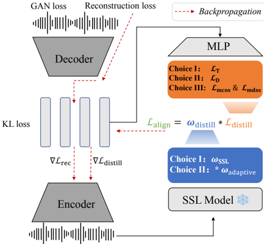

> [!abstract] arXiv · 2026 · Preprint
> **Changhao Cheng et al.** (Shanghai Jiao Tong University / ByteDance Seed) · [→ Paper](https://arxiv.org/abs/2604.12383) · Demo: ? · Code: ✓
>
> Maps the design space of SSL-distillation losses for continuous speech VAE latents and shows that a joint-marginal alignment loss with gradient-ratio adaptive weighting gives the best balance of reconstruction, SUPERB-style understanding, and downstream TTS among the variants tested.

## Problem

Continuous VAE latents are an attractive alternative to mel spectrograms and discrete codec tokens for speech generation, and recent work (Semantic-VAE) improves their generative usefulness by distilling self-supervised (SSL) features into the latent with a frame-wise (time-axis) cosine loss. Those VAEs are optimised for reconstruction and generation only. The authors show that such time-axis aligned latents remain weak as features for speech understanding: on SUPERB-style probes they lag far behind Fbank on ASR. With speech LLMs moving toward unified understanding and generation, the paper asks whether time-axis distillation is the right loss when all three capabilities matter, and how the loss form and its weighting shift the trade-off.

## Method

The backbone is a stable-audio-tools speech VAE with a DAC-style encoder and a BigVGAN decoder, trained with reconstruction, KL (weight 0.001), and GAN losses. The encoder downsamples 16 kHz audio by factors {4, 4, 5, 5} to a 64-dimensional latent at 40 Hz. An MLP projects the latent to 1024 dimensions so it can be aligned with layer-23 features of a frozen WavLM Large teacher; the alignment term is a weighted distillation loss added to the usual VAE objective. Parameter count is not reported.

The design space has two axes. For the loss form, the paper compares three options. Time-axis alignment (TAS-VAE, equivalent to Semantic-VAE) applies a per-frame log-sigmoid cosine loss. Dimension-axis alignment (DAS-VAE) applies the same cosine loss per feature dimension across time, capturing each dimension's temporal trajectory. Joint-marginal alignment (JMAS-VAE), adapted from VA-VAE in image generation, combines a per-frame marginal cosine loss with hinge margin m1 and a "marginal distance sequence similarity" loss that matches the pairwise frame-to-frame cosine similarity structure of latent and teacher with hinge margin m2. For the loss weight, the options are a static weight (2.5) or that weight scaled by an adaptive factor: the ratio of the reconstruction-loss gradient norm to the distillation-loss gradient norm, computed on the encoder projection layer. For JMAS-VAE the factor is computed separately for each of the two terms.

All VAEs are trained on the full Libriheavy corpus. Evaluation covers three axes. Reconstruction is measured with PESQ and STOI on LibriSpeech test-clean. Understanding uses eight SUPERB tasks (ER, PR, ASR, KS, SID, ASV, SD, IC) on frozen latents, with ASR and SID probes trained for 500k rather than 200k steps. Generation trains a small F5-TTS model on LibriTTS over each representation and measures WER and speaker similarity on LibriSpeech-PC test-clean. The authors also define an overall score: per-axis arithmetic means are combined by a geometric mean, with error rates converted to 1 minus the error and PESQ divided by 5.

## Key Results

On the authors' overall score (Table 1), JMAS-VAE with adaptive weighting (m1 = 0.5, m2 = 0.25) is highest at 0.772. DAS-VAE with a static weight follows at 0.746, and the time-axis variants are around 0.71 (TAS-VAE 0.713, TAS-VAE with adaptive weighting 0.716). Semantic-VAE scores 0.690, the mel/Fbank baseline 0.653, EnCodec 0.651, and the vanilla VAE 0.645.

The gain comes almost entirely from understanding. JMAS-VAE with adaptive weighting reaches an understanding mean of 0.681, against 0.449 for Semantic-VAE and 0.413 for Fbank. For example, its SUPERB ASR WER is 21.04%, close to Fbank's 20.86%, compared with 41.75% for Semantic-VAE. Reconstruction stays close to the other VAEs (PESQ 3.84, STOI 0.973, vs. 3.97 and 0.981 for Semantic-VAE). Generation is mixed. TTS WER is 2.04%, similar to Semantic-VAE (2.01%) and better than mel-based F5-TTS (2.23%). Speaker similarity, however, drops to 0.57, below both Semantic-VAE (0.67) and the mel baseline (0.61).

Adaptive weighting strongly improves understanding for all three loss forms. For time-axis and dimension-axis alignment it breaks reconstruction and voice similarity: PESQ falls to about 2.7 to 2.9 and TTS SIM to 0.31 to 0.32, even though ASR WER improves to about 15%. Only the margins in the joint-marginal loss prevent this. Figure 3 shows the adaptive weights growing by orders of magnitude above typical static values during training. The margin ablation (Figure 4, 11 JMAS-VAE runs) shows that smaller margins improve understanding and hurt reconstruction and generation, and that the two margins are not interchangeable. Across those runs (Table 2), a smaller frame-wise cosine distance correlates with better understanding and TTS intelligibility but worse reconstruction and TTS SIM. The pairwise-structure distance shows the opposite pattern.

Several comparison details matter. Semantic-VAE and the authors' TAS-VAE use the same distillation scheme but report different numbers (understanding mean 0.449 vs. 0.510), so the Semantic-VAE row is not a controlled replication. TAS-VAE and DAS-VAE with adaptive weighting are trained for 1100k steps, against 600k for the other aligned VAEs. EnCodec runs at 24 kHz and its F5-TTS model uses a 10x lower learning rate. The overall score is the authors' own composite, so the ranking depends on its equal weighting of the three axes. The Fbank SID accuracy of 0.00085% looks like a failed probe rather than a real baseline value. No human listening tests are reported.

## Novelty Assessment

The main novelty is the training objective. Dimension-axis alignment and the joint-marginal loss have precedents in discrete-token distillation and in image VAEs (VA-VAE), and gradient-norm adaptive weighting is a familiar device, so the individual components are adapted rather than invented. The contribution is bringing them to continuous speech VAEs and comparing them on one backbone across three task families. The finding that adaptive weighting without margins drives latents toward the teacher at the cost of acoustic detail is a useful diagnostic. The ablation linking each marginal loss to a semantic or acoustic direction gives practitioners a concrete tuning lever. The study is small in scope: one teacher layer, one latent size, one frame rate, one training corpus, and a small F5-TTS probe for generation.

## Field Significance

Moderate. The paper shows that the distillation loss used to make continuous speech latents "semantic" is a real trade-off control, not a free improvement. Time-axis alignment helps generation but leaves understanding weak. Pushing alignment harder recovers understanding but damages reconstruction and speaker similarity unless margins regularise it. For continuous representations intended for unified speech LLMs, this provides a measured trade-off map and a loss recipe that keeps reconstruction close to a vanilla VAE while approaching Fbank on understanding.

## Claims

- **supports:** Distilling self-supervised features into continuous speech autoencoder latents improves their usefulness for both downstream understanding and generation relative to an unaligned VAE.
  > *Evidence:* Every SSL-aligned VAE, including Semantic-VAE, exceeds the vanilla VAE on the understanding mean (0.449 to 0.751 vs. 0.382) and gives lower F5-TTS WER on LibriSpeech-PC (1.93 to 2.59% vs. 2.72%). With static weights, the PESQ cost is small (3.97 to 3.98 vs. 4.12). *(§4.1, Table 1)*
- **complicates:** Frame-wise alignment of continuous speech latents to SSL features, as used for generation-oriented latents, leaves them weak as general-purpose features for speech understanding.
  > *Evidence:* The time-axis aligned VAE and Semantic-VAE reach SUPERB ASR WER of 39.97% and 41.75% and intent-classification accuracy below 17%, against 20.86% ASR WER for Fbank, even though their reconstruction and TTS performance are competitive. *(§4.1, Table 1, Figure 1)*
- **complicates:** Stronger alignment of codec or autoencoder latents to a self-supervised teacher trades acoustic fidelity and speaker similarity for semantic content unless the alignment is explicitly regularised.
  > *Evidence:* Gradient-ratio adaptive weighting lowers SUPERB ASR WER to about 15% for time-axis and dimension-axis alignment but drops reconstruction PESQ to 2.73 to 2.92 and TTS speaker similarity to 0.31 to 0.32. In the margin ablation, smaller margins improve understanding and degrade reconstruction and generation. *(§4.1, §4.3, Table 1, Figure 4)*
- **refines:** In semantic distillation for speech latents, frame-level feature matching mainly transfers semantic content, while matching the pairwise temporal similarity structure better preserves acoustic and speaker information.
  > *Evidence:* Across 11 joint-marginal VAE runs, the frame-wise marginal cosine distance correlates negatively with understanding (PCC -0.615) and TTS 1-WER (-0.552) but positively with reconstruction (0.723) and TTS SIM (0.701); the pairwise-structure distance shows the opposite signs. A joint-marginal loss with margins and adaptive weighting gives the best authors' overall score (0.772). *(§4.3, Table 2, §4.1, Table 1)*

## Limitations and Open Questions

- The headline ranking depends on the authors' composite score, and the best overall model still loses speaker similarity in TTS (0.57 vs. 0.67 for Semantic-VAE and 0.61 for mel).
- Training budgets differ across rows (1100k vs. 600k steps for some aligned VAEs, 550k for the vanilla VAE), and the Semantic-VAE row is not a controlled reimplementation, so some differences between rows may reflect training differences rather than the loss.
- Generation is tested with one small F5-TTS model trained on LibriTTS, scored only with automatic WER and SIM. There are no human listening tests and no naturalness metric such as UTMOS or MOS.
- Only one teacher (WavLM Large, layer 23), one latent configuration (64-dim, 40 Hz), and one English training corpus are explored. The authors leave channel dimension, frame rate, and use in speech LLMs to future work.
- Some joint-marginal margin settings make VAE training diverge (Figure 4), so the method needs margin tuning.

## Wiki Connections

- [[neural-codec|Neural Audio Codec]] — Studies continuous VAE latents as an alternative to discrete codec tokens and compares them against EnCodec on reconstruction, understanding, and TTS.
- [[self-supervised-speech|Self-Supervised Speech]] — WavLM Large features serve as the distillation teacher, and the choice of alignment loss determines how much SSL structure transfers into the latent.
- [[flow-matching|Flow Matching]] — Generation quality of each representation is measured by training a small flow-matching F5-TTS model on its latents.
- [[2509.22167|Semantic-VAE]] — The direct predecessor: its time-axis cosine distillation is the TAS-VAE baseline that this paper generalises and compares against.
- [[2025.acl-long.313|F5-TTS]] — Used as the downstream TTS model trained on each candidate representation to measure generation performance.
- [[2210.13438|EnCodec]] — Discrete codec baseline in the three-axis comparison.
- [[2306.00814|Vocos]] — Mel vocoder used for the conventional reconstruction baseline.
- [[2206.04658|BigVGAN]] — Provides the decoder architecture of the speech VAE backbone.
- [[2502.03930|DiTAR]] — Cited as evidence that continuous VAE latents support high-quality speech generation, which motivates the study.
- [[2508.08961|DualSpeechLM]] — Cited as an example of unified speech understanding and generation models that motivate a single representation for both.
- [[2502.11946|Step-Audio]] — Cited alongside DualSpeechLM as a unified understanding-and-generation speech system motivating the three-axis evaluation.
