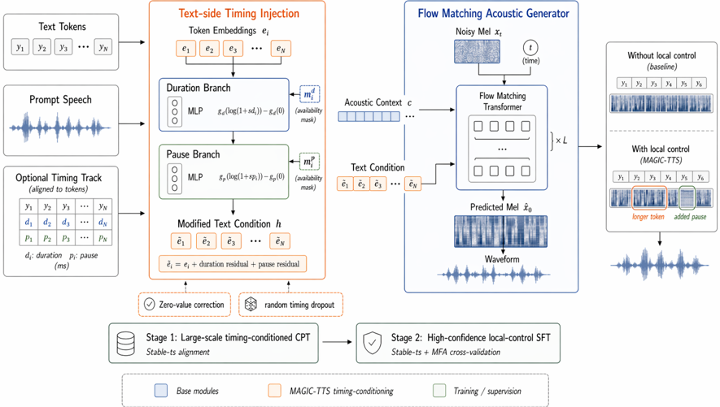

> [!abstract] arXiv · 2026 · Preprint
> **Jialong Mai et al.** (South China University of Technology) · [→ Paper](https://arxiv.org/abs/2604.21164) · Demo: ✓ · Code: ✓
>
> Adds an optional, token-aligned timing track (per-token content duration and following pause, as numeric values) to a pretrained F5-TTS flow-matching backbone, so users can lengthen, shorten, or insert pauses at chosen tokens while leaving the rest of the utterance to the model.

## Problem

Modern zero-shot TTS systems expose timing only at the utterance level (total length, as in [[2506.21619|IndexTTS2]]) or as a global style attribute (speaking rate via natural-language descriptions, as in [[2402.01912|Lyth and King]]). Autoregressive systems model duration implicitly through free-running rollout, which makes local timing hard to pin down, and classic duration-predictor systems such as [[2006.04558|FastSpeech 2]] treat duration as an internal alignment variable rather than a user-facing control. The authors argue that overriding such internal variables does not give dependable control: in an appendix probe, replacing [[2105.06337|Grad-TTS]]'s duration expansion (and YourTTS's duration and blank-token timing) with target durations shifts the rhythm but sharply degrades timbre and intelligibility. Applications such as navigation prompts, read-after-me tutoring, and digit-by-digit code reading need precise per-token pacing and pause placement.

## Method

MAGIC-TTS keeps the [[2025.acl-long.313|F5-TTS]] Base configuration and its conditional flow-matching objective unchanged (DiT generator, hidden size 1024, 22 blocks, 16 heads, 100-bin mel at 24 kHz with a Vocos vocoder). The only architectural change is on the text-conditioning side. Each token embedding receives two gated residuals, one from a content-duration MLP and one from a pause MLP, both applied to log-compressed frame counts. Two training-side mechanisms are built into this residual:

- **Zero-value correction**: each branch subtracts its encoder's output at zero (g(log(1+s·x)) − g(0)), so a zero duration or zero pause adds nothing. Without this, the dense zero pauses present at almost every token act as a sequence-wide bias that lets the model lean on the pause branch at the expense of content duration.
- **Availability masking and timing dropout**: per-branch masks zero out missing controls, and the whole timing track is dropped for 20% of training samples. This keeps ordinary prompt-plus-text synthesis available when no track is supplied.

The learnable gates start at zero, so training begins from the pretrained backbone's behaviour.

Supervision comes from a two-stage data pipeline. Stage 1 (continued pretraining, 27k updates) uses Stable-ts word alignments projected onto model tokens for about 2.2M Emilia utterances (about 30k hours). These were selected because the MNV-17 nonverbal-aware ASR re-transcription found at least one nonverbal vocalization in each, which gives a corpus where content and pauses are interleaved. Stage 2 (local-control SFT, 36k steps) uses a "B@150" high-confidence subset. Stable-ts and MFA alignments must cover the same text, have order-consistent token groupings, and agree within 150 ms on every span's start, end, and duration. Of 13.06M EN/ZH utterances with both alignments, 202,086 (230.72 hours) survive, and MFA timings serve as the final labels. At inference the model can run in "spontaneous" mode (no track) or "controlled" mode. Controlled mode works best when the timing track covers both the prompt and the target text, matching the training format.

## Key Results

Timing-following accuracy is measured on 100 utterances (3 to 10 s) sampled from the B@150 subset, with MFA re-aligning the generated audio (Table 1). In controlled mode, the final model reaches content-duration MAE 10.56 ms (correlation 0.918) and pause MAE 8.32 ms (correlation 0.793), with pause-placement F1 of 0.410 at a 50 ms threshold. The same model in spontaneous mode gives 36.88 ms, 0.588, 18.92 ms, 0.283, and 0.128. F5-TTS Base, which has no timing input, sits at a similar level to spontaneous mode (38.82 ms content MAE). The comparison baseline is therefore free-running synthesis, not another controllable system.

The ablations (Table 3) show that cross-validated supervision gives most of the content-side gain: CPT-only training gives content MAE 15.93 ms and correlation 0.787. Zero-value correction adds a smaller gain (12.89 to 10.56 ms content MAE). Pause F1@50 is slightly higher without zero correction (0.428 vs. 0.410), which the authors attribute to the ablated model over-using pause cues. An inference-format ablation on an earlier checkpoint (Table 8) shows that the model depends strongly on prompt-side timing. With target-only timing, content MAE rises from 11.85 to 27.98 ms, and training with prompt-duration masking recovers only part of this gap (23.58 ms).

For local editing, a three-demo Chinese benchmark (Table 2) starts from a uniform 170 ms per-token track, which is realized at a mean of 171.07 ms. Editing selected tokens to 225 ms gives a mean of 207.40 ms (17.60 ms bias), and inserting 260 ms pauses gives 236.67 ms (23.33 ms bias). On the larger B@150 stress tests (Appendix A, Table 4), a requested 2.0× stretch of adjacent spans is realized as 1.777× (two tokens) and 1.783× (three tokens), and 0.5× compression as 0.685× and 0.666×. Results are weaker on the small strict Chinese subset (Table 6). The authors argue, from manual listening, that MFA underestimates edit strength, so they present these figures as lower bounds.

Adding control costs some quality in spontaneous mode (Table 7, Seed-TTS-Eval). Against a control-free baseline continued-trained on the same data, English WER rises from 1.994 to 3.434 and Chinese CER from 1.772 to 2.215. Speaker similarity is essentially unchanged (0.649 to 0.638 EN, 0.733 to 0.738 ZH). No subjective listening test (MOS or preference) is reported anywhere.

## Novelty Assessment

The architectural change is small: two gated MLP residuals on the text embeddings of an existing flow-matching backbone. What is new is how this residual is made to work as a reliable control. The zero-centred encoders stop the dense pause track from dominating, timing dropout keeps the track optional, and alignment cross-validation provides clean token boundaries. The ablations attribute measurable gains to the latter two. Claiming the "first TTS model with explicit local timing control" needs qualifying, because duration-predictor systems have long allowed per-phoneme duration overrides. The paper's counterargument (degraded quality when internal durations are overridden) rests on informal, zero-training listening probes of two older systems, without quantitative numbers. The more defensible novelty is placing separate content and pause controls inside a modern alignment-free zero-shot backbone. The evaluation tests the model only against its own spontaneous mode and ablations. There is no quantitative comparison against an existing duration-controllable system.

## Field Significance

Moderate. The paper shows that an alignment-free flow-matching TTS backbone, which normally learns timing implicitly, can be retrofitted with separate token-level duration and pause controls through continued training. It also gives a concrete recipe (zero-centred timing encoders, timing dropout, cross-validated alignments) and documents the cost to WER in uncontrolled mode. Its main value is as evidence for how to add explicit local controls to alignment-free generators, not as a new generation paradigm.

## Claims

- **supports:** Alignment-free flow-matching TTS backbones can be given explicit token-level duration and pause control by injecting numeric timing residuals into the text conditioning, without changing the generative objective.
  > *Evidence:* Gated MLP residuals for content duration and pause added to F5-TTS text embeddings cut content-duration MAE from 36.88 to 10.56 ms and pause MAE from 18.92 to 8.32 ms versus the same model without a timing track. *(§3.2, §4.2, Table 1)*
- **supports:** The precision of local timing control depends on the reliability of token-boundary supervision, more for token-internal duration than for pauses.
  > *Evidence:* Fine-tuning on a Stable-ts/MFA cross-validated subset (230.72 h) lowers content MAE from 15.93 to 10.56 ms and raises content correlation from 0.787 to 0.918, while pause metrics change less. *(§3.3, §4.4, Table 3)*
- **refines:** When sparse timing controls such as pauses are mostly zero, encoding zero as a nonzero vector adds a dense bias that lets the model rely on the easier control at the expense of the harder one. Centring the encoders at zero restores balance.
  > *Evidence:* Removing zero-value correction raises content MAE from 10.56 to 12.89 ms, while pause F1@50 rises slightly (0.410 to 0.428), consistent with over-reliance on pause cues. *(§3.4, §4.4, Table 3)*
- **complicates:** Adding fine-grained controllability to a zero-shot TTS model can degrade intelligibility in uncontrolled synthesis, even when the control input is optional at inference time.
  > *Evidence:* Against a control-free baseline continued-trained on the same data, spontaneous-mode English WER rises from 1.994 to 3.434 and Chinese CER from 1.772 to 2.215. The degradation grows from the CPT to the SFT checkpoint, while speaker similarity barely changes. *(§Appendix B, Table 7)*
- **complicates:** Overriding internal duration variables in duration-predictor TTS systems does not by itself give a clean user-facing timing control.
  > *Evidence:* Zero-training probes that replace Grad-TTS duration expansion and YourTTS duration and blank-token timing with MFA-derived targets shift rhythm partially but sharply degrade timbre and intelligibility in informal listening; no quantitative results are reported. *(§Appendix B)*

## Limitations and Open Questions

> [!warning]
> Timing accuracy is measured on 100 utterances sampled from the same B@150 subset used for SFT, and the paper does not state that they were held out. The only comparisons are with the model's own spontaneous mode and ablations, not with other duration-controllable systems. No subjective naturalness evaluation is reported, so it is unknown how natural the edited speech sounds.

- Evaluation depends on MFA re-alignment of generated speech. The authors find, by listening, that MFA underestimates pause and stretch edits and fails to align some samples (92 of 100 controlled and 90 of 100 spontaneous cases scored). They therefore treat the editing results as lower bounds, but this cannot be verified from the reported numbers.
- The best control requires timing tracks for both the prompt and the target text. Target-only control is much weaker (Table 8), which matters for real editing workflows where prompt timing may not be available.
- Spontaneous-mode intelligibility degrades noticeably (EN WER 1.994 to 3.434), and this trade-off grows during the controllability-focused SFT stage.
- The scenario benchmark has only three Chinese demos. The Chinese stress-test subsets are small (14 to 18 rows after strict filtering) and show weaker edit realization than English.
- A rare failure mode moves a requested pause to a nearby existing pause boundary (1 of 84 strict-boundary rows).

## Wiki Connections

- [[flow-matching|Flow Matching]] — Adds explicit token-level timing conditioning to a conditional flow-matching acoustic generator without changing its training objective.
- [[zero-shot-tts|Zero-Shot TTS]] — Keeps prompt-based zero-shot voice cloning while making local timing optional, and reports the intelligibility cost on Seed-TTS-Eval.
- [[prosody-control|Prosody Control]] — Introduces separate numeric controls for per-token content duration and pause, edited independently of text and speaker.
- [[2025.acl-long.313|F5-TTS]] — Serves as the backbone and initial checkpoint. Its Base model is the reference for the spontaneous-mode quality and timing-accuracy comparisons.
- [[2506.21619|IndexTTS2]] — Cited as utterance-level duration control in autoregressive TTS. MAGIC-TTS targets per-token control instead.
- [[2409.00750|MaskGCT]] — Cited for its observation that autoregressive systems lack duration controllability, which motivates the choice of a non-autoregressive backbone.
- [[2006.04558|FastSpeech 2]] — Represents duration as an internal predictor variable. The paper argues this is not a dependable user-facing local control.
- [[2105.06337|Grad-TTS]] — Used in an appendix probe where overriding internal durations degrades timbre and intelligibility.
- [[2402.01912|Lyth and King]] — Represents style-level speaking-rate control through natural-language descriptions, which MAGIC-TTS complements with numeric local timing.
