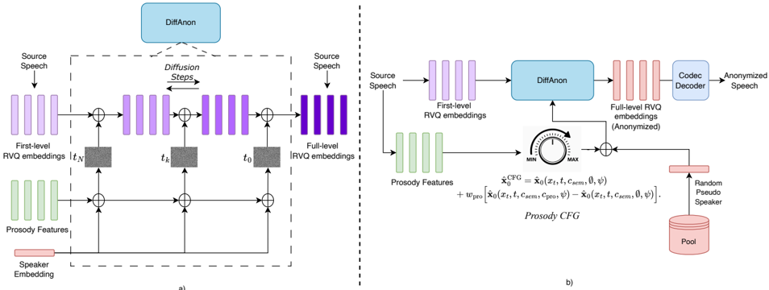

> [!abstract] arXiv · 2026 · Preprint
> **Ulgen et al.** (Johns Hopkins University) · [→ Paper](https://arxiv.org/abs/2604.26281) · Demo: ? · Code: ✓
>
> DiffAnon turns the amount of source prosody kept in anonymized speech into a continuous inference-time knob, using classifier-free guidance on a prosody condition inside a diffusion model that refines SpeechTokenizer codec embeddings, so one trained model can sweep across utility-privacy operating points.

## Problem

Voice anonymization has to hide speaker identity while keeping linguistic content and paralinguistic information. Prosody sits at the centre of that trade-off: it carries emphasis, intent, and emotion, but speakers also have characteristic prosodic patterns that speaker verification systems can exploit. Existing anonymizers fix their handling of prosody by design. Cascaded ASR-TTS pipelines discard source prosody, voice conversion (VC) based anonymizers keep it implicitly and leak identity through imperfect disentanglement, and random prosody perturbation degrades utility unpredictably. Each system therefore sits at a fixed point on the utility-privacy curve, and moving along the curve has required training or combining different systems.

## Method

DiffAnon is a conditional denoising diffusion model (DDPM, x0-prediction) whose target is the full 8-level SpeechTokenizer embedding sum Q1:8 (1024-dimensional per frame); the frozen SpeechTokenizer decoder converts the output to waveform. It takes three separately extracted conditions:

- **Content:** the first-level SpeechTokenizer embedding Q1, which is semantically distilled and carries little speaker information. The model adds Q1 directly (without projection) at every timestep and inside every residual block. The diffusion model therefore mainly has to recover the acoustic residual Q2:8 on top of a fixed semantic prior, which mirrors the coarse-to-fine structure of residual vector quantization (RVQ).
- **Prosody:** frame-level latent features from a masked prosody model (MPM), pretrained by masked prediction of speaker-normalized pitch, energy, and voicing. The features are interpolated to the codec frame rate.
- **Speaker:** an utterance-level FreeVC speaker-encoder embedding repeated across frames. A single utterance-level vector is chosen to limit frame-level prosodic leakage into the speaker condition and to make pseudo-speaker sampling simple.

Prosody and speaker conditions pass through separate 1D convolutional projections and are added to the noisy latent. The denoiser follows the NaturalSpeech 2 diffusion backbone: 40 non-dilated WaveNet-style residual blocks (kernel 5, 1024 channels) with MLP timestep embeddings. The total parameter count is not reported.

Training uses structured condition dropout so that classifier-free guidance (CFG) is possible at inference: 50% all conditions, 30% prosody dropped, 20% prosody and speaker both dropped. The authors deliberately never drop the speaker alone, reporting that in preliminary experiments speaker-only dropout taught the model to recover identity from prosodic features. At inference the source speaker is replaced by a pseudo-speaker ψ, which is the mean embedding of one LibriTTS training speaker drawn from a pool. Two guidance modes are defined:

- **Prosody-adjusted guidance** interpolates between a prediction conditioned on content and ψ only and one that also includes source prosody, using a weight w_pro. At w_pro = 1 source prosody is fully used, and at 0 it is dropped.
- **Pseudo-speaker guidance** drops prosody entirely and sharpens the pseudo-speaker condition against a content-only prediction with weight w_spk.

Sampling uses DDIM with 100 steps. The model is trained on LibriTTS for about 400k steps (batch size 8, one H100).

## Key Results

All results come from one trained model, with only inference settings varied, and are evaluated under the VoicePrivacy 2024 protocol, plus the VoicePrivacy 2022 F0-correlation metric (Table 1):

- **Prosody sweep.** Lowering w_pro from 1.0 to 0.8, 0.5, 0.2, and null monotonically raises libri-test lazy-informed EER (33.09 → 34.40 → 36.41 → 41.82 → 42.43) and semi-informed EER (14.53 → 20.66). Over the same sweep, test F0 correlation falls from 75.58 to 62.45 and IEMOCAP test UAR falls from 50.80 to 45.23. WER rises only modestly (4.62 → 5.61). Figure 2 plots this as a smooth trade-off curve.
- **Strongest privacy.** Pseudo-speaker guidance (w_spk = 3, null prosody) reaches 48.16 lazy EER on libri-test, close to the best baselines (B4 48.84, B5 49.55). This costs WER 6.22 and F0 correlation 56.06.
- **Utility versus baselines.** At w_pro = 1, DiffAnon's F0 correlation (76.67 dev / 75.58 test) is the highest in the table, above B4 (70.93 / 69.39). Its test UAR of 50.80 beats all official baselines except B2 (53.49), and its test WER (4.62) is lower than B2, B4, and B6 but higher than B1, B3, B5, and the top challenge systems T8 to T10 (2.37 to 3.19).
- **Semi-informed privacy is the weak point.** Under the semi-informed attacker, DiffAnon ranges from 14.53 to 22.78 test EER. That is above B1, B2 and B6 (6.07, 4.48, 21.14) but well below B3 to B5 (27.38 to 34.34) and far below T8, T9, and T10 (35.10 to 42.46). The authors call semi-informed privacy "competitive" (§5); the table supports that only against the weaker baselines. Lazy-informed privacy (up to 48.16) is competitive with the strongest baselines.
- **Pitch-shift variant.** Mean pitch-shifting the source before prosody extraction (w_pro = 1) raises test lazy EER from 33.09 to 36.43, with only a small F0-correlation loss (75.58 → 73.17).

Comparisons with T8 to T10 and B1/B6 use reported numbers, and lazy-informed EER and F0 correlation are missing for several of them. There is no listening test and no naturalness or speaker-similarity MOS, so perceptual quality of the anonymized speech is not assessed.

## Novelty Assessment

The architectural contribution is the formulation, not the backbone. DiffAnon reuses a NaturalSpeech 2-style WaveNet denoiser, a frozen SpeechTokenizer codec, a frozen FreeVC speaker encoder, and a previously published masked prosody model. Three things are new: diffusion that treats the semantic RVQ level as a fixed additive prior and generates only the acoustic residual; a CFG scheme in which guidance targets a prosody condition rather than text or speaker; and a condition-dropout schedule chosen to avoid leaking identity through prosody. Applying CFG to make anonymization strength a continuous inference-time parameter is a clean idea, and the monotonic sweep in Table 1 shows that it works as intended. The trade-off itself is not new: the VoicePrivacy challenges and prior emotion-preserving anonymization work already documented it. What is new is a single-model mechanism for moving along it. The absolute privacy level under the stronger attacker trails the best challenge systems, so the paper's value lies in controllability rather than in a better operating point.

## Field Significance

Moderate. The paper shows that classifier-free guidance on a disentangled prosody condition gives smooth, interpretable control over the privacy cost of prosody in anonymization. This makes prosody a tunable variable rather than a fixed design decision. It also shows that a codec's semantic first RVQ level can act as a content prior for diffusion-based conversion. Because its semi-informed privacy is weaker than leading systems, it is more useful as evidence about controllability than as a new state of the art.

## Claims

- **supports:** In voice anonymization, the amount of source prosody retained is a primary driver of the utility-privacy trade-off: preserving more prosody improves prosodic and emotional fidelity but increases speaker re-identification risk.
  > *Evidence:* Within one model, lowering the prosody guidance weight from 1.0 to null raises libri-test lazy-informed EER from 33.09 to 42.43, lowers F0 correlation from 75.58 to 62.45 and IEMOCAP UAR from 50.80 to 45.23, all monotonically, while WER changes only from 4.62 to 5.61. *(§5, Table 1, Figure 2)*
- **supports:** Classifier-free guidance on a specific conditioning stream can provide continuous inference-time control over a single speech attribute without retraining.
  > *Evidence:* Training with structured dropout of prosody and speaker conditions lets the guidance weight w_pro interpolate between prosody-free and prosody-conditioned predictions, giving a structured privacy-utility curve from one trained model. *(§3.2, §5, Table 1)*
- **refines:** Condition-dropout design matters for disentanglement in conditional speech generation: dropping speaker identity while keeping prosody can teach a model to recover identity from prosodic cues.
  > *Evidence:* The authors drop prosody alone or prosody and speaker together, never speaker alone, because preliminary experiments showed speaker-only dropout led the model to exploit speaker information leaking through prosodic features. These preliminary results are not shown. *(§3.2)*
- **supports:** Semantically distilled first-level codec tokens can serve as a fixed content prior, letting a generative model restrict itself to synthesizing acoustic residual detail and keeping content intelligibility stable across conversion settings.
  > *Evidence:* Adding Q1 directly at every timestep and residual block keeps libri-test WER between 4.62 and 6.22 across all prosody and speaker-guidance settings, including fully dropped prosody and speaker conditions. *(§3.1, §5, Table 1)*
- **complicates:** Privacy gains from removing prosody are much smaller against attackers that adapt to anonymized speech than against lazy-informed attackers.
  > *Evidence:* DiffAnon's best semi-informed libri-test EER is 22.78, compared with 48.16 lazy-informed for the same setting. Top challenge systems reach 35.10 to 42.46 semi-informed EER. *(§5, Table 1)*

## Limitations and Open Questions

> [!warning]
> Under the semi-informed attacker, the more realistic VoicePrivacy threat model, DiffAnon's EER (14.53 to 22.78 on libri-test) is substantially below the top challenge systems (35.10 to 42.46) and several official baselines. Even its strongest setting leaves considerable residual identity information.

- Only frame-level pitch, energy, and voicing features are controlled. Timing and duration come from the source through the Q1 content stream and are not anonymized. The authors name duration as future work.
- Pseudo-speakers are averaged embeddings of real LibriTTS training speakers, not synthetic identities, and the paper does not analyze the effect of this choice on linkability.
- There is no subjective evaluation (naturalness, speaker dissimilarity, or prosody perception) and no speaker-similarity metric beyond the attacker EER.
- The 100-step DDIM sampling cost and real-time factor are not reported. The model is trained only on English read speech (LibriTTS), and emotion utility is measured on IEMOCAP.
- The claim that speaker-only dropout causes leakage relies on preliminary experiments that are not reported.

## Wiki Connections

- [[voice-conversion|Voice Conversion]] — DiffAnon is a VC-based speaker anonymizer that replaces source identity with a pseudo-speaker and is evaluated with VoicePrivacy EER, WER, and emotion UAR.
- [[diffusion-tts|Diffusion TTS]] — The generator is a DDPM/DDIM model in codec-embedding space, and the paper uses classifier-free guidance as its control mechanism.
- [[prosody-control|Prosody Control]] — A prosody guidance weight continuously controls how much of the source pitch and energy contour is preserved, measured directly by F0 correlation.
- [[2308.16692|SpeechTokenizer]] — DiffAnon uses SpeechTokenizer's semantic first RVQ level as its content condition, its full 8-level embeddings as the diffusion target, and its decoder for waveform synthesis.
- [[2304.09116|NaturalSpeech 2]] — The diffusion denoiser backbone (WaveNet-style residual blocks) is adapted from NaturalSpeech 2.
- [[2207.12598|Classifier-Free Diffusion Guidance]] — The CFG formulation is repurposed to guide a prosody condition and a pseudo-speaker condition rather than a class label.
- [[1904.02882|LibriTTS]] — LibriTTS is DiffAnon's only training corpus and the source of its pseudo-speaker pool.
- [[1609.03499|WaveNet]] — The denoiser's residual block design follows WaveNet.
