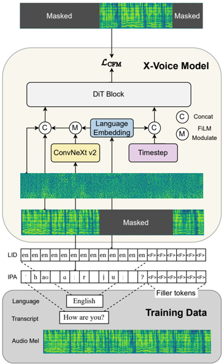

> [!abstract] arXiv · 2026 · Preprint
> **Xu et al.** (Shanghai Jiao Tong University / Shanghai Innovation Institute / Johns Hopkins University) · [→ Paper](https://arxiv.org/abs/2605.05611) · Demo: ? · Code: ✓
>
> X-Voice scales F5-TTS-style flow matching to 30 languages with a shared IPA vocabulary, language IDs injected at both the text and timestep level, and a fine-tuning stage on self-synthesized prompts that removes the need for a transcript of the reference audio, at 0.4B parameters.

## Problem

Zero-shot voice cloning in infilling-style non-autoregressive TTS needs the transcript of the audio prompt, because the prompt text and target text are concatenated and aligned implicitly against the prompt-plus-target mel sequence. In multilingual and cross-lingual use, prompt transcripts are often unavailable or unreliable, especially for low-resource languages and unwritten dialects. Earlier routes around this either add auxiliary modules (separate speaker encoders, inference-time classifiers) or depend on forced-alignment preprocessing, as in the group's own [[2509.14579|Cross-Lingual F5-TTS]], which the authors argue introduces cascading errors when scaled across many languages. Separately, multilingual NAR systems suffer from accent leakage in cross-lingual synthesis: the prompt speaker's source-language accent carries into the target language. Multilingual systems that scale to dozens of languages are mostly large autoregressive or hybrid models with slow inference.

## Method

**Representation.** All languages share one phonetic token space: IPA from eSpeak-NG for most languages, with specialized frontends for Thai (PyThaiNLP), Japanese (PyOpenJTalk) and Korean (g2pK), and Pinyin for Mandarin. Lexical stress markers are kept as tokens, and suprasegmental modifiers (length, aspiration, tone numbers) are split from the core articulatory symbol but embedded in the same sequence (§3.3, Table 1).

**Backbone.** X-Voice uses the F5-TTS DiT configuration (22 layers, 16 heads, 1024-d text embeddings) trained with optimal-transport conditional flow matching on the text-guided mel infilling task, initialized from the public F5-TTS v1 Base checkpoint (trained on Emilia) and further trained for 600K updates on a 420K-hour, 30-language corpus assembled from open datasets and filtered by duration, speaking rate, transcript-language check, deduplication and DNSMOS (§2.1, §4.1, Appendix A-B). No explicit alignment is used in either stage.

**Dual-level language injection.** A 512-d language-ID embedding is (a) concatenated with the flow timestep embedding and passed through an MLP, giving a global, sequence-wide language signal, and (b) applied to text embeddings through FiLM (scale and shift conditioned on the language ID) rather than concatenation. Both injection paths are zero-initialized so they do not disturb the pretrained F5-TTS weights at the start of training (§3.4).

**Decoupled, scheduled CFG.** At inference, guidance is split into an acoustic term (full condition versus text-plus-language only) and a linguistic term (text-plus-language versus unconditional), each with its own strength (w_A = 2.5, w_L = 4.0). The authors add an asymmetric warmup (A-Warmup): linguistic guidance ramps linearly from zero over the first steps while acoustic guidance starts at full strength, and both decay as (1 - t)^2 in the final steps. Inference uses a 16-NFE Euler solver with sway sampling (§3.4, §4.1).

**Stage 2: transcript-free fine-tuning.** A 30K-hour subset (top 1K hours per language by DNSMOS) is used as prompts for X-Voice s1, which synthesizes 10,533 hours of new utterances in the same voice from texts sampled from a per-language text pool. Fine-tuning then pairs each synthetic clip (as the prompt) with the real recording (as the target), and removes the prompt text: the text sequence starts with N learnable prompt placeholder tokens (N set by the prompt-to-target duration ratio) plus an EOS mark, followed by the target text. The timestep-level language ID is fixed to the target language; at the text level, placeholder and filler tokens receive no language ID and the EOS mark gets an "unknown" ID. This synthetic-prompt SFT recipe follows the group's unpublished Cross-Lingual F5-TTS 2. Fine-tuning runs 70K steps from the s1 checkpoint. Because the prompt transcript no longer fixes total duration, X-Voice s2 uses a separate transformer speaking-rate predictor (configuration taken from Cross-Lingual F5-TTS), which brings the system to 0.4B parameters (§3.5, §4.1, Table 2, Appendix B).

The authors also release a 30-language test set (500 utterances, over 100 speakers per language, mostly from Common Voice) with VAD trimming and an ECAPA-TDNN prompt/target similarity filter of 0.6, plus a normalization frontend and evaluation scripts (§2.2).

## Key Results

**Seed-TTS test set (Table 3).** X-Voice s1/s2 reach WER 1.19/1.28 on test-zh and 1.53/1.30 on test-en, with SIM-o 0.75/0.76 (zh) and 0.65/0.65 (en). Both beat the F5-TTS figures reported in the original paper (1.74 zh, 1.89 en WER) and LEMAS-TTS on test-zh (3.34), while on test-en only s2 beats LEMAS-TTS (1.49; s1 is 1.53). However, Qwen3-TTS (0.92, 1.08 WER; 0.77, 0.71 SIM-o) is better on all four columns, and OmniVoice's reported numbers are better on test-zh WER and on SIM-o in both languages. X-Voice's RTF (0.073 on an RTX 4090, batch 1) is the lowest among the multilingual systems (OmniVoice 0.198, LEMAS-TTS 0.131, Qwen3-TTS 1.754, Fish Audio S2 4.801). MOSS-TTS, OmniVoice and F5-TTS quality numbers are copied from their papers rather than rerun.

**LEMAS-TTS test set (Table 4).** Against the closest flow-matching multilingual baseline, X-Voice s1 has lower WER than LEMAS-TTS in all 10 languages and higher SIM-o in 9 of 10 (Portuguese is the exception: 0.722 vs 0.737). X-Voice s2 has lower WER in all languages except Portuguese (5.71 vs 5.30) and higher SIM-o in all except English (0.710 vs 0.726) and Portuguese (0.715 vs 0.737).

**30-language X-Voice test set (Tables 5 and 6).** On WER, X-Voice is competitive with or better than the open-source systems in most languages and achieves the best WER on English (s2 2.29) and Russian (s1 2.68). The comparison with the stronger baselines is more mixed than the abstract's "comparable to billion-scale models" suggests. Over the 10 languages Qwen3-TTS supports, X-Voice s2 has lower WER on Korean, English and Russian and higher WER on the other seven (e.g. Chinese 2.87 vs 2.16, French 8.55 vs 6.65, Spanish 2.89 vs 2.11). OmniVoice (0.8B) has lower WER than X-Voice s2 on most of the widely used languages (Chinese, Japanese, Thai, French, German, Italian, Portuguese, Spanish), while X-Voice s2 is lower on Korean, Vietnamese, English, Russian and several low-resource European languages (Estonian, Finnish, Hungarian, Latvian, Maltese, Romanian, Slovenian). On SIM-o, Qwen3-TTS is higher than X-Voice s2 on all 10 shared languages, and OmniVoice is higher in essentially every language; the largest gap is English (0.547 for s2 vs 0.719 OmniVoice and 0.697 Qwen3-TTS, and below LEMAS-TTS's 0.560). The authors describe the SIM shortfall as "slight"; for English it is not. In the human evaluation (10 native raters, 20 utterances per language, 5-point IMOS for intelligibility/naturalness and SMOS for speaker similarity), X-Voice beats Fish Audio S2 and MOSS-TTS on most low-resource European languages (Swedish is an exception, where MOSS-TTS is higher on both IMOS and SMOS), but Qwen3-TTS has higher IMOS and SMOS in most of its supported languages, and X-Voice is weakest on Japanese (s2 IMOS 3.10, SMOS 2.76) and Portuguese SMOS (2.36). OmniVoice is absent from the subjective test because it appeared after the test was run.

**Cross-lingual (Table 7, WER only).** Over 10 prompt-to-target pairs, X-Voice s2 has the lowest WER on 5 (zh to ru, ru to ko, ko to en, ko to ru, it to en), Qwen3-TTS on 4 (en to it, it to zh, ru to zh, zh to it), and Fish Audio S2 on en to ko (1.71 vs 3.10). No speaker-similarity or accent metric is reported for the cross-lingual setting, the condition where timbre retention versus accent suppression matters most.

**Transcript-free cost.** Moving from s1 to s2 removes the prompt transcript but raises WER on the LEMAS test set in 9 of 10 languages (e.g. Chinese 1.38 to 1.87; English is the exception, 1.06 to 0.98) and lowers SMOS in most languages in Table 6, which the authors attribute to more standardized, less speaker-specific pronunciation.

**Ablations (Tables 8 and 9).** Adding timestep-level language injection to FiLM text injection cuts cross-lingual WER sharply (en to zh 6.05 to 1.87, it to zh 6.85 to 2.93) and intra-lingual average WER from 5.28 to 4.94. FiLM versus concatenation at the text level is mostly favourable to FiLM (intra-lingual 4.94 vs 5.49), though concatenation is marginally better on it to zh (2.88 vs 2.93). For CFG, Decoupled + Decay + A-Warmup gives the best average WER (8.20) and UTMOS (3.284), against 8.85 and 3.207 for single-scale CFG at w = 2.5, while the best SIM-o (0.694) comes from single-scale w = 2.5 with decay; A-Warmup itself adds only 0.09 WER over Decoupled + Decay. No variance or significance testing is reported.

## Novelty Assessment

The system is an incremental but coherent extension of F5-TTS. The genuinely new pieces are modest: timestep-level language-ID injection combined with FiLM text modulation, and an asymmetric warmup on top of decoupled CFG, which itself is borrowed from [[2502.18924|MegaTTS 3]] and [[2601.03632|ReStyle-TTS]], with the decay schedule taken from [[2601.04233|LEMAS]] and related work. The ablation for dual-level injection is convincing on cross-lingual WER; the CFG gains are small. The transcript-free stage follows a recipe credited to the group's unpublished Cross-Lingual F5-TTS 2, so its novelty here is in applying it at 30-language scale and showing it can replace the forced-alignment preprocessing of [[2509.14579|Cross-Lingual F5-TTS]]; the paper does not compare numerically against either predecessor. The contributions most likely to matter practically are the released 420K-hour corpus, the 30K-hour high-quality subset and the 30-language benchmark with scripts, together with an inference speed advantage that is real (RTF 0.073 vs 0.198 to 4.8 for the multilingual baselines). The comparison is reasonably fair in that most baselines were rerun on the same test sets, but several Seed-TTS numbers are copied from original papers, and the benchmark is built by the same authors.

## Field Significance

Moderate. X-Voice shows that a sub-0.5B non-autoregressive flow-matching model with a shared phonetic vocabulary can cover 30 languages with WER in the range of much larger autoregressive systems, while trailing them on speaker similarity, and that synthetic-prompt fine-tuning can remove prompt transcripts at a measurable cost in intelligibility and similarity. Its open corpus and 30-language benchmark provide reusable infrastructure for multilingual zero-shot TTS evaluation.

## Claims

- **supports:** Injecting a global language identity signal into the flow-matching time conditioning, not only into text embeddings, substantially reduces accent leakage in cross-lingual zero-shot synthesis.
  > *Evidence:* Adding timestep-level language-ID concatenation to FiLM text-level injection lowers cross-lingual WER from 6.05 to 1.87 (en to zh), 5.89 to 3.44 (zh to it) and 6.85 to 2.93 (it to zh), versus much smaller changes from text-level injection alone over no injection. *(§4.5, Table 8)*
- **complicates:** Removing the need for prompt transcripts in infilling-based zero-shot TTS trades away some intelligibility and speaker similarity.
  > *Evidence:* The transcript-free X-Voice s2 has higher WER than the transcript-dependent s1 in 9 of 10 languages on the LEMAS-TTS test set (e.g. Chinese 1.38 to 1.87) and lower SMOS in most languages in the 30-language listening test, attributed to more standardized pronunciation. *(§4.3, Table 4, Table 6)*
- **supports:** Synthetic audio prompts generated by a pretrained zero-shot TTS model can serve as training data for transcript-free voice cloning without forced alignment or auxiliary speaker encoders.
  > *Evidence:* Fine-tuning on 10,533 hours of self-synthesized prompt/real-target pairs with prompt text replaced by placeholder tokens yields a model that clones voices without prompt transcripts while keeping Seed-TTS WER at 1.28 (zh) and 1.30 (en). *(§3.5, Table 3)*
- **refines:** Separating acoustic and linguistic classifier-free guidance improves intelligibility and naturalness in multilingual flow-matching TTS, but a single conservative guidance scale still preserves speaker timbre best.
  > *Evidence:* Decoupled guidance with decay and asymmetric warmup gives the lowest average WER (8.20) and highest UTMOS (3.284), while the highest SIM-o (0.694) comes from single-scale CFG at w = 2.5 with decay. *(§4.6, Table 9)*
- **complicates:** Speaker similarity remains the weakest axis for compact multilingual zero-shot TTS relative to larger systems, even when intelligibility is competitive.
  > *Evidence:* X-Voice s2 achieves the best English WER on the 30-language test set (2.29) but its English SIM-o (0.547) is far below OmniVoice (0.719) and Qwen3-TTS (0.697), and Qwen3-TTS has higher SIM-o in all 10 shared languages. *(§4.3, Table 5)*

## Limitations and Open Questions

- Speaker similarity lags the strongest baselines across nearly all languages, by a wide margin in English; the authors acknowledge that the accent-suppression versus timbre-preservation trade-off needs finer modelling.
- Cross-lingual evaluation reports WER only. Without cross-lingual SIM or an accent measure, the claim that dual-level injection suppresses accent leakage "while maintaining" timbre is supported only on the intelligibility side.
- The transcript-free stage depends on high-quality synthetic data from the stage-1 model, so any stage-1 weaknesses (e.g. on Japanese) can propagate; the authors name purely unsupervised cross-lingual transfer as open.
- Intra-sentential code-switching is not handled well, per the authors.
- No direct comparison with Cross-Lingual F5-TTS, the forced-alignment approach X-Voice is positioned against, so the practical benefit of avoiding forced alignment is argued rather than measured.
- The benchmark and its curation thresholds are defined by the same authors; human evaluation uses 20 utterances per language without confidence intervals, and OmniVoice is excluded from it.
- The vocoder used to render mel-spectrograms is not reported.

## Wiki Connections

- [[flow-matching|Flow Matching]] — X-Voice is an OT-CFM DiT that adds language-ID conditioning paths and a decoupled, scheduled CFG for multilingual synthesis.
- [[zero-shot-tts|Zero-Shot TTS]] — Provides a transcript-free variant of infilling-based zero-shot voice cloning via fine-tuning on self-synthesized prompts.
- [[multilingual-tts|Multilingual TTS]] — Trained on 420K hours across 30 languages with a shared IPA vocabulary and evaluated intra- and cross-lingually in all 30.
- [[subjective-evaluation|Subjective Evaluation]] — Runs per-language native-speaker IMOS and SMOS tests (10 raters, 20 utterances) across 30 languages.
- [[evaluation-metrics|Evaluation Metrics]] — Releases a 30-language zero-shot cloning test set with ground-truth targets, a normalization frontend and evaluation scripts.
- [[2025.acl-long.313|F5-TTS]] — X-Voice adopts the F5-TTS architecture, initializes from its v1 Base checkpoint, and reports lower Seed-TTS WER than F5-TTS's published numbers.
- [[2509.14579|Cross-Lingual F5-TTS]] — Earlier system from the same group whose forced-alignment preprocessing X-Voice replaces with synthetic-prompt fine-tuning, while reusing its speaking-rate predictor design.
- [[2601.04233|LEMAS]] — Closest flow-matching multilingual baseline and source of a training subset and test set; X-Voice beats it on WER in nearly all languages.
- [[2601.15621|Qwen3-TTS]] — Billion-scale autoregressive baseline that still leads X-Voice on speaker similarity and on WER in most of its supported languages.
- [[2604.00688|OmniVoice]] — Concurrent non-autoregressive omnilingual baseline with higher SIM-o than X-Voice in nearly every language and mixed WER comparisons.
- [[2603.08823|Fish Audio S2]] — Autoregressive baseline that X-Voice outperforms clearly on low-resource European languages in both WER and listening tests.
- [[2601.03632|ReStyle-TTS]] — Source of the decoupled classifier-free guidance that X-Voice extends with asymmetric warmup and decay.
- [[2406.02430|Seed-TTS]] — Provides the Chinese and English intra-lingual test sets used for comparison.
