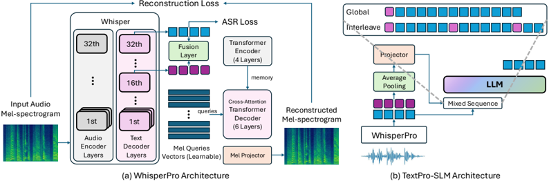

> [!abstract] arXiv · 2026 · Preprint
> **Wenqian Cui et al.** (The Chinese University of Hong Kong / Huawei Technologies) · [→ Paper](https://arxiv.org/abs/2605.05927) · Demo: ? · Code: ?
>
> Replaces the usual continuous or discrete speech-feature input of a speech LLM with a transcript plus a single pooled prosody embedding from a reconstruction-trained Whisper decoder, so the text-LLM backbone sees almost exactly its native input and loses very little accuracy relative to text-only prompting.

## Problem

Speech LLMs built from text-LLM checkpoints still answer spoken questions noticeably worse than their backbone answers the same questions in text (the "modality gap"). The authors argue that prior mitigation worked mainly on the output side: moving from speech-token-only generation, to text-then-speech generation, to thinker-talker designs where the backbone emits only text. With the output side already text-like, they locate the remaining bottleneck on the input side, where the LLM must infer both lexical content and paralinguistic cues from a speech representation that is far from its training distribution. Training-side fixes (KL distillation as in SALAD, on-policy distillation, modality-specific mixture-of-experts as in [[2506.21864|DeepOmni]], experience replay) improve optimisation but leave the input format unchanged.

## Method

TextPro-SLM has two components. The speech encoder, **WhisperPro**, is a fine-tuned [[2212.04356|Whisper]]-large-v3 that emits two token-aligned streams: the autoregressively decoded transcript, and "prosody embeddings" taken as the hidden state of each text token at the 16th of Whisper's 32 decoder layers. To force these hidden states to carry acoustic information, a mel-reconstructor is attached: text-token embeddings and projected prosody embeddings are concatenated and fused per token, contextualised by a 4-layer Transformer encoder, and decoded into a fixed 3000-frame, 128-bin mel spectrogram by a 6-layer cross-attention Transformer decoder driven by learnable per-frame queries. WhisperPro trains with ASR cross-entropy plus mel MSE (λ = 1.0) on LibriSpeech 960h with punctuated LibriSpeech-PC transcripts, augmented with 40h of CommonsenseQA questions synthesised by Kokoro TTS to stabilise transcription of question-plus-choices utterances. The mel-reconstructor is a training-only auxiliary; no speech is generated at inference.

The **prosody-aware LLM** (Qwen2.5-3B/7B-Instruct) receives the WhisperPro transcript re-tokenised with its own tokenizer. In the default "global prepending" mode, all prosody embeddings of the user turn are average-pooled into one vector, projected by a two-layer MLP, and prepended as a single soft token before the text. An "interleaving" variant pools the prosody sequence into ⌈T/r⌉ groups and inserts one projected embedding every r text tokens (5:1 in experiments). Training is two-stage (projector only with frozen LLM, then projector plus LLM), using cross-entropy on about 990 hours of audio: knowledge distillation data (UltraChat subset and CommonsenseQA, converted to speech with Kokoro TTS, transcribed by WhisperPro, with responses from the original text LLM as targets), speech captioning (ParaSpeechCaps, for gender and accent), and emotion and age classification (IEMOCAP, CREMA-D, SAVEE, TESS, ESD English; Common Voice age labels). Appendix F reports that plain cross-entropy on teacher responses conditioned on ASR text (ASRQ_ASRA, α = 0) beat KL distillation and ground-truth-text variants, so the final model uses it. Speech output is out of scope: the authors treat synthesis from the text response as a decoupled talker problem and evaluate text outputs only.

## Key Results

**Encoder.** WhisperPro lowers WER relative to Whisper-large-v3 on LibriSpeech test (1.96% vs 4.43%) and GigaSpeech test (12.89% vs 13.66%), though the LibriSpeech gain is in-domain since WhisperPro fine-tunes on LibriSpeech. Its prosody embeddings are much more probe-able: 2-layer MLP probe average 61.09 vs 38.53 across SER (RAVDESS), speaker ID (VoxCeleb1), and binned F0 and energy (LibriTTS), with gains on every attribute *(Table 2)*. Layer choice (4/16/30) and λ (0.5/1.0/2.0) change OBQA accuracy and SER probing only modestly *(Figure 3)*.

**Modality gap (Table 3).** Gap is the backbone's text accuracy minus speech accuracy (lower is better), following SALAD's protocol. TextPro-SLM-7B reaches 82.5% average accuracy with an average gap of 0.7, versus 3.1 for [[2503.20215|Qwen2.5-Omni]] (80.1%), 3.5 for [[2504.18425|Kimi-Audio]] (79.7%), 7.1 for SALAD-7B Stage II (75.7%), 21.2 for [[2407.10759|Qwen2-Audio]], 28.4 for [[2412.02612|GLM-4-Voice]], 36.4 for [[2025.acl-long.388|DiVA]], and 4.3 for the Whisper + Qwen2.5-7B cascade (78.9%). At 3B the gap is 2.6 (74.3%) versus 3.0 for the cascade and 4.8 for SALAD-3B Stage II. The picture per benchmark is more mixed: on PIQA, TextPro-SLM-7B (69.7%) trails Kimi-Audio (82.9%), SALAD-7B (80.3%), and Qwen2-Audio (73.4%) in raw accuracy, and its negative PIQA gap (-1.6) means speech input scored above the text backbone, which also happens for Qwen2.5-Omni (-4.8) and Kimi-Audio (-14.8), so the gap metric is noisy on this task. On StoryCloze it is close to but below the 7B cascade (88.6% vs 89.1%), and on MMSU it trails the cascade (66.7% vs 67.9%) while winning on OBQA, ARC-E, and ARC-C. SALAD rows omit ARC-Easy, so SALAD's averages cover five rather than six benchmarks. Baseline gaps are computed against different backbones (GLM-4-9B, Qwen-7B-Chat, Llama-3-8B, Qwen2.5-7B-Instruct, Qwen2.5 Base for SALAD), so absolute gap values are not strictly comparable across rows. The 5:1 interleaved variant is nearly identical (82.1%, gap 1.1).

**Ablations (Table 3).** Removing knowledge distillation raises the 7B gap from 0.7 to 13.3. Feeding WhisperPro transcripts straight into an untrained Qwen2.5-7B-Instruct gives 79.7% with gap 3.6, better than the Whisper cascade (4.3) but worse than the trained system. The authors read this as evidence that adapting the LLM to WhisperPro's transcripts helps; the comparison does not isolate the contribution of the prosody token itself.

**Reasoning-heavy math (Table 4).** On VoxEval elementary, high-school, and college math (512-token budget), TextPro-SLM-7B averages 67.8% with gap 5.3, versus 61.6%/11.5 for Qwen2.5-Omni-7B and 49.2%/23.9 for Kimi-Audio-7B. Its largest gap is on college math (10.8). VoxEval is the authors' own earlier benchmark.

**Paralinguistics (Table 5).** On AIR-Bench emotion, gender, and age plus a self-built 1,000-item Common Voice accent benchmark, TextPro-SLM-7B averages 64.8% (5:1 variant 65.8%) versus 58.7% for Qwen2.5-Omni and 57.2% for Kimi-Audio. The lead is driven by age (64.9% vs 44.8% and 60.5%); on gender Qwen2.5-Omni is slightly higher (89.8% vs 88.6%), on emotion Kimi-Audio is slightly higher (61.1% vs 60.5%), and on accent Qwen2.5-Omni is essentially tied (45.3% vs 45.1%). Using original Whisper hidden states instead of the reconstruction-trained ones lowers the average to 61.3%, with drops on all four tasks; skipping paralinguistic training drops it to 35.0%.

## Novelty Assessment

The core idea, presenting speech to the LLM as transcript plus compact prosody vectors rather than as a speech-feature sequence, is a principled middle ground between a cascade and an end-to-end model, and its framing as an input-side counterpart to thinker-talker output design is the paper's main conceptual move. The architectural pieces are new in combination but individually familiar: reading intermediate Whisper decoder states, adding a mel-reconstruction auxiliary loss (borrowed from codec training), mean-pooling into one soft token, and distilling from the text backbone (as SALAD and others do). The near-zero gap is partly a property of the design: since the LLM sees essentially text, the system inherits cascade behaviour and its gap is bounded by ASR quality, so the more informative comparison is against the Whisper cascade, where the improvement is modest (0.7 vs 4.3 at 7B, 2.6 vs 3.0 at 3B). The data-efficiency claim (about 1,000 hours of LLM training audio) is real relative to the compared industrial systems, but much of the semantic competence comes from Whisper's 680k-hour pretraining. The paralinguistic evaluation covers four attributes, one on an authors' own benchmark, and no full-duplex, streaming, or spoken-output evaluation is attempted.

## Field Significance

Moderate. The paper gives clean evidence that, for speech LLMs that serve as spoken conversational agents, a transcript-centred input with a small amount of injected prosody keeps text-LLM reasoning nearly intact while still supporting emotion, gender, age, and accent recognition. It provides a concrete design point against which end-to-end speech-feature inputs can be judged, and its ablations separate the roles of distillation, encoder reconstruction training, and paralinguistic fine-tuning.

## Claims

- **supports:** Feeding a speech LLM a transcript-like input that matches the backbone's native text format largely closes the gap between spoken-input and text-input task accuracy.
  > *Evidence:* TextPro-SLM-7B (transcript plus one prosody token) has an average gap of 0.7 across six QA benchmarks versus 3.1 for Qwen2.5-Omni, 3.5 for Kimi-Audio, and 7.1 for SALAD-7B; on VoxEval math the gap is 5.3 versus 11.5 and 23.9 for Qwen2.5-Omni and Kimi-Audio. *(§4.2.2, Table 3, Table 4)*
- **refines:** Gains from transcript-style speech-LLM inputs over a plain ASR-plus-LLM cascade are small and depend on adapting the backbone to the encoder's transcripts.
  > *Evidence:* The Whisper + Qwen2.5-7B cascade already has an average gap of 4.3; untrained WhisperPro + Qwen2.5-7B reaches 3.6, and the full trained system 0.7; removing knowledge distillation raises the gap to 13.3. *(§4.2.2 "Ablation Studies", Table 3)*
- **supports:** An auxiliary spectrogram-reconstruction objective can inject paralinguistic information into ASR-trained representations without degrading transcription.
  > *Evidence:* WhisperPro's 2-layer probe average rises from 38.53 to 61.09 across SER, speaker ID, F0, and energy while LibriSpeech and GigaSpeech WER also fall; replacing WhisperPro hidden states with original Whisper states lowers downstream paralinguistic average from 64.8% to 61.3%. *(§4.1, Table 2; §4.2.3, Table 5)*
- **complicates:** A single utterance-level prosody summary is close to sufficient for coarse paralinguistic recognition, so denser prosody input yields only small further gains on attribute classification.
  > *Evidence:* Global prepending (one pooled token) scores 64.8% average on emotion/gender/age/accent; 5:1 interleaving scores 65.8%, improving three of four tasks by small margins while leaving QA accuracy nearly unchanged (82.5% vs 82.1%). *(§4.2.3, Table 5; Table 3)*
- **complicates:** Modality-gap scores computed as speech-minus-text accuracy against each system's own backbone are not directly comparable across systems and can go negative.
  > *Evidence:* Gaps are computed against different backbones per system, and several systems including TextPro-SLM, Qwen2.5-Omni, and Kimi-Audio show negative PIQA gaps (down to -14.8), meaning spoken input outscores the text backbone. *(§4.2.1 "Baselines", Table 3)*

## Limitations and Open Questions

> [!warning] No speech output is trained or evaluated
> All comparisons use text responses. Whether the transcript-plus-pooled-prosody input preserves enough information for a talker module to produce context-appropriate expressive speech (as opposed to recognising coarse attributes) is untested.

- The paralinguistic evaluation covers emotion, gender, age, and accent only, with accent on the authors' own 1,000-item Common Voice benchmark; the authors acknowledge that dynamic cues such as within-utterance emotion shifts or intent changes are not tested.
- The pipeline is sequential: Whisper must finish decoding the full utterance before the LLM starts, so it is not streamable and adds latency, a significant constraint for interactive spoken conversational agents.
- The 30-second Whisper window and fixed 3000-frame reconstructor bound the input length; long or multi-turn spoken context is not evaluated.
- Non-speech audio cannot be represented in the transcript stream, so sound-event or mixed-audio understanding is out of reach without redesign.
- The distillation and QA augmentation data are synthesised with a single Kokoro TTS voice, and ASR robustness to real noisy conversational speech beyond GigaSpeech is not reported.
- Errors made by WhisperPro propagate directly into the LLM's input; how often the prosody token helps recover from ASR errors is not analysed.

## Wiki Connections

- [[spoken-language-model|Spoken Language Model]] — Proposes a transcript-plus-prosody-token input format for an adapted text LLM consuming real speech, positioned between cascades and end-to-end speech-feature inputs.
- [[2503.20215|Qwen2.5-Omni]] — Main thinker-talker baseline sharing the Qwen2.5-7B-Instruct backbone; TextPro-SLM reports a lower modality gap and higher paralinguistic average but loses on PIQA and gender accuracy.
- [[2504.18425|Kimi-Audio]] — Compared end-to-end baseline on the same Qwen2.5-7B backbone; stronger on PIQA and emotion, weaker on the modality-gap average and VoxEval math.
- [[2412.02612|GLM-4-Voice]] — Discrete-token speech LLM cited as the motivating example of a large modality gap and evaluated as a baseline.
- [[2025.acl-long.388|DiVA]] — Distillation-based voice assistant baseline with the largest modality gap in the comparison.
- [[2212.04356|Whisper]] — Whisper-large-v3 is the base of the WhisperPro encoder and of the cascaded topline.
- [[2410.17196|VoiceBench]] — Source of the spoken OpenBookQA and MMSU benchmarks used to measure the modality gap.
- [[2402.07729|AIR-Bench]] — Provides the emotion, gender, and age paralinguistic tasks and the format for the authors' accent benchmark.
