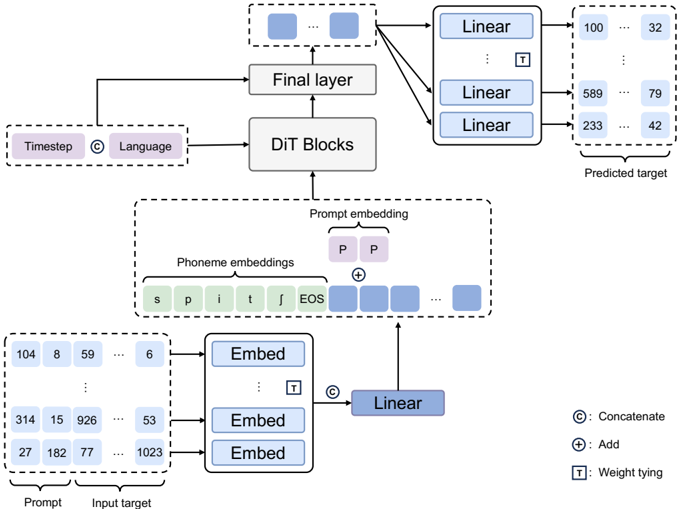

> [!abstract] arXiv · 2026 · Preprint
> **Dong Yang et al.** (The University of Tokyo) · [→ Paper](https://arxiv.org/abs/2605.09386) · Demo: ✓ · Code: ?
>
> Makes metric-induced discrete flow matching practical for codec-token zero-shot TTS by replacing its hand-tuned time scheduler with a training-free kinetic-optimal schedule (constant Fisher-Rao speed) and adding a finite-step moment correction to the CTMC sampler, then shows under a controlled backbone that the resulting GibbsTTS beats masked discrete flow matching and masked discrete diffusion baselines.

## Problem

Non-autoregressive codec-token TTS has mostly used mask-source generation (masked discrete diffusion as in MaskGCT, or masked discrete flow matching as in DiFlow-TTS). These formulations treat codec tokens as symbolic labels and ignore the geometry of the codec's embedding space. Metric-induced discrete flow matching (MI-DFM, introduced by Shaul et al. in the kinetic-optimal discrete flow matching work, not in this corpus) does use that geometry: it starts from a uniform token distribution and defines intermediate distributions as Gibbs distributions over token-to-target embedding distances. Two practical problems limit it. First, its inverse-temperature schedule $\beta_t = c\,(t/(1-t))^a$ is heuristic and requires a downstream hyperparameter search. Second, its first-order continuous-time Markov chain (CTMC) sampler is exact only in the infinitesimal-step limit and accumulates path-tracking error at practical step counts. MI-DFM had also not been studied for TTS before, and prior comparisons of discrete generative formulations for TTS confound the generative algorithm with differences in architecture, data, and inference pipeline.

## Method

**Metric-induced path.** For each token position, the conditional path is $p_t(x \mid x_1) = \mathrm{softmax}(-\beta_t\, d(x, x_1))$, where $d$ is a distance between codebook embeddings. Because the codec uses $\ell_2$-normalized codebook embeddings, the paper uses squared Euclidean distance between normalized embeddings (equivalent to a cosine distance), with one distance matrix per RVQ codebook. At $t=0$ every token is equally likely; as $\beta_t \to \infty$ the distribution collapses onto the target token. Training uses the standard DFM cross-entropy objective of predicting the clean token from a sample drawn along the path.

**Kinetic-optimal time scheduler (§3).** The paper fixes the geometric curve $p(x;\kappa)$ and optimizes only its time reparameterization $\kappa_t$. It proves that the Fisher-Rao length is scheduler-invariant (Lemma 1), that the energy-minimizing scheduler is the one with constant Fisher-Rao speed (Lemma 2), and that this scheduler is $\kappa^*_t = F^{-1}(t)$ with $F$ the normalized cumulative Fisher-Rao arc length (Proposition 1). For the Gibbs path, the Fisher information with respect to $\beta$ is exactly the variance of the distance to the target token, which has no closed form because it depends on the full distance distribution. The scheduler is therefore built numerically: choose a large $\beta_{\max}$ automatically, evaluate the Fisher information on a $\beta$ grid, integrate and invert the arc length on a uniform time grid, and store $\beta^*_t$ and $\dot\beta^*_t$ as lookup tables used by linear interpolation in both training and inference. The only remaining choices are grid resolutions, picked on accuracy-cost grounds rather than by downstream search. As a consistency check, the construction recovers the known closed-form $\sin^2(\frac{\pi}{2}t)$ schedule for mask-source mixture paths (Appendix D).

**Finite-step moment correction (§4).** At each step the sampler predicts an endpoint token, computes the jump intensity and the jump destination distribution, and normally jumps with probability $1-\exp(-h\lambda_t)$. The correction keeps the destination distribution unchanged and replaces only the jump probability with the value that makes a chosen scalar moment after the step match a reference moment at $t+h$ (a one-dimensional least-squares solve). For MI-DFM the statistic is the local Fisher-Rao tangent $\partial_t \log p_t(x \mid \hat{x}_1)$; after $\dot\beta_t$ cancels, the corrected jump probability is the ratio of expected-distance differences, falling back to the base solver whenever it leaves $[0,1]$. The authors state explicitly that this is not a higher-order integrator and does not recover the infinitesimal CTMC limit as $h \to 0$; it targets practical step counts. For the standard mixture path it reduces to the known exact finite-step update (Appendix F).

**Model (§5, §6.1).** GibbsTTS is a DiT backbone (RoPE, SwiGLU, RMSNorm) with timestep and language embeddings concatenated to drive adaLN-Zero conditioning. Embeddings of all 12 RVQ codebooks are concatenated per frame and linearly projected, then concatenated in time with phoneme embeddings from an improved StableTTS G2P frontend. The model predicts all codebooks jointly at every step (full-codebook training and inference) with linearly decaying codebook-wise loss weights, which the authors report were needed to avoid gradient explosion when training from scratch. Zero-shot prompting uses a random prefix (ratio sampled from $U(0, 0.3)$) of the utterance as the speech prompt, marked by a learnable prompt embedding. Target length comes from a rule-based prompt speech-to-phoneme ratio, clipped toward the training-set average ($\gamma = 0.8$). The codec is MaskGCT's released pre-trained acoustic codec, used frozen as the token space and decoder. Large is 399M parameters trained on English and Chinese Emilia (32 GPUs, 46 hours); Base is 178M trained on English Emilia and used for searches and ablations. Inference uses 32 NFE, classifier-free guidance (scale 2.5) and a per-model sampling temperature chosen on LibriTTS test-clean (0.6 for MI-DFM).

**Controlled baselines.** On the same backbone, data, and pipeline, the paper trains masked DFM and masked discrete diffusion (DD, MaskGCT-style inference) with three schedulers each: closed-form kinetic-optimal $\sin^2(\frac{\pi}{2}t)$, the $t^2$ schedule used by DiFlow-TTS, and the $\sin(\frac{\pi}{2}t)$ schedule used by MaskGCT. It also trains MI-DFM with the grid-searched heuristic schedule ($a=5$, $c=1$, selected on the Base variant), with and without the corrector.

## Key Results

Table numbers below follow the paper (Docling's asset numbering is offset by one after Table 2).

**Controlled comparison (Table 2, 32 NFE).** On Seed-TTS test-en, GibbsTTS has the best UTMOS (3.651), WER (1.777%), and SIM (0.743) among generated systems, although the margins over masked DFM with the closed-form KO scheduler are small for UTMOS (3.639) and SIM (0.742); the WER gap is larger (1.969%). On test-zh it has the best UTMOS (2.712) and SIM (0.790), but its CER (1.327%) is behind grid-searched MI-DFM (1.297%) and masked DFM with the DiFlow-TTS scheduler (1.308%). On the CosyVoice 3 sets it has the best UTMOS in both languages (3.238 en, 2.438 zh) and the best English WER (4.110%), but masked DFM with closed-form KO has slightly higher SIM in both languages (0.695 vs 0.691 en, 0.781 vs 0.780 zh) and grid-searched MI-DFM has a clearly lower Chinese CER (3.706% vs 4.144%).

**Scheduler ablation.** Against the grid-searched MI-DFM scheduler, the numerical KO scheduler improves all three metrics on Seed-TTS test-en and CosyVoice 3 en, and improves UTMOS and SIM on both Chinese sets while regressing CER on both (1.327 vs 1.297 on Seed-TTS test-zh; 4.144 vs 3.706 on CosyVoice 3 zh). The gain is that it matches or beats a searched schedule without any search, rather than dominating it.

**Corrector ablation.** At 32 NFE, removing the corrector degrades every metric on every test set under both schedulers; for example, under the KO scheduler Seed-TTS test-en UTMOS falls from 3.651 to 3.403 and WER rises from 1.777% to 2.120%, and CosyVoice 3 zh CER rises from 4.144% to 5.485% (Table 2). Across 16, 32, and 64 NFE (Tables 11 and 12) the corrector helps in nearly all settings; one visible exception is CosyVoice 3 zh SIM at 64 NFE (0.768 with the corrector vs 0.777 without). GibbsTTS SIM on CosyVoice 3 also drops from 32 to 64 NFE (0.691 to 0.677 en, 0.780 to 0.768 zh), so more steps are not uniformly better.

**Scheduler coupling for masked models.** The MaskGCT schedule is the weakest scheduler for masked DFM but the strongest for masked DD; the closed-form KO schedule gives masked DD competitive UTMOS (3.634 on Seed-TTS test-en) with very poor WER (5.808% on Seed-TTS test-en, 18.353% on CosyVoice 3 en).

**Subjective tests (Table 3).** CMOS (range $[-3, 3]$, GibbsTTS as the 0 reference) and SMOS ($[1,5]$), with 20 native English or Chinese listeners recruited on Prolific per test, on utterances drawn equally from Seed-TTS and CosyVoice 3. Every comparison system scores negative CMOS. Differences are significant at $p<0.05$ for the no-corrector variant (-0.362 en, -0.459 zh), masked DD with the MaskGCT schedule (-0.743, -0.647), and the original MaskGCT (-0.762, -0.612). They are weaker for the closest baselines: masked DFM with closed-form KO is -0.229 in both languages at only $p<0.1$, and grid-searched MI-DFM is -0.257 en ($p<0.05$) and -0.153 zh (not significant). GibbsTTS has the highest SMOS (4.18 en, 4.28 zh), but its lead over grid-searched MI-DFM (4.05, 4.21), masked DFM closed-form KO (3.94, 4.11), and original MaskGCT (4.06, 4.19) is not marked significant.

**Comparison with external systems (Tables 4 and 5).** These systems were run from official checkpoints and are not controlled. GibbsTTS has the highest SIM on Seed-TTS test-en (0.743), test-zh (0.790), and CosyVoice 3 zh (0.780), and is second on CosyVoice 3 en (0.691 vs OmniVoice 0.705). It is not the strongest on naturalness or intelligibility. Qwen3-TTS 1.7B reaches UTMOS 4.178 and WER 1.434% on Seed-TTS test-en, and OmniVoice reaches a test-zh CER of 0.927%. On CosyVoice 3 en, OmniVoice, both Qwen3-TTS sizes, and IndexTTS2 have lower WER, while CosyVoice 3, CosyVoice 2, Spark-TTS, and F5-TTS have higher. Against MaskGCT (1.5B, same codec, semantic-plus-acoustic two-stage pipeline), the 0.4B GibbsTTS is better on every objective metric in both tables. The codec itself caps quality: reconstructed audio scores UTMOS 3.407 and SIM 0.695 on Seed-TTS test-en against 3.527 and 0.734 for ground truth, yet GibbsTTS output scores above both (3.651, 0.743).

**Other ablations (Base variant).** Per-codebook KO schedulers give no consistent gain over one shared scheduler (Table 7). At fixed NFE, MaskGCT-style per-layer generation is worse than full-codebook generation on intelligibility and similarity (for example, CosyVoice 3 en WER 14.366% at 32 NFE vs 7.224%; Table 8), though per-layer gets slightly higher UTMOS in some allocations. An autoregressive full-codebook baseline failed to train stably (Appendix I).

## Novelty Assessment

The contribution is algorithmic and sits in the sampler and schedule, not in the network. Constant-Fisher-Rao-speed scheduling for a fixed scalar path is a clean generalization: kinetic-optimal velocities and the closed-form mask-path schedule already existed, and the step here is a numerical construction for paths with no closed form, which removes the heuristic search the original MI-DFM work flagged as a limitation. The moment correction is a simple, lightweight change to jump probability only, and it is the component with the largest and most consistent empirical effect. The DiT backbone, G2P frontend, rule-based duration, and frozen MaskGCT codec are standard; full-codebook prediction with codebook loss weights is a practical design shared with concurrent OmniVoice. The controlled comparison of uniform-source metric paths against mask-source DFM and DD on one backbone, including scheduler sweeps, is useful on its own. Against the strongest controlled baseline (masked DFM with the closed-form KO schedule), however, the objective margins are small and mixed, and the subjective margin is only $p<0.1$.

## Field Significance

moderate — By the authors' account this is the first application of metric-induced discrete flow matching to TTS. It provides a training-free schedule and a finite-step sampler correction that are general to discrete CTMC samplers. Its main evidence is a controlled comparison showing that exploiting codec-embedding geometry is competitive with, and on several metrics better than, mask-source discrete generation for codec tokens. The sampler correction is the most robust finding. The scheduler's advantage is mainly that it removes search, and the gain over the best masked baseline is modest.

## Claims

- **supports:** Probability paths that exploit the embedding geometry of codec tokens (uniform source with distance-based Gibbs intermediates) are a competitive alternative to mask-source discrete generation for non-autoregressive codec-token TTS.
  > *Evidence:* With the backbone, data, and pipeline held fixed, MI-DFM with the KO scheduler and corrector has the best UTMOS on all four test sets and the best Seed-TTS test-en WER and SIM. However, masked DFM with the closed-form KO schedule is within 0.012 UTMOS and 0.001 SIM on Seed-TTS test-en and slightly ahead on CosyVoice 3 SIM, and the CMOS margin over it is only $p<0.1$. *(§7, Tables 2 and 3)*
- **supports:** For a fixed discrete probability path, a time schedule derived from Fisher-Rao geometry (constant information-geometric speed) can replace heuristic schedule search without loss of overall quality.
  > *Evidence:* The training-free numerical KO schedule improves UTMOS and SIM on all four test sets and English WER on both sets relative to a grid-searched $c\,(t/(1-t))^a$ schedule, while regressing Chinese CER (1.327 vs 1.297; 4.144 vs 3.706). *(§3.2, §7, Table 2, Table 6)*
- **supports:** First-order CTMC samplers for discrete flow matching leave measurable path-tracking error at practical step counts, and adjusting only the jump probability to match a moment of the next-time distribution recovers much of it.
  > *Evidence:* Removing the moment corrector lowers Seed-TTS test-en UTMOS from 3.651 to 3.403 and raises CosyVoice 3 zh CER from 4.144% to 5.485%. The gain holds under both schedulers and in nearly all 16/32/64 NFE settings, with an exception for CosyVoice 3 zh SIM at 64 NFE. *(§4.2, §7, Tables 2, 11, 12)*
- **complicates:** The best noise schedule for masked discrete generation depends on the decoding formulation, so schedules cannot be transferred between masked flow matching and masked diffusion inference even with the same training objective.
  > *Evidence:* The MaskGCT $\sin(\frac{\pi}{2}t)$ schedule is the worst masked-DFM schedule but the best masked-DD schedule. The closed-form KO schedule gives masked DD high UTMOS (3.634) but WER of 5.808% on Seed-TTS test-en and 18.353% on CosyVoice 3 en. *(§7, Table 2, Appendix L)*
- **refines:** For residual-quantized codec tokens under a fixed step budget, jointly updating all codebooks at each step is more effective for intelligibility and speaker similarity than coarse-to-fine per-layer generation.
  > *Evidence:* With equal or larger NFE, MaskGCT-style per-layer generation reaches 14.366% to 16.988% WER on CosyVoice 3 en against 7.224% for full-codebook generation, with lower SIM throughout, though some per-layer allocations score slightly higher UTMOS. *(Appendix I, Table 8)*

## Limitations and Open Questions

- The strongest controlled baseline, masked DFM with the closed-form KO schedule, is close on most objective metrics and only marginally worse subjectively ($p<0.1$). The paper's "best overall" verdict relies on a two-of-three-metric-categories rule rather than uniform dominance.
- The scheduler removes downstream search but does not dominate the searched schedule: Chinese CER is worse on both test sets. The heuristic schedule was searched on the English-only Base variant and then applied to the bilingual Large model, which may disadvantage it.
- The corrector does not recover the infinitesimal CTMC limit, so it is not a consistent integrator. Its gains are empirical at 16 to 64 NFE, and the choice of moment statistic was not explored beyond one option.
- Only one distance (cosine-equivalent, from one $\ell_2$-normalized codec) and one codec are tested. The frozen MaskGCT codec sets a visible ceiling (reconstruction UTMOS 3.407 vs ground truth 3.527 on Seed-TTS test-en), and codebook geometry was not optimized for the metric path.
- Chinese UTMOS values (around 2.4 to 2.8, below the English range even for ground truth) come from UTMOS, a predictor trained on English data, so absolute Chinese naturalness comparisons are less informative than within-language rankings.
- External comparisons are uncontrolled (model size, data, frontend, codec). GibbsTTS lags LLM-initialized and large autoregressive systems on UTMOS and WER/CER, and the authors attribute part of the intelligibility gap to their simple G2P frontend without isolating it.
- Duration comes from a clipped rule-based ratio rather than a learned predictor, which suppresses prompt-dependent speaking-rate variation.
- Code availability is not stated; only a project page is linked.
- Validation is limited to zero-shot TTS in two languages, although the methods are presented as general to discrete generation.

## Wiki Connections

- [[flow-matching|Flow Matching]] — Extends discrete flow matching with a training-free kinetic-optimal schedule for metric-induced paths and a finite-step moment correction for the CTMC sampler.
- [[zero-shot-tts|Zero-Shot TTS]] — Evaluates prompt-prefix zero-shot cloning on Seed-TTS and CosyVoice 3 sets and reports the highest speaker similarity among evaluated systems on three of four sets.
- [[neural-codec|Neural Audio Codec]] — Uses the frozen MaskGCT acoustic codec as the token space and exploits its normalized RVQ codebook embedding distances to define the generative path; the codec itself is not modified.
- [[multilingual-tts|Multilingual TTS]] — Trains one model on English and Chinese Emilia with a language embedding and evaluates output in both languages.
- [[subjective-evaluation|Subjective Evaluation]] — Runs CMOS and SMOS listening tests with 20 native listeners per language and reports significance markers for each comparison.
- [[2409.00750|MaskGCT]] — Supplies the codec, the masked-DD inference baseline and schedule, and the duration rule; GibbsTTS replaces its semantic-plus-acoustic two-stage pipeline with direct text-to-codec generation and beats it on all objective metrics at under a third of the size.
- [[2509.09631|DiFlow-TTS]] — Its masked discrete flow matching schedule is reimplemented as a controlled baseline on the same backbone.
- [[2604.00688|OmniVoice]] — Concurrent full-codebook non-autoregressive codec TTS with LLM initialization; it beats GibbsTTS on UTMOS and WER/CER and on CosyVoice 3 English similarity.
- [[2406.02430|Seed-TTS]] — Provides the test-en and test-zh evaluation sets and the WER/CER protocol.
- [[2505.17589|CosyVoice 3]] — Provides the English and Chinese test sets and serves as an external autoregressive comparison system.
- [[2601.15621|Qwen3-TTS]] — Strongest external system on UTMOS and Seed-TTS English WER in the uncontrolled comparison.
- [[2025.acl-long.313|F5-TTS]] — Continuous flow-matching comparison system, trailing GibbsTTS on similarity and on CosyVoice 3 intelligibility.
- [[2407.05361|Emilia]] — Training corpus (English and Chinese subsets).
