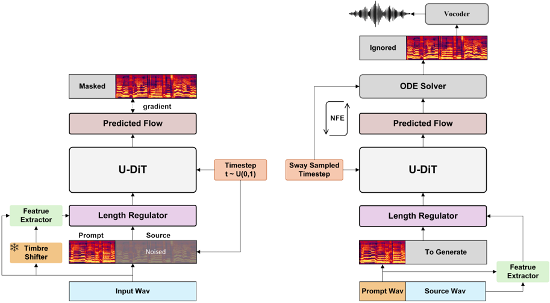
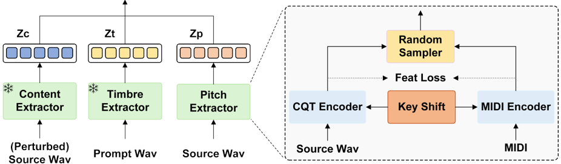

> [!abstract] arXiv · 2026 · Preprint
> **Chen Geng et al.** (Beijing University of Civil Engineering and Architecture / Lyra Lab, Tencent Music Entertainment / Beijing Key Laboratory of Super Intelligent Technology for Urban Architecture) · [→ Paper](https://arxiv.org/abs/2605.12310) · Demo: ✗ · Code: ✗
>
> Replaces the F0 contour in a flow-matching singing voice conversion pipeline with a Constant-Q Transform (CQT) pitch representation, so that residual backing harmonies left behind by vocal-accompaniment separation are converted along with the lead melody instead of corrupting pitch tracking.

## Problem

Most singing voice conversion (SVC) systems factor the voice into content, timbre and pitch, and represent pitch as a single F0 contour from an extractor such as RMVPE or CREPE. Real-world inputs are rarely clean solo vocals: they are separated from full mixes with tools such as Demucs or Ultimate Vocal Remover (UVR), and separation leaves residual harmonies (backing vocals) behind. A monophonic F0 extractor cannot represent several simultaneous pitches, so these residuals cause pitch-tracking errors, off-key output and spectral distortion. Running F0 extraction directly on the accompanied mix fails for similar reasons. The paper argues that the pitch extractor is the critical bottleneck for SVC on such inputs. The paper is accepted at ICASSP 2026 (per the arXiv comment); the page follows the arXiv record.

## Method

Poly-SVC follows the SeedVC-style pipeline: mel-spectrograms are the acoustic target, and a feature extractor produces content, timbre and pitch features that a learnable length regulator aligns to the mel frames. These features condition a conditional flow matching (CFM) decoder whose velocity network is the U-DiT taken from SeedVC. During training the decoder sees a prompt segment of the mel-spectrogram plus a noised source segment and is trained with the CFM loss to predict the linear-path velocity. At inference the prompt singer's mel-spectrogram and features are concatenated with the source features, and an ODE solver with sway-sampled timesteps produces the converted mel-spectrogram. A pretrained Firefly-GAN vocoder (from Fish-Speech), fine-tuned on the authors' harmony data, renders the waveform. A Timbre Shifter based on OpenVoice perturbs the training input's timbre before content extraction, to reduce timbre leakage through the content features and match training to inference conditions.

Content comes from a frozen whisper-small encoder and timbre from a frozen CampPlus (CAM++) speaker-verification model. The new component is the pitch extractor. Audio is resampled to 44.1 kHz and converted to a CQT matrix (hop 441, 12 bins per octave, 84 bins), cropped to the 32 Hz to 1 kHz singing range to discard out-of-range content. A transformer CQT encoder maps it to a pitch embedding. Because the CQT has log-spaced, pitch-aligned bins, it can carry several simultaneous melody lines, and transposition reduces to shifting the matrix along the frequency axis. To keep timbre and other non-pitch content out of the CQT embedding, the authors train with a small amount of MIDI-aligned data (the M4Singer MIDI subset). A transformer MIDI encoder embeds the parallel MIDI score, an L1 feature loss pulls the CQT embedding toward the MIDI embedding, and a Random Sampler combines the two paths (Fig. 2 also shows a key-shift augmentation feeding both encoders). Section 2.2 gives the loss but does not state the sampling rule the Random Sampler uses. At inference only the CQT path is used, so no MIDI is needed.

Training data mixes a small subset of Emilia speech with clean singing corpora (M4Singer, OpenSinger, Opencpop, PopBuTFy, VocalSet). Because no public dataset pairs vocals with their harmonies, the authors also build 70 hours of harmony-rich training vocals by running UVR on public songs in English, Chinese, Cantonese and Japanese, followed by dereverberation. Optimisation uses AdamW with a peak learning rate of 1e-4. Model size and training duration are not reported.

## Key Results

Evaluation is subjective only: 12 Chinese listeners with basic music-theory knowledge rate MOS and similarity MOS (SIM-MOS) on 20 source clips (10 single-melody singing or speech clips, 10 polyphonic singing clips across four languages) converted to one male and one female PopBuTFy target singer. The authors state that no existing objective metric captures conversion quality in harmony-rich audio.

On the harmony set, Poly-SVC reaches MOS 3.75 and SIM-MOS 3.42, compared with SeedVC at 3.35 and 3.40, DDSP-SVC at 2.98 and 2.82, and so-vits-svc at 1.64 and 2.08 (ground truth MOS 3.92) *(Table 1)*. The naturalness gain over SeedVC (+0.40 MOS) is well outside the reported confidence intervals, whereas the SIM-MOS gain (+0.02) is not. On the single-melody set, Poly-SVC scores MOS 3.98 and SIM-MOS 3.78 against SeedVC at 3.85 and 3.74 (ground truth 4.12), differences that sit within the overlapping intervals. The large harmony-set drops for the F0-based so-vits-svc and DDSP-SVC are consistent with the paper's motivation. A spectrogram comparison shows SeedVC keeping only the lead line and making a pitch error, while Poly-SVC retains the harmonic lines *(Fig. 3)*; this is one hand-picked example.

Ablations: removing the Timbre Shifter mainly lowers SIM-MOS (single-melody 3.78 to 3.66, harmony 3.42 to 3.32), and the harmony SIM-MOS without it (3.32) falls below SeedVC (3.40). Removing the Random Sampler lowers all four scores, most visibly harmony MOS (3.75 to 3.62) *(Table 1)*. Most ablation differences are within roughly one confidence interval.

## Novelty Assessment

The contribution is a targeted change to an existing system. The decoder (SeedVC's U-DiT with CFM), content and timbre encoders, Timbre Shifter and vocoder are all reused components. What is new is substituting a CQT-based, MIDI-regularised pitch embedding for F0, which is an established representation in music information retrieval but uncommon as the pitch conditioning for SVC, together with the problem framing of residual harmonies after source separation. The evaluation is small (20 clips, two target singers, 12 raters, no objective metrics, no released harmony test set), and the Random Sampler is under-specified, which limits how far the results can be generalised or reproduced.

## Field Significance

Moderate. The paper identifies a practical failure mode of F0-conditioned SVC on separated real-world vocals and shows that a polyphonic pitch representation can preserve backing harmonies in the converted output. It provides a concrete design alternative to monophonic pitch conditioning, but the evidence is limited to a small listening test.

## Claims

- **supports:** Polyphonic pitch representations such as the CQT let singing voice conversion preserve residual harmonies that monophonic F0 conditioning cannot represent.
  > *Evidence:* On polyphonic source clips the CQT-conditioned system reaches MOS 3.75 against 3.35 for an F0-based SeedVC baseline with the same U-DiT decoder, and a spectrogram example shows the baseline keeping only the lead line while the proposed system retains the harmony lines. *(§3.3, Table 1, Fig. 3)*
- **complicates:** Vocal-accompaniment separation leaves residual harmonies that sharply degrade F0-conditioned singing voice conversion, so results on clean solo vocals overstate real-world quality.
  > *Evidence:* so-vits-svc drops from MOS 3.57 on single-melody input to 1.64 on harmony-rich separated vocals, and DDSP-SVC from 3.83 to 2.98, while ground truth falls only from 4.12 to 3.92. *(§3.3, Table 1)*
- **supports:** Supervising a rich spectral pitch representation with a small amount of symbolic score data reduces non-pitch leakage into the pitch conditioning of voice conversion.
  > *Evidence:* An L1 loss aligning the CQT encoder to a MIDI encoder on the M4Singer MIDI subset, combined through the Random Sampler, is removed in an ablation, and all four MOS/SIM-MOS scores fall (harmony MOS 3.75 to 3.62). *(§2.2, §3.3, Table 1)*
- **supports:** Perturbing the source timbre during training reduces timbre leakage through content features in prompt-based voice conversion.
  > *Evidence:* Removing the OpenVoice-based Timbre Shifter lowers SIM-MOS from 3.78 to 3.66 on single-melody and from 3.42 to 3.32 on harmony input, with smaller MOS changes. *(§2, §3.3, Table 1)*
- **complicates:** Gains in naturalness from better pitch modelling do not necessarily carry over to speaker similarity in singing voice conversion.
  > *Evidence:* On harmony input the proposed system improves MOS over SeedVC by 0.40 but SIM-MOS by only 0.02 (3.42 vs 3.40), within the reported intervals. *(§3.3, Table 1)*

## Limitations and Open Questions

- The evaluation is small and subjective only: 20 source clips, two target singers, and 12 raters from a single linguistic background, with no objective metrics (for example pitch accuracy, intelligibility or speaker-embedding similarity) to corroborate the MOS results.
- The target singers come from PopBuTFy, which is also in the training data ("the remaining recordings were used for training"), so the evaluation does not clearly test the zero-shot setting the paper claims.
- The harmony training and test vocals are produced by UVR separation rather than ground-truth stems, so there is no clean reference for what the harmonies should sound like after conversion.
- Section 2.2 does not specify how the Random Sampler chooses between the CQT and MIDI paths, and neither code nor the 70-hour harmony set is released, limiting reproducibility.
- Single-melody improvements over SeedVC are within the reported confidence intervals, and the ablations show that removing the Timbre Shifter pushes harmony SIM-MOS below SeedVC.
- The authors list overlapping lyric content (several voices singing different words) as unsolved; the CQT handles overlapping pitch but the content path remains single-stream *(§4)*.

## Wiki Connections

- [[singing|Singing Voice Synthesis and Conversion]] — Addresses singing voice conversion on accompanied, separated real-world vocals where backing harmonies remain.
- [[voice-conversion|Voice Conversion]] — A prompt-based SVC system built around a new pitch representation, evaluated with MOS and similarity MOS against three open SVC baselines.
- [[flow-matching|Flow Matching]] — Uses a conditional flow matching decoder with a U-DiT velocity network and sway-sampled ODE inference.
- [[gan-vocoder|GAN Vocoder]] — Fine-tunes a pretrained Firefly-GAN vocoder on harmony-rich vocals to render the converted mel-spectrograms.
- [[disentanglement|Disentanglement]] — Uses a MIDI-aligned feature loss and a timbre-perturbing Timbre Shifter to keep timbre out of pitch and content features, with ablations for both.
- [[subjective-evaluation|Subjective Evaluation]] — Relies entirely on human MOS and similarity MOS ratings, arguing that no objective metric captures harmony-rich conversion quality.
- [[2411.09943|SeedVC]] — Supplies the U-DiT decoder and is the strongest baseline; Poly-SVC can be read as SeedVC with CQT pitch conditioning.
- [[2312.01479|OpenVoice]] — The basis of the Timbre Shifter that perturbs training input timbre.
- [[2411.01156|Fish-Speech]] — Source of the Firefly-GAN vocoder that Poly-SVC fine-tunes.
- [[2212.04356|Whisper]] — Its small encoder is the frozen content extractor.
- [[2025.acl-long.313|F5-TTS]] — Cited for the masked prompt-based timbre conditioning and DiT design that the pipeline follows.
- [[2210.02747|Flow Matching for Generative Modeling]] — Provides the conditional flow matching objective used to train the decoder.
- [[2407.05361|Emilia]] — A small subset of this speech corpus is used for regular voice conversion training.
