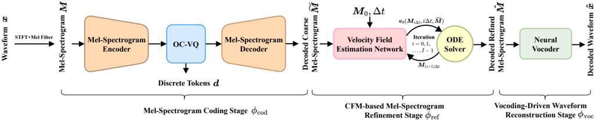

> [!abstract] arXiv · 2026 · Preprint
> **Hui-Peng Du et al.** (University of Science and Technology of China) · [→ Paper](https://arxiv.org/abs/2605.25669) · Demo: ✓ · Code: ✓
>
> FMelCodec codes 80/128-bin mel-spectrograms into a single 1024-entry VQ stream at 250 bps (16 kHz) or 750 bps (48 kHz), then restores the coarse decoded mel with a lightweight few-step conditional flow matching refiner before HiFi-GAN vocoding, staying competitive with much larger single-codebook and SSL-based codecs at matched ultra-low bitrates.

## Problem

Neural speech codecs that reach low bitrates do so in one of two ways: large single-codebook encoder-decoders (BigCodec at 159M parameters, WavTokenizer, Transformer codecs such as TAAE and TS3-Codec), or codecs built on pretrained self-supervised representations (FocalCodec, SemantiCodec). The first route is expensive to run; the second inherits the 16 kHz input assumption of its SSL upstream and so does not directly cover higher sampling rates such as 48 kHz. Spectral-domain codecs (APCodec, MDCTCodec, Spectral Codec) are cheap, but they depend on residual or parallel quantizers and sit around 2 kbps or above. The authors target the sub-1-kbps regime with a purely acoustic codec of modest size that also works at 48 kHz.

## Method

FMelCodec is a three-stage coding-refinement-reconstruction (CRR) pipeline that operates entirely on mel-spectrograms. The three stages are trained separately and chained at inference (Fig. 1).

**Mel-spectrogram coding.** Mel-spectrograms (frame shift 160 samples; 80 bins at 16 kHz, 128 bins at 48 kHz) pass through a ConvNeXt v2 encoder (8 blocks, 256 channels), a stride-4 downsampling convolution and a projection to a 32-dimensional latent. The overall waveform-to-token compression factor is 640. The latent is quantized by a single 1024-entry codebook, which gives 25 Hz × 10 bits = 250 bps at 16 kHz and 750 bps at 48 kHz. A mirrored ConvNeXt v2 decoder outputs a coarse mel-spectrogram. The quantizer is an online-clustering VQ (OC-VQ, adapted from Zheng and Vedaldi). It keeps an EMA estimate of how often each codeword is used. Rarely used codewords are pulled toward anchor features sampled from the current mini-batch, where the sampling favours points far from the existing codeword, and the pull strength decays with usage. This stage uses no adversarial loss. It is trained with an L1+L2 mel reconstruction loss plus the standard VQ-VAE codebook and commitment terms, for 1M steps.

**CFM-based mel refinement.** A conditional flow matching model (OT-CFM) maps Gaussian noise to the target mel-spectrogram, conditioned on the frozen coding stage's coarse mel. The two are concatenated along the channel axis. The velocity estimator is a Matcha-TTS-style Transformer-UNet (2 down/up levels, 2 bridge blocks, 256 hidden channels, SnakeBeta feed-forward activations), with 7.84M parameters. Training runs for 1.0M steps with the plain CFM loss, followed by 0.15M steps that add a **self-consistency loss**. This loss uses a one-step Euler rollout from t to t+Δt and penalises the difference between the velocities predicted at the two points. That pushes the learned flow toward straight, time-invariant trajectories so the ODE can be solved in fewer steps. Inference uses 4 Euler steps.

**Vocoding.** A HiFi-GAN v1 vocoder (official configuration, 13.04M parameters) is retrained by the authors on natural mel-spectrograms from each dataset for 1M steps. It is trained on its own and never sees refined or coded mels.

## Key Results

All quality tests compare codecs at matched bitrates: 250 bps on LibriTTS (16 kHz) and 750 bps on VCTK (48 kHz). The baselines (DAC, MDCTCodec, BigCodec, WavTokenizer, FlowDec, FocalCodec) were retrained from official code with a single 1024-entry codebook and 640× downsampling. FocalCodec is excluded at 48 kHz. Listening tests ran on Amazon Mechanical Turk with 20 utterances and at least 30 listeners per test *(§IV-D)*.

**LibriTTS, 16 kHz, 250 bps (Table I).** FMelCodec has the best ViSQOL (3.56 vs MDCTCodec 3.45), the best UTMOS (3.48 vs 3.26 for BigCodec and FocalCodec) and the best SMOS (3.51 ± 0.05 vs FocalCodec 3.31). Its SIM of 0.92 ties MDCTCodec and FocalCodec. It is second on dWER (27.01% vs FocalCodec 4.97%), MCD (3.60 dB vs MDCTCodec 3.32) and NMOS (3.72 vs BigCodec 3.74, both ± 0.05). DAC, WavTokenizer and FlowDec mostly fail at this rate: dWER between 72% and 76% and NMOS at or below 2.76. The content-preservation gap to the SSL-based FocalCodec is large, and the authors acknowledge it. An ABX test between FMelCodec and FocalCodec gave 36.21% / 31.52% / 32.27% (FMelCodec / no preference / FocalCodec), which is not significant (p = 0.22).

**VCTK, 48 kHz, 750 bps (Table I).** FMelCodec is best on ViSQOL (3.62), SIM (0.93), dWER (4.80% vs MDCTCodec 9.62%), MCD (2.52 dB vs BigCodec 2.87) and SMOS (3.76 vs MDCTCodec 3.73 and BigCodec 3.72). BigCodec is marginally ahead on UTMOS (3.67 vs 3.66) and NMOS (3.75 vs 3.73). The NMOS and SMOS differences between the top systems fall within the ± 0.05 intervals.

**Complexity (Table II, LibriTTS).** FMelCodec has 27.17M parameters, needs 18.47 GFLOPs per second of speech and runs at RTF 0.022. BigCodec is about 5.8× larger (158.31M) at 28.03 GFLOPs, and FocalCodec has 143.3M parameters. FMelCodec is not the cheapest system: MDCTCodec (6.61M, 2.49 GFLOPs, RTF 0.013), WavTokenizer (4.21 GFLOPs, RTF 0.021) and FocalCodec (8.84 GFLOPs) all use less compute. The vocoder stage accounts for 88.73% of FMelCodec's GFLOPs and 47.99% of its parameters (Table IV).

**Public checkpoints (Table III).** FMelCodec at 250 bps is compared with FocalCodec at its native 330 bps and SemantiCodec at 310 bps. FocalCodec leads on UTMOS (4.09 vs 3.48), SIM (0.95 vs 0.92), dWER (3.21% vs 27.01%) and NMOS (3.86 vs 3.79; p = 0.13, not significant). FMelCodec leads on ViSQOL (3.56 vs 3.49), MCD (3.60 vs 3.70) and SMOS (3.88 vs 3.78; p < 0.05). FMelCodec beats SemantiCodec (1033M parameters, RTF 3.267) on every metric. The authors note that the FocalCodec checkpoint was trained on about 586 h of LibriTTS, compared with about 245 h for FMelCodec.

**Bitrate savings (Fig. 6, ABX).** FMelCodec at 250 bps is significantly preferred over DAC and FlowDec at 500 bps and is statistically tied with both at 1000 bps. It is preferred over MDCTCodec at 500 bps but loses to it at 1000 bps (29.19% vs 40.32%, p < 0.01). Against WavTokenizer it ties at 500 bps (p = 0.10) and loses at 1000 bps (26.21% vs 40.76%, p < 0.01). The authors summarise this as a saving of roughly 250 to 750 bps depending on the baseline.

**Ablations (Fig. 8, ABX; Fig. 9).** Removing the CFM refiner gives the largest preference gap (73.06% vs 10.33%). Removing online clustering (26.76%) and replacing stage-wise with joint training (28.87%) are also significantly worse, all at p < 0.01. Without online clustering only 359 of 1024 codewords are used (35.06%), while OC-VQ uses the full codebook. Without the self-consistency loss, 4 ODE steps are significantly worse (30.16% vs 40.97%). The model without self-consistency needs 8 steps to reach parity (p = 0.43), which roughly doubles the refiner's FLOPs.

## Novelty Assessment

The pipeline is assembled from known pieces: mel coding followed by a vocoder (as in Spectral Codec), a CFM post-filter for codec output (as in FlowMAC and FlowDec, with the three-stage framing explicitly inspired by FlowMAC), a Matcha-TTS velocity network, an online-clustered codebook from computer vision, and an off-the-shelf HiFi-GAN v1. The paper's own contributions are three. The first is pushing a purely acoustic mel codec down to a single 10-bit stream at 25 Hz. The second is refining the coarse mel in the mel domain rather than the STFT domain. The third is a self-consistency loss for the CFM refiner that halves the number of ODE steps needed. The ablations support each component. Overall the paper is an incremental architectural step whose main value is a well-ablated ultra-low-bitrate recipe that also works at 48 kHz. The work is also published in IEEE/ACM TASLP.

## Field Significance

Moderate. The paper shows that a small (27M-parameter), purely acoustic, single-codebook mel codec with few-step flow-matching refinement can match or exceed far larger acoustic codecs on most quality metrics at 250 to 750 bps, and that this approach extends to 48 kHz audio, where SSL-based codecs do not apply directly. It also documents the limits of acoustic-only coding at this rate: intelligibility (dWER) lags well behind an SSL-based codec, which makes it a useful reference point in the trade-off between acoustic and semantic tokens at extreme compression.

## Claims

- **supports:** At ultra-low bitrates, a generative refinement stage that restores detail in a coarsely decoded intermediate representation contributes more to perceived quality than refinements to the quantizer or training schedule.
  > *Evidence:* Feeding FMelCodec's coarse decoded mel straight to the vocoder without CFM refinement produced the largest ABX gap of any ablation (73.06% preference for the full system vs 10.33% for the ablation), larger than removing online clustering or stage-wise training. *(§IV-H, Figure 8)*
- **supports:** Single-codebook vector quantizers trained at very low bitrates are prone to codebook collapse, and usage-aware codeword re-initialization during training restores full codebook utilization with a perceptible quality gain.
  > *Evidence:* A plain VQ used 359 of 1024 codewords (35.06%), while the online-clustering VQ used the full codebook, and listeners preferred the OC-VQ system (37.21% vs 26.76%, p < 0.01). *(§IV-H, Figure 8)*
- **supports:** Regularizing a conditional flow-matching model toward time-invariant velocity along its trajectories reduces the ODE steps needed at inference without a quality loss.
  > *Evidence:* With a self-consistency loss, 4 Euler steps matched the ViSQOL of the unregularized model at 8 steps for about half the refiner FLOPs. At equal 4 steps listeners preferred the regularized model (40.97% vs 30.16%, p < 0.01), and against 8 steps the preference was not significant (p = 0.43). *(§IV-H, Figure 8, Figure 9)*
- **complicates:** Purely acoustic codecs at extreme compression can preserve naturalness and speaker identity competitively but lose linguistic content substantially more than codecs built on self-supervised speech representations.
  > *Evidence:* At 250 bps on LibriTTS, FMelCodec had dWER 27.01% vs 4.97% for a retrained FocalCodec and 3.21% for FocalCodec's 330 bps checkpoint, while matching or exceeding it on SMOS and ViSQOL. The authors name content preservation as the main open weakness. *(§IV-E, §IV-F, Table I, Table III)*
- **complicates:** Codecs built on self-supervised encoders trade sampling-rate flexibility for content preservation, because the upstream model fixes the input rate.
  > *Evidence:* FocalCodec could not be evaluated in the 48 kHz VCTK setting because its WavLM encoder expects 16 kHz input, while the mel-domain FMelCodec ran at 48 kHz and 750 bps with the best dWER (4.80%) among the evaluated acoustic codecs. *(§IV-C, §IV-E, Table I)*

## Limitations and Open Questions

- **Content preservation.** At 250 bps, FMelCodec's dWER (27.01%) is several times that of SSL-based FocalCodec, so intelligibility at the lowest bitrate is materially worse even though naturalness and speaker similarity are competitive. The authors leave semantic auxiliary features to future work.
- **Not the cheapest codec.** The abstract's claim of lower complexity holds against BigCodec, DAC, FlowDec, FocalCodec and SemantiCodec, but MDCTCodec and WavTokenizer use less compute and run faster (Table II). Most of FMelCodec's cost comes from the vocoder, which the paper does not optimize.
- **Baselines retrained under one budget.** Retraining every baseline with a single 1024-entry codebook and 640× downsampling puts them all at the same bitrate, but it also takes some of them (DAC, FlowDec, WavTokenizer) far from the configurations they were designed for. Their very poor 16 kHz scores partly reflect that forced setting.
- **Two-tier subjective protocol.** Equal-bitrate quality comparisons use AMT NMOS/SMOS with 20 utterances. Many of the top-system differences fall within the confidence intervals, and FMelCodec's NMOS differs between two separate tests (3.72 in Table I, 3.79 in Table III).
- **Scope.** The system is non-streaming (streaming is listed as future work), English read speech only, and complexity is reported only at 16 kHz. The codec's tokens are not tested as a modeling target for downstream TTS or speech LMs.

## Wiki Connections

- [[neural-codec|Neural Audio Codec]] — Proposes an ultra-low-bitrate (250/750 bps) single-codebook mel-domain speech codec with an online-clustered VQ and generative decoding refinement.
- [[flow-matching|Flow Matching]] — Uses OT-CFM as a conditional mel restoration post-filter and adds a self-consistency loss that halves the ODE steps needed.
- [[gan-vocoder|GAN Vocoder]] — Retrains a standalone HiFi-GAN v1 vocoder on natural mels as the reconstruction stage and shows that it handles refined codec mels robustly, though it dominates system compute.
- [[subjective-evaluation|Subjective Evaluation]] — Reports AMT NMOS/SMOS tests and ABX preference tests with paired t-tests for baseline comparisons, bitrate-saving estimates and ablations.
- [[2409.05377|BigCodec]] — Retrained as a single-VQ baseline at 250/750 bps, where it is marginally ahead on NMOS but about 5.8× larger than FMelCodec.
- [[neurips-2025-7Z3wQSu3mH|FocalCodec]] — SSL-based ultra-low-bitrate baseline that FMelCodec trails clearly on dWER but matches or beats on SMOS and ViSQOL, both retrained and with its public 330 bps checkpoint.
- [[iclr-2025-uxDFlPGRLX|FlowDec]] — Prior CFM post-filter codec, refining in the STFT domain, that FMelCodec contrasts with its mel-domain refinement and outperforms at matched bitrate with far lower compute.
- [[2408.16532|WavTokenizer]] — Single-VQ baseline that FMelCodec outperforms at 250 bps, while WavTokenizer at 1000 bps is preferred over FMelCodec at 250 bps in ABX tests.
- [[2010.05646|HiFi-GAN]] — Supplies the vocoder (v1 configuration), retrained on each dataset for FMelCodec's reconstruction stage.
- [[2210.02747|Flow Matching for Generative Modeling]] — Supplies the CFM formulation that the refinement stage builds on.
- [[2411.19842|TAAE]] — Cited as a large Transformer codec that reaches low bitrates through model capacity, the approach FMelCodec positions itself against.
- [[1904.02882|LibriTTS]] — Supplies the 16 kHz training and test data for the 250 bps experiments.
