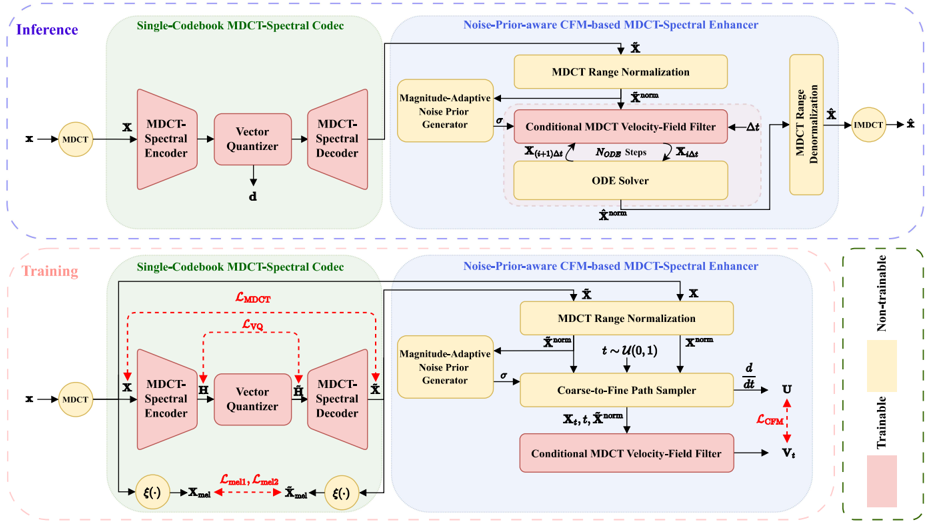

> [!abstract] arXiv · 2026 · Preprint
> **Xiao-Hang Jiang et al.** (University of Science and Technology of China / Tsinghua University) · [→ Paper](https://arxiv.org/abs/2605.26812) · Demo: ✓ · Code: ?
>
> CFMDCTCodec compresses the MDCT spectrum of speech into a single 8192-entry VQ stream (0.65 kbps at 16 kHz) and restores the coarse decoded spectrum with a conditional flow matching enhancer whose starting noise is scaled by the coarse spectrum's own energy, with codec and enhancer trained jointly and without adversarial losses, in a 14.61M-parameter model.

## Problem

At a few hundred bits per second, a codec bitstream can carry only coarse spectral structure, so decoding becomes highly ill-posed. Residual vector quantization (RVQ), used by SoundStream, EnCodec, DAC and the authors' earlier MDCTCodec, is hard to push down to these rates because removing codebooks removes discrete capacity. The two existing escape routes each have a cost. BigCodec keeps a single VQ but scales the encoder and decoder past 100M parameters. FlowDec adds a conditional flow matching (CFM) post-filter in the STFT domain on top of a waveform codec, but it targets higher bitrates, trains the base codec and post-filter in two separate stages, and is computationally heavy. The authors want a lightweight spectral-domain codec that holds up at 0.65 kbps.

## Method

CFMDCTCodec works entirely in the modified discrete cosine transform (MDCT) domain, a real-valued and critically sampled time-frequency representation, which avoids explicit phase modeling. The MDCT uses frame length 80, hop 40 and 40 frequency bins.

**Single-codebook MDCT-spectral codec.** The encoder and decoder follow MDCTCodec: a 1-D convolutional front end, eight modified ConvNeXt v2 blocks with global response normalization, and a strided convolution that downsamples time by a factor R (mirrored by upsampling in the decoder). Instead of MDCTCodec's RVQ, the latent (32 dimensions) is quantized with one 8192-entry codebook (13 bits per token) using cosine-normalized nearest-neighbour assignment. Bitrate follows from the sampling rate, the hop and R: R = 8 at 16 kHz gives 50 Hz tokens and 0.65 kbps, R = 4 gives 1.3 kbps, and at 48 kHz R = 8 and R = 4 give 1.95 and 3.9 kbps. To prevent codebook collapse, a "codebook forced updating" rule tracks an EMA of each codeword's usage and pulls rarely used codewords toward latent vectors sampled from the minibatch, with pull strength decaying as usage grows. The decoder outputs a coarse MDCT spectrum.

**Noise-prior-aware CFM enhancer.** The coarse spectrum is first range-normalized: magnitudes are power-law compressed (α = 0.5) and divided by the per-utterance maximum while signs are kept, mapping the heavy-tailed, signed MDCT coefficients into [-1, 1]. A magnitude-adaptive noise prior is then computed per time-frequency bin from the normalized coarse spectrum (2-D average pooling, square-root compression, normalization by the utterance's 99th-percentile magnitude, clipping to [10⁻³, 1]). The CFM initial state is the normalized coarse spectrum plus Gaussian noise scaled element-wise by this prior and a temperature τ (1.0 at 16 kHz, 1.3 at 48 kHz), so energetic regions start with more noise and quiet regions stay close to the coarse estimate. A lightweight 1-D U-Net velocity estimator (adapted from Matcha-TTS, with time-conditioned convolutional residual blocks and Transformer blocks) takes the current state concatenated with the normalized coarse spectrum. Inference uses 6 explicit Euler steps, followed by denormalization and inverse MDCT.

**Joint non-adversarial training.** Codec and enhancer are optimized end-to-end with an MDCT L2 loss and mel L1/L2 losses on the coarse output, the VQ codebook and commitment losses, and the CFM velocity-regression loss on a straight path from the noisy initial state to the normalized ground-truth spectrum. The CFM gradient flows back into the codec as well as the velocity estimator. There is no discriminator. Training runs 1M steps with batches of 48 one-second segments.

## Key Results

All codecs, including the baselines MDCTCodec, DAC, BigCodec, WavTokenizer and FlowDec, were retrained at matched bitrates with a single 8192-entry codebook and matched frame rates. MUSHRA tests ran on Amazon Mechanical Turk with 20 utterances per system and 30 native English listeners per test *(§IV-B, §IV-C)*.

**0.65 kbps, LibriTTS 16 kHz (Table I).** CFMDCTCodec has the best SI-SDR (-3.206 dB vs DAC -3.578) and is second to BigCodec on UTMOS (3.761 vs 3.846) and MUSHRA (76.81 ± 3.64 vs 78.15 ± 3.27). BigCodec is also ahead on STOI (0.886 vs 0.866), SIM (0.944 vs 0.942), LSD (0.936 vs 1.166) and DNSMOS (3.221 vs 3.186). MDCTCodec leads on SIM (0.945), LSD (0.932) and STOI (0.870), but CFMDCTCodec beats it by about 12 MUSHRA points (76.81 vs 64.88). WavTokenizer reaches 73.80 MUSHRA, DAC 71.83 and FlowDec 67.01; FlowDec also has the lowest STOI (0.781) and UTMOS (1.915). The authors describe BigCodec as comparable, which the overlapping MUSHRA intervals support. No significance tests are reported.

**Higher bitrates (Tables I and II).** The advantage shrinks as the bitrate rises. At 1.3 kbps CFMDCTCodec's MUSHRA (81.66) is below BigCodec (82.36) and WavTokenizer (82.05) and slightly above MDCTCodec (79.32); it is second on UTMOS (3.862 vs BigCodec 4.016). At 1.95 kbps on VCTK 48 kHz it scores 79.06, behind BigCodec (82.47) and FlowDec (81.74). At 3.9 kbps it scores 83.37, behind FlowDec (85.98), BigCodec (84.35) and WavTokenizer (83.59). CFMDCTCodec has the highest LSD of all six codecs at every bitrate (1.166, 1.157, 1.089, 1.056).

**Efficiency (Tables III and IV).** At 0.65 kbps CFMDCTCodec has 14.61M parameters and 11.93 GFLOPs per second of speech, against 112.36M and 52.56 GFLOPs for BigCodec, 55.53 GFLOPs for DAC and 2306.48 GFLOPs for FlowDec. CPU RTF is 0.442 (BigCodec 1.899, FlowDec 21.349) and GPU RTF 0.088. MDCTCodec (6.15M, 2.28 GFLOPs, CPU RTF 0.055) and WavTokenizer (4.20 GFLOPs, CPU RTF 0.184) are cheaper and faster. At 48 kHz, CPU RTF rises to 1.378 (1.95 kbps) and 1.440 (3.9 kbps), slower than real time on that CPU. The utterance-level normalization and GRN make algorithmic delay depend on utterance length, while DAC, BigCodec and FlowDec have fixed delays of 329 ms, 372 ms and 4.82 s *(§IV-E)*.

**Ablations at 0.65 kbps (Tables V to VIII).** Replacing the adaptive prior with a fixed noise scale lowers UTMOS from 3.761 to 3.140 and raises LSD from 1.166 to 1.702. Removing range normalization lowers UTMOS to 3.437 and DNSMOS to 3.003 (from 3.186), with SI-SDR essentially unchanged (-3.13 vs -3.206). Decoupled two-stage training collapses: SI-SDR falls to -25.928 and UTMOS to 2.682, and adding an MDCT adversarial loss to the codec stage helps only slightly (-25.33, 2.716). Misaligning the enhancer's MDCT hop from the codec's (20, 80 or 160 instead of 40) hurts every quality metric. A complex-STFT version of the same framework needs 1074 GFLOPs and 41.99M parameters, with lower UTMOS (3.603) and higher LSD (1.959), although its SI-SDR is better (0.233 vs -3.206).

## Novelty Assessment

The post-filter idea (a deterministic base codec plus a generative refiner) comes from ScoreDec and FlowDec, and the backbone is MDCTCodec with RVQ swapped for a single codebook with usage-based codeword resetting. The new parts are carrying a CFM refiner into the MDCT domain, the stabilizing pieces needed to do so (sign-preserving range normalization and an utterance- and bin-specific noise prior derived from the coarse spectrum, where FlowDec uses dataset-level frequency statistics), and end-to-end joint training of codec and refiner without adversarial losses. The ablations support each of these, and the joint-versus-two-stage result is the most striking. Overall this is an incremental architectural step. Its headline gain is over the authors' own MDCTCodec; it does not beat the much larger BigCodec at 0.65 kbps. The paper has been accepted to IEEE TASLP.

## Field Significance

Moderate. The paper shows that a roughly 15M-parameter spectral codec with a jointly trained flow-matching enhancer can reach subjective quality close to a 112M-parameter single-codebook codec at 0.65 kbps for under a quarter of the compute, and that training the base codec and generative post-filter together, rather than in sequence, is decisive at this rate. It also shows a cost of perceptually driven refinement: spectral distortion (LSD) is the worst of all compared codecs, and the benefit over a plain decoder largely disappears above about 1 kbps.

## Claims

- **supports:** For codecs with a generative post-filter, training the base codec and the refiner jointly matters more at low bitrates than the choice of base-codec objective, because the refiner needs the codec's coarse output distribution to match its own input expectations.
  > *Evidence:* At 0.65 kbps, joint training gave SI-SDR -3.206 dB and UTMOS 3.761, while a two-stage variant with the codec frozen before CFM training collapsed to -25.928 dB and 2.682; adding an adversarial loss to the codec stage raised these only to -25.33 dB and 2.716. *(§IV-G, Table VII)*
- **supports:** Initializing a flow-matching restoration model from the degraded estimate plus noise whose scale follows the estimate's local energy restores spectral detail better than a uniform noise scale.
  > *Evidence:* Replacing the magnitude-adaptive prior with a constant noise scale of 1.0 lowered UTMOS from 3.761 to 3.140 and DNSMOS from 3.186 to 3.054 and raised LSD from 1.166 to 1.702, with visibly oversmoothed high frequencies. *(§IV-F, Table V, Figure 6)*
- **complicates:** Generative refinement in speech codecs improves perceptual quality while increasing objective spectral distortion, so log-spectral distance can rank such codecs opposite to listeners.
  > *Evidence:* CFMDCTCodec beat MDCTCodec by about 12 MUSHRA points at 0.65 kbps (76.81 vs 64.88) yet had worse LSD (1.166 vs 0.932), and it had the highest LSD of all six codecs at every bitrate; FlowDec, the other generative post-filter codec, also had high LSD. *(§IV-D, Table I, Table II)*
- **refines:** The benefit of a generative post-filter over a plain decoder is concentrated at the lowest bitrates and shrinks once the bitstream preserves enough spectral detail.
  > *Evidence:* The MUSHRA gain over MDCTCodec was 11.93 points at 0.65 kbps, 2.34 at 1.3 kbps, 3.04 at 1.95 kbps and 1.30 at 3.9 kbps, where CFMDCTCodec ranked behind FlowDec, BigCodec and WavTokenizer. *(§IV-D, Table I, Table II)*
- **supports:** Real-valued MDCT spectra are a far cheaper modeling target than complex STFT spectra for spectral codecs with generative refinement, without a loss in predicted perceptual quality.
  > *Evidence:* Within the same framework at 0.65 kbps, the MDCT version used 11.93 GFLOPs and 14.61M parameters against 1074 GFLOPs and 41.99M for a two-channel complex-STFT version, with higher UTMOS (3.761 vs 3.603) and lower LSD (1.166 vs 1.959), although the STFT variant had better SI-SDR (0.233 vs -3.206 dB). *(§IV-H, Table VIII)*

## Limitations and Open Questions

- **Not ahead of BigCodec.** The abstract states that CFMDCTCodec outperforms competitive baselines at 0.65 kbps, but BigCodec is ahead on MUSHRA, UTMOS, DNSMOS, STOI, SIM and LSD in Table I. The supported claim is comparable quality at about 13% of the parameters and under a quarter of the FLOPs.
- **Not streaming.** Utterance-level range normalization and noise-prior statistics, plus GRN in the backbone, make algorithmic delay depend on the input length. The authors acknowledge this and list streaming as future work.
- **Not real time at 48 kHz on CPU.** CPU RTF is 1.378 to 1.440 in the 48 kHz settings (Table IV), and the enhancer makes CFMDCTCodec several times more expensive than MDCTCodec at every rate.
- **Spectral fidelity.** LSD is the worst among all codecs at every bitrate, so the enhancer trades exact spectral reconstruction for perceptual plausibility.
- **Forced baseline configurations.** All baselines were retrained with one 8192-entry codebook and adjusted strides to match bitrates, which moves DAC, FlowDec and WavTokenizer far from their design points; FlowDec in particular was built for higher bitrates.
- **Evaluation scope.** English read speech only (LibriTTS, VCTK). There is no intelligibility metric based on ASR (no WER/CER), the MUSHRA tests use 20 utterances without significance testing, and the tokens are not tested as a target for TTS or speech LMs. The temperature τ needed retuning between 16 kHz and 48 kHz (Figure 8).

## Wiki Connections

- [[neural-codec|Neural Audio Codec]] — Proposes a 0.65 to 3.9 kbps single-codebook MDCT-domain speech codec with a jointly trained generative enhancer and a usage-driven codeword reset to avoid codebook collapse.
- [[flow-matching|Flow Matching]] — Uses conditional flow matching as a codec post-filter that starts from the coarse spectrum plus energy-scaled noise, with 6 Euler steps at inference.
- [[subjective-evaluation|Subjective Evaluation]] — Runs four crowdsourced MUSHRA tests (one per bitrate) with 30 native English listeners against five retrained baselines.
- [[2409.05377|BigCodec]] — Retrained single-VQ baseline that stays slightly ahead on MUSHRA and UTMOS at 0.65 kbps while using about 7.7 times the parameters and 4.4 times the FLOPs.
- [[iclr-2025-uxDFlPGRLX|FlowDec]] — Closest prior design (CFM post-filter on an STFT spectrum, two-stage training); CFMDCTCodec contrasts its MDCT-domain, jointly trained refiner and per-utterance noise prior, and beats FlowDec at 0.65 to 1.3 kbps but trails it at 1.95 and 3.9 kbps.
- [[2408.16532|WavTokenizer]] — Retrained low-bitrate single-VQ baseline that trails CFMDCTCodec at 0.65 kbps but edges it on MUSHRA at 1.3 and 3.9 kbps.
- [[2605.25669|FMelCodec]] — Companion work from the same group that applies a similar single-codebook codec plus CFM refinement recipe in the mel domain with a separate vocoder and stage-wise training, the opposite training choice to CFMDCTCodec's joint optimization.
- [[2210.02747|Flow Matching for Generative Modeling]] — Supplies the flow matching formulation behind the enhancer's velocity-regression objective.
- [[1904.02882|LibriTTS]] — Supplies the 16 kHz training and test data for the 0.65 and 1.3 kbps experiments.
- [[2204.02152|UTMOS]] — Used as a predicted-MOS metric across all bitrate settings and ablations.
