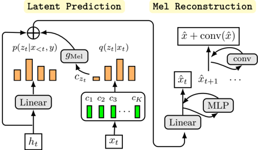

> [!abstract] arXiv · 2026 · Preprint
> **Sung-Lin Yeh et al.** (University of Edinburgh / Google DeepMind / Meta Superintelligence Labs) · [→ Paper](https://arxiv.org/abs/2605.29859) · Demo: ? · Code: ✗
>
> MELD trains a single decoder-only Transformer directly on mel-spectrograms by routing each next-frame prediction through a sampled discrete latent, optimized under a variational lower bound, so that the speech encoder and the autoregressive model are learned jointly and the same network can do zero-shot TTS and speech-to-text.

## Problem

Most speech language models use two training stages: a codec or VAE is trained first to produce speech representations, then an autoregressive model is trained on top. The encoder never sees the downstream objective, so it cannot decide what information to keep, and discretized representations are known to drop task-relevant content. Modeling mel-spectrograms directly avoids the separate encoder, but autoregressive mel-spectrogram models have their own problems: they produce deterministic frame estimates with no proper sampling distribution, need a separate stop predictor, and tend to get trapped in stretched silence or repeated artifacts. The continuous Gaussian sampling of MELLE ([[2025.acl-long.65|MELLE]]) addresses sampling only partially and, per the authors, relies on VAD pre-processing to avoid infinite silence. dMel discretizes mel-spectrograms with a fixed quantizer before modeling, which again decouples the representation from the task.

## Method

MELD factorizes each autoregressive step into a discrete latent and a continuous frame: p(x_t, z_t | x_<t, y) = p(x_t | z_t, x_<t, y) p(z_t | x_<t, y), where x_t is an 80-dim log-mel frame (62.5 Hz) and y is a BPE text sequence (vocabulary 4096). Two conditional independence assumptions make z_t depend only on past frames and text, and let the frame decoder condition on z_t plus the history, so a single compact codebook suffices without residual vector quantization or speaker embeddings. Because the marginal over K latents is intractable, training minimizes a variational lower bound (L_VLB): per frame, a KL term between a proposal q(z_t | x_t) and the autoregressive prior p(z_t | x_<t, y), plus a reconstruction term (§2.1, §2.2, Appendix A.1).

The proposal is a soft vector quantizer: assignment probabilities are a softmax over negative squared Euclidean distances to K = 8192 codewords (temperature 1), which corresponds to the posterior of an isotropic Gaussian mixture. The codebook is initialized with k-means on mel frames and then frozen, which sidesteps the usual optimization difficulties of training vector quantizers; the reconstruction network is left to refine codewords. The proposal is used only in training (§3.1).

The autoregressive network is a 12-layer, 16-head decoder-only Transformer (d_model 1024, about 200M parameters). Mel frames and codewords enter through a shared 3-layer MLP encoder (following MELLE), text through an embedding table, and a single softmax over the union of text tokens, latents and an EOS token makes the stop predictor unnecessary (§3.2). Reconstruction follows Tacotron 2: the Transformer output plus the embedded sampled codeword passes through a linear layer with an MLP residual to produce the frame, and a convolutional postnet refines the full spectrogram; with unit-variance Gaussian likelihoods the reconstruction term becomes a two-part MSE (§3.3). A slowness penalty rewards frame-to-frame change to discourage stalled generation (§3.4). At inference, latents are drawn with top-k (k = 60) and top-p (p = 0.9) sampling plus a repetition penalty, with test-time dropout in the mel encoder for TTS; waveforms come from an off-the-shelf HiFi-GAN pre-trained on LibriTTS (§5.1, §5.2).

Speech-to-text reuses the same network: the KL term expands into a cross-entropy over latents, so placing mel frames ahead of BPE targets with an STT task token gives a standard next-token objective. STT training disables mel-encoder dropout and adds SpecAugment. Joint TTS-STT training starts with 80k TTS-only steps and then mixes both tasks equally per batch (§2.3, §5.5, §5.6). All models train on LibriSpeech 960h for 200k steps on 16 V100 GPUs (Appendix A.2).

## Key Results

All systems, including baselines, are trained by the authors on LibriSpeech 960h with the same Transformer backbone, except VALL-E, dMel and Moshi, whose numbers are quoted from other papers. TTS WER is reported as a pair from two ASR evaluators (a Conformer-Transducer and Whisper-large).

**Zero-shot TTS (3 s prompt continuation, LibriSpeech test-clean 4-10 s, Tables 2 and 3).** MELD at 62.5 Hz reaches WER 2.4 / 1.9 and SIM 0.872, against 5.3 / 4.8 and 0.864 for the BPE Codec-LM (DAC, 12 RVQ levels with a delay pattern) and 5.7 / 4.7 and 0.872 for the phoneme Codec-LM. On WER MELD has the lowest values of any generative system in Table 2, close to the 2.2 / 1.6 ground truth. On SIM it ties the phoneme Codec-LM at 0.872 and is above VALL-E's quoted 0.868 and the BPE Codec-LM; it remains well below ground truth (0.925) and the HiFi-GAN resynthesis ceiling (0.903). Halving the frame rate to 31.3 Hz keeps WER (2.5 / 1.9) but drops SIM to 0.855, the lowest among the LM systems in Table 2. The mel-spectrogram baselines trail: Mel-LM (no sampling) scores 4.7 / 4.2 and 0.825, and the authors' MELLE reproduction 4.8 / 4.2 and 0.826; both produce long pauses despite the slowness penalty. The slowness penalty matters for MELD too: without it, WER rises to 6.0 / 3.7 (SIM 0.862), worse than the BPE Codec-LM on the first ASR evaluator.

**Subjective evaluation (Table 4).** On 43 samples from 40 speakers rated by 30 Amazon Mechanical Turk listeners, MELD obtains SMOS 3.89 ± 0.06 against 3.72 ± 0.15 for Codec-LM and 3.81 ± 0.12 for the joint MELD model; ground truth is 4.11 ± 0.10. The Codec-LM and MELD intervals overlap. In CMOS relative to MELD, Codec-LM is -0.31 and joint MELD -0.20, while ground truth is +0.27 above MELD.

**Role of the latent and sampling (Table 5).** Zeroing the sampled codeword at inference collapses output (WER 52.3 / 51.7, SIM 0.52, more than 200 minutes of audio against 131.8 for ground truth), so the model does not ignore its latents. Removing the repetition penalty raises WER to 3.1 / 2.6, lengthens total audio from 129.3 to 137.4 minutes, and nearly doubles deletions (300 vs 157), consistent with more silence and word omissions.

**Speech-to-text (Table 6, beam 5).** The 200M MELD reaches 4.0 / 9.8 / 4.2 / 10.0 on dev-clean / dev-other / test-clean / test-other, well ahead of Codec-LM (6.1 / 16.5 / 6.4 / 16.4). Against the quoted dMel (258M, 18 layers, 3.8 / 10.3 / 4.2 / 10.4), the 200M MELD is better on both "other" sets, tied on test-clean, and worse on dev-clean. The 260M MELD (3.6 / 9.0 / 3.5 / 9.2) is lower than dMel on all four sets. Without SpecAugment, MELD's other-set WER rises to 12.5. Codec-LM fails to converge (WER above 100) unless its codebook embeddings are initialized from a TTS Codec-LM.

**Joint TTS-STT (Table 7).** A single MELD model doing both tasks gives TTS WER 2.8 / 2.2 and SIM 0.870, and STT WER 4.9 / 12.1 (test-clean / test-other). This costs 0.7 / 2.1 STT WER and 0.4 / 0.3 TTS WER relative to the task-specific MELD models, but its STT is better than the quoted joint dMel (7.5 / 15.3) and its TTS is better than the task-specific Codec-LM. The 7B Moshi figure in Tables 6 and 7 (5.8 test-clean) comes from a much larger model trained on far more data and is not a matched comparison.

## Novelty Assessment

The architectural contribution is genuine but built from familiar parts. A mel-frame autoregressive decoder with a Tacotron 2 postnet, a MELLE-style MLP frame encoder, soft vector quantization against a frozen k-means codebook, and top-k/top-p sampling with a repetition penalty are all established. What is new is combining them under a single variational lower bound in which the discrete latent is a sampling device rather than a reconstruction bottleneck: the frame decoder still sees the full continuous history, so a single 8192-entry codebook suffices and the speech input path is trained end to end. Folding EOS and BPE tokens into the same output softmax, which makes STT and joint TTS-STT fall out of the same objective, is a tidy consequence of that formulation.

The evidence is reasonably controlled (one backbone, one training corpus, author-trained baselines) but small in scale: 200M-parameter models trained only on LibriSpeech 960h, evaluated only on LibriSpeech. The main mel-spectrogram comparison is against the authors' own MELLE reproduction, which by their own account does not reach the published MELLE numbers, so the size of the advantage over a well-tuned MELLE is uncertain. Codec and mel systems also use different waveform decoders (DAC decoder vs HiFi-GAN), which the authors acknowledge.

## Field Significance

Moderate. The paper provides controlled evidence, at small scale, that a discrete sampling space can be attached to continuous mel-spectrogram autoregression without giving up end-to-end training of the speech input path, and that this both curbs the silence and omission failures of mel-frame language models and improves speech recognition over pre-discretized inputs. It is a useful alternative design point to the codec-then-LM pipeline, but whether its advantages hold at the data and model scales of current speech language models is not tested here.

## Claims

- **supports:** Sampling from a discrete latent distribution reduces runaway silence in autoregressive continuous-feature speech generation compared with deterministic or single-Gaussian frame prediction.
  > *Evidence:* With matched backbones on LibriSpeech 960h, Mel-LM (no sampling) and a MELLE reproduction (single-Gaussian sampling) reach WER 4.7 / 4.2 and 4.8 / 4.2 with SIM about 0.83 and audible long pauses, while MELD's categorical latent sampling reaches 2.4 / 1.9 and 0.872; the authors attribute MELLE's failure to the reverse-KL prior collapsing onto silence once a silent frame is predicted. *(§5.3, Table 3)*
- **supports:** Jointly optimizing the speech input representation with the downstream autoregressive objective improves speech recognition over representations discretized independently of the task.
  > *Evidence:* The same decoder-only Transformer reaches test-other WER 10.0 on mel-spectrograms vs 16.4 on frozen DAC codes, and a 260M MELD (9.2) is below dMel's fixed-quantizer mel tokens (10.4); the 200M MELD is tied with dMel on test-clean and worse on dev-clean (4.0 vs 3.8). *(§5.5, Table 6)*
- **refines:** Decoding-time diversity controls such as repetition penalties act as length and omission regularizers in discrete-sampling speech LMs, not only as diversity aids.
  > *Evidence:* Removing the repetition penalty from MELD raises WER from 2.4 / 1.9 to 3.1 / 2.6, lengthens total generated audio from 129.3 to 137.4 minutes (ground truth 131.8), and nearly doubles deletion errors from 157 to 300. *(§5.4, Table 5)*
- **complicates:** Training one autoregressive speech-text model on both synthesis and recognition still costs accuracy on each task relative to task-specific models, even when the speech representation is learned end to end.
  > *Evidence:* Joint MELD reaches STT WER 4.9 / 12.1 vs 4.2 / 10.0 for STT-only MELD, and TTS WER 2.8 / 2.2 vs 2.4 / 1.9 for TTS-only MELD, although it narrows the gap compared with joint dMel (7.5 / 15.3). *(§5.6, Table 7)*
- **complicates:** Lowering the frame rate of autoregressive speech features preserves intelligibility but erodes speaker similarity in prompt-based voice cloning.
  > *Evidence:* Concatenating pairs of mel frames to go from 62.5 to 31.3 Hz leaves MELD's WER essentially unchanged (2.4 / 1.9 to 2.5 / 1.9) while SIM falls from 0.872 to 0.855. *(§5.3, Table 2)*

## Limitations and Open Questions

The comparison to MELLE, the closest prior mel-spectrogram language model, rests on the authors' own reproduction, which they state does not reach the published MELLE results on LibriSpeech 960h; they suspect MELLE depends on an undisclosed VAD pre-processing step, and their reproduction needed the slowness penalty and longer training to function at all (§7, Appendix A.6). The measured gap over MELLE should therefore be read as a gap over this reproduction.

- **Scale and domain.** All models are about 200M parameters (260M for one STT run), trained only on LibriSpeech 960h read speech and evaluated only on LibriSpeech. Behaviour at the multi-thousand-hour scale of current zero-shot TTS systems, on spontaneous or multilingual speech, is untested.
- **Unequal waveform decoders.** Codec-LM uses the DAC decoder and mel systems use a HiFi-GAN pre-trained on LibriTTS, so TTS comparisons across representation types are not fully controlled (§7).
- **Small listening test.** SMOS and CMOS use 43 samples from 40 speakers with 30 crowdsourced listeners; the SMOS intervals for MELD and Codec-LM overlap, and no significance test is reported (Table 4, Appendix A.4).
- **Quoted baselines.** VALL-E, dMel and Moshi numbers are copied from other papers with different text units, codec frame rates, model sizes or training data.
- **Dependence on heuristics.** Without the slowness penalty MELD's WER rises to 6.0 / 3.7, and the repetition penalty is needed to control length, so the variational objective alone does not eliminate degenerate generation.
- **Collapse is possible in principle.** The objective admits collapsed solutions such as a constant latent; the authors show empirically that their models do not collapse but offer no guarantee (§5.4).
- **Narrow task coverage.** Only TTS and STT are studied; question answering, translation and spoken dialogue are left as future work (§7). The demo URL in the paper is an unresolved placeholder and no code release is mentioned.

## Wiki Connections

- [[zero-shot-tts|Zero-Shot TTS]] — MELD is evaluated on 3-second prompt continuation for unseen LibriSpeech test-clean speakers, with objective SIM and subjective SMOS.
- [[subjective-evaluation|Subjective Evaluation]] — Reports crowdsourced SMOS and CMOS (relative to MELD) for ground truth, Codec-LM, and task-specific and joint MELD models.
- [[2025.acl-long.65|MELLE]] — The closest prior mel-spectrogram language model; MELD reuses its MLP frame encoder and replaces its single-Gaussian sampling with a discrete latent, comparing against an imperfect reproduction.
- [[2301.02111|VALL-E]] — Codec-language-model reference point; LibriSpeech-trained VALL-E results (quoted from ELLA-V) are compared with the authors' Codec-LM and MELD.
- [[2401.07333|ELLA-V]] — Source of the LibriSpeech 960h VALL-E numbers and the SIM evaluation protocol that MELD follows.
- [[1712.05884|Tacotron 2]] — MELD's frame reconstruction network and convolutional postnet follow the Tacotron 2 design, and the Mel-LM baseline is a decoder-only Tacotron 2 variant.
- [[2010.05646|HiFi-GAN]] — Off-the-shelf vocoder used to convert all mel-spectrogram outputs to waveforms.
- [[2410.00037|Moshi]] — Quoted as a large joint speech-text model reference for speech recognition WER.
- [[2509.24650|VoxCPM]] — Contrasted as a nominally end-to-end speech LM that still depends on a pre-trained VAE for its input representation.
- [[2025.naacl-long.591|Robust and Unbounded Length Generalization in AR TTS]] — Cited for the difficulty of autoregressive mel-spectrogram generation and of joint TTS-STT training.
