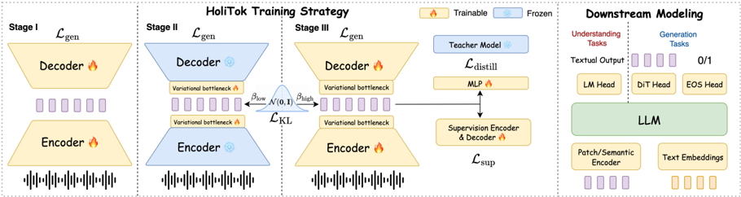

> [!abstract] arXiv · 2026 · Preprint
> **Bohan Li et al.** (Shanghai Jiao Tong University / Xiaohongshu) · [→ Paper](https://arxiv.org/abs/2605.29948) · Demo: ? · Code: ✓
>
> HoliTok is a continuous 25 Hz speech VAE trained in three stages (autoencoder, weakly regularized variational bottleneck, then strong KL with WavLM distillation and LLM task supervision), and among the tested latent spaces it degrades least on TTS when one AR+DiT model is trained jointly on TTS and ASR.

## Problem

Unified speech foundation models need one continuous representation that a waveform decoder can invert, a language model can predict, and an understanding head can read. Existing representations cover only part of this. Mel spectrograms and similar features are dense and redundant. Self-supervised features carry semantics but are hard to decode and hard to generate. Continuous speech VAEs are mostly tuned for reconstruction or TTS alone. Unified designs such as MingTok-Audio pair a fixed low-level VAE latent with a separate semantic module, so understanding and generation operate on different spaces. The authors argue that this pushes the burden of unification onto ever more complex downstream architectures, and that "unified" tokenizers are rarely tested inside a single shared generation-understanding model.

## Method

**Tokenizer architecture.** HoliTok encodes 48 kHz audio into a 25 Hz sequence of 128-dimensional continuous latents (hop size 1920; compression ratio 7.5x by the paper's bitrate definition). The encoder has six strided causal convolutional blocks with dilated residual stacks and a final 2-frame lookahead. A temporal variational bottleneck (4-layer LSTM with linear projections) predicts a diagonal Gaussian posterior; a normalizing flow is applied when computing the KL term against a standard normal prior. The decoder is a BigVGAN-style generator with AMPBlocks and SnakeBeta activations, also causal apart from a 2-frame lookahead. Parameter counts are 36M (encoder), 17M (bottleneck) and 128M (decoder). Training uses a multi-period discriminator and a multi-scale sub-band CQT discriminator, following the BigVGAN v2 recipe.

**Progressive three-stage training.**
- *Stage I* (500K steps) trains a deterministic autoencoder with multi-scale mel, adversarial and feature-matching losses to establish a high-fidelity reconstruction space.
- *Stage II* (50K steps) freezes encoder and decoder and trains only the variational bottleneck with a weak KL weight (beta_low = 0.1). Appendix A bounds the resulting waveform distortion by the Stage-I distortion plus a Lipschitz-scaled latent shift; the authors call this "implicit fidelity transfer".
- *Stage III* (200K steps) unfreezes encoder and bottleneck and raises the KL weight (beta_high = 7). It adds frame-level distillation toward WavLM layer-23 features and utterance-level distillation toward an x-vector speaker embedding (cosine losses through small prediction heads), plus a multi-task language-modeling loss. That loss comes from a supervision network (a 0.6B Transformer encoder feeding a pretrained Qwen2.5-0.5B decoder) that reads the latents and predicts targets for ASR, emotion recognition, audio captioning and sound event detection. The supervision decoder is discarded after training.

The tokenizer trains on about 500K hours of speech (public corpora plus internal English and Chinese TTS data), with environmental sound and music corpora added for robustness.

**Downstream AR+DiT model.** To test the latent space, the authors build a DiTAR-style model: a Qwen2.5-0.5B LLM reads mixed text and audio embeddings (latent patches of size 4 via an 8-layer, 102M PatchEncoder). For generation, LLM hidden states condition a 345M DiT head trained with a flow-matching objective to predict the next latent patch, plus an EOS head; the frozen HoliTok decoder renders the waveform. For understanding, an LM head predicts text tokens. Two variants are compared. HoliTok-Base feeds the VAE latents directly. HoliTok-Unite replaces the patch encoder with a causal version of the Stage-III supervision encoder (680M) as a built-in semantic encoder, similar in spirit to MingTok-Audio. A TTS-only base model trains on 95K hours of filtered Emilia, then is fine-tuned for description-driven controllable TTS on EmoVoice-DB, FCaps and ParaSpeechCaps. The unified model trains on Emilia for TTS and seven ASR corpora at about a 5:1 TTS-to-ASR ratio.

## Key Results

**Reconstruction (Table 1, LibriSpeech test-other).** HoliTok reaches NB/WB PESQ 4.10/4.01, STOI 0.974, WER 4.22%, SPKSIM 0.968 and EMOSIM 0.995 at 25 tokens per second. Its SPKSIM and EMOSIM are the highest among the reconstructed representations. On signal metrics it ranks third: MingTok-Audio (4.23/4.12 PESQ, 50 TPS) and BigVGAN v2 mel vocoding (STOI 0.988, 86 TPS) score higher. WER is also third, behind mel vocoding (3.96%) and Semantic-VAE (4.15%). UTMOS is 3.75 for every system except Semantic-VAE (3.76). Its compression (7.5x, 25 TPS) is the highest among the compared representations, shared only with a vanilla VAE of the same architecture trained in one stage. That vanilla VAE is much worse on every signal and content metric (WB PESQ 2.65, STOI 0.925, WER 5.41%, SPKSIM 0.859), so the staged recipe matters for fidelity. A preliminary NMOS test (20 listeners, 15 samples each, Appendix B) gives an overall 4.38 for HoliTok-Base versus 4.31 for MingTok-Audio and 3.57 for Semantic-VAE. The gap is mainly on speech mixed with sound or music (4.23 vs 4.12 vs 3.14); no confidence intervals are reported.

**TTS-only generation (Table 2).** On Seed-TTS-Eval the HoliTok TTS model is competitive rather than dominant. It has the lowest English WER (1.33% vs 1.42% Semantic-VAE and 1.84% MingTok-Audio). Semantic-VAE is slightly better on zh (0.91% vs 0.98%) and hard (7.53% vs 7.59%), and speaker similarity is within 0.01 to 0.02 across all three systems. The clearer gap is on EmergentTTS-Eval win rate against GPT-4o-mini-TTS: 25.5 on emotion (14.3 and 8.4 for the baselines) and 53.6 on paralinguistics (44.2 and 39.8). For controllable TTS (Figure 2), HoliTok has the lowest WER on EmoVoiceDB-test (1.66%) and FCaps-test (3.19%), ties Semantic-VAE on EMOSIM (0.91), and has the highest CLSP style-alignment score among the systems (0.58 vs 0.57 and 0.56).

**Unified ASR+TTS (Table 3).** Joint training is where the representations separate. Under default unified training, Semantic-VAE collapses on TTS (WER 97% to 102%) and MingTok-Audio degrades sharply (51.06% en, 18.17% zh, 50.35% hard). HoliTok-Base is better on all three TTS WERs (27.85%, 4.4%, 30.44%), but its ASR is far behind MingTok-Audio (16.51% vs 9.06% on test-other, 14.92% vs 5.01% on AISHELL-1). HoliTok-Unite cuts the average TTS WER from 20.90% to 8.59% and the average ASR WER from 12.63% to 8.02% relative to HoliTok-Base. It has the lowest TTS WER and highest SIM on all three Seed-TTS subsets. MingTok-Audio still has the lowest ASR WER on all three ASR test sets (4.62% / 9.06% / 5.01% vs 5.48% / 12.65% / 5.93%).

**Ablations (Appendix C, Table 8).** Removing the LLM supervision loss from Stage III breaks TTS for HoliTok-Base (Seed-TTS-en WER 110.05%), and removing both distillation and supervision does the same (103.14%). Removing only distillation lowers TTS WER (22.80% en) but slightly reduces SIM, without a consistent ASR gain. Initializing the DiT from a TTS checkpoint helps every representation. MingTok-Audio drops from 51.06% to 14.53% en WER and HoliTok-Unite from 7.2% to 3.64%, so part of the baseline collapse depends on the training setup.

Fairness caveats: all downstream models are trained by the authors in one backbone at one scale (0.5B LLM). HoliTok-Unite carries an extra 680M semantic encoder. The tokenizer's training data include internal corpora not available to the baselines.

## Novelty Assessment

The contribution is the tokenizer training recipe. The downstream AR+DiT model follows DiTAR and Ming-UniAudio, and the paper says so. The individual ingredients are known: BigVGAN-style decoders, VAE bottlenecks with flow-augmented KL, WavLM distillation into VAE latents (as in Semantic-VAE), and supervising a representation through an LLM decoder. What is new is how they are combined: freezing a pretrained autoencoder and inserting a weakly regularized variational bottleneck, then jointly enriching the latent with strong KL, SSL and speaker distillation, and multi-task LLM supervision. Evaluating the result inside a single shared ASR+TTS model is also a useful methodological choice, since it exposes a failure mode that reconstruction and TTS-only tests miss. The supervision ablation is the most informative result: the LLM-supervision term, not distillation, makes the latent generatable in the unified setting. The gains over baselines in reconstruction and TTS-only generation are small. The unified-setting advantage is large but rests on one backbone and the authors' own training of the baselines.

## Field Significance

Moderate — HoliTok shows that a continuous speech latent can be shaped for decodability, generative learnability and recognition in one space. It also shows that tokenizers which look comparable on reconstruction and TTS-only benchmarks can diverge sharply when one model must both generate and recognize from them. This gives evidence that unified speech LMs need tokenizer evaluation inside joint training, not only reconstruction metrics.

## Claims

- **supports:** Training a speech VAE in stages, first as a deterministic autoencoder and then adding a weakly regularized variational bottleneck on top of the frozen encoder and decoder, preserves reconstruction fidelity at high compression better than training the VAE in one stage.
  > *Evidence:* At the same 25 Hz, 7.5x-compression architecture, the progressively trained HoliTok reaches WB PESQ 4.01, STOI 0.974, WER 4.22% and SPKSIM 0.968, versus 2.65, 0.925, 5.41% and 0.859 for a directly trained vanilla VAE on LibriSpeech test-other. *(§3.2, §4.2, Table 1)*
- **complicates:** A continuous speech representation's reconstruction quality and its task-specific TTS performance do not predict whether it stays learnable as a generation target when one model is trained jointly on speech generation and recognition.
  > *Evidence:* Semantic-VAE and MingTok-Audio are close to HoliTok on reconstruction and TTS-only Seed-TTS-Eval (en WER 1.42% and 1.84% vs 1.33%), yet under joint ASR+TTS training in the same AR+DiT backbone their Seed-TTS-en WER rises to 102.32% and 51.06%, against 27.85% for HoliTok-Base and 7.2% for HoliTok-Unite. *(§4.4, Tables 2-3)*
- **refines:** Language-model task supervision of a continuous speech latent contributes more to its generative learnability in unified models than distillation toward self-supervised features, which can on its own weaken generation.
  > *Evidence:* Removing the multi-task LLM supervision loss from Stage III raises HoliTok-Base unified Seed-TTS-en WER from 27.85% to 110.05%, whereas removing only WavLM and x-vector distillation lowers it to 22.80% with slightly lower speaker similarity; the authors relate the supervision-free case to Semantic-VAE's TTS collapse. *(§4.4 "Ablation study", Appendix C, Table 8)*
- **refines:** In unified speech LMs that generate continuous latents with an autoregressive backbone and a flow-matching head, a semantic encoder over the shared latent improves both recognition and generation rather than trading one against the other.
  > *Evidence:* Adding the causal Stage-III semantic encoder (HoliTok-Unite) lowers average Seed-TTS WER from 20.90% to 8.59% and average ASR WER from 12.63% to 8.02% relative to feeding raw latents (HoliTok-Base); keeping that encoder frozen during downstream training raises ASR WER on all three test sets. *(§4.4, Table 3, Appendix C, Table 8)*
- **complicates:** Comparisons of tokenizers inside unified generation-understanding models are sensitive to how the generation head is initialized.
  > *Evidence:* Initializing the DiT predictor from a TTS-specialized checkpoint cuts MingTok-Audio unified Seed-TTS-en WER from 51.06% to 14.53% and Semantic-VAE's from 102.32% to 34.12%, and changes HoliTok-Unite's AISHELL-1 ASR WER from 5.93% to 7.17%. *(Appendix C, Table 8)*

## Limitations and Open Questions

> [!warning]
> The unified-modeling advantage, the paper's central evidence, comes from a single AR+DiT backbone (Qwen2.5-0.5B with a 345M DiT) in which the authors trained all baselines. Under default training two baselines collapse on TTS, and a TTS-initialized DiT narrows the gap substantially (Table 8). No external unified speech LM is compared.

- The authors note that evaluation covers only speech reconstruction, TTS and ASR. Although the tokenizer trains on sound and music data, its use for general audio and music generation is untested. Only the NMOS test includes speech mixed with AudioSet or MUSDB audio.
- They also note that other unified paradigms (pure DiT or fully non-autoregressive models) are not explored.
- Tokenizer training relies on large internal English and Chinese corpora, so the data side of the recipe cannot be fully reproduced, although code is released.
- Subjective evidence is a preliminary NMOS test (20 listeners, 15 samples each) on reconstruction only. Synthesized speech has no listening test; it is scored with WER, SIM, EMOSIM, CLSP and an LLM-judge win rate.
- Understanding is instantiated only as ASR in the unified model. Emotion recognition, captioning and sound-event tasks appear in tokenizer supervision but are not evaluated downstream.
- HoliTok-Unite adds a 680M semantic encoder, so its gains over HoliTok-Base and the baselines come with a much larger tokenizer-side footprint (861M vs 181M).

## Wiki Connections

- [[neural-codec|Neural Audio Codec]] — Proposes a continuous 25 Hz VAE speech tokenizer trained in three progressive stages, evaluated on reconstruction and on downstream learnability.
- [[autoregressive-codec-tts|Autoregressive Codec TTS]] — Trains an autoregressive LLM with a flow-matching patch head over HoliTok's continuous latents for zero-shot, controllable and unified TTS.
- [[spoken-language-model|Spoken Language Model]] — Uses the same latent sequence as input to an LLM that performs ASR jointly with TTS, testing the tokenizer as a shared interface for unified speech LMs.
- [[self-supervised-speech|Self-Supervised Speech]] — Distills WavLM layer-23 features into the VAE latent during Stage III and ablates that distillation.
- [[zero-shot-tts|Zero-Shot TTS]] — Evaluates prompt-based voice cloning on Seed-TTS-Eval in both TTS-only and unified models.
- [[flow-matching|Flow Matching]] — The downstream AR+DiT model generates each latent patch with a flow-matching DiT head trained by the paper on HoliTok latents, for both TTS-only and unified ASR+TTS models.
- [[2509.22167|Semantic-VAE]] — Main baseline that also distills SSL features into a speech VAE; competitive on reconstruction and TTS-only, but it collapses on TTS under unified training.
- [[2511.05516|Ming-UniAudio]] — Source of the MingTok-Audio baseline, the strongest on ASR in the unified setting; HoliTok-Unite borrows its idea of a built-in semantic encoder.
- [[2502.03930|DiTAR]] — Basis of the downstream AR+DiT design (LLM backbone with a DiT flow-matching head over continuous patches) used as the evaluation protocol.
- [[2406.05551|ARDiT]] — Followed for the autoregressive patch-prediction pattern of the DiT head.
- [[2206.04658|BigVGAN]] — The HoliTok decoder and discriminator setup follow the BigVGAN (v2) generator recipe; BigVGAN mel vocoding is also a reconstruction reference.
- [[2406.02430|Seed-TTS]] — Provides Seed-TTS-Eval, the zero-shot TTS benchmark used in both TTS-only and unified evaluations.
- [[2407.05361|Emilia]] — Training corpus (95K hours filtered) for the TTS and unified downstream models.
- [[2504.12867|EmoVoice]] — Source of EmoVoice-DB, used for controllable-TTS fine-tuning and evaluation.
