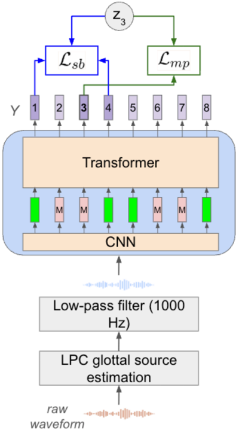

> [!abstract] ACL · 2026 · Conference
> **Kevin Everson et al.** (University of Washington) · [→ Paper](https://aclanthology.org/2026.acl-short.26) · [→ Preprint](https://arxiv.org/abs/2606.00407) · Demo: ? · Code: ?
>
> A HuBERT-style self-supervised prosody encoder trained on glottal-source input with speaker-normalized pitch targets and a gradient-reversal speaker adversary cuts VoxCeleb1 speaker-identification accuracy from 0.64 (HuBERT-base) to 0.14 while matching or beating HuBERT-base on prosodic event detection and pitch reconstruction probes; no speech is generated.

## Problem

Frame-level prosody representations are useful for both expressive speech generation and spoken language understanding, but acoustic-prosodic cues such as pitch carry speaker identity. Classic hand-crafted prosody features rely on F0 tracking and phone alignment, which are unreliable, and energy is sensitive to recording conditions. Recent self-supervised prosody encoders (ProsodyBERT, PE-Wav2vec) learn richer representations but do not try to remove speaker information. The authors frame the resulting identity leakage as a privacy risk, for example enabling voice deepfakes, and target a general prosody representation that keeps prosodic structure while discarding speaker identity.

## Method

The encoder follows the HuBERT-base design (convolutional front end plus Transformer) and the ProsodyBERT recipe of masked prediction over prosody-derived hidden units, with three changes. Parameter count is not reported.

**Input.** Instead of the raw waveform, the encoder consumes an estimated glottal source obtained by LPC inverse filtering (order 16, 25 ms window, 10 ms stride). Frames with energy below 10^-4 pass the raw waveform through, because LPC coefficients were unreliable in non-speech regions and caused training instability. A 1 kHz low-pass filter follows; the authors report from anecdotal listening only that this reduces lexical leakage.

**Targets.** Hidden units come from offline k-means over frame vectors of periodicity, log F0, delta log F0, and the first MFCC (c1, used instead of energy). Unlike ProsodyBERT, log F0 is speaker-normalized by subtracting a periodicity-weighted speaker mean before clustering.

**Objective.** The loss sums three cross-entropy terms: the standard HuBERT masked-prediction loss, a SpanBERT-style span-boundary loss that predicts a masked frame's unit from the unmasked frames on either side of the span plus the distances to them, and an adversarial speaker-identification loss applied through a gradient-reversal layer on the frame-level outputs.

Pretraining uses the transcribed portion of GigaSpeech (about 11K hours of English). GigaSpeech has no speaker labels, so speaker pseudo-labels come from clustering utterance-level embeddings of a pretrained speaker encoder into 1000 clusters. Training runs 500K steps on four A40 or L40 GPUs with fairseq. For downstream probes the encoder is frozen and only its final layer is used (s3prl), which the authors choose for privacy reasons; SUPERB setups normally use a weighted sum of all layers.

## Key Results

All probes measure representation content; no speech is synthesized or converted.

- **Prosodic event detection (BU Radio News, Table 1).** Three of the four encoder variants reach phrase-boundary F1 0.82 (HuBERT-base 0.79, raw prosody features 0.49) and syllable-prominence F1 0.85 to 0.86 (HuBERT-base 0.74, raw prosody 0.66). The full system (both disentanglement strategies) scores 0.82 and 0.85. The exception is the variant with the adversary but without F0 normalization, which drops to phrase-boundary F1 0.73 and accuracy 0.93, below HuBERT-base (0.79 and 0.95).
- **Pitch reconstruction (LibriTTS, SUPERB-prosody, Table 1).** All encoder variants beat HuBERT-base on standard log F0 MSE (0.024 to 0.048 vs. 0.056). The adversary-only variant has the lowest standard MSE (0.024), with the full system at 0.025. On the 0-mean evaluation, which removes speaker mean pitch, the full system has the lowest MSE (0.008); the other three variants score 0.012, slightly worse than HuBERT-base (0.011).
- **Speaker leakage (VoxCeleb1 SID accuracy, lower is better, Table 2).** HuBERT-base final layer 0.64; encoder without disentanglement 0.41; F0 normalization alone 0.42; adversary alone 0.22; both 0.14. The authors report this as a 46% relative reduction for the adversary and 66% for both strategies, relative to the variant without disentanglement.

Fairness caveats: HuBERT-base is probed from its final layer only, which the authors note lowers its SID accuracy relative to the 0.81 reported in SUPERB; that choice may also affect its prosody scores. The closest prior prosody encoders (ProsodyBERT, PE-Wav2vec) are not compared, because no code is public and the authors' reimplementations were uncompetitive.

## Novelty Assessment

The architecture is HuBERT-base and the training recipe extends ProsodyBERT; the glottal-source input comes from PE-Wav2vec. The new elements are speaker-normalized clustering targets and a gradient-reversal speaker adversary inside a self-supervised prosody encoder, with a two-factor ablation showing their separate and joint effect on speaker leakage. Each ingredient is known individually (adversarial speaker removal also appears in earlier prosody work), so the contribution is a well-ablated training-objective modification rather than a new paradigm. The evaluation is narrow: one SID probe, two linguistic prosody tasks on a 7-speaker read-speech corpus, and one pitch probe.

## Field Significance

Low — The paper shows that speaker information in a self-supervised prosody encoder can be cut sharply by combining speaker-normalized targets with an adversarial speaker loss while linguistic prosody probes hold steady. It does not generate speech, so its relevance to speech generation is limited to motivation; the authors leave evaluation on a generation task, with subjective assessment, as future work.

## Claims

- **supports:** Adversarial speaker objectives can remove much of the speaker identity from self-supervised prosody representations without degrading linguistic prosody information.
  > *Evidence:* Adding a gradient-reversal speaker loss with speaker-normalized log F0 targets lowers VoxCeleb1 SID accuracy from 0.41 to 0.14, while phrase-boundary F1 stays at 0.82 and syllable-prominence F1 moves from 0.86 to 0.85 on BU Radio News. *(§4.4, Tables 1 and 2)*
- **refines:** Normalizing pitch targets by speaker mean does little for speaker removal by itself, but it is complementary to adversarial training and avoids the prosodic-event losses seen with the adversary alone.
  > *Evidence:* F0 normalization alone leaves SID accuracy at 0.42 (vs. 0.41), but with the adversary it lowers SID from 0.22 to 0.14 and restores phrase-boundary F1 from 0.73 to 0.82. *(§4.4, Tables 1 and 2)*
- **supports:** Prosody-targeted self-supervised pretraining yields representations that encode prosodic events better than general-purpose speech SSL models.
  > *Evidence:* All encoder variants exceed final-layer HuBERT-base on syllable-prominence F1 (0.82 to 0.86 vs. 0.74) and standard pitch MSE (0.024 to 0.048 vs. 0.056); HuBERT-base is probed from its final layer only. *(§4.4, Table 1)*
- **complicates:** Standard pitch-reconstruction error mixes speaker mean pitch with local pitch dynamics, so it can misrank representations designed to remove speaker information.
  > *Evidence:* On standard MSE the adversary-only variant (0.024) edges out the fully disentangled one (0.025), while after shifting contours to 0 mean the fully disentangled encoder is clearly lowest (0.008 vs. 0.011 to 0.012 for all others). *(§4.2, §4.4, Table 1)*

## Limitations and Open Questions

> [!warning]
> No speech is generated. The representation is evaluated only with frozen-encoder probes (pitch reconstruction, ToBI event detection, speaker identification); its value for TTS or voice conversion, and whether speaker removal survives a synthesis pipeline, is untested.

- Speaker normalization and the adversary both rely on pseudo-labels from clustered utterance-level speaker embeddings; the authors expect ground-truth labels to work better (§Limitations).
- Privacy is measured with a single SID probe trained on limited per-speaker data; the authors note that stronger attackers with more data per speaker might recover identity (§Ethical considerations).
- ToBI tasks use hand transcriptions and one small read-speech corpus of seven professional announcers; paralinguistic tasks are not evaluated.
- The encoder is non-causal, so it does not yet suit streaming generation.
- The claim that the low-pass filter reduces lexical leakage rests on anecdotal listening, not a measured probe.
- No comparison with ProsodyBERT or PE-Wav2vec.

## Wiki Connections

- [[self-supervised-speech|Self-Supervised Speech]] — The method is itself a HuBERT-style masked-prediction speech SSL model, specialized to prosody through prosodic hidden-unit targets and glottal-source input.
- [[disentanglement|Disentanglement]] — Removes speaker information from prosody representations through a gradient-reversal speaker loss and speaker-normalized targets, with a two-factor ablation of their effect on speaker identification.
- [[1904.02882|LibriTTS]] — Supplies the SUPERB-prosody pitch reconstruction task used to probe pitch content in the representation.
- [[2106.06909|GigaSpeech]] — Its transcribed portion (about 11K hours) is the pretraining corpus for the prosody encoder.
