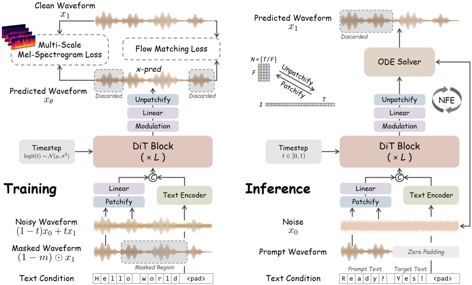

> [!abstract] arXiv · 2026 · Preprint
> **Wenxi Chen et al.** (Shanghai Jiao Tong University / Shanghai Innovation Institute / ByteDance Seed) · [→ Paper](https://arxiv.org/abs/2606.03455) · Demo: ? · Code: ?
>
> WavTTS trains a flow-matching Diffusion Transformer directly on patchified 16 kHz raw waveforms, with no VAE, codec, or vocoder anywhere in the pipeline, and reaches zero-shot TTS quality close to mel- and latent-space NAR systems trained on the same Emilia data.

## Problem

Current non-autoregressive zero-shot TTS systems run diffusion or flow matching on compressed continuous representations: VAE latents or mel-spectrograms. Both are lossy (mel discards phase and high-frequency detail; VAE latents are heavily compressed), which caps achievable quality, and both depend on a separately trained autoencoder or vocoder, so the pipeline is two-stage and can accumulate reconstruction artifacts. Direct raw-waveform generation avoids these issues but has been considered impractical because of sequence length. Earlier waveform-domain TTS (WaveNet-style autoregression, WaveGrad 2, E3-TTS, DiffAR) was either slow, single-speaker, or never compared against modern NAR zero-shot baselines at scale. VITS and JETS are trained end to end, but they model acoustics in an intermediate latent space and rely on adversarial upsampling decoders.

## Method

WavTTS follows the F5-TTS / E2 TTS recipe of text-conditioned speech infilling with implicit alignment. The difference is that the flow runs on raw waveform samples rather than mel frames.

- **Patchification.** The 16 kHz waveform is cut into non-overlapping patches of F = 160 samples, which gives a 100 Hz sequence. The noisy waveform and the masked audio prompt are each embedded by a two-layer linear projection. Text (bilingual pinyin plus alphabet characters) is padded with filler tokens to the patch length, encoded by four ConvNeXt V2 blocks, and concatenated with the audio embeddings along the feature dimension. A DiT backbone with adaLN-Zero timestep conditioning, RMSNorm, and RoPE then processes the sequence. A final linear layer is unpatchified back into a waveform. The main model has 28 layers, hidden size 1152, and 673M parameters; a 22-layer, 340M-parameter variant is used for scaling ablations *(Appendix A)*.
- **x-prediction objective.** Instead of regressing the rectified-flow velocity x1 − x0, the network predicts the clean waveform directly (following JiT from pixel-space image diffusion). The loss is rewritten as an x-prediction loss weighted by 1/(1−t) on the masked span, with t clipped at 0.98 *(§3.1)*.
- **Multi-scale mel-spectrogram loss.** Because the network outputs a waveform estimate, a DAC-style multi-scale log-mel L1 loss (seven resolutions, window 32 to 2048) can be applied to it directly. The loss is restricted to masked regions and weighted at λ_mel = 0.05 *(§3.2, Appendix A)*.
- **Signal-noise variance alignment.** Raw speech has a much smaller standard deviation than the unit Gaussian prior (about 0.12 on Emilia, 0.07 on LibriTTS), which pushes the log-SNR trajectory down by about 20 dB. The target waveform is scaled by a constant k = 9 so that its std is close to 1. The mel loss is computed at the original scale, and outputs are divided by k at inference *(§3.3.1)*.
- **Noise-shifted schedules.** Training timesteps are drawn from a logit-normal with µ = −0.8, σ = 0.8, which biases sampling toward high noise. At inference, the proposed *PolyShift* schedule t = τ^p / (τ^p + s(1−τ^p)) with p = 2, s = 3 puts Euler steps densely in the high-noise region. This is a stronger shift than F5-TTS's Sway Sampling *(§3.3.2, Appendix B)*.

Inference uses 50 NFE, CFG scale 3 (jointly dropping text and prompt), and a target duration estimated from the character-length ratio between the reference and target transcripts. Training runs 1.2M steps on 8 A100 GPUs over about 95K hours of English and Chinese Emilia speech *(§4)*.

## Key Results

**Zero-shot TTS on Seed-TTS (Table 1).** On test-en, WavTTS gets WER 1.50%, SIM-o 0.65, and UTMOS 3.92. Its WER is the lowest in the table (ZipVoice 1.60, F5-TTS 1.65, Spark-TTS 1.98) and its UTMOS is the highest (ZipVoice 3.83, LongCat-AudioDiT 3.80, F5-TTS 3.73; AR models have no UTMOS reported). Speaker similarity is weaker: SIM-o 0.65 is below LongCat-AudioDiT (0.76), MaskGCT and E2 TTS (0.71), ZipVoice (0.70), and F5-TTS (0.66), and ties CosyVoice 2. On test-zh, WavTTS gets CER 1.59%, SIM-o 0.73, and UTMOS 3.08. It trails LongCat-AudioDiT (1.10 / 0.81 / 3.16), ZipVoice (1.40 / 0.75 / 3.15), and F5-TTS on CER (1.55), so the Chinese result is competitive rather than leading. AR baseline rows are copied from their original papers, not re-evaluated. Most mel and latent NAR baselines share the 100K-hour Emilia training set, which makes the NAR comparison reasonably controlled. LongCat-AudioDiT is the exception (multilingual data, 1.42B params).

**Against earlier end-to-end systems (Table 2).** WavTTS is prompted with one fixed LJSpeech clip. On LJSpeech it gets WER 3.43% and UTMOS 4.39, ahead of VITS-LJ (3.72 / 4.37) and JETS (3.73 / 4.36). On LibriSpeech-PC test-clean it gets WER 2.02% (VITS-LJ 2.23, JETS 3.00) and UTMOS 4.36, which ties VITS-LJ (4.36). WaveGrad 2 is far behind (WER 25.19 / 33.77).

**Ablations (1M steps, Seed-TTS test-en).**
- Without the mel loss (λ_mel = 0), WER rises to 1.92, SIM-o falls to 0.56, and UTMOS falls to 3.77, compared with 1.65 / 0.65 / 3.93 at λ_mel = 0.05. Larger weights (0.2, 0.5) also degrade results. x-prediction beats v-prediction mainly on SIM-o (0.65 vs 0.61); WER is nearly equal (1.65 vs 1.67) and UTMOS is marginally lower (3.93 vs 3.94) *(Table 3)*.
- Without waveform scaling (k = 1), the model collapses to WER 4.18, SIM-o 0.32, UTMOS 2.40. k = 5 gives the lowest WER (1.51) but lower SIM-o and UTMOS (0.59 / 3.81), and the authors report audible artifacts *(Table 4)*.
- PolyShift (p = 2, s = 3) improves on uniform (1.78 / 0.63 / 3.77) and Sway Sampling (1.68 / 0.64 / 3.88), reaching 1.65 / 0.65 / 3.93. The PolyShift s = 1 variant has lower WER (1.60), as does s = 5 (1.58) *(Table 5)*.
- On LibriTTS (585 h), both model sizes reach only SIM-o 0.31 to 0.35. On Emilia, going from 340M to 673M raises SIM-o from 0.56 to 0.65 *(Table 6)*.
- Under the same flow-matching framework, waveform modeling reaches 4.10% WER at 200K steps against 9.76% for mel-spectrograms (with a Vocos vocoder), and UTMOS 3.93 against 3.68 at 1M steps. STFT and MDCT representations converge much more slowly *(§5.2.5, Figure 6)*.

All evaluation is objective (Whisper / Paraformer ASR, WavLM-based SIM-o, UTMOS). No formal listening test is reported; "subjective listening" is mentioned only informally in the ablations.

## Novelty Assessment

The backbone (DiT with flow matching, filler-token implicit alignment, ConvNeXt text encoder, infilling training) is inherited from F5-TTS and E2 TTS. The novelty is in moving that framework into raw waveform space and in the set of design choices that make this work: patchification, x-prediction combined with a waveform-domain mel loss, variance alignment of the target, and the PolyShift inference schedule. Several of these come from pixel-space image diffusion (JiT x-prediction, logit-normal sampling, PixelGen-style perceptual loss). Their transfer to speech, and the ablation evidence that each one matters (variance scaling in particular), is the paper's contribution. The authors' claim to be the "first raw waveform generative TTS model" to approach latent-space systems is framed narrowly. E3-TTS and DiffAR had already done waveform-domain diffusion TTS, but not with zero-shot prompting at this scale or against these baselines. The representation comparison (waveform vs mel vs STFT vs MDCT under one framework) is a useful controlled experiment in its own right.

## Field Significance

moderate — The paper shows, under controlled Emilia-trained comparisons, that a flow-matching TTS model with no autoencoder, codec, or vocoder can match or exceed mel-space baselines on English intelligibility and predicted naturalness, while still trailing them on speaker similarity. Its ablations isolate which design choices make raw-waveform flow matching trainable (target variance alignment, x-prediction with a mel loss, high-noise-shifted schedules). This gives a concrete template for single-stage speech generation that removes the vocoder or codec stage. It stays at moderate rather than high: waveform-domain TTS predates it (WaveGrad 2, E3-TTS, DiffAR), the main design choices are transferred from pixel-space image diffusion, speaker similarity and Chinese results still trail latent and mel systems, and the evaluation is objective only.

## Claims

- **supports:** Flow-matching TTS can operate directly on raw waveform samples, without any pretrained autoencoder, codec, or vocoder, and reach intelligibility and predicted naturalness comparable to mel-spectrogram and latent-space systems trained on the same data.
  > *Evidence:* WavTTS (673M, Emilia) gets 1.50% WER and 3.92 UTMOS on Seed-TTS test-en, against F5-TTS 1.65 / 3.73 and ZipVoice 1.60 / 3.83 trained on the same 100K-hour Emilia data. In a controlled representation comparison, waveform modeling also beats mel at 200K steps (4.10% vs 9.76% WER). *(§5.1.1, Table 1; §5.2.5, Figure 6)*
- **complicates:** Generating directly in the waveform domain tends to cost speaker similarity relative to compressed-representation generators, even when intelligibility and naturalness are on par.
  > *Evidence:* WavTTS SIM-o is 0.65 on test-en and 0.73 on test-zh, below LongCat-AudioDiT (0.76 / 0.81), MaskGCT (0.71 / 0.77), and ZipVoice (0.70 / 0.75). The authors attribute this to capacity being spent on fine-grained phase and ambient detail. *(§5.1.1, Table 1)*
- **refines:** In waveform-domain flow matching, matching the target signal's variance to the Gaussian prior is a precondition for learning, not a minor tuning choice, because the low amplitude of raw speech pushes most timesteps into very low SNR.
  > *Evidence:* Without scaling (k = 1), SIM-o falls to 0.32 and UTMOS to 2.40, against 0.65 / 3.93 at k = 9. Raw speech std is about 0.12 on Emilia, which implies a roughly 20 dB log-SNR offset. *(§3.3.1, Figure 3; §5.2.2, Table 4)*
- **supports:** Auxiliary multi-resolution spectral losses help diffusion-style generators that output waveforms directly, but too much weight on them degrades the generative objective.
  > *Evidence:* Removing the mel loss gives WER 1.92 / SIM-o 0.56 / UTMOS 3.77 versus 1.65 / 0.65 / 3.93 at λ_mel = 0.05. Raising λ_mel to 0.5 degrades results again (1.81 / 0.55 / 3.82). Without the mel loss the model is still unintelligible at 200K steps. *(§5.2.1, Table 3)*
- **complicates:** Lossless time-frequency representations such as STFT or MDCT are not automatically easier diffusion targets than raw waveforms; their value distributions can slow flow-matching convergence substantially.
  > *Evidence:* Under the same DiT flow-matching setup, MDCT produces recognizable speech only after about 400K steps and STFT only after about 600K, while waveform and mel models are already below 10% WER at 200K. The MDCT features are sharply peaked (std about 0.005, max 0.15). *(§5.2.5, Figure 6; Appendix C)*

## Limitations and Open Questions

- **Speaker similarity gap.** SIM-o trails the strongest latent and mel NAR systems on both languages. The authors suggest scaling and speaker-oriented alignment as remedies but do not test them.
- **Objective-only evaluation.** Naturalness is measured with UTMOS, a MOS predictor, and no human listening test is reported. Artifacts mentioned in the ablations (electronic noise, background noise with aggressive PolyShift shifts) are described only qualitatively.
- **Chinese performance.** WavTTS is competitive but does not lead on test-zh in CER, SIM-o, or UTMOS.
- **Baseline provenance.** AR baseline numbers are copied from their original papers, and AR rows have no UTMOS. The end-to-end comparison in Table 2 sets a zero-shot-prompted 95K-hour model against single-speaker LJSpeech-trained baselines, so it reflects data scale as well as architecture.
- **Sample rate and cost.** Audio is modeled at 16 kHz only. Inference cost (RTF) compared with mel-space systems is not reported, and neither is training compute beyond step counts and GPU type.
- **Data dependence.** On 585 h of LibriTTS, out-of-domain speaker similarity is poor (SIM-o about 0.3), so the approach appears to need large-scale data.
- Code and demo availability are not stated in the paper.

## Wiki Connections

- [[flow-matching|Flow Matching]] — Moves rectified-flow TTS from mel or latent space into raw waveform space using x-prediction, variance-aligned targets, and a new high-noise-shifted inference schedule (PolyShift).
- [[zero-shot-tts|Zero-Shot TTS]] — Evaluated on prompt-based cloning of unseen speakers on Seed-TTS test-en and test-zh, where speaker similarity is its weakest axis.
- [[multilingual-tts|Multilingual TTS]] — Trained on English and Chinese Emilia data and evaluated on both languages, with stronger English than Chinese results.
- [[2025.acl-long.313|F5-TTS]] — Direct architectural parent (DiT, filler-token alignment, infilling, Sway Sampling) and the main mel-space baseline that WavTTS matches or beats on English WER and UTMOS.
- [[2406.18009|E2 TTS]] — Origin of the implicit text-padding alignment that WavTTS reuses, and a mel-space Emilia-trained baseline in Table 1.
- [[2506.13053|ZipVoice]] — Strongest Emilia-trained mel baseline on English (1.60% WER) and ahead of WavTTS on Chinese CER and SIM-o.
- [[2603.29339|LongCat-AudioDiT]] — Waveform-latent diffusion baseline that leads both test sets on speaker similarity and leads Chinese CER and UTMOS, the main counterpoint to WavTTS's results.
- [[2409.00750|MaskGCT]] — Latent-space Emilia-trained baseline with higher SIM-o but worse WER and UTMOS than WavTTS on test-en.
- [[2406.02430|Seed-TTS]] — Source of the Seed-TTS test-en and test-zh zero-shot evaluation sets.
- [[2407.05361|Emilia]] — The roughly 95K-hour English and Chinese training corpus shared by WavTTS and most NAR baselines.
- [[1609.03499|WaveNet]] — The original raw-waveform generator that WavTTS revisits with parallel flow matching instead of sample-level autoregression.
