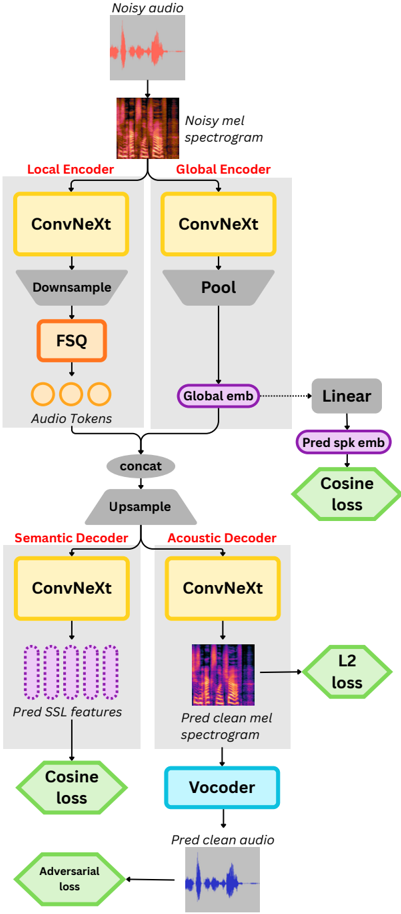

> [!abstract] arXiv · 2026 · Preprint
> **Eugene Kwek et al.** (Pennsylvania State University / Drexel University) · [→ Paper](https://arxiv.org/abs/2606.04418) · Demo: ? · Code: ?
>
> CleanCodec trains a single-codebook, 12.5 tokens/s disentangled speech codec to denoise while it compresses, and adds a speaker-verification loss on its global embedding, so its bitrate goes to content and timbre rather than to noise and recording conditions.

## Problem

Speech tokenizers for LLM-based generation have to trade token rate against reconstruction. Semantic tokenizers built on SSL features keep linguistic content but lose timbre and prosody. Acoustic codecs reach high fidelity with multi-codebook residual quantization, which multiplies the token rate. Single-codebook and disentangled codecs reach low token rates but, in the authors' experiments, reconstruct poorly, especially out of domain. The authors argue that part of the problem is the training target itself: codecs are asked to reproduce everything in the input, including background noise, reverberation and microphone colouration. At very low token rates, those perceptually unimportant components compete with content and speaker identity for the same bits (§1, §3.2.1).

## Method

CleanCodec has two parts: a VQ-VAE-style disentangled autoencoder that works on 24 kHz log-mel spectrograms at 62.5 Hz, and a separately trained Vocos-style vocoder that turns the reconstructed mel back into a waveform (§3.1). The authors choose mel input over SSL features, which they say lose non-linguistic information and generalise poorly. They also choose it over raw waveforms, arguing that mel is closer to human perception.

- **Local encoder.** 1D ConvNeXt blocks (16 layers, 768-dim), downsampled by 5 to 12.5 Hz and quantized with finite scalar quantization (FSQ) at levels [8, 8, 8, 8, 8]. This gives a single, parameter-free codebook of 32,768 codes (§3.1, Appendix A).
- **Global encoder.** Modified NeXt-TDNN ConvNeXt blocks with attentive statistics pooling produce one 256-dim utterance embedding. The design follows Kanade. The embedding is concatenated to the tokens before decoding.
- **Dual decoder.** After upsampling back to 62.5 Hz, an acoustic decoder regresses the clean mel spectrogram (L2 loss) and a semantic decoder regresses WavLM-large features (cosine loss). The semantic branch is used only in training and can be dropped at inference (§3.1, §3.2.4).

The training framework is the core of the paper (§3.2):

1. **Speech enhancement as a co-objective.** Each input is corrupted with simulated reverberation (pyroomacoustics RIRs), additive noise from AudioSet, FSD50K and WHAM! at 15 to 30 dB SNR, low-pass filtering, resampling and MP3 compression, each applied with probability 0.5. The pipeline follows Sidon. The model must reconstruct the *clean* signal, so the encoder learns to discard what the degradations add (§3.2.2).
2. **Speaker-verification conditioning of the global encoder.** A learned linear projection maps the global embedding into the TitaNet-large embedding space, and a cosine loss pulls it toward the pretrained speaker embedding. The authors describe this as the first use of a speaker recognition model to condition a codec (§3.2.3).
3. **Two-stage training.** Training the autoencoder and vocoder jointly from scratch caused adversarial training to collapse. In stage one, the autoencoder (no adversarial loss) and the vocoder (Vocos recipe: multi-period and multi-band STFT discriminators, multi-scale mel, adversarial and feature-matching losses) are each trained for 1M steps. In stage two, they are fine-tuned end to end for 200K steps at a learning rate of 2e-6 (§3.2.4, Appendix A).

The full model has 471M parameters, or 396M without the semantic decoder. It is trained on about 2,400 h (LibriTTS-R plus an 1,800 h Emilia-YODAS subset) on one A100 for about a week. Variants with downsampling factors 1 and 2 give CleanCodec@62.5 and CleanCodec@31.25 (§4.1, Appendix A). The downstream TTS and ASR probes are 96M-parameter LLaMA-style decoder-only transformers trained for 10K steps on LibriTTS tokens. For disentangled codecs, the global embedding is prepended to the sequence (Appendix A).

## Key Results

Codecs are compared within token-rate bands: CleanCodec@12.5 against baselines below 50 t/s, and the 31.25 and 62.5 variants against baselines at or above 50 t/s (§4.3). All reported metrics are automatic. SIM uses ReDimNet-M, WER/CER use Parakeet transcripts of the original audio as reference, and UTMOS and SI-SDR come from the reference-free Torchaudio-Squim suite. There is no human listening test.

**Reconstruction on LibriTTS (Table 1).** In the below-50 t/s band (WavTokenizer 40 t/s, FocalCodec and Kanade 12.5 t/s), CleanCodec@12.5 has the lowest WER (2.7 vs 4.0 for Kanade), lowest CER (1.4 vs 2.1), highest SIM (0.86 vs 0.65), highest UTMOS (4.32 vs 4.22) and lowest Mel L1 (0.44 vs 0.46 for WavTokenizer) on test-clean. Its UTMOS is above the ground-truth 4.20. On SI-SDR it ranks third of four (21.96 vs FocalCodec 25.19 and Kanade 23.60; only WavTokenizer is lower at 19.98). Test-other shows the same pattern: WER 5.7 vs 8.2, SIM 0.84 vs 0.64, SI-SDR third of four. CleanCodec@31.25 beats BiCodec and XCodec2 (both 50 t/s) on 5 of 6 test-clean metrics. The exception is SI-SDR (22.02 vs 26.49 and 23.51). CleanCodec@62.5 ties the 200 t/s Qwen3-TTS-Tokenizer on WER (1.3), SIM (0.90) and Mel L1 (0.29) and is slightly better on CER (0.6 vs 0.7). It is lower on UTMOS (4.23 vs 4.27) and SI-SDR (22.94 vs 27.99).

**Out-of-domain reconstruction (Table 2, Table 7).** Among the low-rate codecs, CleanCodec@12.5 keeps much lower error rates: Expresso WER 3.9 vs 9.3 for Kanade, AISHELL-3 CER 1.5 vs 6.1 for WavTokenizer, and CML-TTS WER 12.1 vs 29.6 for WavTokenizer and 42.1 for Kanade. It also has the highest SIM on all three sets. It does not lead on UTMOS, where FocalCodec is higher on all three (3.75, 3.68, 3.58 vs 3.55, 3.04, 3.47), or on AISHELL-3 SI-SDR (22.41 vs FocalCodec 25.43). Its CML-TTS Mel L1 (0.65) ranks third of the four low-rate codecs. On multilingual CML-TTS, its WER stays well above the 50 t/s codecs (XCodec2 6.2).

**Disentanglement probes (Table 3).** Speaker verification on VoxCeleb1 uses the global embedding alone. All CleanCodec variants reach EER 0.22 to 0.58, against 1.52 for BiCodec and 3.38 for Kanade. An ASR probe trained on local tokens gives WER 4.7 to 5.6, against 6.2 and 8.1.

**Voice conversion on VCTK (Table 4).** Swapping in a reference speaker's global embedding gives SIM 0.81 for CleanCodec@12.5, against 0.52 for Kanade and 0.47 for BiCodec. Kanade keeps the highest UTMOS (4.21 vs 4.09). BiCodec has a lower WER than CleanCodec@12.5 (1.3 vs 1.4), but CleanCodec@62.5 has the lowest WER and CER (0.8, 0.3). SIM falls as the token rate rises (0.81, 0.76, 0.70 at 12.5, 31.25, 62.5 t/s), so more speaker information leaks into the local tokens at higher rates.

**Downstream TTS on Seed-TTS-eval (Table 5).** With the same 96M AR model, CleanCodec tokens give the highest SIM (0.56 vs 0.51 for BiCodec) and lowest WER (3.9 vs 4.9 for XCodec2). Training time (01:00) and RTF (0.170) match the other 12.5 t/s codecs. Kanade is marginally faster (0.169). Against the 200 t/s Qwen3 tokenizer, this is about 10x faster training (10:02) and 17x faster inference (RTF 2.930). Absolute SIM is low for every codec in this small-scale probe.

**Ablations (Table 6).** Removing the WavLM semantic branch triples WER (8.1 vs 2.7) while slightly improving UTMOS, SI-SDR and Mel L1. Removing TitaNet conditioning drops SIM from 0.86 to 0.74, and replacing TitaNet with WavLM-SV gives 0.77. One-stage training degrades all six metrics. Removing the denoising objective degrades 5 of 6 metrics (WER 3.4, SIM 0.82, UTMOS 4.24, SI-SDR 20.55) but improves Mel L1 (0.41 vs 0.44). Swapping the SSL teacher to HuBERT changes little.

**Efficiency (Table 8, Table 9).** Normalized codebook entropy is 0.985, second to BiCodec (0.995) and essentially level with SpeechTokenizer (0.984). The baseline entropies are copied from the Kanade paper rather than re-measured. CleanCodec has the fastest encoding RTF (0.0011) but the third-fastest total RTF (0.0045, behind FocalCodec 0.0036 and WavTokenizer 0.0039). At 396M parameters it is the second-largest codec compared, after X-Codec2 (823M).

## Novelty Assessment

Most of the architecture is assembled from existing parts: Vocos-style ConvNeXt blocks and vocoder, FSQ, a Kanade-style global encoder with NeXt-TDNN blocks and attentive pooling, and WavLM feature regression as semantic distillation. What is new is the training framework. The two ideas with the clearest ablation support are (1) treating codec training as joint compression and speech enhancement, so the bottleneck is spent on clean speech, and (2) supervising the global embedding against a pretrained speaker-verification model. The two-stage schedule that keeps adversarial vocoder training away from the bottlenecked autoencoder is a practical stabilisation trick and is also ablated.

Several caveats limit how far the gains can be read. The SV disentanglement probe partly measures what the global encoder was directly trained for, since it is explicitly pulled toward TitaNet embeddings. The probe also shows speaker information in the global embedding, not its absence from the local tokens; the VC SIM trend suggests some leakage at higher rates. The denoising objective makes signal-fidelity metrics hard to interpret, because the output intentionally departs from the input. SI-SDR is where CleanCodec most often trails, and UTMOS above ground truth is consistent with enhancement rather than faithful reconstruction. The downstream TTS comparison uses one small, short-trained AR model, and the authors note that the gaps between codecs may shrink with longer training.

## Field Significance

Moderate. The paper gives ablated evidence that, at very low token rates, a codec can trade input fidelity for content and speaker preservation by learning to discard recording conditions. It shows that a single 12.5 tokens/s stream can reach intelligibility and speaker similarity comparable to 50 t/s codecs on clean read speech. It also introduces speaker-verification supervision of a codec's global embedding as a simple, effective conditioning signal. The evidence is limited to automatic metrics and small downstream probes.

## Claims

- **supports:** Training a speech codec to reconstruct clean speech from degraded input improves intelligibility and speaker similarity at very low token rates, because the bottleneck stops spending capacity on noise and recording artefacts.
  > *Evidence:* Removing the degradation pipeline from CleanCodec@12.5 training raises WER from 2.7 to 3.4 and lowers SIM from 0.86 to 0.82, UTMOS from 4.32 to 4.24 and SI-SDR from 21.96 to 20.55, although Mel L1 improves slightly (0.44 to 0.41). *(§4.8, Table 6)*
- **supports:** Explicitly supervising a codec's utterance-level embedding with a pretrained speaker-verification model improves speaker preservation in reconstruction and supports cleaner content/speaker factorization than unsupervised global pooling.
  > *Evidence:* Removing the TitaNet cosine loss drops reconstruction SIM from 0.86 to 0.74, and replacing TitaNet with WavLM-SV gives 0.77. The global embedding alone reaches VoxCeleb1 EER 0.58 vs 3.38 for Kanade, and voice conversion by embedding swap reaches SIM 0.81 vs 0.52. *(§3.2.3, §4.5, §4.8, Tables 3, 4, 6)*
- **supports:** Semantic distillation from a self-supervised speech model is what keeps low-token-rate codecs intelligible, and the choice of SSL teacher matters little.
  > *Evidence:* Dropping the WavLM-large regression branch roughly triples WER (2.7 to 8.1) and CER (1.4 to 4.3) while non-linguistic metrics change little or improve; swapping the teacher to HuBERT gives WER 2.9 and SIM 0.85. *(§4.8, Table 6)*
- **complicates:** In global/local disentangled codecs, separation of speaker identity from local tokens weakens as the local token rate increases, so higher-rate variants are worse for voice conversion even when reconstruction improves.
  > *Evidence:* VCTK voice-conversion SIM falls from 0.81 (12.5 t/s) to 0.76 (31.25 t/s) and 0.70 (62.5 t/s), and UTMOS falls from 4.09 to 3.93, while LibriTTS reconstruction SIM rises from 0.86 to 0.90. BiCodec shows the same leakage more strongly. *(§4.6, Table 4, §Limitations)*
- **complicates:** Signal-fidelity and reference-free quality metrics can misrepresent denoising codecs, which score above ground truth on predicted quality while trailing on signal-level similarity.
  > *Evidence:* CleanCodec@12.5 scores UTMOS 4.32 against ground-truth 4.20 on LibriTTS test-clean, yet ranks third of four low-rate codecs on SI-SDR (21.96 vs FocalCodec 25.19). CleanCodec@31.25 loses only SI-SDR to BiCodec and XCodec2. *(§4.4, Table 1)*

## Limitations and Open Questions

> [!warning]
> All quality evidence is automatic (UTMOS, Squim SI-SDR, ReDimNet SIM, ASR-based WER). No human listening test is reported, and because the codec is trained to remove noise, reverberation and channel effects, it intentionally does not reproduce the recording conditions of its input.

- The authors acknowledge that disentanglement degrades as the token rate rises, and that how best to decode local and global information at high token rates is left open (§Limitations).
- Downstream TTS and ASR use a single 96M model trained for 10K steps on LibriTTS. The authors note that the gaps between codecs may shrink with larger compute budgets (§Limitations, Appendix A).
- Training data is English-heavy (LibriTTS-R plus an Emilia-YODAS subset). The multilingual CML-TTS WER of 12.1 is well above that of 50 t/s codecs, so generalisation beyond English is partial (Table 7).
- The codebook-entropy comparison reuses baseline numbers from the Kanade paper rather than re-measuring them under the same conditions (Table 8).
- Code and demo availability are not stated in the parsed text.

## Wiki Connections

- [[neural-codec|Neural Audio Codec]] — Contributes a single-codebook 12.5 tokens/s speech codec whose denoising objective reallocates the bottleneck from recording conditions to content and timbre.
- [[self-supervised-speech|Self-Supervised Speech]] — Uses WavLM-large as a semantic distillation teacher through a feature-regression decoder, and shows that removing it triples WER.
- [[disentanglement|Disentanglement]] — Separates a global speaker embedding, explicitly supervised by a speaker-verification model, from local content tokens, with SV, ASR and voice-conversion probes plus an ablation.
- [[gan-vocoder|GAN Vocoder]] — Trains an enlarged Vocos vocoder adversarially and shows that a two-stage schedule, separating adversarial vocoder training from the bottlenecked autoencoder, avoids training collapse.
- [[autoregressive-codec-tts|Autoregressive Codec TTS]] — Trains decoder-only AR TTS models on each codec's tokens to show that 12.5 t/s tokens cut training and inference cost while improving SIM and WER.
- [[2602.00594|Kanade]] — Main low-rate disentangled baseline; CleanCodec borrows its global-encoder design but replaces SSL-feature input with mel input and adds speaker-verification supervision.
- [[neurips-2025-7Z3wQSu3mH|FocalCodec]] — 12.5 t/s single-codebook baseline that CleanCodec beats on intelligibility and SIM but not on SI-SDR or out-of-domain UTMOS.
- [[2408.16532|WavTokenizer]] — 40 t/s single-codebook baseline in the low-rate band, compared in reconstruction and TTS.
- [[2503.01710|Spark-TTS]] — Source of the BiCodec disentangled baseline, which leads codebook entropy but leaks speaker identity into its local tokens under voice conversion.
- [[2502.04128|Llasa]] — Source of the XCodec2 baseline, which CleanCodec@31.25 beats on 5 of 6 LibriTTS metrics at a lower token rate.
- [[2410.00037|Moshi]] — Source of the Mimi 100 t/s baseline in reconstruction and downstream TTS comparisons.
- [[2601.15621|Qwen3-TTS]] — Source of the Qwen3-TTS-Tokenizer baseline at 50, 100 and 200 t/s, the reference for the 10x training and 17x inference speedup.
- [[2306.00814|Vocos]] — Supplies the ConvNeXt backbone and the adversarial vocoder recipe that CleanCodec scales up and retrains.
