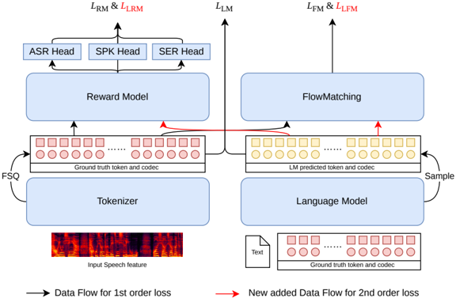
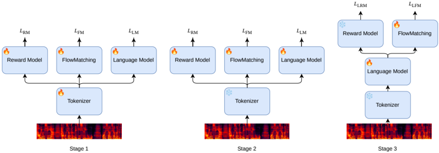

> [!abstract] arXiv · 2026 · Preprint
> **Changfeng Gao et al.** (Tencent Yuanbao) · [→ Paper](https://arxiv.org/abs/2606.09234) · Demo: ? · Code: ?
>
> Trains the speech tokenizer, autoregressive LLM, flow-matching decoder and a recognition-based reward model of a discrete-token TTS cascade jointly, first shaping the tokenizer with all downstream losses and then backpropagating reconstruction and recognition losses through Gumbel-Softmax samples of the LLM, which lowers Seed-TTS-Eval error rates relative to an identically trained cascaded pipeline.

## Problem

Current LLM-based TTS systems (Seed-TTS, CosyVoice 3, Qwen3-TTS) are cascades of a speech tokenizer, an autoregressive LLM over discrete tokens, and a flow-matching (FM) decoder, each trained separately. The tokenizer is fixed first, using proxy objectives (ASR accuracy, SSL representation quality, autoencoding fidelity) that are not aligned with LLM token prediction or FM reconstruction, so it caps system quality. The FM decoder is trained on ground-truth tokens rather than LLM predictions, so LLM errors propagate at inference, and the LLM's cross-entropy objective ignores the perceptual quality of the final speech. Prior partial joint-training work couples only subsets of modules: diffusion-trained tokenizers (TaDiCodec, scaled diffusion autoencoders), joint LLM+FM training (JoyVoice), and differentiable reward optimization (DiffRO) coupling the LLM to a reward backend. The paper argues for optimizing all components together.

## Method

The system has four components that share a single FSQ codebook (8 dimensions with 3 levels each, 6561 codes): a speech tokenizer, a multi-task recognition reward model (RM), an LLM and an FM decoder. The tokenizer and RM are built by inserting the FSQ quantizer into an existing Conformer CTC ASR model (0.6B and 0.7B parameters respectively); the RM adds attention-pooling heads for speech emotion recognition (SER) and speaker identification (SPK). The LLM is Qwen3-0.6B with 6561 speech tokens plus 4 control tokens added, and its speech-token embeddings are tied to the FSQ codebook through a light linear adapter. The FM decoder is a 0.5B Diffusion Transformer following CosyVoice 3, and a HiFi-GAN vocoder converts the predicted mel spectrograms to waveforms. All modules read the quantized vectors directly, not a separate embedding table *(§3.1.2)*.

**First-order loss** *(§2.1)*. The quantized ground-truth token vectors feed the RM (CTC ASR loss, SER cross-entropy, cosine loss against a pretrained x-vector), the FM (velocity-prediction loss reconstructing speech from the tokens) and the LLM (next-token cross-entropy conditioned on text). Because these losses use tokenizer outputs, their gradients reach the tokenizer, so it is shaped by reconstruction, predictability and recognition together: L1 = αL_LM + βL_RM + γL_FM, with weights 0.1, 1.0 and 1.0 *(§3.1.3)*. The LLM's training targets move while the tokenizer trains, which destabilizes optimization. To handle this, once the tokenizer is trainable the LLM's output logits are replaced by the similarity between its final hidden state and the codebook entries, with gradient stopped into the codebook.

**Second-order loss** *(§2.2)*. The FM and RM also receive tokens predicted by the LLM, either Gumbel-Softmax hard samples looked up in the codebook or the LLM's hidden states. The resulting losses (L_LRM, L_LFM) backpropagate through the sampling step into the LLM. This trains the FM on the LLM's own output distribution and pushes the LLM toward tokens that reconstruct and recognize well. The authors call this a reinforcement-style alignment; it works through a differentiable reward rather than a policy-gradient method. Within L_LRM the ASR and speaker loss weights are 1.0 and 0.1, and the emotion loss is used only when emotion conditioning is needed *(§3.1.3)*.

**Three-stage pipeline** *(§2.3)*. Stage 1 trains everything end to end with L1. Stage 2 freezes the tokenizer and fine-tunes the RM, FM and LLM separately, so each can use its own data (e.g. noisier data and Emo2Vec-Large emotion pseudo-labels for the RM). Stage 3 freezes the tokenizer and RM and trains the LLM and FM with L2.

The paper also gives an information-theoretic account (§2.4). It treats the tokenizer as a source coder whose token entropy H(X_n) is maximized by minimizing reconstruction uncertainty (the FM loss). Modelling tokens as a first-order Markov source, it argues that the LM loss directly raises the mutual information I(X_{n+1}; X_n) between adjacent tokens. Training data is about 100k hours of in-house Chinese and English speech (4:1), pseudo-transcribed with Whisper-large-v3 and FireRedASR and filtered at DNSMOS 3.3 and a 5% transcription-disagreement threshold *(§3.1.1)*. Training ran on 64 H20 GPUs.

## Key Results

**Zero-shot TTS, Seed-TTS-Eval (Table 1).** The Stage 3 system reaches CER 0.78 on test-zh and WER 1.56 on test-en, the lowest error rates in the table. Nearest rows are OmniVoice (0.84 / 1.60), JoyVoice (0.97 / 1.69), Qwen3-TTS-0.6B (1.18 / 1.64) and CosyVoice3-1.5B (1.12 / 2.21). On test-hard, Stage 3 CER is 6.61, worse than JoyVoice (5.55) and CosyVoice3-1.5B (5.83) but better than Seed-TTS (7.59), F5-TTS (8.67) and MaskGCT (10.27). Speaker similarity is not where it leads. Test-zh SS 0.781 ties CosyVoice3-1.5B and trails Seed-TTS (0.796) and JoyVoice (0.786). Test-en SS 0.705 is below Seed-TTS (0.762), OmniVoice (0.741), JoyVoice (0.736), CosyVoice3-1.5B (0.720) and MaskGCT (0.714). Test-hard SS 0.759 trails Seed-TTS (0.776). Baseline numbers appear to be taken from prior reports rather than re-run; the paper does not say which.

**Effect of end-to-end training (Table 1).** The controlled comparison is against "w/o E2E-training": a separately pretrained tokenizer with LLM and FM trained from scratch on the same data. That pipeline gets CER 0.87 / WER 1.89 / test-hard CER 7.35 with SS 0.760 / 0.682 / 0.745, against Stage 3's 0.78 / 1.56 / 6.61 and 0.781 / 0.705 / 0.759. Gains build up over the stages. Stage 1 alone (1.16 / 2.09 / 7.68) is worse than the cascaded baseline, Stage 2 reaches 0.86 / 1.72 / 7.21 with SS 0.775 / 0.696 / 0.752, and Stage 3 adds further gains on all six columns.

**FM reconstruction (Table 2).** Compared with resynthesis from the CosyVoice 2 S3-Tokenizer-FSQ, Stage 3 reconstruction lowers test-zh CER (2.93 vs 3.31) and test-en WER (3.08 vs 4.09) and raises test-zh SS (0.826 vs 0.787). Test-en SS is slightly lower (0.702 vs 0.709), and on the CV3-Eval subjective subset WER is roughly tied (11.56 vs 11.50) while SS is higher (0.780 vs 0.761). Removing L_LM from Stage 1 (3.12 / 3.45) and removing both L_LM and L_FM (3.68 / 4.11) both hurt reconstruction. Per the authors, L_FM matters most for reconstruction quality.

**RM recognition (Table 3).** On discrete input, the Stage 2 RM's ASR head gets WER 6.50 on CommonVoice-zh (S3-Tokenizer-FSQ 7.27, Qwen-TTS-Tokenizer 14.99, Whisper-large-v3 12.40) and 2.22 on LibriSpeech test-clean (Whisper-large-v3 2.56). On CommonVoice-en it is worse (14.53 vs Whisper 9.66, S3-Tokenizer-FSQ 10.67, Qwen-TTS-Tokenizer 10.40). SER weighted accuracy (IEMOCAP 60.8, MELD 55.6) is below Emo2Vec-large (67.3 / 57.4) and SenseVoice-small (65.7 / 57.8).

**Token statistics (Table 4, Figure 3).** On LibriTTS, adding the FM and then the LM losses raises unigram token entropy (10.905, then 11.254, then 11.363 bits) and adjacent-token mutual information (2.50, then 2.53, then 2.55). Codebook utilization is near 100% for all variants, but the RM-only tokenizer concentrates mass on a narrow range of indices.

## Novelty Assessment

The pieces are established: FSQ tokenizers inside an ASR encoder (CosyVoice 2/3 style), Qwen3 LLM backbones, a DiT flow-matching decoder, Gumbel-Softmax through discrete sampling, and differentiable reward optimization from the same first author. The new part is the joint system: one codebook shared across tokenizer, LLM, FM and RM; codebook-similarity logits that keep LLM targets stable while the tokenizer moves; and a staged schedule that adds a second-order loss through LLM samples. The tokenizer-side effect is ablated (w/o L_LM, w/o L_LM and L_FM) and the system-level effect is tested against an identically trained cascade, so the evidence for joint training is better controlled than the leaderboard comparison. However, the cascaded baseline gets no Stage-2-style separate fine-tuning or reward optimization of its own. Also, the "w/o E2E-training" row is described in one sentence, so it is unclear how much of the Stage 3 gain comes from the tokenizer and how much from the second-order loss. The information-theoretic analysis is a motivating interpretation and is not used to derive the method. The leaderboard gains on test-zh/test-en are small (0.06 CER and 0.04 WER over the nearest row), and speaker similarity on test-en is clearly behind larger systems.

## Field Significance

Moderate. The paper shows within a single data and model setup that co-training the tokenizer with the downstream LLM, flow-matching and recognition objectives, then training the LLM through its own samples, lowers error rates of a sub-1B discrete-token TTS system compared with the same components trained in cascade. It extends partial joint-training results (tokenizer+decoder, LLM+decoder, LLM+reward) to the whole pipeline. The test-en speaker-similarity deficit and the weaker test-hard result limit how far the result reaches.

## Claims

- **supports:** Jointly optimizing the speech tokenizer with downstream language-modelling and reconstruction objectives yields better discrete-token TTS than training the tokenizer separately and cascading the components.
  > *Evidence:* With identical data, the full three-stage system beats a pipeline with an independently pretrained tokenizer on every Seed-TTS-Eval column: CER 0.78 vs 0.87 (test-zh), WER 1.56 vs 1.89 (test-en), CER 6.61 vs 7.35 (test-hard), with higher SS on all three sets. *(§3.2.1, Table 1)*
- **supports:** Backpropagating reconstruction and recognition losses through the language model's own sampled tokens reduces train-inference mismatch and improves pronunciation accuracy in LLM-based TTS.
  > *Evidence:* Stage 3, which adds the second-order loss through Gumbel-Softmax samples, lowers error rates from Stage 2 (test-zh CER 0.86 to 0.78, test-en WER 1.72 to 1.56, test-hard CER 7.21 to 6.61) and raises test-en SS from 0.696 to 0.705. *(§2.2, §3.2.1, Table 1)*
- **refines:** Speech tokens that are easier for a language model to predict need not lose information: next-token-prediction and reconstruction losses on the tokenizer increase both token entropy and adjacent-token mutual information.
  > *Evidence:* On LibriTTS, the RM-only tokenizer gives H(X_n) 10.905 and I(X_{n+1};X_n) 2.50; adding L_FM gives 11.254 and 2.53; adding L_LM as well gives 11.363 and 2.55. Without these losses, token use is heavily long-tailed despite near-full codebook utilization. *(§3.2.4, Table 4, Figure 3)*
- **complicates:** End-to-end joint training of a TTS pipeline is not stable or beneficial in a single stage; separate per-module fine-tuning after joint tokenizer training is needed to realize the gains.
  > *Evidence:* Stage 1 joint training alone (CER 1.16, WER 2.09, test-hard CER 7.68) is worse than the separately trained cascade (0.87, 1.89, 7.35), and the RM's ASR and SER accuracy also improve from Stage 1 to Stage 2. The authors attribute this to the LM's inputs and targets both shifting during Stage 1. *(§3.2.1, §3.2.3, Tables 1 and 3)*
- **complicates:** Gains in content accuracy from joint optimization of discrete-token TTS do not automatically carry over to speaker similarity.
  > *Evidence:* Stage 3 posts the lowest test-zh CER and test-en WER in the comparison, but its test-en SS of 0.705 trails Seed-TTS (0.762), OmniVoice (0.741), JoyVoice (0.736) and CosyVoice3-1.5B (0.720). In FM reconstruction, Stage 3 improves WER over Stage 2 while SS stays flat. *(§3.2.1, §3.2.2, Tables 1 and 2)*

## Limitations and Open Questions

> [!warning]
> All training uses an in-house ~100k-hour corpus with no code, demo or release mentioned, and the only controlled comparison is against one cascaded baseline described in a single sentence; the separate contributions of tokenizer co-training and the second-order loss to the final system are not isolated.

- Baseline rows in Table 1 are not re-run under a common setup, and the paper does not state their sources beyond citations.
- No subjective listening tests (MOS, SMOS or CMOS) are reported; quality is judged only by WER/CER and speaker similarity.
- Emotion conditioning is mentioned (the SER loss is "applied only when emotion conditioning is required") but no emotional TTS evaluation is reported, and the RM's SER accuracy trails dedicated emotion models.
- Table 2 reconstruction error rates (e.g. test-zh CER 2.93) are higher than the corresponding TTS error rates in Table 1 (0.78). The paper does not discuss the evaluation setup behind this gap.
- Token frame rate, inference speed and streaming behaviour are not reported. The authors list per-component analysis of the FM, RM and tokenizer under end-to-end training as future work.

## Wiki Connections

- [[autoregressive-codec-tts|Autoregressive Codec TTS]] — The Qwen3-0.6B LLM autoregressively predicts single-codebook FSQ speech tokens and is trained jointly with the tokenizer and through its own samples.
- [[flow-matching|Flow Matching]] — The DiT flow-matching decoder is co-trained with the tokenizer in Stage 1 and adapted to LLM-predicted tokens in Stage 3, rather than inherited frozen.
- [[neural-codec|Neural Audio Codec]] — The FSQ speech tokenizer itself is trained with FM, LM and recognition losses, and its entropy and mutual information are analyzed.
- [[rlhf-speech|RLHF Speech]] — The second-order loss is a differentiable-reward alignment of the LLM through an ASR/SER/speaker reward model via Gumbel-Softmax, not policy-gradient RL.
- [[zero-shot-tts|Zero-Shot TTS]] — The system is evaluated on Seed-TTS-Eval zero-shot cloning against Seed-TTS, CosyVoice 3, JoyVoice and OmniVoice.
- [[multilingual-tts|Multilingual TTS]] — Trained on Chinese and English data and evaluated on both test-zh and test-en.
- [[interspeech-2025-0704|DiffRO]] — Earlier differentiable reward optimization by the same first author; this paper generalizes that LLM-to-reward coupling into full-pipeline joint training.
- [[2505.17589|CosyVoice 3]] — Source of the DiT flow-matching design and a main Table 1 baseline.
- [[2412.10117|CosyVoice 2]] — Its S3-Tokenizer-FSQ is the reconstruction and ASR baseline tokenizer in Tables 2 and 3.
- [[2512.19090|JoyVoice]] — Prior joint LLM+FM training that this work extends to the tokenizer and reward model; JoyVoice has the best test-hard CER in Table 1.
- [[2406.02430|Seed-TTS]] — Defines the Seed-TTS-Eval benchmark and has the highest speaker similarity in Table 1.
- [[2604.00688|OmniVoice]] — Closest competitor on test-zh CER and test-en WER, with higher test-en speaker similarity.
- [[2601.15621|Qwen3-TTS]] — Same-size (0.6B) autoregressive baseline; its tokenizer is also compared on ASR in Table 3.
- [[2508.16790|TaDiCodec]] — Prior diffusion-trained tokenizer cited as partial joint optimization of tokenizer and decoder.
