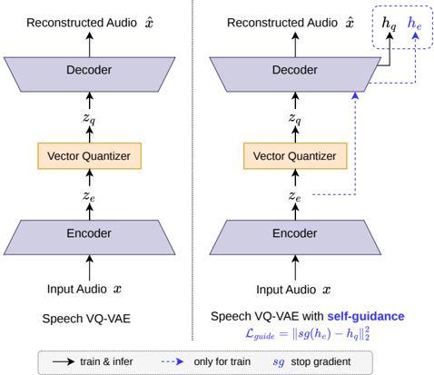

> [!abstract] ICML · 2026 · Conference
> **Xiang Li et al.** (Tsinghua University / Pengcheng Laboratory) · [→ Paper](https://openreview.net/forum?id=druaDr7zNI) · [→ Preprint](https://arxiv.org/abs/2606.12940) · Demo: ✓ · Code: ?
>
> A training-only feature-mapping loss makes a VQ-VAE speech codec decoder produce the same internal features from quantized tokens as from the continuous pre-quantization latents, improving low-bitrate reconstruction with no inference change and letting a 4× smaller codebook approach the quality of a larger one.

## Problem

Single-codebook speech codecs used as tokenizers for speech LLMs lose fidelity to quantization error. Feeding a trained decoder the continuous encoder output z_e instead of the quantized z_q gives clearly better audio: STOI rises from 0.88 to 0.95 for EnCodec at 6 kbps and from 0.93 to 0.95 for BigCodec at 1.04 kbps, with BigCodec WER falling from 3.6 to 2.9 (Table 1). The usual fixes are residual multi-codebook quantization or very large flat codebooks (2^16 entries and above in TS3Codec and XCodec2). Both make downstream autoregressive language modeling harder. The paper asks whether the decoder can instead be made robust to quantization error, leaving the quantizer and the token vocabulary small.

## Method

Self-guidance (SG) adds a second decoder pass during training only. The decoder runs once on the quantized tokens z_q, as usual, and once on the pre-quantized latents z_e. A feature-mapping loss L_guide = ||sg(h_e) − h_q||² pulls the quantized-path hidden features h_q toward the continuous-path features h_e, with a stop-gradient on the continuous ("teacher") branch. The extra pass needs no backward computation. Inference is unchanged: the decoder sees only z_q. Unlike classical self-distillation, there is no separately pre-trained teacher; both branches share weights and train end to end.

The main system is XCodec2: a convolutional acoustic encoder, a single-layer finite scalar quantizer (FSQ) at 50 Hz, an auxiliary semantic autoencoder on Wav2Vec2-BERT features, and an acoustic decoder made of a 12-block Transformer followed by an iSTFT head (Vocos-style). The guidance loss is applied to the output of the final Transformer block, just before the iSTFT head, so waveform-level losses do not interfere with it. The full objective sums the guidance loss with XCodec2's semantic MSE loss, multi-scale mel L1 loss, and adversarial losses from multi-period and spectrogram discriminators (§4.2). The guidance weight is 5 for the 65,536-entry codebook and 10 for the 16,384 and 8,192 codebooks. A sweep shows weights of 5 to 10 work best, while 15 and above make the auxiliary loss dominate and lower quality (§A.1, Table 9).

All codecs are trained on the 960 h LibriSpeech training set at 16 kHz for 600k iterations on 8 RTX 4090 GPUs. SG adds under 0.5% training time per epoch (25,783.8 s versus 25,668.0 s). To test generality, SG is also applied to XCodec2 with SimVQ and with two-level Residual FSQ (2 × 1,024), and to a 40 Hz BigCodec variant with a convolutional upsampling decoder. In BigCodec, the loss is added at the output of every upsampling block (§A.5).

## Key Results

**Reconstruction against other codecs (LibriSpeech test-clean, Table 2).** At |Q| = 65,536, SG improves XCodec2 PESQ from 2.28 to 2.39, STOI from 0.910 to 0.915, MCD from 3.57 to 3.41, SIM from 0.79 to 0.80 and UTMOS from 4.06 to 4.10, while WER stays at 3.2. Among the 40-50 Hz single-codebook codecs in the table (WavTokenizer, BigCodec, TS3Codec, XCodec2), this row has the highest PESQ, STOI, SIM and UTMOS and the lowest MCD. Its WER of 3.2 ties the XCodec2 baseline. Two higher-bitrate entries still score higher on several metrics: the 80 Hz BigCodec (PESQ 2.68, STOI 0.935, SIM 0.84, UTMOS 4.11) and the 50 Hz 8-codebook DAC (PESQ 2.72, STOI 0.940, SIM 0.87). DAC, WavTokenizer and TS3Codec figures are copied from their papers; BigCodec and XCodec2 are retrained by the authors.

**Small codebooks.** At |Q| = 8,192, plain XCodec2 trails a retrained 40 Hz BigCodec on PESQ (2.03 vs 2.11), STOI (0.892 vs 0.894) and MCD (3.84 vs 3.72). With SG it beats that BigCodec on all six metrics: PESQ 2.13, STOI 0.898, MCD 3.60, WER 3.8 vs 6.7, SIM 0.73 vs 0.66 and UTMOS 4.08 vs 4.05 (Table 2).

**Across codebook sizes (Table 5).** SG raises PESQ-WB by 0.10 to 0.12 and STOI by 0.005 to 0.006 at every size. It is not uniform on every metric: at 16,384, WER rises from 3.47 to 3.53, and at 8,192, UTMOS falls from 4.09 to 4.08. The paper's headline "4× codebook reduction without fidelity loss" rests on the training curves in Figure 2. At the final checkpoint in Table 5, the 16,384 + SG model still trails the 65,536 baseline on PESQ-WB (2.27 vs 2.28), STOI (0.907 vs 0.910), MCD (3.70 vs 3.57), WER (3.53 vs 3.23) and SIM (0.77 vs 0.79), and is ahead only on UTMOS (4.08 vs 4.06). It does close most of the gap between the 16,384 and 65,536 baselines.

**Human preference.** In an AB test on 30 LibriSpeech clips with 38 valid evaluations, listeners preferred SG in 38.7% of cases, the baseline in 15.4%, and had no preference in 46.0% (Table 3). The section does not state which codebook size was tested.

**Generality (Table 6, §A.3-A.5).** SG improves PESQ, STOI, MCD, SIM and UTMOS with SimVQ (|Q| = 16,384), with Residual FSQ at 1 kbps, and with the 40 Hz BigCodec decoder, whose SIM rises from 0.46 to 0.51. WER rises slightly with SimVQ (3.59 to 3.63). The Residual FSQ and BigCodec runs stop at 100k steps.

**Mechanism.** The quantization-error distributions with and without SG nearly coincide: mean 0.858 vs 0.851 at 65,536 and 0.741 vs 0.744 at 8,192 (Table 14). SG therefore does not work by shrinking quantization error. It sharply reduces the decoder hidden-feature gap ||h_e − h_q||². The mean falls from 23.6 to 4.2 at 8,192 and from 9.4 to 5.9 at 65,536 (Table 15), so the effect grows as the codebook shrinks. kNN Jaccard rises from 0.276 to 0.307 and Procrustes residual falls from 0.265 to 0.171 (Table 4). Linear CKA rises in all 12 decoder blocks, even though the loss touches only the last one (Table 13).

**Downstream TTS (Table 7).** A Qwen2.5-0.5B phoneme-to-token LM is trained on LibriTTS-R and decoded with VALL-E-style 3-second prompt continuation. Codebook size matters more than SG: the 16,384-entry models reach WER 28.0-28.8, against 33.0-35.1 for 65,536. At 16,384, SG improves UTMOS (3.51 to 3.58), WER (28.78 to 28.02) and SIM (0.56 to 0.58). At 65,536, SG raises UTMOS slightly but worsens WER (33.03 to 35.07), with SIM unchanged. Absolute WERs near 30% show this is a small, short-trained setup, and the paper itself calls these results preliminary.

## Novelty Assessment

The contribution is a new training objective on an unchanged architecture. Its core idea is to treat the decoder's own response to continuous latents as an internal target for its response to quantized tokens. The ingredients are familiar: feature-matching losses, stop-gradient teacher branches, and the known gap between z_e and z_q decoding (reported for EnCodec by Liu et al.). Using them as a single-pass, shared-weight decoder regularizer for VQ-VAE codecs is new, and it costs almost nothing in training and nothing at inference. The gains are consistent but small (about +0.1 PESQ). The evidence is strong on mechanism (quantization-error invariance, hidden-MSE, CKA and t-SNE analyses) and on transfer across quantizers and decoders. It is weaker on the downstream claim, which rests on one small TTS run. All reconstruction tests use English LibriSpeech at 16 kHz.

## Field Significance

Moderate — The paper shows that part of the quantization loss in low-bitrate speech codecs can be recovered on the decoder side, with no change to the quantizer, bitrate or inference path. It thereby separates codebook size from reconstruction quality to some degree. It offers codec designers a cheap regularizer that applies to any VQ-VAE codec. Its downstream evidence that smaller flat codebooks help AR TTS is directional rather than conclusive.

## Claims

- **supports:** A training-only consistency loss that aligns a codec decoder's hidden features for quantized tokens with those for the continuous pre-quantization latents improves reconstruction fidelity without changing the quantizer, bitrate, or inference procedure.
  > *Evidence:* Adding the stop-gradient feature-mapping loss on the final decoder Transformer block raises XCodec2 PESQ-WB by 0.10-0.12 and STOI by 0.005-0.006 at codebook sizes of 8,192, 16,384 and 65,536, at under 0.5% extra training time. Listeners prefer it over the baseline 38.7% to 15.4% in an AB test. *(§4.1, §5.1, §5.2, Table 3, Table 5)*
- **refines:** Decoder-side gains in VQ-VAE codecs can come from making the decoder robust to quantization error rather than from reducing the error itself, and the gain grows as the codebook shrinks.
  > *Evidence:* Quantization-error distributions are nearly identical with and without self-guidance (mean 0.741 vs 0.744 at 8,192). The decoder hidden-feature gap drops from 23.6 to 4.2 at 8,192 but only from 9.4 to 5.9 at 65,536. Linear CKA between the two branches rises in all 12 decoder blocks. *(§5.3, §5.4, Table 13, Table 14, Table 15)*
- **supports:** Decoder-alignment regularization transfers across vector quantizer types and decoder backbones in speech codecs.
  > *Evidence:* Gains on PESQ, STOI, MCD, SIM and UTMOS are reported with SimVQ, two-level Residual FSQ and a convolutional 40 Hz BigCodec decoder (SIM 0.46 to 0.51). WER rises slightly with SimVQ (3.59 to 3.63). *(§5.5, Table 6, Tables 10-12)*
- **supports:** Smaller flat codec vocabularies make downstream autoregressive speech-token language modeling easier, so codec quality gains help TTS most when they allow a smaller codebook.
  > *Evidence:* A Qwen2.5-0.5B phoneme-to-token TTS model trained on LibriTTS-R reaches WER 28.0-28.8 with 16,384-entry XCodec2 tokens, against 33.0-35.1 with 65,536 entries. At 16,384, self-guidance improves UTMOS, WER and SIM. *(§5.6, Table 7)*
- **complicates:** Better codec reconstruction does not reliably carry over to downstream TTS when the token vocabulary is large.
  > *Evidence:* At a codebook size of 65,536, self-guidance improves reconstruction (Table 2) but raises downstream TTS WER from 33.03 to 35.07 with unchanged SIM. The authors attribute this to the language-modeling difficulty of the large codebook. *(§5.6, Table 7)*

## Limitations and Open Questions

- The "4× smaller codebook without fidelity loss" claim rests on training curves (Figure 2). At the final checkpoint in Table 5, the 16,384 + SG model still trails the 65,536 baseline on PESQ, STOI, MCD, WER and SIM.
- The downstream TTS experiment is small: a 0.5B LM with absolute WERs near 30%, a single run, and no human evaluation. The authors call it preliminary.
- All codec training and reconstruction tests use English read speech (LibriSpeech, 16 kHz). The authors list general audio, music and image VQ-VAEs as untested.
- The AB preference test is small (30 clips, 38 valid evaluations) and does not report which codebook configuration was compared.
- Different tables report different MCD values for the same configurations. XCodec2 + SG at 8,192 has 3.60 in Table 2 and 3.79 in Table 5; FSQ + SG at 16,384 has 3.60 in Table 10 and 3.70 in Table 5. The other metrics match across tables.
- The method does not remove artifacts entirely. The appendix shows a residual depressed-pitch failure case (§A.8, Figure 9).
- Code release is not stated. Model size is not reported for the proposed codec.

## Wiki Connections

- [[neural-codec|Neural Audio Codec]] — Proposes a decoder-side training regularizer that improves single-codebook VQ-VAE speech codec reconstruction at low bitrate without changing the quantizer or inference.
- [[autoregressive-codec-tts|Autoregressive Codec TTS]] — Tests whether a smaller codebook made viable by self-guidance improves an LLM-based phoneme-to-codec-token TTS model, with positive results at 16,384 entries and mixed results at 65,536.
- [[subjective-evaluation|Subjective Evaluation]] — Supplements objective metrics with an AB preference test on reconstruction fidelity against ground truth.
- [[2502.04128|Llasa (XCodec2)]] — The paper's main codec is XCodec2 from Llasa; self-guidance is added to its official code and compared against retrained XCodec2 baselines.
- [[2409.05377|BigCodec]] — Used as the preliminary z_e vs z_q decoding study, a retrained baseline at 80 Hz and 40 Hz, and the convolutional-decoder testbed for self-guidance.
- [[2411.18803|TS3Codec]] — A large-codebook single-codec baseline (65,536 and 131,072 entries) whose figures come from its paper; its Transformer-plus-iSTFT decoder design is shared by XCodec2.
- [[2408.16532|WavTokenizer]] — A single-codebook baseline at 75 Hz and 40 Hz, with figures copied from its paper.
- [[2210.13438|EnCodec]] — Its z_e vs z_q decoding gap (from Liu et al.) motivates the method.
- [[2309.15505|FSQ]] — The default quantizer in XCodec2, plus the basis of the Residual FSQ generality test.
- [[2301.02111|VALL-E]] — The downstream TTS experiment uses VALL-E-style 3-second prompt continuation for inference.
- [[2412.15115|Qwen2.5]] — The 0.5B Qwen2.5 model is the backbone of the downstream phoneme-to-token TTS LM.
