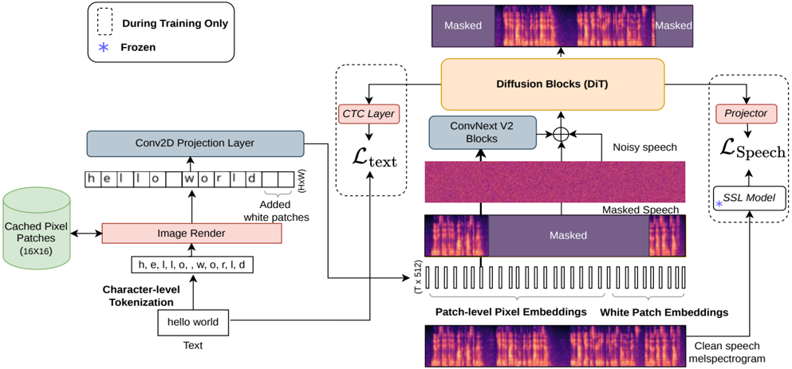

> [!abstract] arXiv · 2026 · Preprint
> **Adarsh Arigala et al.** (Indian Institute of Technology Madras / MBZUAI) · [→ Paper](https://arxiv.org/abs/2606.14750) · Demo: ✗ · Code: ✗
>
> Replaces the character embedding table of a flow-matching TTS model with rendered 16×16 glyph images projected by a single 2D convolution, so that unseen characters, diacritics and homoglyphs get usable embeddings without vocabulary expansion.

## Problem

Character-input TTS systems such as F5-TTS and its descendants map every Unicode symbol to an independent embedding row. A character absent from the training vocabulary has no meaningful embedding: in zero-shot use it falls back to a filler token, and in cross-lingual fine-tuning the embedding matrix must be expanded and the new rows learned from scratch. Visually related symbols (`e` and `é`, `A` and `Ä`, a Latin letter and its Unicode homoglyph) share nothing in this representation. An earlier visual-text TTS (vTTS, built on FastSpeech2) showed that rendered text can drive synthesis, but only on monolingual single-speaker data, leaving open whether pixel input helps with unseen characters, cross-lingual transfer, low-resource adaptation or multilingual scaling in a modern zero-shot system.

## Method

Pixel-TTS is built on [[interspeech-2025-1236|ADMA]], an extension of [[2025.acl-long.313|F5-TTS]] that adds dual-modality alignment losses to speed up training; the paper's "Text-TTS" baseline is ADMA itself, trained identically. Only the text front end changes (§2):

- **Text-to-image rendering (§2.1).** Following the PIXEL framework from NLP, each character is rendered as a 16×16 grayscale patch. As in F5-TTS's alignment-free design, the character sequence is padded with blank white patches to the mel-spectrogram length T, and all patches are stacked horizontally into one 16 × 16T image. Patches are pre-computed and cached.
- **Pixel projection (§2.2).** A single Conv2D layer (1 input channel, 512 output channels, 16×16 kernel, stride 16) maps each patch to a 512-dimensional vector, producing a T × 512 embedding sequence. Four ConvNeXtV2 blocks then refine it, exactly as in the text-input model. Because the embedding is a function of the glyph's pixels, visually similar characters start with similar embeddings and any renderable character gets one.
- **Objective (§2.3).** The generative loss is F5-TTS's conditional flow matching on masked mel-spectrograms with a DiT backbone. ADMA's two auxiliary terms are kept: a CTC text-alignment loss at an intermediate layer (weight 0.1) and a speech-representation alignment loss against layer-21 features of a frozen HuBERT (cosine similarity, weight 1.0). The CTC loss is removed during fine-tuning for both systems.

English experiments use the ADMA Small configuration (about 159M parameters, 18 Transformer layers, hidden size 768) trained on LibriTTS (585 h) for up to 300k updates on 8 A100 GPUs; audio is 24 kHz, 100-bin mel-spectrograms, vocoded by a pre-trained Vocos. The multilingual experiment (§6) uses ADMA Base (335.8M parameters, 22 DiT layers, hidden size 1024) trained for 160k updates on LibriTTS plus Common Voice German (250 h), French (250 h) and Dutch (57.18 h), about 1,142 h in total. Inference is prompt-based voice cloning in the F5-TTS cross-sentence protocol.

## Key Results

All comparisons are against a single baseline, the matched text-embedding ADMA model (Text-TTS); no other published system is evaluated. Every intelligibility metric is Whisper-based WER/CER.

- **In-domain English (Table 1, LibriSpeech-PC).** At 300k updates Pixel-TTS reaches WER/CER 2.28/0.81 versus 2.53/1.16, while speaker similarity and UTMOS are slightly lower (SIM 0.579 vs 0.591, UTMOS 4.013 vs 4.061). Pixel-TTS has lower WER at every checkpoint from 80k to 300k; at the first checkpoint (60k) its WER is marginally higher (22.01 vs 21.95) while CER is lower.
- **Subjective naturalness (Table 2).** Sixteen listeners rated 10 samples per system on a 5-point scale: MOS 4.63 ± 0.11 for Pixel-TTS versus 4.25 ± 0.14 for Text-TTS (95% confidence intervals do not overlap). The paper does not state which test set the samples came from.
- **Out-of-domain and accented English (Tables 3 and 4).** WER/CER improves on Seed-TTS English (2.19/0.90 vs 2.36/1.06), on an LJSpeech zero-shot set (5.13/2.84 vs 5.69/3.27) and on L2-ARCTIC non-native prompts (3.87/1.99 vs 5.35/3.07). SIM and UTMOS are equal or slightly lower on all three (for example LJSpeech UTMOS 4.151 vs 4.275).
- **Zero-shot unseen languages (Table 6).** With English-only training, both systems are largely unintelligible on German, French and Dutch Common Voice (WER 44 to 71%), but Pixel-TTS is lower on every language (German 66.48 vs 71.49, French 62.56 vs 63.95, Dutch 44.30 vs 47.14); SIM is tied on German and slightly lower for Pixel-TTS on French and Dutch.
- **Low-resource German fine-tuning (Table 7).** The Text-TTS embedding table is expanded by 23 (10h) or 51 (50h) new characters initialised to the mean embedding. Pixel-TTS is ahead at every checkpoint; with 10 h it reaches WER 16.67 at 70k updates, below Text-TTS's 17.22 at 150k, and at 150k the gap is 9.85 vs 17.22 WER (42.80% relative reduction) and 4.00 vs 8.54 CER. With 50 h the relative WER reduction is 62.30% at 70k and 26.81% at 150k (9.42 vs 12.87).
- **Orthographic noise (§5.7, Figure 3).** Under Unicode homoglyph substitution (corruption probability 0.1 to 1.0), Text-TTS WER rises from 26.67 to 119.55 while Pixel-TTS goes from 5.00 to 34.88; under l33tspeak, Text-TTS goes from 15.35 to 101.15 and Pixel-TTS from 9.87 to 77.18.
- **Multilingual training (Table 8, Tables 12 to 15).** At 160k updates the multilingual Pixel-TTS has lower WER/CER on all four training languages: English 1.94/0.71 vs 2.35/0.83, German 7.44/2.64 vs 9.74/4.54, French 12.14/5.34 vs 14.26/6.98, Dutch 3.82/1.32 vs 4.68/2.01, with SIM within 0.006 and UTMOS within 0.03. Early in training the order reverses: at 60k updates Text-TTS has lower WER on all four languages (for example English 9.04 vs 13.45). Zero-shot transfer of the multilingual models to Spanish, Italian and Portuguese also favours Pixel-TTS on WER/CER (Table 11), although Portuguese WER is nearly tied (39.86 vs 40.04).
- **Embedding analysis (Table 9, Figures 4 and 5).** Average cosine similarity between a base letter and its accented variants is 0.984 to 0.993 for Pixel-TTS versus -0.042 to 0.026 for Text-TTS.

## Novelty Assessment

The architectural change is small and well-targeted: one Conv2D patch projection replaces the embedding lookup, with everything else (DiT, flow matching, alignment losses, vocoder) inherited from ADMA and F5-TTS. Rendering text as pixels is borrowed from NLP (PIXEL, visual-text machine translation), and vTTS had already fed rendered text to a FastSpeech2 model, so the idea of visual text input for TTS is not new. The contribution is carrying it into an alignment-free, zero-shot flow-matching system and testing the cases where it should matter: unseen characters, cross-lingual fine-tuning, homoglyph noise, and multilingual training over related Latin scripts.

The evaluation is internally fair (identical backbone, data and schedule for both arms) but narrow. There is only one baseline, so how Pixel-TTS compares with other cross-lingual TTS systems or with byte- or phoneme-based inputs is unknown. The English gains are modest (0.25 WER at 300k) and come with slightly lower SIM and UTMOS, while the human MOS gap rests on 10 samples. The fine-tuning advantage partly reflects the baseline's handicap: new Text-TTS rows start at the mean embedding, which is a weak initialisation, so the comparison measures pixel input against a naive vocabulary expansion. All scripts tested are Latin; the claimed benefit for "visually similar scripts" is not tested on non-Latin or cross-script settings.

## Field Significance

Moderate — The paper provides controlled evidence that tying character embeddings to glyph appearance removes the vocabulary-expansion step in cross-lingual adaptation and makes a flow-matching TTS model markedly more robust to unseen and visually perturbed characters, at no architectural cost beyond a single convolution. It is a cheap, drop-in input-representation change for character-based zero-shot TTS, demonstrated so far only on Latin scripts and against a single matched baseline.

## Claims

- **supports:** Grounding character embeddings in rendered glyph images lets a character-input TTS model handle characters unseen in training, improving intelligibility where a learned lookup table can only fall back to filler tokens.
  > *Evidence:* Trained on English only, the pixel-input model has lower WER/CER than the matched embedding-table model on German, French and Dutch test sets containing 62, 114 and 20 unseen characters (German WER 66.48 vs 71.49), though both remain largely unintelligible. *(§5.5, Tables 5 and 6)*
- **supports:** Visually grounded text input speeds cross-lingual low-resource fine-tuning of TTS by avoiding new, randomly or mean-initialised embedding rows for added characters.
  > *Evidence:* Fine-tuned on 10 h of German, the pixel model reaches WER 16.67 at 70k updates, below the expanded-vocabulary baseline's 17.22 at 150k, and ends at 9.85 vs 17.22 WER; with 50 h the relative WER reduction is 62.30% at 70k and 26.81% at 150k updates. *(§5.6, Table 7)*
- **supports:** Character-level TTS input encodings that ignore visual form are fragile to orthographic perturbations such as homoglyphs and character substitutions, while glyph-based encodings degrade gracefully.
  > *Evidence:* As Unicode homoglyph corruption rises from 0.1 to 1.0, the embedding-table model's WER goes from 26.67 to 119.55 while the pixel model's goes from 5.00 to 34.88; under l33tspeak the corresponding ranges are 15.35 to 101.15 and 9.87 to 77.18. *(§5.7, Figure 3)*
- **supports:** In multilingual TTS over related scripts, input representations that share structure across diacritic variants improve per-language intelligibility over independent character embeddings.
  > *Evidence:* A pixel-input model trained on English, German, French and Dutch has lower WER/CER on all four languages at 160k updates (German 7.44 vs 9.74 WER), and its embeddings of base letters and accented variants have cosine similarity around 0.99 versus about 0 for the embedding-table model. *(§6, §6.1, Tables 8 and 9)*
- **complicates:** Intelligibility gains from alternative text input encodings in zero-shot TTS can come with small losses in speaker similarity and predicted naturalness, and need not appear early in training.
  > *Evidence:* At 300k updates on LibriSpeech-PC the pixel model trails on SIM (0.579 vs 0.591) and UTMOS (4.013 vs 4.061) and is lower on SIM and UTMOS on both out-of-domain sets; in multilingual training it has higher WER than the text model on all four languages at 60k updates before overtaking it. *(§5.1, §5.3, Tables 1, 3 and 12 to 15)*

## Limitations and Open Questions

- The only baseline is the authors' text-embedding ADMA model. No external systems are evaluated, and phoneme-, byte- or subword-based inputs, which also avoid some vocabulary problems, are not compared.
- All languages tested use Latin script. Whether glyph sharing helps across scripts (or hurts when visually similar glyphs are pronounced differently across languages) is untested.
- The subjective evaluation uses 16 listeners and 10 samples per system, with the source test set unspecified; no speaker-similarity listening test is reported.
- Zero-shot cross-lingual WERs of 44 to 71% (English-only model) mean that the improvement in Table 6 is between two unusable systems; the practically relevant gains come from fine-tuning and multilingual training.
- The fine-tuning comparison initialises new Text-TTS embeddings at the mean of existing ones; stronger initialisations for vocabulary expansion are not tried.
- Code and trained models are not yet released (the paper states they "will be released soon"), and no demo page is given.

## Wiki Connections

- [[flow-matching|Flow Matching]] — Pixel-TTS keeps the conditional flow-matching DiT backbone of F5-TTS/ADMA and changes only how text is embedded before it.
- [[zero-shot-tts|Zero-Shot TTS]] — all evaluations clone voices from audio prompts in the F5-TTS cross-sentence protocol, including LJSpeech, Seed-TTS and accented L2-ARCTIC prompts.
- [[multilingual-tts|Multilingual TTS]] — a model trained jointly on English, German, French and Dutch shows that glyph-based input improves intelligibility in every training language and transfers to Spanish, Italian and Portuguese.
- [[self-supervised-speech|Self-Supervised Speech]] — training retains ADMA's speech-alignment loss against frozen HuBERT layer-21 features alongside flow matching.
- [[subjective-evaluation|Subjective Evaluation]] — a 16-listener MOS test compares the pixel and text input models on naturalness.
- [[interspeech-2025-1236|ADMA (Dual Modality Alignment)]] — the direct base model and the Text-TTS baseline; Pixel-TTS swaps its character embeddings for pixel projections and keeps its losses and configurations.
- [[2025.acl-long.313|F5-TTS]] — source of the alignment-free character-padding design, the CFM objective and the LibriSpeech-PC evaluation protocol.
- [[2406.18009|E2 TTS]] — cited as an example of character-embedding TTS that needs vocabulary expansion for new languages.
- [[2406.02430|Seed-TTS]] — its English test set is used for out-of-domain evaluation.
- [[2306.00814|Vocos]] — the pre-trained vocoder used for all waveform synthesis.
- [[1904.02882|LibriTTS]] — the English training corpus for all single-language experiments.
- [[1912.06670|Common Voice]] — source of the German, French and Dutch training, fine-tuning and zero-shot test data.
- [[2204.02152|UTMOS]] — the automatic naturalness predictor reported throughout.
