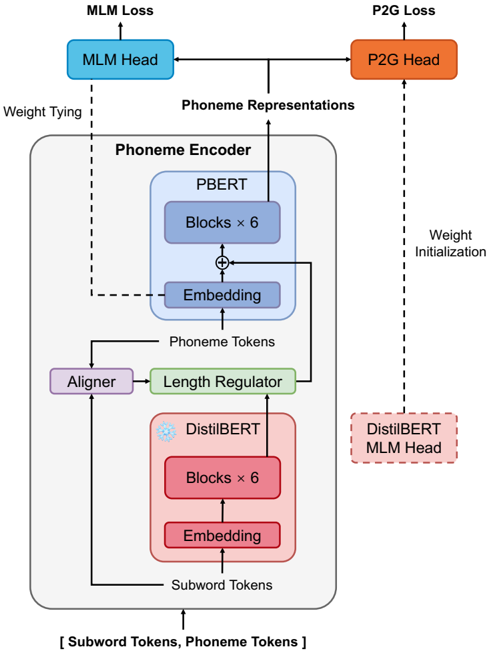

> [!abstract] arXiv · 2026 · Preprint
> **Dong Yang et al.** (The University of Tokyo) · [→ Paper](https://arxiv.org/abs/2606.16668) · Demo: ✓ · Code: ?
>
> Feeds frozen subword-level BERT representations, aligned to phonemes by a data-driven DTW aligner, into the input of a phoneme-level BERT, so a TTS phoneme encoder reaches MOS comparable to MP BERT and PL BERT after roughly one tenth of their pre-training steps.

## Problem

BERT-style pre-trained phoneme encoders (PPEncs) improve the naturalness and prosody of TTS, but phoneme-only encoders are expensive to pre-train. Phoneme sequences are two to three times longer than the corresponding word sequences, which makes learning word- and sentence-level context slow; each language can have several phonetic notations, multiplying pre-training cost; and the tiny phoneme vocabulary limits representation capacity and makes masked language modelling (MLM) too easy. Prior fixes either add input tokens (PnG BERT's grapheme-plus-phoneme input, which lengthens sequences further; Mixed-Phoneme BERT's sup-phoneme tokens), add a phoneme-to-grapheme (P2G) objective with a word-level tokenizer that maps rare words to an unknown token (PL BERT), or add subword BERT features to the phoneme encoder output without pre-training it, using word-level averaging or undisclosed heuristic subword-phoneme alignment.

## Method

CraBERT pairs a pre-trained, frozen DistilBERT over subword tokens with a trainable phoneme-level BERT (PBERT: 6 BERT-base blocks with relative positional encoding, so the whole encoder is 12 layers, matching the re-implemented baselines). An aligner maps each phoneme to its subword; a length regulator (as in [[2006.04558|FastSpeech 2]]) upsamples the DistilBERT outputs to phoneme resolution; and the aligned subword representations are added element-wise to the phoneme embeddings before the PBERT blocks. The authors call this cascade fusion, in contrast to parallel fusion, which adds BERT features to the phoneme encoder's output. Parameter count is not reported.

Pre-training combines two cross-entropy objectives on masked positions only. MLM uses whole-word dynamic masking over phonemes (80/10/10 replacement), and the subword representation at each [MASK] position is replaced with a trainable embedding so the subword prior does not leak the answer. P2G predicts the subword token of each masked phoneme, rather than predicting for every phoneme as PL BERT does, which the authors found hurt MLM efficiency. The PBERT embedding is weight-tied to the MLM head, and the P2G head is initialised from DistilBERT's pre-trained MLM head to speed convergence. Because the subword prior makes both predictions easier, a 75% masking rate is used instead of the conventional 15%.

The subword-phoneme aligner is a data-driven two-step method following Futami et al. A character-phoneme co-occurrence matrix is accumulated over BookCorpus word-phoneme pairs, weighted by a Gaussian decay on relative position (α = 50) and row-normalised; DTW over this matrix aligns the characters and phonemes of each word; and the phoneme → letter → subword mapping then gives subword-phoneme alignment for any subword tokenizer. Phonemes come from the g2pE ARPAbet converter, with WordPiece-style "##" prefixes marking word-internal phonemes and attached punctuation.

Pre-training uses BookCorpus plus English Wikipedia, sequences of up to 1,024 phonemes, mini-batches of 2,000 sequences, AdamW and 8 A100 GPUs. For the downstream evaluation, VITS's phoneme encoder is replaced by each PPEnc, and the full VITS model (a VAE with adversarial training) is trained for 250 epochs on a LibriTTS-R train-clean-360 subset annotated with respiratory pauses and breath sounds.

## Key Results

All comparisons come from crowd-sourced MOS tests on Prolific with native English listeners, rating naturalness and prosody on a single 5-point scale. Only English is evaluated, and no objective metrics are reported.

- **Masking rate (Table I; 50 listeners, 18 samples each; all models pre-trained 9,000 steps):** MOS rises from 3.10 ± 0.16 at 15% masking to 3.23 (30%), 3.25 (45%), 3.25 (60%) and a high of 3.29 ± 0.17 at 75%, then falls to 3.15 ± 0.19 at 90%. The 75% vs. 15% gap (+0.19) is close to the size of the confidence intervals.
- **Encoder comparison (Table II; 50 listeners, 24 samples each):** ground truth 3.60 ± 0.18; untrained-encoder VITS baseline 2.83 ± 0.18; MP BERT 3.14 ± 0.17 and PL BERT 3.13 ± 0.19 (90,000 steps each); CraBERT-1e 3.21 ± 0.18 (9,000 steps); CraBERT-10e 3.15 ± 0.19 (90,000 steps). CraBERT-1e has the highest point estimate among the synthesized systems, but its intervals overlap those of MP BERT, PL BERT and CraBERT-10e, so the result supports "comparable", which is how the authors phrase it, rather than superiority. Ten times more pre-training (CraBERT-10e) brings no further gain.
- **Fusion ablation (Table II):** without any phoneme-level pre-training, cascade fusion (CraBERT-0e, 3.09 ± 0.17) scores above parallel fusion (CraBERT-para-0e, 2.90 ± 0.18), and CraBERT-0e is already close to the fully pre-trained baselines. Parallel fusion itself scores only slightly above the untrained baseline (2.83).
- **Cost (§IV-C):** one epoch of pre-training takes about 19, 27 and 29 hours on 8 A100s for CraBERT, MP BERT and PL BERT respectively (CraBERT's per-epoch saving comes from freezing DistilBERT). From these times the authors estimate speedups of about 14× and 15× over 10-epoch MP BERT (~270 h) and PL BERT (~290 h). Inference speed is reported as comparable but not quantified.

The baselines are the authors' re-implementations in a unified framework (same backbone, data and G2P), not the original checkpoints. This makes the comparison controlled, but it differs from the original MP BERT and PL BERT training recipes (e.g. ~40 epochs for MP BERT). Tables I and II come from separate listening tests and are not comparable with each other.

## Novelty Assessment

The architectural idea is modest but clearly defined: inject a frozen subword LM's contextual features at the input of a phoneme BERT (cascade) rather than at its output (parallel), and pre-train the phoneme BERT on top of that prior with a high masking rate and a masked-only P2G target. Each piece has precedent (length regulators, subword BERT features in TTS, P2G objectives, the two-step alignment idea from Futami et al.), so the contribution lies in the combination and in the efficiency it buys. The data-driven DTW aligner is a useful, tokenizer-agnostic engineering component. The empirical support is narrow: a single English dataset, a single TTS backbone (VITS), one combined naturalness-and-prosody MOS per system, overlapping confidence intervals across all pre-trained encoders, and no objective or prosody-specific metrics. The speedup figures are estimates derived from per-epoch times, not measured end-to-end runs.

## Field Significance

Moderate. The paper shows that much of the benefit of phoneme-encoder pre-training for TTS can come from a frozen text LM's word- and sentence-level context, with phoneme-level pre-training needed only briefly. This makes PPEncs cheaper to build, for example per phonetic notation. The evidence is a single-dataset, single-backbone English MOS study with overlapping intervals, so the paper establishes parity at lower cost, not a quality gain.

## Claims

- **supports:** Injecting pre-trained subword-level language model representations into a phoneme encoder sharply reduces the phoneme-level pre-training needed to reach the naturalness and prosody gains of pre-trained phoneme encoders in TTS.
  > *Evidence:* CraBERT-1e (9,000 steps) scores 3.21 ± 0.18 MOS vs. 3.14 ± 0.17 (MP BERT) and 3.13 ± 0.19 (PL BERT) at 90,000 steps each, and CraBERT-0e with no phoneme-level pre-training already reaches 3.09 ± 0.17, against 2.83 for an untrained encoder in VITS. *(§IV-B, Table II)*
- **refines:** Where external linguistic features enter a TTS phoneme encoder matters: fusing them at the encoder input (before self-attention) is more effective than adding them to the encoder output.
  > *Evidence:* With no pre-training in either case, cascade fusion (CraBERT-0e) scores 3.09 ± 0.17 MOS vs. 2.90 ± 0.18 for parallel output fusion (CraBERT-para-0e), which barely improves on the 2.83 baseline. *(§IV-B, Table II)*
- **refines:** When a masked phoneme language model is conditioned on a strong contextual prior, the conventional 15% masking rate under-trains it, and much higher masking rates give better downstream TTS.
  > *Evidence:* At 9,000 pre-training steps, TTS MOS rises from 3.10 at 15% masking to a high of 3.29 at 75%, then drops to 3.15 at 90%. *(§IV-A, Table I)*
- **complicates:** Longer phoneme-level language-model pre-training does not reliably translate into better TTS naturalness, which points to a mismatch between language-modelling features and TTS needs.
  > *Evidence:* CraBERT-10e (90,000 steps) scores 3.15 ± 0.19 MOS vs. 3.21 ± 0.18 for CraBERT-1e, and the authors leave the LM-vs-TTS feature discrepancy to future work. *(§IV-B, Table II)*

## Limitations and Open Questions

> [!warning]
> All MOS differences among the pre-trained encoders (3.13 to 3.21) fall within overlapping 95% confidence intervals from one 50-listener test, so the evidence supports parity at lower pre-training cost, not a quality improvement over MP BERT or PL BERT.

- The evaluation is English-only, uses one dataset (a LibriTTS-R subset with pause and breath annotations) and one TTS backbone (VITS). Transfer to other acoustic models (e.g. StyleTTS 2, which PL BERT was built for) and to other languages or phonetic notations, which motivate the efficiency argument, is not tested.
- Naturalness and prosody are rated jointly on a single scale. No objective metrics (WER, F0 statistics, duration error) or prosody-specific tests are reported, so the prosody claims rest on the combined MOS alone.
- Baselines are re-implementations trained on BookCorpus plus Wikipedia with a shared G2P, not the published models, and XPhoneBERT and PnG BERT are excluded.
- The 14× and 15× speedups are extrapolated from measured per-epoch times. CraBERT also depends on a frozen DistilBERT at inference and on g2pE-derived alignment, whose error rate is not reported.
- Parameter counts and code availability are not reported, and the optimal amount of pre-training remains open.

## Wiki Connections

- [[gan-vocoder|GAN Vocoder]] — CraBERT is evaluated by training the full VITS model (VAE with adversarial waveform training) with each candidate phoneme encoder swapped in.
- [[subjective-evaluation|Subjective Evaluation]] — All findings rest on crowd-sourced MOS tests (Prolific, 50 native English listeners per test) rating naturalness and prosody, with 95% confidence intervals.
- [[1810.04805|BERT]] — CraBERT's PBERT is a BERT-base stack, and its subword branch is DistilBERT, a distilled BERT, trained with the MLM recipe BERT introduced.
- [[2006.04558|FastSpeech 2]] — CraBERT borrows FastSpeech 2's length regulator to upsample subword representations to phoneme resolution.
- [[2105.06337|Grad-TTS]] — Cited as one of the TTS models whose phoneme encoder a PPEnc such as CraBERT could replace; it is not evaluated.
