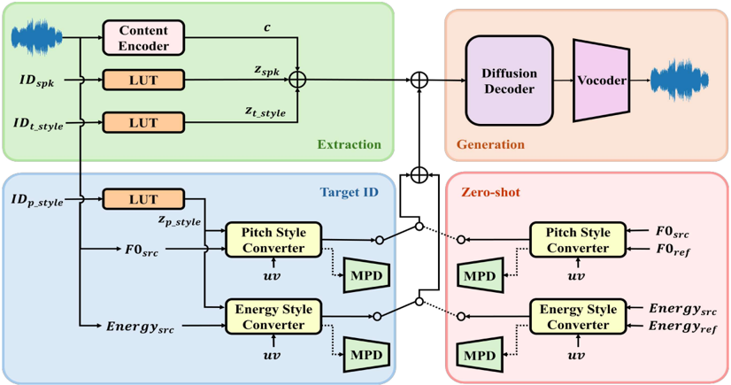

> [!abstract] IEEE TASLP · 2026 · Journal
> **Joon-Seung Choi et al.** (Korea University) · [→ Paper](https://arxiv.org/abs/2606.17126) · Demo: ✓ · Code: ✓
>
> VibE-SVC2 extends the DWT-based vibrato converter of VibE-SVC with an energy style converter, reference-driven (zero-shot) pitch style transfer, inference-time vibrato rate scaling independent of extent, and phonation (timbre) style control with a subharmonic F0 correction for vocal fry.

## Problem

Singing style conversion asks a singing voice conversion (SVC) system to change localized expressive techniques (vibrato, breathy or belted phonation, vocal fry) independently of singer identity and melody. The authors' earlier system, [[interspeech-2025-1397|VibE-SVC]], isolated vibrato by splitting the F0 contour with a discrete wavelet transform (DWT) and predicting its high-frequency band, but the paper identifies four gaps in it: the periodic loudness oscillation that accompanies vibrato stays in the energy contour and leaks source style into the output; only vibrato extent, not rate, can be controlled; target pitch styles must come from predefined style IDs; and timbre (phonation) styles are not handled at all. Phonation styles bring their own failure: vocal fry has subharmonic structure that makes F0 extractors jump by an octave, and those jumps propagate into pitch-jump artifacts during conversion. Among contemporary singing style conversion systems, the paper notes that Serenade does not convert pitch styles and Vevo1.5 targets content, melody and style separation rather than separating specific timbre styles from global timbre.

## Method

The base SVC model is inherited from VibE-SVC: HuBERT-soft content units (extracted at 16 kHz and linearly upsampled to the mel frame rate), speaker and style embeddings from lookup tables (LUTs), and explicit F0 and energy contours condition a diffusion decoder that predicts a 100-bin mel-spectrogram; a pretrained BigVGAN renders the waveform. F0 is extracted with RMVPE and energy is the frame RMS. Audio is processed at 24 kHz in 10-second segments. Model size is not reported.

Pitch style is handled, as in VibE-SVC, by decomposing the F0 contour with a DWT (Daubechies-10 wavelet, cutoff level 4 in this paper) into a low-frequency melody contour and a high-frequency style contour. A pitch style converter predicts the target high-frequency contour from the low-frequency contour, an unvoiced flag and a target style embedding, and is trained with a reconstruction loss on the log high-frequency contour plus adversarial and feature-matching losses against a multi-period discriminator (MPD). The full contour is then the low band plus the predicted high band, with the high band optionally multiplied by an extent factor α (the VibE-SVC extent control).

VibE-SVC2 adds four components on top of that design:

- **Energy style converter.** A second converter with the same architecture as the pitch converter (without the log transform) applies the DWT split to the energy contour and predicts the target high-frequency energy band from the low-frequency band and the style ID. The converted energy contour is fed to the pretrained SVC model, so the decoder no longer receives the source singer's vibrato loudness oscillation.
- **Zero-shot style converter (ZSC).** Instead of a style ID, the pitch and energy converters can be conditioned on the high-frequency contour of a reference recording: a high-frequency style encoder (the Meta-StyleSpeech mel style encoder with a one-channel input) produces a style vector injected into every layer through style-adaptive layer normalization. During training each converter reconstructs the source's own high-frequency contour from itself as the reference. "Zero-shot" here refers to the pitch style reference; singer identity is still selected by speaker ID.
- **Vibrato rate scaling.** To raise the vibrato rate by a factor β, the low-frequency contour is upsampled in time by β, the style encoder predicts a high-frequency contour on the stretched input, and the prediction is downsampled back to the original length (the order is reversed to lower the rate). Combined with α, this gives inference-time control of rate and extent with no vibrato parameters used in training.
- **Timbre style LUT and Subharmonic Correction (SHC).** A 256-dimensional timbre style embedding lets the model convert among straight, belt, breathy and vocal fry phonation. The authors argue that, because frame-level pitch variation is fully supplied by the explicit F0 input, the global timbre LUT acts as a bottleneck that captures only average spectral and phonation characteristics. SHC is a deterministic (not learned) preprocessing step: it takes the first-order difference of the log2 F0 contour, zeroes voiced frames whose absolute difference exceeds a threshold (an octave jump or drop gives a difference near 1), re-accumulates the contour from the first frame, and re-anchors it with the mode of the offset between original and corrected contours.

The SVC model is trained for 200k steps (batch 128); the pitch and energy style converters for 100k and 60k steps (batch 256); the ZSC converters for 100k steps (batch 256). Remaining converter and discriminator settings follow VibE-SVC.

## Key Results

All subjective scores come from Amazon MTurk tests with 20 participants per task and 50 samples per model; nMOS is on a 5-point scale and sMOS on a 4-point scale, with 95% confidence intervals. SECS uses WavLM embeddings, and style accuracy uses fine-tuned MERT classifiers for pitch and timbre style.

**ID-based pitch style conversion (VocalSet, Table I).** Against three SoVITS/DiffSVC-based baselines (style embedding, style embedding plus low-frequency F0, and a performance style transfer module) and VibE-SVC, VibE-SVC2 has the highest average style accuracy among converted systems (0.736 vs. 0.693 for VibE-SVC and 0.160 to 0.540 for the SoVITS variants) and the highest average nMOS among converted systems (4.000 ± 0.077 vs. 3.944 for the next best). Its average SECS (0.785) ties VibE-SVC, and its average sMOS (2.932) is slightly below the SoVITS style-embedding baseline (2.946) and VibE-SVC (2.937), within the confidence intervals. The gain over VibE-SVC comes mainly from the Vibrato-to-Straight direction (accuracy 0.725 vs. 0.636), the direction the energy converter targets; Straight-to-Vibrato accuracy is essentially unchanged (0.747 vs. 0.750). In the Vibrato-to-Straight direction alone the SoVITS + PST baseline scores higher accuracy (0.949) but collapses in the opposite direction (0.028).

**Zero-shot pitch style conversion (VocalSet, Table II).** VibE-SVC2-ZSC reaches average style accuracy 0.614 against 0.427 for Vevo2, 0.342 for Vevo1.5, 0.215 for Seed-SVC, 0.133 for NeuCoSVC2 and 0.121 for Serenade, and has the highest accuracy in both directions (0.515 and 0.713). On perceptual quality it trails: NeuCoSVC2 has the highest average nMOS (3.971 vs. 3.876), sMOS (3.314 vs. 3.271) and SECS (0.803 vs. 0.787). VibE-SVC2-ZSC's nMOS is above Serenade (3.848) and Vevo1.5 (3.841) and below Seed-SVC (3.916) and Vevo2 (3.917). The authors state that the gaps to the best baselines fall within the 95% confidence intervals.

**Unseen glissando style (Table III).** For a pitch style unseen in training (Vevo models excluded because they trained on GTSinger glissando), VibE-SVC2-ZSC has the highest F0 Pearson correlation (0.812 vs. 0.788 to 0.794 for Seed-SVC, NeuCoSVC2 and Serenade) but the lowest nMOS (3.884), sMOS (3.283) and SECS (0.912) of the four systems.

**Vibrato control (Figures 7 and 8).** Spectrograms show rate changes at fixed extent and joint rate and extent changes. In the boundary analysis the paper reports that style accuracy improves with extent up to about α = 3.0 and then degrades while SECS falls steadily, and that style accuracy drops sharply once rate scaling β exceeds 2.0 while SECS stays stable. Scaling only the energy extent (F0 extent fixed at 0) produces a volume-only vibrato that still contributes positively to style accuracy.

**Timbre style conversion (VocalSet, Tables IV and V).** Against VibE-SVC with a timbre embedding but no SHC, and a variant conditioned on a chromagram instead of F0, VibE-SVC2 has the highest average style accuracy (0.768 vs. 0.725 and 0.358), nMOS (3.763 vs. 3.752 and 3.568), sMOS (2.698 vs. 2.627 and 2.654) and SECS (0.766 vs. 0.765 and 0.759). Per target style, accuracy rises over VibE-SVC for straight (0.715 vs. 0.675), belt (0.722 vs. 0.668) and breathy (0.858 vs. 0.787), and only marginally for vocal fry (0.778 vs. 0.771). nMOS is slightly lower than VibE-SVC for straight (3.754 vs. 3.788) and vocal fry (3.984 vs. 4.012) targets. Halving the source F0 to enforce vocal fry raises vocal fry accuracy from 0.778 to 0.976 but lowers SECS from 0.763 to 0.743 (Table V).

**Ablations.** Removing the energy style modeling from VibE-SVC2-ZSC on GTSinger lowers SECS from 0.922 to 0.895 and WER from 21.5 to 19.8 (Table VI), so energy modeling helps speaker similarity at a small intelligibility cost. Mode alignment in SHC beats mean alignment in both SECS (0.773 vs. 0.766) and style accuracy (0.771 vs. 0.730) (Table VII). In speaker-preserving timbre conversion (Table VIII), VibE-SVC2 has the highest style accuracy (0.794 vs. 0.672 for VibE-SVC and 0.112 to 0.549 for the zero-shot and singing style conversion baselines), while VibE-SVC (0.788), Vevo2 (0.785) and Vevo1.5 (0.781) have higher SECS than VibE-SVC2 (0.779).

The baseline comparisons are uneven in kind: the ID-based task compares against the authors' own reimplemented SoVITS variants and VibE-SVC, while the zero-shot task compares against public checkpoints of systems trained on different, typically larger, data and conditioned on reference audio for singer identity, whereas VibE-SVC2-ZSC uses seen-speaker IDs.

## Novelty Assessment

Relative to VibE-SVC, the genuinely new parts are the energy style converter (applying the same DWT high-band prediction to loudness, motivated by the coupling of pitch and amplitude in vibrato), the time-stretch trick for rate control, and the SHC algorithm. The rate control is simple but useful: it reuses the trained converter without vibrato-rate supervision. SHC is a signal-processing heuristic, not a learned module. The zero-shot style converter reuses a Meta-StyleSpeech style encoder with SALN, and the timbre control is a style LUT; both are standard conditioning patterns applied to this setting. The diffusion SVC backbone, HuBERT-soft content features, MPD-based adversarial converters and BigVGAN vocoder are inherited. The contribution is therefore a set of targeted architectural and algorithmic extensions to one system rather than a new paradigm, with the main conceptual point being that singing style lives in multiple coupled contours (pitch and energy) that each need explicit band separation.

## Field Significance

Moderate. The paper demonstrates that separating style bands in both the F0 and energy contours gives SVC fine-grained, independent control over vibrato rate, vibrato extent and phonation style, and that explicit-contour designs can reach much higher style accuracy than reference-conditioned zero-shot SVC and singing style conversion systems, at some cost in naturalness and speaker similarity. Its evidence is limited to two small singing corpora and a few style categories, so it is best read as a well-ablated incremental step for controllable singing style conversion.

## Claims

- **supports:** In singing voice conversion, vibrato style information persists in the energy contour as well as in F0, so converting only the pitch contour leaves residual source style in the output.
  > *Evidence:* Adding an energy style converter to the DWT pitch converter raises Vibrato-to-Straight style accuracy from 0.636 (VibE-SVC) to 0.725 and average accuracy from 0.693 to 0.736, with average nMOS 4.000 vs. 3.924; scaling only the energy extent yields a volume vibrato that still raises style accuracy. *(§V.A, Table I; §V.C)*
- **supports:** Separately controllable vibrato rate and extent can be obtained at inference time by time-stretching the input to a trained high-frequency F0 predictor, without vibrato-parameter supervision.
  > *Evidence:* Upsampling the low-frequency F0 by β before the style encoder and downsampling its output changes vibrato rate while the extent factor α is varied independently; style accuracy holds up to β = 2.0 and drops sharply beyond it, while SECS stays stable across rate settings. *(§III.D, §V.C, Figures 7 and 8)*
- **complicates:** Explicit, ID-based style decoupling in singing voice conversion improves style transfer accuracy but trails reference-conditioned zero-shot systems on naturalness and speaker similarity.
  > *Evidence:* VibE-SVC2-ZSC has the highest zero-shot pitch style accuracy (0.614 vs. 0.427 for the next best) but lower average nMOS, sMOS and SECS than NeuCoSVC2 (3.876/3.271/0.787 vs. 3.971/3.314/0.803), and the lowest nMOS and SECS on unseen glissando despite the highest F0 correlation. *(§V.B, Tables II and III; §V.F)*
- **complicates:** Pushing explicit F0 manipulation to strengthen a singing style trades off against preservation of the target singer's identity.
  > *Evidence:* Halving the source F0 to enforce vocal fry raises vocal fry accuracy from 0.778 to 0.976 but lowers SECS from 0.763 to 0.743, and increasing vibrato extent beyond about α = 3.0 reduces both SECS and style accuracy. *(§V.D, Table V; §V.F, Figure 8)*
- **refines:** Octave errors in F0 extraction on subharmonic phonations such as vocal fry degrade timbre style conversion, and correcting the F0 contour before conversion mitigates this.
  > *Evidence:* Adding the subharmonic correction to the timbre-conditioned model raises style accuracy for straight (0.675 to 0.715), belt (0.668 to 0.722) and breathy (0.787 to 0.858) targets, and to 0.794 vs. 0.672 in speaker-preserving conversion; mode-based re-anchoring outperforms mean-based (0.771 vs. 0.730 accuracy). *(§V.D, Table IV; §V.E, Tables VII and VIII)*

## Limitations and Open Questions

Experiments use VocalSet (20 singers, vowel-heavy exercises and excerpts) and the English vibrato subset of GTSinger, with only straight and vibrato pitch styles plus glissando for the unseen-style test, and four phonation styles. The "zero-shot" setting covers pitch style references only: singer identity and timbre style are still chosen by ID, so the system cannot convert to unseen singers, and the authors attribute its lower speaker similarity against NeuCoSVC2 and Seed-SVC to this ID-based speaker modeling. Several perceptual gaps between systems are within the 95% confidence intervals of 20-listener MTurk tests, so naturalness and similarity rankings among close systems are not resolved.

The paper's own analyses show that disentanglement is incomplete: timbre style accuracy drops when converting to a straight timbre while applying vibrato pitch (Figure 9), vocal fry remains tied to F0 range (Table V), and energy rate control only works with a large energy extent, with a minor entanglement between energy extent and rate. Energy style modeling slightly increases WER (19.8 to 21.5), and style accuracy depends on MERT classifiers fine-tuned by the authors, which could not be applied to GTSinger in the ablation. SHC's autoregressive accumulation can build up error when a sample has many unvoiced regions, which the authors note can hurt melody similarity. The comparison to VibE-SVC in the ID-based task is a full-system comparison rather than a single-component ablation of the energy converter.

## Wiki Connections

- [[singing|Singing Voice Synthesis]] — Contributes explicit, independently controllable vibrato and phonation style conversion for singing voice.
- [[voice-conversion|Voice Conversion]] — A dedicated singing voice conversion system evaluated with SECS, nMOS, sMOS and style accuracy against zero-shot SVC and singing style conversion baselines.
- [[disentanglement|Disentanglement]] — Factorizes F0 and energy contours into DWT low and high bands with adversarially trained band predictors, with energy-converter and SHC ablations and joint pitch/timbre control analysis.
- [[prosody-control|Prosody Control]] — Provides inference-time control of vibrato rate (time-stretching) and extent (band scaling), evaluated with boundary analyses of style accuracy and SECS.
- [[diffusion-tts|Diffusion TTS]] — Conditions an inherited diffusion decoder on converted F0 and energy contours; a chromagram-conditioned variant of the decoder serves as a timbre baseline.
- [[subjective-evaluation|Subjective Evaluation]] — Runs 5-point nMOS and 4-point sMOS tests on Amazon MTurk with 20 participants per task and 95% confidence intervals.
- [[interspeech-2025-1397|VibE-SVC]] — Direct predecessor by the same group; this journal paper keeps its DWT pitch style converter and diffusion SVC backbone, adds energy style conversion, zero-shot style references, rate scaling and timbre control with SHC, and uses it as the main baseline.
- [[2508.16332|Vevo2]] — Zero-shot singing style conversion baseline (with Vevo1.5); second-best in Vibrato-to-Straight accuracy but far below VibE-SVC2 in speaker-preserving timbre conversion.
- [[2411.09943|Seed-VC]] — Its singing variant (Seed-SVC) is a zero-shot SVC baseline with higher naturalness and speaker similarity but low pitch style accuracy.
- [[2509.15629|SVCC 2025]] — The challenge that motivates singing style conversion and whose report the paper cites for Serenade's difficulty converting between straight and vibrato.
- [[2510.21685|StylePitcher]] — Cited as related work on singer-specific pitch curve generation, contrasting curve generation with this paper's band-wise contour conversion.
- [[2509.07038|Phoneme-Level Energy SVS]] — Cited as prior singing synthesis work with an energy predictor that treats energy holistically rather than modeling its periodic vibrato modulation.
- [[2206.04658|BigVGAN]] — Pretrained vocoder used for waveform generation.
