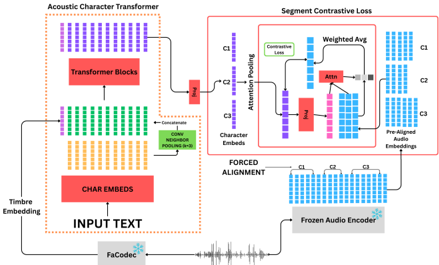

> [!abstract] arXiv · 2026 · Preprint
> **Priyam Mazumdar et al.** (University of Illinois Urbana-Champaign) · [→ Paper](https://arxiv.org/abs/2607.01238) · Demo: ? · Code: ?
>
> Replaces the character embedding layer of a TTS model with a pretrained, speaker-conditioned character encoder whose outputs are contrastively aligned to frozen Wav2Vec2 frames, offering a learned alternative to G2P that markedly lowers WER when downstream TTS data is scarce.

## Problem

Phoneme inputs resolve much of the one-to-many mapping between spelling and sound, but they depend on G2P systems that need dialect-specific pronunciation dictionaries or phoneme labels and that operate at the word level, ignoring coarticulation and speaker-specific pronunciation. Grapheme inputs avoid G2P and work well when data is plentiful, yet prior work found them weaker than phonemes in low-resource settings. The authors target this gap: a grapheme representation that already carries acoustic pronunciation information before downstream TTS training begins. They also argue that CLAP-style contrastive audio-text pretraining is unsuitable here because it aligns whole clips with captions rather than individual characters with their acoustic realisation.

## Method

SPARCLE is a character-level Transformer encoder (12 blocks, 12 heads, 768 dimensions) over a vocabulary of uppercase A-Z plus space. Each 128-dimensional character embedding is concatenated with a 128-dimensional local-context feature from a kernel-3 1D convolution over neighbouring characters, then projected to the model dimension. Speaker identity enters as a prepended token holding a unit-normalised FaCodec timbre embedding (dropout p = 0.5); the token is discarded after encoding. Using a pretrained timbre encoder rather than a learned speaker table is intended to let the model condition on speakers outside the pretraining set.

Pretraining targets come from a frozen Wav2Vec2-Large model (layer -17, chosen empirically as the most phonetic of the layers tested). LibriSpeech-960h transcripts are force-aligned to the Wav2Vec2 frame sequence, so each character maps to a variable set of frames (about 2.8 frames per letter and 6.7 per space on average). A learned attention pooling, driven by a projection of the character embedding, reduces each character's frames to a single target. Character and pooled acoustic embeddings are L2-normalised and trained with a contrastive loss over all character pairs in the batch (N positives, N² - N negatives, temperature 0.1). Pretraining runs 200K steps at batch size 1024 utterances on 4 GH200 GPUs, with clips shorter than 2 s or longer than 20 s removed.

Downstream, SPARCLE outputs (plus a small auxiliary table for non-letter symbols) replace the character embedding lookup in two backends trained from scratch: ParrotTTS, which predicts discrete self-supervised units from text and uses a separate vocoder, and VITS (a VAE with adversarial training). In ParrotTTS, the aligner and vocoder are trained once on full VCTK and held fixed across all budgets. Adaptation depth is varied (frozen, last K ∈ {1, 3, 7} blocks unfrozen, or fully unfrozen), with and without the timbre token. Downstream data are speaker-balanced VCTK subsets of 10 min, 30 min, 1 h, 5 h and 10 h across 108 speakers, so the British English downstream domain differs from the mostly North American LibriSpeech pretraining data.

## Key Results

All evaluation is automatic: WER from Whisper-small transcripts and speaker-verification EER from a SpeechBrain ECAPA-TDNN, on a fixed 512-utterance VCTK test set. No MOS or listening test is reported.

ParrotTTS, WER (Table 1, best SPARCLE configuration per budget versus character baseline):

| Budget | Characters | Phonemes (g2pE) | Best SPARCLE (config) |
|---|---|---|---|
| 10 min | 85.7 | 96.0 | 42.2 (K=7, +T) |
| 30 min | 35.3 | 32.6 | 10.0 (K=7, +T) |
| 1 h | 24.7 | 26.8 | 7.5 (K=7, +T) |
| 5 h | 17.2 | 27.7 | 8.5 (K=7, +T) |
| 10 h | 14.4 | 25.1 | 9.9 (unfrozen, +T) |

The abstract's "halved WER in extreme low-resource settings" is, if anything, an understatement for 30 min to 5 h: the best SPARCLE setting cuts WER by roughly 51% at 10 min, 72% at 30 min, 70% at 1 h and 51% at 5 h, narrowing to about 31% at 10 h. These are best-of-several configurations chosen per column on the test set; the frozen encoder alone gives smaller but still large gains at low budgets (53.4 at 10 min, 13.7 at 1 h, without timbre) and is slightly worse than characters at 10 h with timbre (14.8 versus 14.4).

Adaptation depth matters: partial fine-tuning (K=3 or K=7) beats both the frozen and fully unfrozen encoder in most columns (10 min without timbre: frozen 53.4, K=7 42.4, unfrozen 52.1). Timbre conditioning hurts a frozen encoder (1 h: 13.7 to 18.0) but helps once upper layers adapt (1 h, K=7: 9.2 to 7.5). EER is low for every system (all below 3.4%) and generally improves with SPARCLE (10 h: 1.17 baseline to 0.76 with K=7 +T), but not in every configuration; at 10 h the frozen encoder without timbre (1.56) and K=3 with timbre (1.38) are worse than the character baseline.

The g2pE phoneme baseline is worse than characters at every budget except 30 min, which the authors attribute to the North American pronunciation dictionary mismatching British VCTK speech rather than to phonemes per se.

On VITS at 1 h (Table 2) the system fails in both conditions: WER 121.7 for characters versus 117.34 with SPARCLE, though EER improves from 5.6 to 3.9. The VITS comparison is a single budget and configuration, so it says little about backend generality for intelligibility. A sub-word variant using RoBERTa tokens failed (94.4% WER on LJSpeech, muffled audio, §5).

## Novelty Assessment

The new element is the pretraining target: per-character contrastive alignment between a speaker-conditioned grapheme encoder and pooled SSL acoustic frames, producing a learned, context-sensitive replacement for G2P. The ingredients (Transformer text encoders, frozen Wav2Vec2 features, forced alignment, InfoNCE-style losses, FaCodec timbre vectors) are all existing, and the downstream backends are unchanged apart from their input layer. The contribution is therefore an architectural and training-recipe idea for the text front end, evaluated in a narrow setting: one downstream corpus, one meaningful backend, automatic metrics only, and English only.

## Field Significance

moderate — The paper shows that acoustically grounded character representations, pretrained on transcribed speech, can substitute for a G2P front end and substantially improve intelligibility of a small-data multi-speaker TTS model, including under an accent shift where a dictionary-based phonemizer degrades. It provides an explicit design point for SSL-supervised text front ends, but evidence is limited to automatic metrics on VCTK with ParrotTTS, and the authors' proposed extensions to multilingual, zero-shot and codec-LM TTS are untested.

## Claims

- **supports:** Pretraining a grapheme encoder to align with self-supervised acoustic representations improves intelligibility of low-resource TTS relative to learned-from-scratch character embeddings.
  > *Evidence:* Replacing ParrotTTS character embeddings with SPARCLE lowers Whisper WER on VCTK at every budget, from 85.7 to 42.2 at 10 min and 24.7 to 7.5 at 1 h, with the gap narrowing to 14.4 versus 9.9 at 10 h. *(§5, Table 1)*
- **complicates:** Dictionary-based phoneme inputs can underperform raw graphemes when the pronunciation dictionary's accent does not match the target speakers.
  > *Evidence:* A g2pE (CMUdict-based) phoneme ParrotTTS is worse than the character model on British English VCTK at 10 min, 1 h, 5 h and 10 h, better only at 30 min (32.6 versus 35.3), contrasting with earlier LJSpeech-based findings that phonemes help at low resource. *(§5, Table 1)*
- **refines:** When transferring a pretrained text front end into TTS training, partial fine-tuning of upper layers outperforms both freezing and full fine-tuning.
  > *Evidence:* Without timbre at 10 min, WER is 53.4 frozen, 42.4 with the last seven blocks unfrozen, and 52.1 fully unfrozen; at 1 h the pattern is 13.7, 9.2 and 11.6. *(§5, Table 1)*
- **complicates:** Speaker conditioning of a text representation can harm intelligibility unless the conditioned layers are adapted to the downstream speaker distribution.
  > *Evidence:* Adding FaCodec timbre to a frozen SPARCLE raises 1 h WER from 13.7 to 18.0 and 10 min WER from 53.4 to 69.2, while with K=7 fine-tuning it lowers 1 h WER from 9.2 to 7.5. *(§5, Table 1)*
- **complicates:** Improved text representations alone do not rescue end-to-end TTS trained on extremely little multi-speaker data.
  > *Evidence:* VITS with 1 h of VCTK produces WER above 100% with both character inputs (121.7) and SPARCLE inputs (117.34), although speaker EER improves from 5.6 to 3.9. *(§5, Table 2)*

## Limitations and Open Questions

> [!warning] Automatic metrics on one corpus only
> All results are Whisper-small WER and ECAPA-TDNN EER on a single VCTK test set, with no MOS, naturalness or listening test, so the paper does not show that SPARCLE improves perceived quality, only intelligibility and verification scores. Best configurations are selected per budget from many variants evaluated on the same test set, and no significance testing or variance across runs is reported.

- The paper states the SPARCLE pretraining checkpoint was chosen as "the best checkpoint on the test data" (§3.5), a further source of optimistic selection.
- Table 2's ParrotTTS row at 1 h (24.8 / 1.9 versus 9.2 / 1.5) does not correspond exactly to any single Table 1 configuration: 9.2 WER appears for K=3 +T (EER 1.18) and K=7 -T (EER 1.56), and the baseline WER is 24.7 in Table 1 (checked against table-1.png and table-2.png). The text also quotes the VITS SPARCLE WER as 117.39 while Table 2 shows 117.34. These are minor, but the configuration behind Table 2 is unspecified.
- EER values for ParrotTTS are all near or below 2% after the 10 min budget, so the speaker-consistency comparison operates near a floor and small differences may not be meaningful; the speaker set is identical between training and test, so unseen-speaker cloning is not evaluated.
- The vocabulary is restricted to A-Z and space; numerals and punctuation rely on an auxiliary table, and extension to other scripts and languages is proposed but untested.
- SPARCLE's pretraining requires forced alignment of transcribed speech, so it trades the G2P dictionary dependency for an aligner and a transcribed corpus in the target language.
- The ParrotTTS vocoder and aligner are trained on full VCTK and frozen across budgets, so the "10 min" condition is not a true 10-minute end-to-end setup.
- The benefit for modern large-scale grapheme-input systems such as flow-matching or codec-LM TTS, which the authors cite as motivation, is not measured.

## Wiki Connections

- [[self-supervised-speech|Self-Supervised Speech]] — SPARCLE is trained to align character embeddings with frozen Wav2Vec2-Large frame representations, and ParrotTTS predicts self-supervised units downstream.
- [[transformer-enc-dec-tts|Transformer Encoder-Decoder TTS]] — SPARCLE replaces the input embedding of the ParrotTTS text-to-units model, which is trained from scratch on each VCTK budget.
- [[gan-vocoder|GAN Vocoder]] — VITS, an end-to-end VAE with adversarial waveform training, is retrained with SPARCLE inputs as the second backend.
- [[2025.acl-long.313|F5-TTS]] — cited as a modern system that adopts grapheme inputs directly, motivating a learned grapheme front end; not used experimentally.
- [[2301.02111|VALL-E]] — named as the codec-LM direction to which SPARCLE embeddings could be extended in future work.
- [[2403.03100|NaturalSpeech 3]] — source of the FaCodec timbre embeddings used for speaker conditioning.
- [[2212.04356|Whisper]] — Whisper-small transcribes generated speech for the WER evaluation.
- [[2005.07143|ECAPA-TDNN]] — the SpeechBrain ECAPA-TDNN verifier provides the speaker EER metric.
