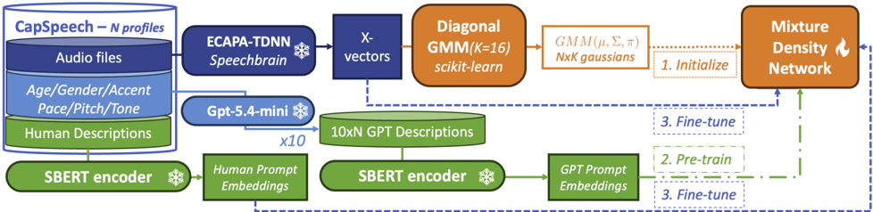

> [!abstract] arXiv · 2026 · Preprint
> **Thomas Thebaud et al.** (Johns Hopkins University / AMIAD / Universidad Carlos III de Madrid) · [→ Paper](https://arxiv.org/abs/2607.05276) · Demo: ✗ · Code: ✓
>
> ProPS maps a free-text speaker description ("a thirties male speaker with an Indian accent") to a Gaussian mixture over ECAPA-TDNN x-vectors, so new speaker embeddings for TTS or VC can be sampled from a prompt instead of extracted from reference audio.

## Problem

Speaker-conditioned TTS and VC systems usually take an x-vector extracted from an enrollment utterance. Without reference audio, the usual way to create a new voice is to sample from an unconditional or label-conditioned prior fitted to training x-vectors (a GMM or PLDA-style prior), which offers only coarse control. The closest prior work, PromptSpeaker, generates x-vectors from text descriptions, but it samples in a semantic latent space under a single Gaussian and then maps through a Glow model, so the diversity of the generated speaker distribution is controlled only indirectly. ProPS instead models the prompt-conditioned distribution directly in x-vector space as a mixture.

## Method

ProPS is a mixture density network (MDN). A prompt is encoded with a frozen Sentence-BERT model (all-MiniLM-L6-v2, 384 dimensions), and a three-layer MLP (hidden sizes 1024, 2048, 1024) outputs softmax mixture weights over a shared bank of diagonal Gaussian components in the 192-dimensional ECAPA-TDNN x-vector space (SpeechBrain extractor, frozen). The bank holds N × K components: one K-component GMM per speaker profile, with N = 942 profiles (profiles with at least 100 segments) and K = 16. The component means and standard deviations are trainable parameters, so the prompt chooses and mixes regions of an observed speaker space rather than predicting free-form Gaussian parameters.

Training has three stages. First, a diagonal GMM is fitted with scikit-learn to the real x-vectors of each CapSpeech profile; together these GMMs initialize the component bank. Second, the MLP is pretrained with a cross-entropy loss to reproduce each profile's precomputed mixture weights (zero weight on other profiles' components) from GPT-generated paraphrases of the structured profile: ten descriptions per profile from gpt-5.4-mini, with descriptions 3 to 10 used for training and 2 for development (100 epochs, learning rate 1e-4). Third, the whole MDN, including means and variances, is fine-tuned end to end on CapSpeech's human-written descriptions by minimizing the negative log-likelihood of the paired real x-vector (100 epochs, learning rate 1e-5). Profiles span gender, age (4 classes), 23 accents, pitch (7 levels), pace and tone. At inference, the predicted GMM is sampled to produce synthetic x-vectors. The paper does not report a parameter count.

K was chosen among powers of two, starting at K = 1, by fitting per-profile GMMs and scoring held-out x-vectors. Each component needs at least two training x-vectors, so larger K leaves fewer valid profiles. The held-out likelihood stabilizes from K = 16, which the authors adopt as the balance between fit and profile coverage (Figure 2).

## Key Results

All evaluation is in the x-vector space. No speech is synthesized.

- **Likelihood ablation (Table I, log-likelihood, higher is better).** Precomputed per-profile GMMs, which use no prompt, score 303.1 on test x-vectors scored against their own profile (human-prompt column). The pretrained MDN gives similar values: 303.5 with human prompts and 304.2 with the held-out GPT prompt. Fine-tuning on human descriptions raises human-prompt likelihood to 309.1 on test (+5.6 over the pretrained MDN) and 308.9 on dev (+5.5). The authors report this gain as significant (Welch's t-test). With GPT prompts, the fine-tuned model moves by +1.1 on test (305.3) and -0.3 on dev (303.7). The fine-tuned MDN has the highest value in three of the four columns; on dev with the GPT prompt, the pretrained MDN is slightly higher (304.0 vs 303.7). The randomly initialized GMM baseline described in §IV.C has no row in Table I.
- **Attribute preservation (Table II).** An SVM trained on real dev-set x-vectors classifies 10,000 x-vectors sampled per single-attribute prompt (for example, "a male speaker"). Generated accuracy is close to real-test accuracy for gender (98.4 vs 99.1) and accent (91.6 vs 93.4, 23 classes). For age, generated accuracy is higher than real (65.4 vs 59.8). Generated accuracy drops by 9.3 points for pitch (28.2 vs 37.5) and by 5.8 points for pace (31.6 vs 37.4). Tone is near chance for both real and generated x-vectors (21.9 and 23.8, five classes).
- **Qualitative.** LDA projections show generated and real x-vectors overlapping and separating by gender and by six frequent accents (Figures 3 and 4).

There is no quantitative comparison with PromptSpeaker or any other text-to-speaker-embedding system. The real-vs-generated accuracy check also uses a classifier trained on the same x-vector space that ProPS was fitted to. As a result, it measures whether the samples land in the right region, not whether they produce distinct, natural-sounding voices.

## Novelty Assessment

The structural idea is new for this task. ProPS predicts weights over a fixed bank of per-profile GMM components that are initialized from data, then learns end to end with a likelihood objective. A staged recipe (GMM initialization, paraphrase pretraining, human-description fine-tuning) teaches the model to map prompts to that bank. MDNs, SBERT and ECAPA-TDNN are all established components, so the contribution lies in how they are combined and trained, not in any new building block. The paper's description of "natural language-conditioned speaker-distribution synthesis" as a new task overlaps with PromptSpeaker's description-to-x-vector generation. The new element is predicting an explicit multimodal distribution rather than one sample route. The empirical support is narrow. It covers a single dataset, includes no baseline from prior work, and stops at the embedding: the downstream TTS or VC use that motivates the paper is left to future work.

## Field Significance

Low — ProPS shows that a prompt-weighted bank of data-initialized GMM components can turn speaker descriptions into x-vector distributions that keep gender, accent and age recoverable. It is a possible voice-design front end for embedding-conditioned TTS or VC. Because no audio is generated and no prior method is compared, the result is evidence about the embedding space, not about controllable speech output.

## Claims

- **supports:** Natural-language speaker descriptions can steer a generative model of speaker embeddings so that sampled embeddings keep demographic and accent attributes recoverable at close to the rate of real embeddings.
  > *Evidence:* Classifiers trained on real dev x-vectors reach 98.4% (gender) and 91.6% (23-way accent) on ProPS samples, against 99.1% and 93.4% on real test x-vectors. Age accuracy is 65.4% on samples vs 59.8% on real data. *(§V.D, Table II)*
- **complicates:** Prosodic attributes such as pitch, pace and tone are poorly encoded in speaker-verification embeddings, so describing them in a prompt gives weak control when the generated voice is represented only by such an embedding.
  > *Evidence:* Real test x-vectors already give only 37.5% (pitch, 7 classes), 37.4% (pace) and 21.9% (tone, near chance for five classes). Generated samples lose a further 9.3 points on pitch and 5.8 on pace. *(§V.D, Table II)*
- **supports:** Paraphrases of structured attribute labels generated by an LLM can bootstrap a description-to-voice mapping, but fine-tuning on human-written descriptions is what aligns it with realistic prompts.
  > *Evidence:* After pretraining on GPT paraphrases only, the MDN scores 303.5 log-likelihood with human prompts on test, close to its GPT-prompt score of 304.2. Fine-tuning on human descriptions raises the human-prompt score to 309.1 (dev 308.9), while GPT-prompt scores change by +1.1 (test) and -0.3 (dev). *(§V.B, Table I)*
- **refines:** For description-conditioned speaker generation, anchoring the generative distribution in GMM components fitted to real speaker embeddings gives a strong likelihood baseline. Prompt conditioning then adds controllability on top of it, rather than distributional fit.
  > *Evidence:* Per-profile precomputed GMMs that use no prompt already reach 302.9 to 303.8 log-likelihood. The pretrained prompt-conditioned MDN matches them (303.4 to 304.2) before human-description fine-tuning. *(§III.C, §V.B, Table I)*

## Limitations and Open Questions

> [!warning]
> No speech is generated or evaluated. All results are likelihoods and classifier accuracies on x-vectors, with no comparison against PromptSpeaker or another baseline from prior work. Whether ProPS samples yield natural, distinct and description-matching voices in a TTS or VC system is untested.

- The x-vectors and profiles come only from English CapSpeech data, which limits descriptors and generalization to other languages. Rare or ambiguous profiles, and the biases of CapSpeech labels, are acknowledged risks (§VI).
- Only profiles with at least 100 segments are kept (942 profiles). Each prompt is effectively mapped onto combinations of these observed profiles, so how far the model generalizes to descriptions outside the profile set is not measured.
- The paper does not measure the diversity of generated speakers or their distance from training speakers. PromptSpeaker's discussion in the paper calls this property important for downstream use.
- The attribute evaluation uses single-attribute prompts. Joint control over several attributes in one description is shown only through the likelihood experiment, not through attribute accuracy.

## Wiki Connections

- [[instruction-conditioned-tts|Instruction-Conditioned TTS]] — ProPS supplies a description-to-speaker-embedding front end for voice design, conditioning on free-text speaker descriptions, but evaluates it only in embedding space without synthesizing speech.
- [[2506.02863|CapSpeech]] — supplies the speaker-profile labels and human-written descriptions that ProPS trains and evaluates on, and shares authors with this paper.
- [[2005.07143|ECAPA-TDNN]] — defines the 192-dimensional speaker-embedding space in which ProPS predicts and samples its Gaussian mixtures.
- [[2106.04624|SpeechBrain]] — provides the pretrained ECAPA-TDNN extractor used to embed all CapSpeech utterances.
- [[2407.05361|Emilia]] — one of the source corpora behind CapSpeech's speech segments used for training.
- [[2106.06909|GigaSpeech]] — one of the source corpora behind CapSpeech's speech segments used for training.
- [[1912.06670|Common Voice]] — its English subset is one of the CapSpeech source corpora used for training.
- [[2012.03411|MLS]] — its English subset is one of the CapSpeech source corpora used for training.
