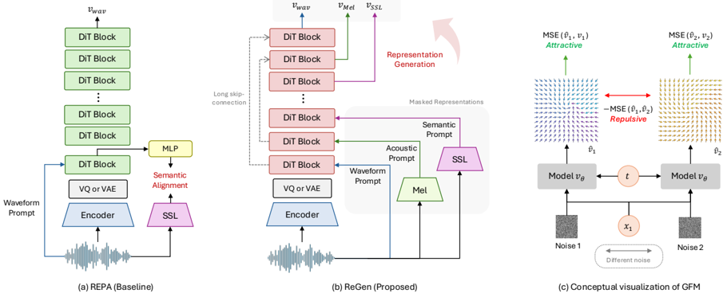

> [!abstract] ICML · 2026 · Conference
> **Sang-Hoon Lee et al.** (Ajou University / KT Corp.) · [→ Paper](https://openreview.net/forum?id=T8Y9elIrXa) · [→ Preprint](https://arxiv.org/abs/2607.09134) · Demo: ✓ · Code: ?
>
> ReGen replaces representation alignment (REPA) in a waveform diffusion Transformer with joint generation of SSL, Mel-spectrogram and waveform vector fields, and adds a repulsive velocity-space term to conditional flow matching (generalized flow matching, GFM). This lets a single-stage waveform decoder reconstruct speech from 25 Hz tokens or 12.5 Hz latents and supports a 6.25 Hz latent-diffusion TTS model.

## Problem

Low-bitrate neural audio codecs with GAN decoders lose semantic capacity (hurting intelligibility) and acoustic capacity (losing high-frequency detail). Semantic distillation with RVQ helps intelligibility but adds quantizers. For waveform diffusion Transformers (DiT), REPA speeds up training by aligning intermediate DiT features to SSL features. The authors' own StreamFlow-based codec experiments show that REPA alone does not train a usable codec at very low bitrates. The paper attributes this to REPA entangling the DiT's latents and biasing the model toward over-smoothed, low-frequency output. A second problem is that plain regression-style flow matching on waveforms collapses distinct stochastic trajectories toward a conditional mean, which removes high-frequency energy.

## Method

**Representation generation (ReGen).** The waveform DiT does not regularize hidden states toward fixed SSL features. It instead predicts three conditional flow-matching vector fields at once: SSL features (MMS, 7th layer), Mel-spectrogram, and waveform. All three are conditioned on a compressed latent from the codec or VAE encoder. The representations become generated variables rather than fixed conditioning signals. The DiT is hierarchical (ReGen-H): earlier blocks output the SSL field, middle blocks the Mel field, and the last blocks the waveform field, with U-Net-like long skip connections (Figure 1b). Each level also receives a masked prompt of its own representation (semantic, acoustic and waveform prompts). This masked-infilling scheme follows Voicebox and enables audio-prompted generation.

**Generalized flow matching (GFM).** Two flow trajectories share one target waveform but start from different noise samples. An attractive term regresses both predicted velocities to their targets. An asymmetric repulsive term, weighted by λ_neg, pushes one predicted velocity away from the other, with a stop-gradient on the reference trajectory. The idea adapts the generalized-energy-distance repulsion of Gritsenko et al. (2020) from sample space to velocity space. The final loss applies GFM to the waveform and adds λ_regen-weighted GFM losses for Mel and SSL (λ_regen = 0.1 and λ_neg = 0.01 by default).

**Wave-DiT decoder and encoders.** The decoder reuses StreamFlow's linear-reshape transformation and Scale-DiT, so diffusion runs at 50 Hz directly on 24 kHz waveforms. AdaLN is replaced with AdaLN-SOLA, and the block layout is [3,3,6,3,3] at 1024 dimensions. ReGenTokenizer is a causal-Transformer encoder with finite scalar quantization (FSQ, codebook size 65536) at 25 Hz (400 bps). ReGenVAE uses the same encoder with weak KL regularization on a 32-dimensional continuous latent at 12.5 Hz. ReGenTokenizer has 402M parameters (Table 11). Following PeriodWave-Turbo, both models then go through adversarial post-training (MPD, MS-STFT and MS-SB-CQT discriminators) to fix sampling at 4 steps.

**ReGenVoice (TTS).** ReGenVoice is a latent-diffusion TTS model on ReGenVAE latents. It has a causal Transformer text encoder and an implicit aligner that average-downsamples text features to the latent rate (inspired by ZipVoice). The backbone is a U-Net-like Wave-DiT that down-samples to 6.25 Hz, trained with masked infilling and GFM. Two sizes exist (0.3B and 0.5B), trained on LibriTTS (0.5k hours) or Emilia-en (40k hours). Inference uses 25 NFE with proportional duration.

## Key Results

**Reconstruction (Tables 1, 2).** On the X-codec2 LibriSpeech benchmark (baseline numbers cited from X-codec2), ReGenVAE-Emilia at 12.5 Hz reaches WER 2.11, SPK-SIM 0.89 and UTMOS 4.16. ReGenVAE-LibriTTS has the lowest WER of all codec rows (2.05, against 2.15 for EnCodec at 6 kbps). Its SPK-SIM (0.89) ties EnCodec at 6 kbps, and StableCodec has a higher UTMOS (4.23 vs. 4.21 for ReGenVAE-LibriTTS). ReGenTokenizer-Emilia at 400 bps (WER 2.70, SPK-SIM 0.74) clearly beats WavTokenizer at 480 bps (WER 11.20) and StableCodec at 700 bps (WER 5.12). X-codec2 at 800 bps remains better (WER 2.47, SPK-SIM 0.82). On the LibriTTS benchmark, ReGenVAE-LibriTTS has the lowest CER (0.94) and WER (2.88) of all rows, below both DAC (8 codebooks, 1.09 / 2.91) and ground truth (1.12 / 3.06). ReGenTokenizer has weak PESQ (1.496) and the largest pitch error of all rows (94.5). Crowdsourced MOS sits in a narrow band: ReGenTokenizer-LibriTTS scores 3.88, ReGenVAE-LibriTTS 3.85, WavTokenizer (75 Hz) 3.86 and GT 3.99, with ±0.03 intervals.

**Prompted reconstruction (Table 3, Seed-en, baselines cited from TaDiCodec).** ReGenVAE-LibriTTS and ReGenVAE-Emilia reach WER 2.03 and 2.09 and SPK-SIM 0.72 and 0.73. This is with a single-stage waveform decoder. The strongest multi-stage baseline, TaDiCodec (Mel-CFM plus GAN vocoder), reaches WER 2.57 and SPK-SIM 0.69. ReGenTokenizer-Emilia's SPK-SIM (0.71) exceeds every non-ReGen row (maximum 0.69, TaDiCodec). ReGenVAE's WER is below the GT reference WER of 2.14, and its SIM equals the GT SIM of 0.73. Appendix C (Table 12) separates the prompt's role: with the prompt, SPK-SIM to the prompt rises from 0.65 to 0.73, while SPK-SIM to the ground truth stays at 0.86 to 0.87.

**Ablation (Table 4, 0.5M steps).** Without REPA, the codec does not learn (WER 136.57). SSL-only REPA barely helps (130.64). Mel REPA and hierarchical REPA-H reach WER 15.10 and 16.53. Hierarchical ReGen-H with both SSL and Mel lowers WER to 11.99 and raises SPK-SIM from 0.38 (REPA-H) to 0.54. Unified ReGen-U, which prompts and generates at the same layer, fails at the default weight (WER 89.94). GFM improves M-STFT, PESQ, pitch error, SPK-SIM and UTMOS over ReGen-H, but WER rises slightly (11.99 to 12.59). The GFM sweep (Table 5) shows λ_neg = 0.1 degrades every reported metric except SPK-SIM (0.57 vs. 0.54). Replacing FSQ with the VAE latent lowers WER from 6.01 to 3.63 and raises SPK-SIM to 0.72. Adversarial post-training then improves both models (final ReGenVAE WER 2.88, SPK-SIM 0.87, UTMOS 4.096).

**Zero-shot TTS (Tables 6, 7).** On Seed-en, ReGenVoice 0.5B trained on 40k hours reaches WER 1.62 and SIM 0.70. Across the cited baselines, CosyVoice3-RL has the lowest WER (1.68), and ZipVoice and CosyVoice3-RL have the highest SIM (0.69). ReGenVoice trained on only 0.5k hours of LibriTTS reaches WER 1.46, but with lower SIM (0.64). The baseline numbers are cited, and the baselines train on 100k to 166k hours. In the crowdsourced test, ReGenVoice MOS (4.029) is effectively tied with CosyVoice2 (4.033). Its SMOS (3.762) is within the ±0.02 interval of CosyVoice2 (3.754) and GT (3.756). Both scores are above CosyVoice3-RL (3.867 / 3.606). ReGenVoice's RTF is 0.08, compared with 1.05 for CosyVoice2 and 0.81 for CosyVoice3-RL with vLLM. The NFE study (Table 9) shows that 4 NFE is clearly worse (WER 4.20), 8 NFE is close (1.93), and quality saturates around 25 NFE.

## Novelty Assessment

The architectural contribution is real but narrow. Generating auxiliary representations as extra flow-matching outputs, instead of aligning hidden states to them, is a clear reframing of REPA for waveform DiTs. The hierarchical semantic-to-acoustic-to-waveform layout and its masked multi-prompting are a new decoder design. GFM is a new training objective on an otherwise standard CFM setup: it moves a known energy-distance repulsion idea into velocity space. Much of the rest is inherited from the authors' earlier work: Scale-DiT and the linear-reshape front end come from StreamFlow, and adversarial post-training comes from PeriodWave-Turbo.

The evidence has gaps. Most baseline numbers are copied from the X-codec2 and TaDiCodec papers rather than re-run. The ablation is run at 0.5M steps, and the GFM gain over plain CFM is modest and mixed on WER. Adversarial post-training contributes a large part of the final quality, so the CFM components are not shown to stand alone. The TTS comparison mixes training-data scales and decoding stacks. The low-data result (0.5k hours) is interesting, but the baselines have no matched-data controls.

## Field Significance

Moderate — The paper shows that a single-stage waveform diffusion decoder can match or beat multi-stage token-to-Mel-to-vocoder decoders on intelligibility and speaker similarity at 12.5 to 25 Hz. It also reports that REPA-style feature alignment underperforms explicit representation generation in this regime. GFM is a general repulsive-term modification of flow matching that other continuous-output speech generators could test.

## Claims

- **complicates:** Aligning diffusion-Transformer hidden states to self-supervised speech features is not sufficient to train waveform-level diffusion decoders from highly compressed latents.
  > *Evidence:* A single-stage waveform DiT codec trained with SSL-only REPA stays unintelligible (WER 130.64 vs. 136.57 without REPA). Mel REPA and hierarchical REPA-H reach only WER 15.10 and 16.53, with SPK-SIM at most 0.38 after 0.5M steps. *(§2.4, §7.4, Table 4)*
- **supports:** Predicting auxiliary semantic and acoustic representations as additional generated outputs, arranged hierarchically across decoder depth, improves low-bitrate waveform reconstruction over hidden-state alignment.
  > *Evidence:* Hierarchical ReGen-H (SSL plus Mel) lowers WER from 16.53 to 11.99 and raises SPK-SIM from 0.38 to 0.54 relative to REPA-H. A unified variant that prompts and generates at the same layer fails at the default weight (WER 89.94). *(§3, §7.4, Table 4)*
- **refines:** Adding a repulsive term between velocity predictions from different noise samples helps flow-matching waveform generation, but only at small weights and mainly on spectral and pitch accuracy rather than intelligibility.
  > *Evidence:* GFM with λ_neg = 0.01 improves M-STFT (1.886 to 1.795), PESQ (1.452 to 1.500), pitch error (62.5 to 57.5) and SPK-SIM (0.54 to 0.59) over ReGen-H. WER rises slightly (11.99 to 12.59), and λ_neg = 0.1 degrades every metric except SPK-SIM. In the TTS model, removing GFM raises WER from 1.46 to 1.60. *(§4, §7.4, Tables 4, 5, 8)*
- **supports:** Very low frame-rate continuous latents (12.5 Hz, diffused at 6.25 Hz) can support zero-shot TTS with competitive intelligibility and speaker similarity at much lower real-time factor than LM-plus-flow-matching cascades.
  > *Evidence:* ReGenVoice 0.5B reaches Seed-en WER 1.62 and SIM 0.70 trained on 40k hours, and WER 1.46 trained on 0.5k hours. Its RTF is 0.08, compared with 1.05 for CosyVoice2 and 0.81 for CosyVoice3-RL with vLLM, at comparable crowdsourced MOS (4.029 vs. 4.033 for CosyVoice2). *(§7.5, Tables 6, 7)*
- **complicates:** Heavier spectral (STFT) losses can raise objective speaker-similarity scores of waveform decoders while introducing audible metallic artefacts, so objective and perceptual quality can diverge.
  > *Evidence:* The authors train ReGenVAE with a small STFT loss weight because high-weight STFT losses caused metallic sounds. A high-STFT-loss variant of ReGenVoice reached SIM 0.72 but could contain metallic noise. The low-weight model reports lower objective SIM (0.70) but competitive MOS. *(§5, §7.5, Table 7)*

## Limitations and Open Questions

> [!warning]
> Most baseline results in the reconstruction and TTS tables are copied from the X-codec2 and TaDiCodec papers, and from each TTS system's own reports, rather than re-run under one protocol. The TTS baselines also train on 100k to 166k hours versus 0.5k to 40k for ReGenVoice. Head-to-head margins of a few hundredths in WER or SIM are therefore not controlled comparisons.

- The final systems depend on adversarial post-training for both quality and 4-step sampling. The authors list removing this dependency as open work (Appendix D).
- Ablations use 0.5M training steps, and GFM was tuned with one global weight for all representation levels. The paper notes that per-representation weighting is untested.
- ReGenTokenizer at 400 bps trades signal fidelity for intelligibility: PESQ is low (1.496 on LibriTTS) and pitch error is the largest in Table 2.
- Emilia training improves speaker similarity, but its MP3 artefacts reduce high-frequency quality. Only English evaluation is reported.
- The causal text encoder and 4 s causal codec context are motivated by streaming, but streaming TTS latency is not evaluated.
- Code was promised, not released, at the time of the paper.

## Wiki Connections

- [[flow-matching|Flow Matching]] — Proposes generalized flow matching, a repulsive velocity-space extension of conditional flow matching, and uses multi-target CFM for waveform, Mel and SSL generation.
- [[neural-codec|Neural Audio Codec]] — Contributes a 400 bps single-codebook FSQ tokenizer and a 12.5 Hz continuous VAE, both with a single-stage waveform diffusion decoder.
- [[zero-shot-tts|Zero-Shot TTS]] — ReGenVoice performs prompted zero-shot TTS on Seed-en via masked latent infilling at 6.25 Hz.
- [[self-supervised-speech|Self-Supervised Speech]] — MMS (7th-layer) SSL features act as a semantic prompt and a generated target inside the decoder, replacing their use as an alignment target.
- [[gan-vocoder|GAN Vocoder]] — Adversarial post-training with MPD, MS-STFT and MS-SB-CQT discriminators turns the CFM decoder into a 4-step generator, and Table 4 ablates its effect.
- [[subjective-evaluation|Subjective Evaluation]] — Reports crowdsourced MOS and SMOS from Amazon Mechanical Turk (20 raters per sample, noise-sample attention checks).
- [[neurips-2025-1cURNMriee|StreamFlow]] — Direct predecessor whose Scale-DiT, linear-reshape front end and REPA setup ReGen builds on and replaces.
- [[iclr-2025-tQ1PmLfPBL|PeriodWave]] — The authors' earlier flow-matching waveform generator, cited as part of the CFM-for-audio line that ReGen extends.
- [[2508.16790|TaDiCodec]] — Supplies the prompted-reconstruction protocol and baseline numbers, and is the strongest multi-stage decoder compared in Table 3.
- [[2412.10117|CosyVoice 2]] — Baseline in prompted reconstruction, zero-shot TTS and the MOS/RTF comparison, and the source of the token-distillation auxiliary decoder ablated in Table 4.
- [[2506.13053|ZipVoice]] — Inspires ReGenVoice's average-downsampling implicit text-latent aligner, and serves as a zero-shot TTS baseline.
- [[2025.acl-long.313|F5-TTS]] — Flow-matching TTS baseline on Seed-en in Table 6.
- [[2410.00037|Mimi (Moshi)]] — Semantic-distillation codec baseline in the reconstruction tables.
- [[2308.16692|SpeechTokenizer]] — Semantic-distillation codec baseline that motivates the move away from RVQ-based distillation.
