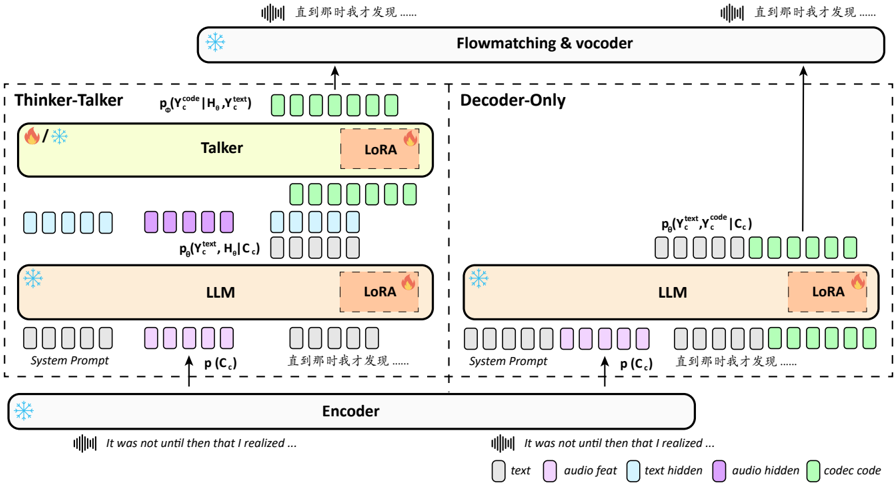

> [!abstract] arXiv · 2026 · Preprint
> **Rongshen He et al.** (The Chinese University of Hong Kong, Shenzhen / Amphion Technology Co., Ltd.) · [→ Paper](https://arxiv.org/abs/2607.19810) · Demo: ✗ · Code: ✗
>
> Turns a Qwen2.5-Omni Thinker-Talker speech LM into a sentence-level and long-form simultaneous Chinese-English speech-to-speech translator by supervising target text and DualCodec semantic codes along one shared read/wait/write trajectory, with about 2.1k hours of paired S2ST data on top of a much larger auxiliary ASR, S2TT, MT and TTS mixture.

## Problem

Streaming speech-to-speech translation (S2ST) must decide both what to say and when to commit, over unbounded input. Earlier streaming S2ST models rely on sentence-bounded cues (CTC triggers, transducers, monotonic attention), which do not transfer to continuous long-form speech. Recent streaming speech LMs that do handle unbounded speech output, such as Hibiki and Seed LiveInterpret 2.0, depend on large paired-audio corpora (the paper cites more than 40k hours), expert-annotated alignments or reinforcement learning. Training-free policies (SimulS2S-LLM, SimulU) avoid paired data but stay tied to wait-k or attention heuristics and pre-segmented input. Text-output trajectory methods (InfiniSST) embed the read/write policy in the LLM, but they do not cover irrevocable, time-sensitive emission of speech tokens. The paper asks whether a speech LM can learn long-form streaming S2ST from a small paired-S2ST budget, and which backbone layout makes that possible.

## Method

**Trajectory construction.** Each paired sample has source speech, target text and target speech; the target speech is tokenized into DualCodec semantic codes. Source and target speech are force-aligned at the word level, and SimAlign gives cross-lingual word alignments. Each target word inherits the end frame of its aligned source word, made monotonic with a running maximum so that local reordering never moves a write position backwards. Target code spans are cut at the target word boundaries and inherit the same source boundary. Words whose boundaries fall in the same 1-second source chunk are grouped into one step. Steps with no new target content are read/wait steps; steps with content are write steps that emit target text and target codes together. Training maximizes the chunk-factorized log-likelihood of text and codes given the consumed source prefix and previous outputs (Equations 1 and 2). Offline S2ST is the special case of a single chunk. Because text and codes share one commitment path, no separate speech-side emission controller is needed.

**Backbones.** The main system is a two-stream Thinker-Talker initialized from Qwen2.5-Omni: the Thinker (an LLM with LoRA adapters over a frozen speech encoder) generates target text, and the Talker (about 0.4B parameters) predicts codes conditioned on the Thinker's hidden states and the aligned target-text embeddings. The Talker's embedding and output head are re-initialized for the 16,384-entry DualCodec vocabulary. The matched baseline (Dec-only) appends the code tokens to the Thinker vocabulary and emits each chunk's text then codes from a single 3B autoregressive head. Both share the speech encoder, base LLM, tokenizer and a frozen flow-matching acoustic model plus vocoder (the paper cites FlexiVoice and Voicebox for the flow-matching model and Vocos for the vocoder). At inference the flow-matching model takes the latest 4 s of source audio and 2 s of generated audio as prompt context, to keep timbre consistent and smooth chunk joins (Appendix C).

**Data.** The paired S2ST set is constructed, not collected. Source transcripts from public ASR and S2TT corpora are cross-checked with two ASR systems, a text LLM (Qwen3.6 35B-A3B) translates where no parallel target exists, and OmniVoice synthesizes the target speech with cross-lingual voice cloning. ASR-based filtering (5% Chinese and 7% English error thresholds) keeps about 79-80% of candidates. The result is 2,104.8 h of paired S2ST audio (1,193.3 h En→Zh, 911.4 h Zh→En). This sits on top of a much larger auxiliary mixture: 89,595.8 h of TTS audio (mostly Emilia), 24,359.1 h of S2TT, 2,811.9 h of ASR and text-only MT (AI Challenger, WMT), 118,871.6 h of audio in total (Table 2, Table 6). Streaming trajectories are further selected by Normalized Inversion Rate (NIR) and sentence length quotas (Appendix A.3).

**Training.** Three matched stages: (1) warmup, where the Thinker-Talker trains only the Talker on TTS data and Dec-only uses a dual-branch LoRA warmup later fused into one adapter; (2) joint multitask pretraining on ASR, S2TT, MT, TTS and S2ST at a 0.2:1:0.5:1:1.5 ratio; (3) streaming fine-tuning with fresh LoRA adapters and frozen embeddings and heads, on trajectories for simultaneous ASR, S2TT, MT and S2ST. A latency multiplier m from 1 to 12 merges m source chunks into one read step, so a single checkpoint serves every latency tier. Dec-only uses about twice the GPU-hours of the Thinker-Talker (Table 8). Streaming inference keeps a rolling KV cache and uses beam search (4 beams) for text in the main results.

## Key Results

**Offline S2ST, CVSS-T (Table 1).** The Thinker-Talker reaches 31.12 / 25.18 ASR-BLEU (En→Zh / Zh→En) against 27.12 / 23.41 for Dec-only, and 33.73 / 26.41 Text-BLEU against 31.59 / 24.90. Against the strongest re-evaluated open S2ST baseline, UniSS (Q) at 32.04 / 24.72, it trails by 0.92 on En→Zh and leads by 0.46 on Zh→En. Step-Audio 2 mini (32.81 En→Zh) and GPT-4o (31.64 Zh→En, quoted from the UniSS paper) score higher on ASR-BLEU. Dec-only keeps the better acoustic scores: A.PCP 2.96 / 2.75 and SIM-O 0.45 / 0.59, against 2.70 / 2.64 and 0.35 / 0.45 for the Thinker-Talker. The two-stream design buys content accuracy at some cost in prosody and speaker similarity offline.

**Sentence-level streaming, RealSI (Figure 3, Table 3).** The Thinker-Talker sits above SeamlessStreaming and Dec-only on ASR-BLEU at every latency tier in both directions (frontier plots). Against reported Seed LiveInterpret 2.0 points, it leads on Zh→En from tier m4 (22.47 vs 22.19) but stays below on En→Zh at every tier shown (best 26.32 at m6 vs 29.09). The paper reports that, from tier m3, its streaming points exceed offline UniSS (Q) in both directions (figure-based). Under computation-aware latency (LAAL_CA), compute adds roughly 2 s to every tier, and an En→Zh gap of roughly 3 ASR-BLEU to LiveInterpret 2.0 remains at comparable latency (Appendix F.1). Active-compute RTF drops below 1 only from tier m4 onward (Appendix F.2).

**Long-form streaming (Table 3, Figure 5).** On RealSI long-form S2ST the system exceeds LiveInterpret 2.0 on En→Zh from m4 (29.69, 30.04, 29.73 vs 29.33) and stays just below on Zh→En (best 26.53 at m5 vs 26.80). Re-scoring with Qwen3-ASR widens LiveInterpret 2.0's long-form Zh→En lead (28.03 vs at most 26.55), while the other three settings keep their order (Table 13). On ACL60/60-dev long-form En→Zh S2TT (text output, not speech), the beam-search Thinker-Talker reaches 52.30 BLEU at tier m3, which the paper reports as above the CMU, NAIST and IWSLT baselines in that latency region.

**Data budget and filtering ablations (Tables 4, 5, 12).** Cutting paired S2ST to 10% costs the Talker little when the auxiliary mixture stays (En→Zh m1 17.30 to 15.50; m4 24.04 to 23.47 ASR-BLEU). Removing the auxiliary simultaneous ASR/S2TT/MT data from the 10% setting drops m1 to 9.47 on En→Zh. At m1 in that reduced setting, Dec-only scores higher than the Talker (12.96 vs 9.47 En→Zh; 10.24 vs 8.45 Zh→En), and the 3-seed rerun reproduces the reversal (12.83 vs 9.04; 10.34 vs 8.88). At m2 to m4 the Talker leads in all budgets. Random trajectory selection collapses low-latency S2TT (m1 BLEU 4.59 / 3.56 vs 21.14 / 11.98 with NIR filtering); shaped multiplier schedules change little.

**Human and LLM-judge evaluation (Appendix H).** Five raters from the authors' lab scored 15 RealSI sentence-level items per direction. At the latency-matched tier m5, the Overall score is 4.15 vs 4.12 for LiveInterpret 2.0 on En→Zh (not significant, p = 0.93) and 4.64 vs 4.01 on Zh→En (p = 0.003). Seamless-Streaming trails in both directions. LiveInterpret 2.0 rates higher on En→Zh naturalness (4.22 vs 4.04). An LLM-judge adequacy protocol (VIP) shows the same split: 0.361 vs 0.436 on En→Zh at m5, parity at m5 on Zh→En (0.633 vs 0.646) and a lead from m6 (Table 16).

**Zero-shot TTS diagnostic (Table 10).** On Seed-TTS eval, the Talker reaches 1.93 / 1.87 WER (EN / ZH) against 2.73 / 2.34 for Dec-only, with comparable SIM-O (0.652 / 0.723 vs 0.665 / 0.741). Dedicated TTS systems remain ahead on some cells, for example F5-TTS at 1.83 EN WER and CosyVoice 2 at 1.45 ZH WER.

Superlatives and strong comparisons used on this page, with supporting cells:
- Talker "above" SeamlessStreaming and Dec-only at every tier on RealSI sentence level: read from Figure 3 frontier curves, as reported in §4.3; no per-tier table.
- Talker "leads" UniSS (Q) offline on Zh→En: 25.18 vs 24.72 ASR-BLEU; it trails on En→Zh (31.12 vs 32.04), and Step-Audio 2 mini (32.81) and GPT-4o (31.64) are higher on their respective directions (Table 1).
- "Exceeds" LiveInterpret 2.0 on long-form En→Zh from m4: 29.69 / 30.04 / 29.73 vs 29.33; m2 and m3 are below (26.58, 28.42) (Table 3).
- Dec-only "better acoustic scores" offline: A.PCP 2.96 vs 2.70 (En→Zh), 2.75 vs 2.64 (Zh→En); SIM-O 0.45 vs 0.35, 0.59 vs 0.45 (Table 1). On Zh→En A.PCP, Seamless-expressive (2.76) is highest overall.

## Novelty Assessment

The genuinely new piece is the joint text-code trajectory: extending trajectory-based simultaneous translation (as in InfiniSST) from text output to paired text and semantic-code output, so the speech LM learns one read/wait/write policy for both. The Thinker-Talker backbone, DualCodec, the flow-matching backend, SimAlign, NIR filtering and the latency-multiplier augmentation are existing components. The controlled Thinker-Talker versus unified-decoder comparison is useful evidence about modality interference, but it compares two layouts of one pretrained family. The Thinker-Talker also inherits a pretrained Qwen talker body; a TTS-only control shows that a from-scratch Talker still beats the Dec-only TTS branch (Table 11), which supports but does not fully settle the attribution in the S2ST setting.

The "data-efficient" framing is narrow. Only the paired S2ST portion is small (about 2.1k h, synthesized). The model also trains on about 116k hours of other audio plus large text MT corpora, and the paired targets come from a strong zero-shot TTS system. Main results are single runs; only the cheapest ablation was rerun across seeds.

## Field Significance

Moderate — The paper shows that a speech LM can learn long-form simultaneous S2ST with a single text-and-code commitment path and a modest paired-S2ST budget, without a separate speech emission controller or reinforcement learning. It also gives controlled evidence that separating text planning from code prediction helps content accuracy under limited paired data. Results reach parity with a closed-source system in some directions and settings but not others, and cover only Chinese-English.

## Claims

- **supports:** Supervising target text and target speech tokens along one shared, alignment-derived read/write trajectory lets a speech LM perform long-form streaming speech-to-speech translation without a separate speech-side emission policy.
  > *Evidence:* Trajectories built from forced and SimAlign cross-lingual alignments, grouped into 1 s chunks, train a Thinker-Talker that reaches 29.69-30.04 ASR-BLEU on RealSI long-form En→Zh at tiers m4-m6 against 29.33 for Seed LiveInterpret 2.0, with one checkpoint covering all latency tiers. *(§3.2, §4.4, Table 3)*
- **supports:** Decoupling text planning from dense speech-token prediction into separate streams improves translation content accuracy over a unified decoder that predicts both from one head.
  > *Evidence:* With matched encoder, tokenizer, backend, data and a larger compute budget for the baseline, the Thinker-Talker beats Dec-only on CVSS-T ASR-BLEU (31.12 vs 27.12 En→Zh, 25.18 vs 23.41 Zh→En) and on Seed-TTS WER (1.93 vs 2.73 EN). *(§4.2, Table 1; Appendix E.2, Table 10)*
- **complicates:** A two-stream design that gains content accuracy can lose prosody and speaker similarity relative to a unified decoder that spends its full capacity on speech tokens, and its advantage can reverse at the lowest latency when auxiliary data is removed.
  > *Evidence:* Offline, Dec-only scores higher A.PCP (2.96 vs 2.70 En→Zh) and SIM-O (0.45 vs 0.35, 0.59 vs 0.45); at tier m1 with 10% paired data and no auxiliary data, Dec-only beats the Talker (12.96 vs 9.47 En→Zh), a gap the 3-seed rerun reproduces. *(§4.2, Table 1; §4.5, Table 5; Appendix G.1, Table 12)*
- **supports:** Auxiliary multitask supervision can substitute for most paired speech-to-speech data in streaming translation, as long as it is retained.
  > *Evidence:* Cutting paired S2ST to 10% lowers RealSI sentence-level En→Zh ASR-BLEU only from 17.30 to 15.50 at m1 and 24.04 to 23.47 at m4, but also removing auxiliary simultaneous ASR/S2TT/MT data drops m1 to 9.47. *(§4.5, Table 5)*
- **supports:** Filtering streaming training trajectories for alignment monotonicity is critical for low-latency simultaneous translation quality.
  > *Evidence:* Random trajectory selection gives 4.59 / 3.56 BLEU at tier m1 on RealSI long-form S2TT, against 21.14 / 11.98 with NIR-based selection, while shaped latency-multiplier schedules change scores little. *(§4.5, Table 4)*

## Limitations and Open Questions

> [!warning]
> "Data-efficient" refers only to the paired S2ST data (2,104.8 h, with OmniVoice-synthesized targets). The model also trains on about 116k hours of ASR, S2TT and TTS audio plus large MT text corpora and starts from Qwen2.5-Omni, so the recipe is not low-resource overall, and results cover only Chinese-English.

- The paired training data are synthesized, aligned and filtered rather than real interpretation, and may miss phenomena of real simultaneous interpreting (§Limitations).
- The chunk-wise flow-matching backend is frozen and not streaming-native; the paper reports audible boundary artifacts at chunk joins, lower naturalness at tier m2, and RTF above 1 below tier m4 (Appendix C, F.2, H.1, J.1).
- On En→Zh, the system trails Seed LiveInterpret 2.0 on sentence-level ASR-BLEU at all tiers shown and on VIP adequacy; long-form Zh→En stays slightly below and becomes a wider gap under a second ASR backend (Tables 3, 13, 16).
- The human study is small (5 raters from the authors' lab, 15 items per direction); the paper notes raters were not professional interpreters.
- Comparisons with LiveInterpret 2.0 use its reported operating points or API outputs, and the ACL60/60-dev comparison is text-output S2TT, not speech.
- Main results are single training runs. The paper says run identifiers and artifacts will be listed in a public code release, but no code or demo link is given.

## Wiki Connections

- [[speech-to-speech|Speech-to-Speech]] — Proposes a streaming speech-to-speech translation recipe for both sentence-level and long-form Chinese-English input.
- [[spoken-language-model|Spoken Language Model]] — Adapts a Qwen2.5-Omni speech LM, which consumes source speech, into a simultaneous translator, and compares two-stream and unified-decoder layouts.
- [[streaming-tts|Streaming TTS]] — Emits target speech incrementally in chunks and measures quality against LAAL, StreamLAAL and computation-aware latency.
- [[multilingual-tts|Multilingual TTS]] — Trains one model on both translation directions and evaluates generated English and Chinese speech.
- [[autoregressive-codec-tts|Autoregressive Codec TTS]] — The trained Talker autoregressively predicts DualCodec semantic codes from text and Thinker states, and is also evaluated as a zero-shot TTS model on Seed-TTS eval.
- [[subjective-evaluation|Subjective Evaluation]] — Reports a small blind listening test of naturalness, fidelity and adequacy against Seed LiveInterpret 2.0 and Seamless-Streaming.
- [[2503.20215|Qwen2.5-Omni]] — Supplies the speech encoder, Thinker LLM and Talker initialization for both compared backbones.
- [[2505.13000|DualCodec]] — Provides the semantic-code tokenizer whose codes the Talker predicts.
- [[2507.17527|Seed LiveInterpret 2.0]] — Main closed-source streaming S2ST comparison, matched on long-form En→Zh and partly on Zh→En, but ahead on sentence-level En→Zh.
- [[2312.05187|Seamless]] — SeamlessStreaming is the open streaming baseline that the Thinker-Talker outperforms at all latency tiers on RealSI.
- [[iclr-2026-5o0ZvYzh6B|UniSS]] — Strongest open offline S2ST baseline on CVSS-T and the source of the offline evaluation protocol.
- [[2604.00688|OmniVoice]] — Synthesizes the target speech of the paired S2ST training data via cross-lingual voice cloning.
- [[2025.acl-long.817|SimulS2S-LLM]] — Training-free simultaneous S2ST approach that the paper contrasts with learned trajectory supervision for long-form input.
- [[2602.11072|Simultaneous S2ST Without Aligned Data]] — Kyutai's Hibiki line of streaming S2ST speech LMs, cited as needing much larger paired supervision, the data regime this paper aims to avoid.
