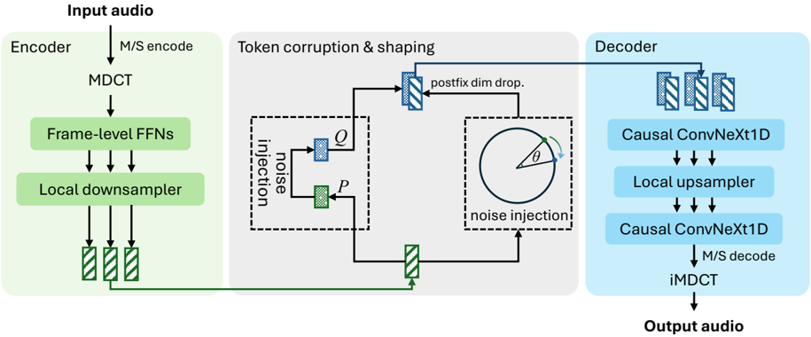

> [!abstract] arXiv · 2026 · Preprint
> **Yi Luo et al.** (ByteDance Seed) · [→ Paper](https://arxiv.org/abs/2607.29363) · Demo: ✗ · Code: ✗
>
> Co-designs a reconstruction-first continuous tokenizer (Locodec, 8 Hz, 768-dim spherical tokens shaped around a low-dimensional core manifold and an energy hierarchy) with a multi-path autoregressive flow-matching generator (MP-ELD) whose separately scaled guidance residuals curb drift in long-form TTS, all trained from scratch without SSL, ASR or text-LM components.

## Problem

Autoregressive (AR) speech generators face a three-way tension between token bandwidth, AR horizon length and model complexity. High-bandwidth tokens (deep RVQ, high-rate FSQ, continuous latents) reconstruct well but leave many degrees of freedom to predict, so small errors feed back and accumulate as drift in loudness, timbre, speaking rate or spectral quality. Low-bitrate tokens are easier to predict but discard detail. Current low-frame-rate continuous systems usually avoid very high-dimensional native tokens. They instead group short-range low-dimensional tokens and add local encoders and local prediction modules (local DiTs) inside the generator, or they borrow a "semantic" space from external SSL or ASR models. The paper asks whether a natively low-rate, high-dimensional continuous token can be made predictable enough for stable single-token AR generation without either crutch.

## Method

The work has two parts: a tokenizer whose latent geometry is shaped for predictability, and a generator structured to resist error accumulation.

**Locodec tokenizer.** Stereo or mono 24 kHz audio is converted to mid/side signals and then to MDCT coefficients (512-point window) with signed dynamic-range compression. A fully local encoder (6 frame-level SwiGLU FFN blocks, then a single linear layer that groups 11 MDCT frames) produces one token per group, about 8.5 Hz, with no cross-token mixing. Each token is normalized onto a 768-dimensional sphere. Three shaping mechanisms act on this token space during training:

- **Spherical rotation noise.** Tokens are rotated along a random tangent direction by an angle drawn from (π/2)·Beta(1,2), up to 90°. The decoder must reconstruct from the rotated token. This replaces a KL prior with a noise-defined bottleneck and trains angular robustness.
- **Low-dimensional core manifold.** A learnable row-orthogonal projection (via QR) maps each token to a d_core-dimensional sphere, and a column-orthogonal lift maps it back. A bidirectional cosine commitment loss aligns the native and lifted tokens. A second, down-weighted reconstruction path decodes from the lifted, strongly corrupted core token. The paper motivates this with a spherical-cap covering argument: dense interpolatability is impractical over a full high-dimensional sphere but feasible on a lower-dimensional one.
- **Postfix dimension dropout (PDD).** With probability 0.5 the token keeps only a random prefix of its dimensions. Combined with the fixed norm, this availability bias pushes energy into the prefix dimensions, giving an energy hierarchy the authors call identifiability.

The decoder is causal: ConvNeXt1D blocks on the token grid, linear upsampling, more ConvNeXt1D blocks on the MDCT grid, separate mid/side heads with a gated amplitude/sign output, and inverse MDCT. Training combines multi-resolution STFT magnitude losses on both reconstruction paths, LSGAN adversarial and feature-matching losses from MDCT-domain full-band and sub-band discriminators, and the commitment loss. The encoder has 59.5M parameters and the decoder 180.9M. Eight variants are trained: d_core in {768, 256, 64, 32, 16}, plus PDD variants for 64, 32 and 16.

**Spherical flow-matching head.** Next-token generation uses spherical flow matching (the spherical case of Riemannian flow matching), with geodesic interpolation from a Gaussian sample projected onto the sphere. The authors argue that full-velocity MSE causes "under-stepping": under directional uncertainty, the MSE-optimal speed shrinks by cos ψ. So the decoder predicts an endpoint that only defines a tangent direction, trained with a cosine direction loss. At inference the velocity norm is fixed to πR/2, the high-dimensional geodesic length, and integration uses the Riemannian exponential map (20 NFEs).

**MP-ELD generator.** The generator extends the encoder-LM-decoder (ELD) recipe of DiTAR-style AR flow models. It uses three conditioning paths, each fed by its own token encoder:

- **Local continuity (LC):** current token only.
- **Self-consistency (SC):** a 3-layer RoFormer over the token history.
- **Alignment consistency (AC):** a 12-layer RoFormer over phonemes plus token history, with a stop head.

The three vectors are Gram-Schmidt orthogonalized, normalized and summed. A 3-block FFN decoder with adaLN-Zero is trained on three path configurations (L, LS, LSA), with the LC anchor always present. At inference, multi-path residual CFG combines v^L + λ_sc(v^LS − v^L) + λ_ac(v^LSA − v^LS). The self-consistency weight ramps from 1 to λ_sc^max as τ^γ over bridge time. This avoids extrapolating from the unreliable local-only estimate early in the bridge. CFG runs only in the decoder, so the encoders and LMs run once per step. Prefix tokens are lightly corrupted during training to reduce exposure bias. The full model has 0.74B parameters, with no pretrained component and no post-training. Inference follows DiTAR's in-context formulation: (prompt phonemes, target phonemes, prompt audio), continued autoregressively.

## Key Results

**Reconstruction (Seed-TTS-eval, Table 2).** Adding the low-dimensional core does not hurt full-token reconstruction. Without PDD, all five d_core settings sit at ZH MCD 2.21 to 2.38, STOI 0.98, ViSQOL 4.64 to 4.68, WER 1.32 to 1.34% and SIM 0.74 to 0.742. PDD raises MCD by about 0.3 to 0.4 (for example 2.22 to 2.60 at d_core 32) but leaves STOI, ViSQOL, WER and SIM nearly unchanged (32/PDD: ZH WER 1.36%, SIM 0.737). No external codec is reconstructed on the same set, so Locodec's fidelity is not compared with other tokenizers.

**Representation hierarchy (Table 3, Figure 3).** PDD produces a log-linear energy decay across dimensions. Prefix subspaces form a coarse-to-fine hierarchy (ZH WER 60.6 to 62.9% from Prefix-16, 16.9 to 18.6% from Prefix-32, 3.9 to 4.1% from Prefix-64). The learned core beats the prefix of equal size: at d_core 64, Core gives ZH WER 2.47% versus 4.10% for Prefix-64. The 64-dim core recovers content (WER 2.47%) but not speaker identity (SIM 0.595 versus 0.736 for the full token).

**Predictability (Figure 5).** With a fixed MP-ELD setup, the direction-loss curves rank the tokenizers. The 768/no-core variant learns slowest and reaches the highest loss. A core of 256 helps, and 64/32/16 help further but saturate. PDD lowers the loss at every core size, and 32/PDD reaches the lowest final loss.

**Guidance behaviour (Figures 6 to 8).** With λ_sc = 1, raising λ_ac above 1 moves WER on the internal CFG-selection set from above 10% to about 2.6 to 2.9%. λ_sc mainly moves SIM. On the long-form set (about 52 s), constant self-consistency guidance (γ = 0) drifts. At (2.5, 1.5, 0), segment SIM falls from 0.742 to 0.402 and global WER is 31.42%. With γ = 1, the last-segment SIM is 0.679 and WER is 4.97%.

**Token configurations (Table 4).** Under the most aggressive guidance (CFG-S), PDD sharply improves long-form robustness. For 32/no-PDD versus 32/PDD, long-form WER drops from 20.80 to 9.73%, global SIM rises from 0.674 to 0.724, and fifth-segment SIM rises from 0.419 to 0.578. For 16/no-PDD versus 16/PDD, fifth-segment SIM rises from 0.273 to 0.601. Under the stable CFG-L setting, 32/PDD reaches long-form WER 4.61%, global SIM 0.731 and fifth-segment SIM 0.672. The authors call this the most balanced configuration, but no single variant wins every long-form column (16/PDD under CFG-M has WER 4.55%; 256/no-core under CFG-L ends at 0.680 segment SIM).

**Comparison with AR TTS systems (Seed-TTS-eval, Table 5).** MP-ELD 32/PDD has the lowest ZH WER in the table (0.95%, versus 0.96% for [[2606.07080|dots.tts]] and 0.97% for VoxCPM2), but this margin is within 0.02 points. On EN, the best MP-ELD WER is 1.75% (16/PDD), behind dots.tts (1.34%) and DiTAR (1.69%). Speaker similarity is clearly lower than in the strongest systems: ZH SIM is 0.687 to 0.695 against 0.753 (DiTAR), 0.795 (VoxCPM2) and 0.805 (dots.tts). EN SIM is 0.615 to 0.630 against 0.735 to 0.768. MP-ELD's SIM is above FireRedTTS and Spark-TTS. Each MP-ELD row uses the CFG setting picked as best for that variant on Table 4. Baseline numbers come from prior reports, and the baselines use different training data and pretrained components. Seed-TTS-eval utterances average only 4 to 5 s, so the authors note that this benchmark barely exposes AR error accumulation.

## Novelty Assessment

The main novelty is in latent-space shaping, not network structure. The encoder and decoder are deliberately plain FFN and ConvNeXt stacks. The new part is the combination of four mechanisms: rotation noise as a prior-free bottleneck on a spherical token space, an orthogonal low-dimensional core with a dual noisy reconstruction path, postfix dimension dropout that turns availability into an energy ordering, and the measurement of their effect on generator predictability and long-form stability. Each mechanism has antecedents: spherical latents, nested/matryoshka-style dropout, RVQ residual dropout and β-VAE-style bottlenecks. The controlled eight-way tokenizer ablation with a fixed generator makes the link from representation to predictability unusually explicit.

On the generator side, the ELD backbone and spherical flow matching are borrowed. Three ideas are new:

- The three-path information routing with Gram-Schmidt orthogonalized conditions.
- Residual CFG that separately scales a self-consistency and an alignment residual.
- The bridge-time ramp on self-consistency guidance, plus the direction-only, fixed-speed velocity parameterization.

The CFG sweeps support the claimed division of roles (λ_ac controls content, λ_sc controls speaker consistency). Evidence for the drift-reduction mechanism is mostly long-form segment SIM on one internal ZH set, with no comparison against single-path ELD or DiTAR on that set.

## Field Significance

Moderate — The paper shows that native 8 Hz, 768-dimensional continuous tokens are a workable single-token AR target if their geometry is shaped for predictability. It also gives controlled evidence that tokenizer reconstruction quality alone does not predict generator behaviour. Its speaker-similarity gap to strong AR systems and its internal-only training and long-form data keep it a methodological contribution rather than a new performance reference point.

## Claims

- **refines:** Reconstruction fidelity alone does not determine how well a continuous speech representation serves as an autoregressive generation target; latent geometry changes predictability at equal fidelity.
  > *Evidence:* Eight Locodec variants have nearly identical full-token reconstruction (ZH WER 1.32 to 1.37%, SIM 0.736 to 0.742). Yet with a fixed generator, their direction-loss curves differ clearly, and long-form fifth-segment SIM under aggressive guidance ranges from 0.273 to 0.601 depending on core size and dimension dropout. *(§5.2, Table 2; §5.3, Figure 5, Table 4)*
- **supports:** Constraining a high-dimensional continuous token space around a moderate lower-dimensional core, and ordering its coordinates by energy, makes next-token prediction easier without degrading full-token reconstruction.
  > *Evidence:* Adding a core of 256 or fewer dimensions lowers the generator's direction loss relative to the unconstrained 768-dim space, with gains saturating at 64/32/16. Postfix dimension dropout lowers it further at every core size. Full-token reconstruction metrics stay within normal variation, apart from an MCD rise of about 0.3 to 0.4 with dropout. *(§5.2, Table 2; §5.3, Figure 5)*
- **supports:** In autoregressive continuous-token TTS, drift that accumulates over long outputs is driven largely by how classifier-free guidance amplifies acoustic self-consistency cues, and separating content-alignment guidance from acoustic-consistency guidance reduces it.
  > *Evidence:* In MP-ELD's residual CFG, the alignment scale mainly moves WER and the self-consistency scale mainly moves SIM. Constant self-consistency extrapolation (γ = 0) at (2.5, 1.5) drops segment SIM from 0.742 to 0.402 over 50 s with 31.42% WER. Delaying it over bridge time (γ = 1) keeps the last segment at 0.679 with 4.97% WER. *(§4.2, §5.3, Figures 6 and 8)*
- **complicates:** Short-utterance benchmarks and utterance-level automatic metrics understate autoregressive error accumulation in speech generation.
  > *Evidence:* Seed-TTS-eval outputs average 4 to 5 s, versus about 52 s on the long-form set. Many configurations with similar Seed-TTS-eval WER diverge sharply in long-form behaviour. Two settings with near-equal global SIM (0.735 versus 0.736) end at 0.606 versus 0.671 last-segment SIM. Spectrograms with near-identical WER/SIM still differ in visible band-energy drift. *(§5.3, Figures 7 and 8, Table 4)*
- **complicates:** Very low frame-rate unified continuous tokens favour content intelligibility over speaker similarity in autoregressive TTS.
  > *Evidence:* At 8 Hz, MP-ELD matches or beats strong AR systems on ZH WER (0.95%). Its ZH SIM (0.687 to 0.695), however, trails DiTAR, VoxCPM2 and dots.tts (0.753 to 0.805; LM rates 6.25 to 10 Hz), and a 7.5 Hz semantic-acoustic factorized system reaches 0.744. A 64-dim core reconstructs content (WER 2.47%) but not speaker identity (SIM 0.595). *(§5.2, Table 3; §5.3, Table 5)*

## Limitations and Open Questions

> [!warning]
> All evaluation uses automatic metrics (WER, SIM, MCD, STOI, ViSQOL) with no listening test. The long-form and CFG-selection sets are internal and Chinese-only. Training data are internal, and no code or models are released. The paper itself argues that long-form quality needs perceptual listening, so its stability claims rest on segment-level SIM and qualitative spectrograms.

- Speaker similarity is well below the strongest AR systems on Seed-TTS-eval. The authors attribute this partly to the low frame rate and partly to a domain mismatch between their real-world training data and the curated benchmark, but they test neither explanation directly.
- CFG settings are tuned per tokenizer variant, and the best setting depends on output length (stronger self-consistency guidance suits short outputs, alignment-dominant guidance suits long ones). The paper proposes, but does not implement, guidance schedules that also vary with AR generation time.
- There is no ablation of MP-ELD against a standard single-path ELD or a product-structured baseline under the same tokenizer and data. The drift reduction is shown through guidance-schedule and tokenizer comparisons, not through the multi-path design itself.
- The tokenizer and decoder are causal and the paper frames the work as streaming generation, but it reports no latency or chunked-streaming measurements.
- Locodec is formulated for stereo and general audio, but experiments cover only 24 kHz speech. Its reconstruction is not compared against other codecs on the same data.
- Long-form tests stop at about one minute. Hour-scale, multi-speaker and podcast-style generation remain untested.

## Wiki Connections

- [[autoregressive-codec-tts|Autoregressive Codec TTS]] — MP-ELD autoregressively generates tokens from the paper's own continuous codec (Locodec), one 768-dim token per 8 Hz step, and benchmarks against AR codec TTS systems.
- [[flow-matching|Flow Matching]] — Each next token is generated by a spherical (Riemannian) flow-matching head with a direction-only loss, fixed-speed velocity and multi-path residual guidance.
- [[neural-codec|Neural Audio Codec]] — Locodec is a reconstruction-first MDCT-domain continuous codec whose latent geometry (spherical noise, low-dimensional core, postfix dimension dropout) is shaped for downstream predictability.
- [[multilingual-tts|Multilingual TTS]] — Both the tokenizer and the generator are trained on bilingual Chinese/English data and evaluated on the ZH and EN subsets of Seed-TTS-eval.
- [[2502.03930|DiTAR]] — MP-ELD extends DiTAR's encoder-LM-decoder AR flow recipe and follows its in-context inference format and WER/SIM evaluation protocol; DiTAR is also a baseline with higher SIM.
- [[2606.06928|VoxCPM2]] — A product-structured AR baseline (25 Hz tokens, 6.25 Hz LM rate) with clearly higher SIM and comparable ZH WER.
- [[2508.19205|VibeVoice]] — A 7.5 Hz semantic-acoustic baseline whose stronger SIM the authors take as evidence that tokenizer factorization, not frame rate alone, limits Locodec's speaker similarity.
- [[2412.10117|CosyVoice 2]] — An AR TTS baseline on Seed-TTS-eval with higher SIM and higher WER than MP-ELD.
- [[2505.17589|CosyVoice 3]] — An AR TTS baseline (1.5B) with higher SIM on both subsets and a ZH WER 0.17 points above MP-ELD's best.
- [[2509.02020|FireRedTTS-2]] — A 12.5 Hz AR baseline with higher SIM and slightly higher ZH WER.
- [[2503.01710|Spark-TTS]] — A 50 Hz AR baseline that MP-ELD exceeds on SIM.
- [[2406.02430|Seed-TTS]] — Provides the Seed-TTS-eval test sets used for both reconstruction and generation.
