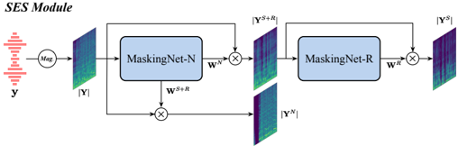

> [!abstract] arXiv · 2026 · Preprint
> **Lu et al.** (University of Science and Technology of China / National Institute of Informatics) · [→ Paper](https://arxiv.org/abs/2608.03011) · Demo: ✓ · Code: ?
>
> Extends the DAIEN-TTS environment-aware zero-shot TTS system so that it separates and re-injects background noise and room reverberation as distinct conditions, controls each with its own guidance scale, and fine-tunes on in-the-wild recordings to close the simulated-to-real gap.

## Problem

Zero-shot TTS systems either discard the acoustic environment of the speaker prompt (speaker-embedding methods) or copy it entangled with the voice (in-context-learning methods such as F5-TTS). Neither lets a user take the voice from one recording and the acoustic scene from another. Prior environment-aware systems handle only time-invariant acoustics such as reverberation, offer only a keep-or-remove choice for background sound, or come from text-to-audio work without zero-shot speaker cloning.

This paper is the authors' extended journal version of [[2509.14684|DAIEN-TTS]] (ICASSP 2026). The paper names two gaps in that conference system: it modelled background noise only, with no reverberation, and it was trained only on simulated data, which leaves a domain gap on real recordings.

## Method

The system keeps the DAIEN-TTS design: F5-TTS-style text-guided mel-spectrogram infilling with a Diffusion Transformer (DiT) trained under conditional flow matching, plus a speech-environment separation (SES) module and a cross-attention layer in each DiT block for the environment condition. The paper extends it in five ways.

1. **Two-stage SES.** A Transformer masking network (MaskingNet-N) splits the input magnitude spectrogram into reverberant speech and noise. A second network (MaskingNet-R) then predicts a reverberation mask that recovers clean speech. Each network has an input convolution, 8 Transformer blocks (16 heads, 1024-dim embedding, 2048-dim FFN) and output convolutions. The SES module is pretrained alone with magnitude and log-mel reconstruction losses on all three components.
2. **Utterance-level reverberation embedding.** Reverberation is not recovered as a signal. The reverberation mask serves as an implicit room descriptor and an ECAPA-TDNN encoder turns it into an utterance-level embedding. That embedding is repeated over frames and added to the frame-level noise mel-spectrogram, and the sum goes to the DiT through cross-attention. The clean-speech condition is concatenated with the text embedding and the noisy input, as in F5-TTS.

3. **Cross-speaker conditioning.** During pretraining on simulated mixtures (LibriTTS speech, DNS-Challenge noise and RIRs, SNR from -5 to 15 dB, noise and RIR each applied with probability 0.5), the reverberation condition comes from a *different* speaker's utterance convolved with the same RIR. This keeps the target speaker's identity out of the environment branch. Speech and noise conditions get independent random span masks (70 to 100% of frames), so prompts of different lengths work at inference.
4. **Real-world fine-tuning.** After 600k pretraining steps, the SES and TTS modules are joined and fine-tuned for 50k steps on TITW-Hard (184.57 hours of in-the-wild English speech derived from VoxCeleb1, upsampled from 16 kHz to 24 kHz). The SES output provides all conditions, and the model reconstructs the same recording. The SES module, text encoder and ECAPA-TDNN reverberation encoder are frozen. The paper freezes the reverberation encoder because cross-speaker conditioning needs known RIRs, which real data lacks.

![Fig. 2. Overview of the two-stage training of the extended DAIEN-TTS, with the detailed DiT block structure shown in the middle. (a) Pretraining on simulated data: the noisy target x1 is constructed from the clean speech s of the target speaker, a selected noise n, and RIR h, while the reverberation condition is extracted from the speech s′ of a different speaker convolved with the same h. (b) Fine-tuning on real-world data: neither n nor h is available; instead, the SES module separates the speech and noise components from real environmental recordings to provide the conditions. Snowflake and flame icons denote frozen and trainable modules, respectively.](assets/2608.03011/figure-2.png)

5. **Triple classifier-free guidance (TCFG).** The conference version's dual guidance becomes three terms, for the speech-plus-text, noise and reverberation conditions, each with its own scale (defaults 1, 3 and 6). Each condition is dropped with probability 0.3 during training. An SNR adaptation step, also used in the conference version, rescales the separated noise magnitude so the output's SNR matches the environment prompt.

A Vocos vocoder trained on noise- and RIR-augmented speech turns mel-spectrograms into 24 kHz waveforms. Inference uses 32 ODE function evaluations. Model size is not reported. Training used 4 NVIDIA A100 80G GPUs.

## Key Results

All systems share the same LibriTTS pretraining data and Vocos vocoder. They are F5-TTS retrained on LibriTTS, DAIEN-TTS-N (the noise-only conference system), DAIEN-TTS-NR (noise and reverberation, simulated data only) and DAIEN-TTS-FT (NR fine-tuned on TITW-Hard). Speaker similarity is SECS from a WavLM-large speaker-verification model (reported here as SPK-SIM). Speaker-similarity MOS (SSMOS) is reported here as SMOS. Environment fidelity uses CLAP similarity, FAD (VGGish) and an environment similarity MOS (ESMOS). Listening tests used more than 30 native English raters on Amazon Mechanical Turk.

**Clean output from a degraded prompt (Table I).** With a silence environment prompt and a simulated noisy-reverberant speaker prompt, DAIEN-TTS-NR gives the best TTS result on every metric: WER 2.24% (F5-TTS 2.80, DAIEN-TTS-N 2.75), SECS 0.486 (0.317, 0.380), MOS 3.91 (3.75, 3.77) and SSMOS 3.37 (3.19, 3.30). Its MOS is close to ground truth (3.95). With clean speaker prompts, all systems score within overlapping confidence intervals on MOS and SSMOS. The DAIEN-TTS variants have slightly lower WER and higher SECS than F5-TTS there.

**Environment reproduction, simulated prompts (Table II).** DAIEN-TTS-NR reaches CLAP 0.770 and FAD 2.11. DAIEN-TTS-N reaches 0.743 and 5.73, and F5-TTS reaches 0.685 and 8.56. DAIEN-TTS-NR has the highest TTS-system scores for SECS (0.361), MOS (3.38), SSMOS (3.53) and ESMOS (3.55, against 3.59 for ground truth). F5-TTS has the lowest WER (2.80%), but only because it does not reproduce the target environment. Ground-truth environmental speech itself scores 15.41% WER, so higher WER in environment-aware output partly reflects the intended noise.

**Environment reproduction, real-world prompts (Table II).** Fine-tuning moves DAIEN-TTS-NR to DAIEN-TTS-FT as follows: FAD 5.33 → 3.62, CLAP 0.612 → 0.634, SECS 0.457 → 0.486, ESMOS 3.58 → 3.62, SSMOS 3.74 → 3.84 and MOS 3.34 → 3.38. DAIEN-TTS-FT has the best CLAP, FAD and ESMOS of all four systems. Its SECS (0.486) and SSMOS (3.84) are only just above F5-TTS (0.481 and 3.82, inside the SSMOS confidence intervals). Two of the text's statements do not match Table II. The text says fine-tuning improved "all metrics", but WER rose from 10.05% to 10.65%. The text also calls DAIEN-TTS-FT best on subjective scores, but F5-TTS has the higher MOS (3.40 vs. 3.38). On this real-world set, adding reverberation modelling (NR) gives no clear environment-fidelity gain over noise-only N (CLAP 0.612 vs. 0.618, FAD 5.33 vs. 4.92). The authors attribute this to TITW environments being mostly noise.

**Noise-only and reverb-only prompts (Table III).** With noise-only prompts, N and NR are close (CLAP 0.735 vs. 0.716, FAD 1.54 vs. 1.25). With reverb-only prompts, NR is much better than N: FAD 2.86 vs. 5.06, SECS 0.400 vs. 0.317, WER 13.53 vs. 17.56.

**Guidance control (Table V).** Raising the reverberation scale from 0 to 9 lowers FAD from 10.38 to 1.48, while CLAP stays between 0.758 and 0.770 from scale 3 upward. The noise scale changes FAD only from 2.36 to 2.90 between scales 0 and 6, while CLAP peaks at the default of 3. Both scales cost intelligibility. WER goes from 13.05% to 31.53% and 63.83% as the noise scale rises from 3 to 6 and 9, and from 5.87% to 25.64% as the reverberation scale rises from 0 to 9. Table IV supports the paper's view that the two objective metrics measure different things: between clean and reverb-only ground truth, FAD to the environment prompt falls from 17.05 to 2.78, while CLAP rises only from 0.540 to 0.729.

## Novelty Assessment

Compared with [[2509.14684|DAIEN-TTS]], the new parts are concrete. They are the cascaded noise-then-reverberation SES, the use of a reverberation mask encoded by ECAPA-TDNN as an utterance-level room embedding, the cross-speaker conditioning trick against speaker leakage, the extension of dual to triple guidance, and the simulated-pretrain then real-fine-tune schedule. The base generator, cross-attention environment injection, SNR adaptation and ESMOS test come from the conference version.

Each addition is a modest step. Mask-based dereverberation and per-condition classifier-free guidance are known techniques. The paper's value is in assembling them into a three-factor (speech, noise, reverberation) disentangle-and-recombine pipeline and testing it on real in-the-wild prompts. The evaluation adds CLAP and FAD as objective environment metrics, analyses what each one captures, and reports a guidance-scale sweep.

The comparison set is the authors' own systems plus F5-TTS. Other environment-aware systems that the paper discusses (VoiceLDM, VoiceDiT, controllable masked speech prediction, and the authors' own earlier incremental-disentanglement system) are not run. The paper does not separately ablate the cross-speaker conditioning strategy.

## Field Significance

Moderate — This paper extends environment-aware zero-shot TTS from noise-only control to separate noise and reverberation control, and it tests the approach on real in-the-wild prompts rather than only on simulated mixtures. It shows that an explicit reverberation branch matters most when the prompt is reverberant. It also shows that fine-tuning on in-the-wild data mainly improves environment fidelity. The evidence comes from the authors' own system variants and one general zero-shot baseline.

## Claims

- **supports:** Zero-shot TTS that is robust to degraded prompts needs reverberation modelled explicitly, not just additive noise.
  > *Evidence:* With noisy-reverberant speaker prompts and a silence environment prompt, the noise-plus-reverberation system reaches WER 2.24% and SECS 0.486, against 2.75% and 0.380 for the noise-only variant. With reverb-only environment prompts, FAD is 2.86 against 5.06. *(§V-A, Table I; §V-C, Table III)*
- **supports:** Separate classifier-free guidance scales for distinct acoustic-environment factors give largely independent control over each factor in a flow-matching TTS model.
  > *Evidence:* Raising the reverberation scale from 0 to 9 lowers FAD from 10.38 to 1.48 while CLAP stays at 0.758 to 0.770 from scale 3 upward. Raising the noise scale from 0 to 6 changes FAD only from 2.36 to 2.90. *(§V-C, Table V)*
- **complicates:** Stronger environment guidance trades intelligibility for environment fidelity in environment-aware TTS.
  > *Evidence:* WER rises from 13.05% to 31.53% and 63.83% as the noise guidance scale goes from 3 to 6 and 9. It rises from 5.87% to 25.64% as the reverberation scale goes from 0 to 9. *(§V-C, Table V)*
- **refines:** Fine-tuning on in-the-wild recordings after simulated-mixture pretraining mainly improves environment reproduction, not intelligibility.
  > *Evidence:* On TITW-Hard prompts, fine-tuning lowers FAD from 5.33 to 3.62 and raises CLAP from 0.612 to 0.634 and SECS from 0.457 to 0.486, while WER rises slightly from 10.05% to 10.65%. *(§V-B, Table II)*
- **complicates:** ASR word error rate is a confounded intelligibility measure when the target output is meant to contain background noise and reverberation.
  > *Evidence:* Ground-truth environmental speech scores 15.41% WER against 2.14% for clean ground truth. F5-TTS gets the lowest WER (2.80%) only because it does not reproduce the target environment (FAD 8.56). *(§V-B, Table I, Table II)*

## Limitations and Open Questions

> [!warning]
> The only external baseline is F5-TTS, which has no environment conditioning. Environment-aware systems that the paper discusses (VoiceLDM, VoiceDiT, controllable masked speech prediction) are not evaluated, so how well the system performs against other environment-aware methods is unknown.

- The text overstates the real-world results: fine-tuning raises WER (10.05% to 10.65%), and F5-TTS has a higher MOS than DAIEN-TTS-FT (3.40 vs. 3.38).
- Reverberation modelling helps on simulated reverberant prompts but shows no clear benefit on the noise-dominated TITW set. Its value on real reverberant recordings is untested.
- The cross-speaker conditioning strategy is motivated but not ablated.
- The real-world WER is affected by ASR-derived prompt transcripts, and real-world SSMOS uses the original noisy prompt as reference.
- The objective environment metrics (CLAP, FAD) are not correlated against ESMOS, so their agreement with listeners is not shown.
- Model size, inference speed and code release are not reported. The evaluation is English-only.

## Wiki Connections

- [[flow-matching|Flow Matching]] — The generator is an F5-TTS-style DiT trained with conditional flow matching, extended with cross-attention environment conditioning and triple classifier-free guidance.
- [[zero-shot-tts|Zero-Shot TTS]] — Evaluated on prompt-based cloning of unseen speakers (Seed-TTS test-en, TITW test), with the voice and the acoustic environment taken from separate prompts.
- [[disentanglement|Disentanglement]] — A separation module trained with reconstruction losses splits speech, noise and reverberation, and cross-speaker conditioning keeps speaker identity out of the reverberation branch. Noise-only and noise-plus-reverberation variants are compared directly.
- [[subjective-evaluation|Subjective Evaluation]] — MOS, speaker-similarity MOS and environment-similarity MOS tests with more than 30 crowd-sourced native English raters, reported with 95% confidence intervals.
- [[2509.14684|DAIEN-TTS]] — The ICASSP 2026 conference version that this paper extends. It is retrained here as the noise-only DAIEN-TTS-N baseline.
- [[2025.acl-long.313|F5-TTS]] — The base framework and the main baseline, retrained on LibriTTS, which shows the prompt-environment sensitivity of in-context-learning TTS.
- [[interspeech-2025-2536|TITW]] — Its TITW-Hard subset is the real-world fine-tuning data and the source of the real-world test prompts.
- [[2406.02430|Seed-TTS]] — Its test-en set, augmented with noise and RIRs, forms the simulated evaluation set.
- [[2005.07143|ECAPA-TDNN]] — Used as the encoder that turns the reverberation mask into an utterance-level room embedding.
- [[2306.00814|Vocos]] — The vocoder, retrained on noise- and RIR-augmented speech, shared by all compared systems.
- [[interspeech-2025-0319|Discrete Acoustic Token Denoising]] — The authors' earlier work on noise-robust LLM-based zero-shot TTS, cited for degraded output under noisy prompts.
- [[2212.04356|Whisper]] — Whisper-large-v3 provides the WER evaluation.
