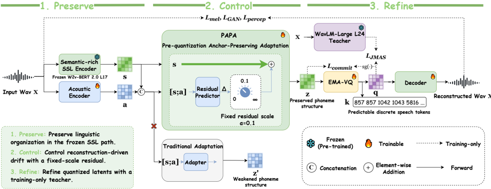

> [!abstract] arXiv · 2026 · Preprint
> **Wan et al.** (Peking University / Tencent) · [→ Paper](https://arxiv.org/abs/2608.08286) · Demo: ? · Code: ✗
>
> A matched probe over 24 codec and SSL representations shows that phoneme structure at the quantizer input tracks how easily an autoregressive model predicts the resulting tokens. ReLMCodec uses this finding to build a 650/800 bps single-codebook codec around a frozen SSL anchor. It improves both token predictability and reconstruction over rate-matched baselines, and the gains carry into downstream TTS.

## Problem

Single-codebook speech codecs put the semantic-acoustic trade-off into one bottleneck. Reconstruction-driven training spends codebook capacity on speaker, prosodic and local acoustic variation. Directly quantized SSL features keep cleaner linguistic organization but lack reconstruction detail. As a result, tokens that reconstruct waveforms well are not necessarily tokens that an autoregressive LM predicts easily. Earlier LM-oriented codecs add semantic or SSL information, but they leave open which property of these representations makes tokens predictable, and whether that property survives reconstruction training.

## Method

**Diagnostic probe.** The paper first isolates the quantizer input from quantizer design. For each of 24 frozen codec, tokenizer and SSL representations (all native 50 Hz), it bypasses the native quantizer, standardizes the features, and trains the same probing VQ (P-VQ): a single 8,192-entry codebook of 8-dimensional codewords with EMA updates, trained for 200K steps on a feature-reconstruction plus commitment objective, with no waveform decoder. A separate Qwen2-1.5B model is then trained on each representation's P-VQ token sequences with an identical recipe (LibriSpeech train-960, 3 epochs). Its top-1 next-token accuracy and perplexity are reported as Probe-ACC (P-ACC) and Probe-PPL (P-PPL). Phoneme structure is measured on MFA-aligned, phoneme-balanced frames with KNN phoneme accuracy (k = 10, after 50-dimensional PCA), plus Silhouette, Davies-Bouldin and V-measure.

**Codec ("preserve-control-refine").** ReLMCodec turns the diagnosis into an architecture with three parts:

- *Preserve.* Frozen W2v-BERT 2.0 layer-17 features (1024-d, 50 Hz) form the main path into the quantizer.
- *Control.* Pre-quantization Anchor-Preserving Adaptation (PAPA) concatenates the SSL features with the output of a trainable acoustic encoder. A 12-layer residual predictor maps this 2048-d input to a correction Δ, and the quantizer input is z = s + αΔ with a fixed α = 0.1. A direct adapter (z = R([s; a])) can overwrite the SSL geometry. PAPA instead keeps the frozen feature as an explicit coefficient-one anchor. It uses the same parameter count, so it changes the parameterization, not the capacity.
- *Refine.* A training-only WavLM-Large layer-24 teacher regularizes the quantized latent through a JMAS loss adapted from [[2604.12383|JMAS-VAE]]. The loss combines a frame-level cosine hinge term with a pairwise-similarity structure term (margins 0.5 and 0.25, at most 256 sampled frames). It is applied to the straight-through codebook embedding rather than to the token IDs.

The quantizer is a single-layer EMA-VQ with 8-dimensional factorized, ℓ2-normalized codes, code expiration and a cross-batch feature pool. It uses 8,192 codes (650 bps) or 65,536 codes (800 bps) at 50 tokens/s. A 12-layer Vocos backbone with an ISTFT head decodes the waveform. Training uses mel, commitment, JMAS and GAN losses, with a multi-period discriminator and a multi-scale STFT discriminator. The GAN loss is warmed up over 50K steps. Each variant trains for 200K steps, then continues for another 200K steps with a perceptual loss from a frozen WavLM speaker-verification model. Both WavLM networks are dropped at inference. The inference model has 782.74M parameters and uses 61.74 GFLOPs per second of audio (Appendix Table A6). All codec, probe and TTS models are trained on LibriSpeech train-960 only.

## Key Results

**Phoneme structure tracks predictability.** Across the 24 representations, KNN phoneme accuracy has a Spearman ρ of 0.911 with P-ACC and −0.901 with P-PPL (95% bootstrap CIs [0.76, 0.98] and [−0.98, −0.73]). V-measure (0.852 / −0.857) and Davies-Bouldin (−0.837 / 0.848) follow the same pattern. Silhouette is weaker (0.715 / −0.713) (Table 1). SSL layers dominate the probe. WavLM-Large L24 reaches 34.27% P-ACC and 11.33 P-PPL, the highest P-ACC of all 24 rows. Most reconstruction codecs sit at 2-7% P-ACC; for example, X-Codec2 reaches 5.12% and FocalCodec 2.51% (Appendix Table A3). Layer-wise KNN is non-monotonic: HuBERT peaks in the middle layers and Whisper drops sharply in its last layers (Figure 2).

**Reconstruction (Table 2, LibriSpeech test-clean/test-other).**

- *650 bps.* ReLMCodec@8K beats FocalCodec on WER (4.16 vs 5.01), Log-Mel (1.370 vs 1.776), PESQ (2.17 vs 1.40), STOI (0.900 vs 0.848) and UTMOS (4.03 vs 3.86), and ties it on SIM (0.749). It is also ahead of SemantiCodec on every metric.
- *800 bps.* ReLMCodec@64K improves WER/SIM/PESQ over [[2502.04128|X-Codec2]] (800 bps, 64K codes) from 5.53/0.801/2.13 to 3.96/0.804/2.40. Its P-ACC rises from 5.12% to 9.65%.
- *All codecs.* ReLMCodec@64K has the best value among all 15 codec rows on all six metrics, including the 1000-1100 bps multi-codebook baselines (XY-Tokenizer, Mimi, Qwen3-TTS-Tokenizer). Some margins are very small: SIM 0.804 vs 0.803 for [[2509.21968|AUV]], PESQ 2.40 vs 2.38 for [[2025.acl-long.937|UniCodec]], and UTMOS 4.07 vs 4.06 for [[2411.19842|Stable Codec]].

Baselines are released checkpoints trained on their own data. ReLMCodec is trained and tested on LibriSpeech, so the comparison favors it in-domain. In an appendix human MOS test (H-MOS, Figure A5) against Stable Codec and X-Codec2, ReLMCodec@64K has the highest mean. The paper reports no numeric scores, rater count or test protocol for it.

**Ablations (Tables 3-5, 8K).**

- *Role assignment.* With W2v-BERT L17 as the main path, switching the teacher from W2v-BERT to WavLM-L24 raises P-ACC from 9.31% to 9.63% and lowers WER from 4.65 to 4.16. Using WavLM-L24 as the main path gives much higher P-ACC (28.59%) but worse WER (5.58) and PESQ (1.74).
- *SSL only (A0).* This variant has the highest P-ACC in Table 4 (12.45%) but poor reconstruction (WER 8.31, SIM .613).
- *Direct adaptation (C0).* Adding the acoustic path through a direct adapter gives the highest SIM (.783) and PESQ (2.35) in the combined group but drops P-ACC to 3.15%. Its KNN retention relative to the SSL anchor is 40.62%, with a CKA of 0.61.
- *PAPA.* PAPA (C1) restores P-ACC to 8.16% and KNN retention to 98.02% (CKA 0.95), with a residual-to-anchor norm ratio of 0.19.
- *PAPA + JMAS (C3).* The full model reaches 9.63% P-ACC and 4.16 WER. Compared with C1, it gives up some SIM (.780 to .749) and PESQ (2.28 to 2.17).
- *Residual scale α.* Between α = 0.1 and 5, PESQ moves by at most 0.02, while P-ACC falls to 6.76% at α = 5. At α = 0.01, P-ACC rises to 11.43% but WER degrades to 5.78 (Appendix D).

**Downstream TTS (Table 6).** Every tokenizer is plugged into the same [[2504.12867|EmoVoice]] LLM-based TTS framework, trained on LibriSpeech train-960, and evaluated on the [[2025.acl-long.313|F5-TTS]] LibriSpeech subset.

- ReLMCodec C3 (8K) has the lowest WER of all tokenizers: 4.30, against 6.82 for FocalCodec, 9.49 for X-Codec2 and 23.10 for WavTokenizer.
- At matched 64K codes and 50 Hz, ReLMCodec@64K improves on X-Codec2 in WER/SIM/UTMOS, from 9.49/.43/4.15 to 4.93/.48/4.25.
- SIM .48 is shared by C1 and @64K. UTMOS 4.25 is shared by C3 and @64K.
- The larger codebook improves reconstruction (Table 2) and TTS SIM (.45 to .48), but downstream WER rises from 4.30 to 4.93.

## Novelty Assessment

Two parts are new. The first is the matched diagnostic: a fixed probe quantizer and a fixed LM separate the quantizer-input representation from native quantizer capacity. The paper uses it to show that phoneme separability predicts LM difficulty across 24 representations. The result is correlational, as the authors state, but its breadth makes it useful evidence for codec design. The second is PAPA. Writing the quantizer input as frozen SSL feature plus a scaled residual is a simple parameterization change, not a new module. Still, the matched-capacity ablation shows that it moves KNN retention from about 41% to 98% and raises P-ACC by 5 points.

The other components are known techniques. SSL-feature fusion into codecs (as in [[2502.04128|X-Codec2]]), teacher distillation of codec latents (as in [[2308.16692|SpeechTokenizer]]), the JMAS loss (taken from [[2604.12383|JMAS-VAE]]), EMA-VQ with code expiration, and the Vocos decoder all predate this paper. The downstream TTS evidence comes from one LibriSpeech-only setup. The headline reconstruction comparison sets an in-domain model against released out-of-domain checkpoints.

## Field Significance

Moderate — The paper gives a measurable target for LM-oriented codec design: phoneme separability at the quantizer input, which can be checked before training a downstream LM. It also shows a cheap way to keep that structure while adding acoustic detail. The evidence is limited to 50 Hz English LibriSpeech.

## Claims

- **supports:** Phoneme separability of the continuous representation entering a quantizer predicts how easily an autoregressive language model can model the resulting discrete tokens.
  > *Evidence:* Across 24 frozen codec and SSL representations, each discretized by the same 8K probe VQ and modeled by the same Qwen2-1.5B recipe, KNN phoneme accuracy correlates with next-token accuracy at Spearman ρ = 0.911 and with perplexity at ρ = −0.901, with permutation p < 0.001. *(§Correlation with Token Modeling Difficulty, Table 1; Appendix Table A3)*
- **complicates:** Strong linguistic structure in speech tokens does not by itself give good waveform reconstruction, so token predictability and reconstruction fidelity pull in different directions within a single codebook.
  > *Evidence:* The SSL-only variant (A0) has the highest P-ACC in the ablation (12.45%) but WER 8.31 and SIM .613. Using WavLM-L24 as the main path gives 28.59% P-ACC but the worst PESQ (1.74) in the role ablation. Adding an acoustic path through direct adaptation (C0) gives SIM .783 and PESQ 2.35 but only 3.15% P-ACC. *(§Disentangling Preservation, Adaptation, and Refinement, Tables 3-4)*
- **supports:** Fusing acoustic detail into SSL features as a scaled residual on a frozen anchor keeps SSL phoneme structure and token predictability better than an unconstrained adapter of the same capacity.
  > *Evidence:* Direct adaptation keeps 40.62% of the SSL anchor's KNN accuracy (CKA 0.61). PAPA keeps 98.02% (CKA 0.95), raising P-ACC from 3.15% to 8.16% and lowering WER from 4.65 to 4.33. Adding JMAS raises retention to 99.55% and P-ACC to 9.63%. *(§Disentangling Preservation, Adaptation, and Refinement, Tables 4-5)*
- **complicates:** A larger codebook can improve codec reconstruction and speaker similarity while making downstream autoregressive TTS less intelligible.
  > *Evidence:* With architecture and 50 Hz rate fixed, going from 8K to 64K codes improves reconstruction WER (4.16 to 3.96) and PESQ (2.17 to 2.40). In EmoVoice-based TTS, SIM rises from .45 to .48 but WER rises from 4.30 to 4.93, with UTMOS unchanged at 4.25. *(§Downstream TTS, Tables 2 and 6)*
- **refines:** Teacher distillation of a codec's quantized latents trades some speaker similarity and signal fidelity for token predictability and downstream intelligibility.
  > *Evidence:* Adding the WavLM-L24 JMAS loss to PAPA (C1 to C3) raises P-ACC from 8.16% to 9.63% and lowers reconstruction WER from 4.33 to 4.16. It lowers SIM from .780 to .749 and PESQ from 2.28 to 2.17. Downstream TTS WER falls from 5.54 to 4.30 while SIM falls from .48 to .45. *(§Disentangling Preservation, Adaptation, and Refinement, Table 4; §Downstream TTS, Table 6)*

## Limitations and Open Questions

- **Single domain.** All analysis, codec training and TTS training use 50 Hz English LibriSpeech. The authors list multilingual, noisy and other-rate settings as future work.
- **Uneven baseline comparison.** Baseline codecs are released checkpoints trained on different data, while ReLMCodec is trained and tested on LibriSpeech. Some of the reconstruction advantage may be in-domain fit.
- **Correlation, not cause.** The predictability analysis is correlational, as the authors state. P-ACC is measured on probe-VQ tokens, not on each codec's native tokens. Native-token accuracy (N-ACC) is reported only for two ReLMCodec quantizer variants and is not comparable to P-ACC.
- **Limited teacher study.** Teacher selection compares only W2v-BERT 2.0 L17 and WavLM-Large L24, so robustness to other teachers is untested.
- **Thin human evaluation.** The H-MOS test is reported only as a box plot over four systems and ground truth, with no rater count, no protocol and no numeric scores.
- **Small downstream test.** Downstream TTS uses one framework (EmoVoice) trained on 960 hours of LibriSpeech. It is unclear how the 8K/64K trade-off and the C3 advantage scale to larger TTS training sets.
- **Size and cost.** The frozen W2v-BERT 2.0 encoder stays in the inference path. The model has about 783M parameters, and end-to-end RTF matches X-Codec2 at 8K and is slightly slower at 64K.
- **No code yet.** Checkpoints and code are promised on acceptance.

## Wiki Connections

- [[neural-codec|Neural Audio Codec]] — Proposes a 650/800 bps single-codebook speech codec built around a frozen SSL anchor, plus a matched probe for comparing quantizer-input representations.
- [[self-supervised-speech|Self-Supervised Speech]] — Frozen W2v-BERT 2.0 features form the codec's main path and a WavLM-Large teacher shapes the quantized latent; layer-wise KNN profiles of HuBERT, WavLM and W2v-BERT guide the role assignment.
- [[autoregressive-codec-tts|Autoregressive Codec TTS]] — Tests codec tokens by token-LM predictability and in an LLM-based TTS model, showing that reconstruction quality and AR predictability can diverge.
- [[subjective-evaluation|Subjective Evaluation]] — Includes a human MOS test on reconstructed speech, reported only as a distribution plot without protocol details.
- [[2502.04128|Llasa (X-Codec2)]] — X-Codec2 is the rate- and capacity-matched baseline (800 bps, 64K codes) that ReLMCodec@64K beats on reconstruction, probe predictability and downstream TTS.
- [[neurips-2025-7Z3wQSu3mH|FocalCodec]] — The 650 bps single-codebook baseline that ReLMCodec@8K beats on every reconstruction metric except SIM, where they tie.
- [[2504.12867|EmoVoice]] — Shared LLM-based TTS framework used to train and compare downstream TTS on every tokenizer.
- [[2025.acl-long.313|F5-TTS]] — Source of the LibriSpeech evaluation subset used for downstream TTS.
- [[2604.12383|JMAS-VAE]] — Source of the joint-marginal alignment loss that ReLMCodec adapts as its post-quantization teacher regularizer.
- [[2509.21968|AUV]] — Single-codebook baseline in reconstruction, the probe study and downstream TTS.
- [[2308.16692|SpeechTokenizer]] — Teacher-distilled tokenizer included as a reconstruction baseline and as one of the 24 probe representations, where it has strong phoneme separability.
- [[2408.16532|WavTokenizer]] — 75 Hz single-codebook baseline with the weakest downstream TTS intelligibility (WER 23.10) in Table 6.
