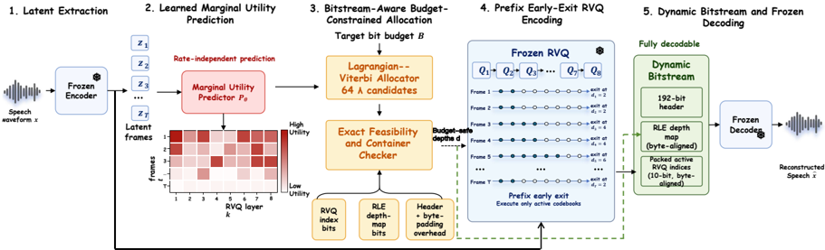

> [!abstract] arXiv · 2026 · Preprint
> **Mingyu Zhao et al.** (Tsinghua University / Tencent / Central Conservatory of Music) · [→ Paper](https://arxiv.org/abs/2608.08432) · Demo: ? · Code: ?
>
> Adds variable, frame-wise RVQ depth to a frozen pretrained speech codec after the fact: a small predictor estimates how much each extra codebook would reduce latent distortion in each frame, and an allocator spends a fixed bit budget where it helps most while guaranteeing the serialized file is no larger than the fixed-depth stream.

## Problem

Neural speech codecs built on residual vector quantization (RVQ) usually apply the same number of codebooks to every frame, so easy frames (silence, steady vowels) receive as many bits as hard ones. Earlier variable-rate approaches, such as VRVQ, learn the variable depth jointly with the codec, which means retraining it. Other adaptive schemes change the frame rate or the code search instead of the depth. The authors identify two gaps: no method assigns RVQ depth frame by frame to a codec that is already trained and kept frozen, and variable-rate schemes typically report a nominal average depth rather than the real size of the encoded stream, which also has to store the per-frame depth map, a header and byte padding.

## Method

BAMU (Bitstream-Aware Marginal-Utility allocation) leaves the codec's encoder, RVQ codebooks and decoder unchanged and adds two components around them.

**Marginal-utility predictor.** For every frame and RVQ layer, the target is the drop in channel-normalized latent residual energy contributed by that layer (its "marginal utility"), clipped at zero and log-compressed. A small non-causal network (three temporal Conv1d blocks, kernel sizes 5/3/3, hidden widths 128/128/64, GELU and GroupNorm, then a 1×1 output layer) reads the frozen encoder's latents and regresses all frame-by-layer utilities with a masked Smooth-L1 loss. The prediction does not depend on the target bitrate, so one predictor serves every operating rate. Predictors have 157,128 parameters for EnCodec and 730,568 for DAC, and are trained for 40 epochs on LibriSpeech train-clean-100 with the codec frozen.

**Bitstream-aware allocator.** Frames are grouped into blocks of four that share a depth. The allocator maximizes total predicted utility subject to a bit budget using Lagrangian relaxation: 64 multiplier values are searched in parallel with GPU-batched Viterbi decoding, with a switching penalty (β = 6) that approximates the cost of changing depth. Each candidate is then checked against the exact raw payload: 10 bits per active RVQ index plus a run-length-coded depth map (3-bit depth and an Elias-gamma run length per run), with 14 bits reserved for worst-case byte padding. A greedy heap step adds whole-block layers in order of utility per code bit while the exact payload still fits. A final container-level checker accepts an allocation only if the serialized dynamic stream (192-bit header plus byte-aligned depth map and code payloads) is no larger than the matched fixed-depth stream written by the same serializer.

**Encoding and decoding.** At RVQ stage k, only frames whose assigned depth is at least k are quantized ("prefix early exit"), which the authors show is numerically identical to full RVQ followed by masking. The decoder reads the depth map, sums each frame's prefix codewords and passes the latent sequence to the frozen decoder.

## Key Results

Experiments use two frozen 24 kHz codecs, EnCodec and DAC, restricted to their first eight codebooks. The main baseline is fixed-depth RVQ at the same realized container size; quality is measured with PESQ, STOI and ViSQOL.

- **EnCodec:** BAMU raises PESQ at every matched budget from depth two to depth seven, by 0.088 to 0.151 on test-clean and 0.086 to 0.149 on test-other, and STOI also improves at every point (rate-distortion curves are in Fig. 2). At depth four on test-clean, PESQ goes from 2.086 to 2.226, the paired effect size is d_z = 1.12, and 89.6% of utterances improve. Bootstrap intervals exclude zero, and paired t-tests and Wilcoxon tests are significant (§3.2).
- **DAC:** gains depend on rate. PESQ changes (dynamic minus fixed) on test-clean are −0.0256, +0.0123 and +0.0259 at depths three, four and five; on test-other they are +0.0078, +0.0412 and +0.0460. The authors treat the lowest-rate test-other result as roughly a tie because its Wilcoxon test is not significant. BAMU therefore helps DAC only at medium and high rates and slightly hurts it at the lowest rate on test-clean (§3.2).
- **Cross-dataset:** the EnCodec predictor, applied to VCTK without any VCTK training, improves PESQ from 2.303 to 2.490 at the depth-four budget (§3.2).
- **Allocation baselines (EnCodec, test-clean, Table 1):** at depths three and four, BAMU (1.982 / 2.226) scores higher than random (1.438 / 1.581), periodic (1.491 / 1.646), waveform-energy allocation (1.751 / 2.006) and fixed depth (1.831 / 2.086). Allocating with ground-truth utilities scores higher still (2.041 / 2.284), but needs every layer's residual and so cannot be used in practice. One caveat favors the baselines: the auxiliary baselines are matched only on the raw budget, while BAMU must also satisfy the stricter packed-container constraint.
- **Listening test (§3.4):** in a P.800-style test with 30 listeners, 25 utterances and 3,000 ratings, MOS was 4.509 for the hidden reference, 4.040 for fixed depth eight, 3.780 for BAMU and 3.449 for fixed depth four. The +0.331 gain over the matched depth-four budget has a listener-level 95% CI of [0.247, 0.414], with p < 10⁻⁵.
- **Bitstream and cost (§3.4):** 200 DAC utterances encoded at depths three to five decode exactly (zero latent error) at realized rates of 2.290, 3.041 and 3.792 kb/s. On an A100, the real-time factor rises from about 0.009 (fixed) to 0.015 (dynamic) for a ten-second input. Prefix early exit adds only 2.1-2.5% to the codec hot path; the utterance-level allocator raises end-to-end latency by about 63-70%.

The comparisons are fair in the sense that both streams are measured by the same serializer at realized container size, which is stricter than the nominal-depth matching common in variable-rate work.

## Novelty Assessment

The novel part is the inference procedure, not the codec: a rate-independent per-layer marginal-utility predictor plus a constrained allocator that enforces the real serialized size, applied after the fact to codecs that are never retrained. That fits `architectural-novelty` under the inference-procedure clause (the codec is unchanged, but the encoding procedure and bitstream format are new); it is not `engineering-integration` because the predictor target and the exact-budget allocator are new components, not existing ones combined. The building blocks (Lagrangian rate allocation, Viterbi search, run-length and Elias-gamma coding, frame-wise importance in VRVQ) are standard in classical coding, so the contribution is applying rate-distortion allocation carefully to frozen neural RVQ codecs rather than a new modelling idea. Gains are clear for EnCodec but small for DAC (at most +0.046 PESQ), and the paper attributes the low-rate DAC loss partly to latent MSE being a poor stand-in for perceptual quality.

## Field Significance

Moderate — This paper shows that a frozen RVQ codec has unused rate-distortion headroom: spending its fixed bit budget unevenly across frames improves objective and subjective quality without retraining the codec. Its careful accounting of real container size is a useful standard for variable-rate codec comparisons. The evidence is limited to two codecs, one training corpus and English read speech, and the benefit depends strongly on which codec is used.

## Claims

- **supports:** Frozen pretrained RVQ speech codecs waste bits under uniform per-frame depth, and post-hoc frame-adaptive depth allocation can improve reconstruction quality at an equal realized bitrate without retraining the codec.
  > *Evidence:* On EnCodec, dynamic allocation gains 0.088-0.151 PESQ on LibriSpeech test-clean across matched depth-two to depth-seven container budgets, and a 30-listener test raises MOS from 3.449 to 3.780 at the depth-four budget. *(§3.2, Figure 2; §3.4)*
- **complicates:** The benefit of adaptive RVQ depth allocation depends on the codec and the operating rate, and can turn negative at low bitrates.
  > *Evidence:* On DAC, PESQ changes by −0.0256 at depth three versus +0.0123 and +0.0259 at depths four and five on test-clean; even allocation with ground-truth utilities scores 1.8779 at depth three, below fixed depth at 1.8922. *(§3.2; §3.3)*
- **complicates:** Latent-space distortion is an imperfect proxy for perceptual quality when deciding where to spend codec bits.
  > *Evidence:* The low-rate DAC loss persists with signed instead of clipped utility targets (1.8810 vs 1.8922 fixed on test-clean), which the authors read as a limitation of latent-MSE utility as a perceptual allocation objective. *(§3.3)*
- **refines:** Learned bit allocation needs per-layer marginal utility targets, not cumulative ones, and coarser allocation granularity trades quality for efficiency.
  > *Evidence:* Predicting cumulative instead of marginal utility drops EnCodec PESQ from 1.9822/2.2265 to 1.9261/2.1699 at depths three/four; at depth four, PESQ falls from 2.260 to 2.186 as block size grows from one to eight frames, all above fixed depth's 2.086. *(§3.3)*
- **supports:** Variable-rate codec comparisons should count the actual serialized stream size, including the side information that signals the variable rate.
  > *Evidence:* BAMU accepts an allocation only if its serialized stream, counting header, run-length depth map and byte padding, is no larger than the matched fixed-depth stream. 200 DAC utterances decode exactly at realized rates of 2.290-3.792 kb/s, and the GPU allocator has no budget violations. *(§2.2; §3.3; §3.4)*

## Limitations and Open Questions

- Only two codecs (EnCodec and DAC, eight codebooks each) are tested. Codecs with semantic first layers or single-codebook designs are not evaluated, so whether the approach transfers to them is unknown.
- Training is on LibriSpeech train-clean-100 only, and evaluation covers English read speech (LibriSpeech, plus VCTK for EnCodec only). There are no noisy, expressive, conversational or multilingual test conditions.
- The utterance-level allocator is non-causal and adds about 63-70% end-to-end latency, so the method as presented does not suit streaming or low-latency coding.
- No intelligibility or speaker-similarity metrics (WER, SPK-SIM) are reported, and the effect on downstream token-based TTS or speech LMs that use these codecs is not studied.
- The listening test compares only four conditions, all based on one codec. The paper does not specify which codec was used for it.
- No code or audio samples are mentioned.

## Wiki Connections

- [[neural-codec|Neural Audio Codec]] — contributes a post-hoc variable-rate scheme that reallocates RVQ depth per frame in frozen pretrained codecs under an exact serialized-size budget.
- [[subjective-evaluation|Subjective Evaluation]] — backs the objective gains with a 30-listener P.800-style MOS test with listener-level confidence intervals and paired significance tests.
- [[2210.13438|EnCodec]] — one of the two frozen host codecs, and the one where BAMU's gains are consistent at every matched rate.
- [[2509.19186|Improving Test-Time Performance of RVQ-based Neural Codecs]] — a complementary frozen-codec method that improves code selection at a fixed depth, whereas BAMU varies the depth itself.
- [[interspeech-2025-1289|Variable Frame Rate Neural Speech Codec]] — an alternative adaptivity axis that varies temporal resolution instead of RVQ depth.
- [[2510.00981|FlexiCodec]] — a dynamic low-frame-rate codec cited as temporal-resolution adaptation, which requires training the codec, unlike BAMU's frozen-codec allocation.
