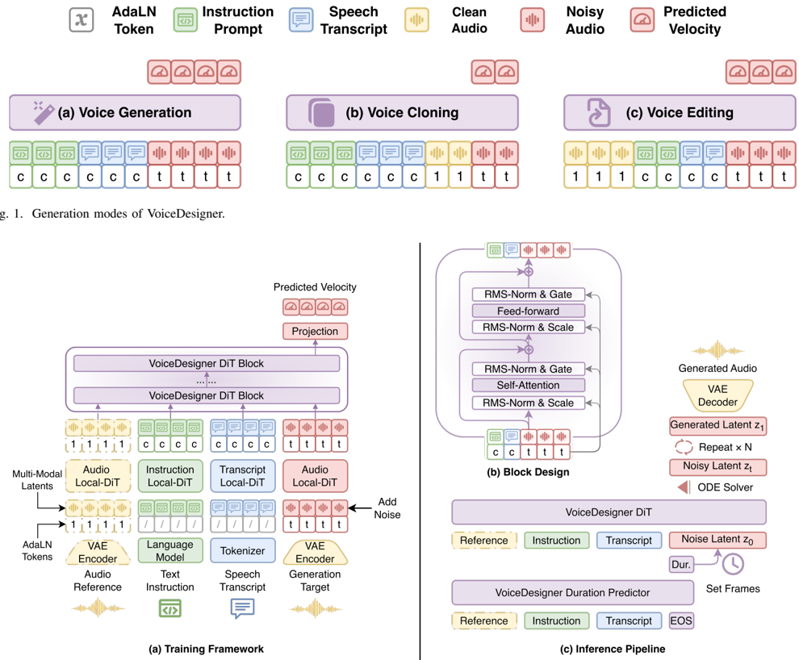

> [!abstract] arXiv · 2026 · Preprint
> **Jiarui Hai et al.** (Johns Hopkins University / Adobe Research) · [→ Paper](https://arxiv.org/abs/2608.13613) · Demo: ✓ · Code: ✗
>
> VoiceDesigner trains one 1.0B flow-matching MM-DiT to do three jobs: generate speech from a natural-language voice description, clone a voice from reference audio, and edit a reference voice by instruction. Two changes to the conditioning (per-token flow-matching timesteps and a 3D rotary position scheme) and DSP-plus-generative data simulation for non-human character voices support these modes.

## Problem

Text-to-voice (TTV) systems generate speech from a transcript and a textual voice description. Prior TTV models mostly cover realistic human voices described by speaker and style traits (age, gender, pitch, emotion). They struggle with uncommon styles such as whispering or nervous speech. They also struggle with fictional and non-human characters ("a massive male dragon speaking in a deep, thunderous voice"), because their audiobook and podcast training data contains few such voices. Practical voice design also needs to reuse and refine a designed voice. Existing cloning systems are less robust on stylised or non-human voices. Instruction-based editing (ISSE, IndexTTS-2's text-to-emotion-vector mode, Step-Audio-EditX) has limited range and often degrades quality. Generation, cloning and editing are usually separate systems.

## Method

**Modes and latent space.** One model covers three modes, defined by which conditions are present: voice generation (instruction + transcript), voice cloning (reference audio + transcript, zero-shot continuation or inpainting), and voice editing (reference audio + edit instruction + transcript). The model generates continuous latents from a DAC-VAE trained on Emilia, Common Voice, VCTK, EARS and AudioSet (48 kHz audio, 25 Hz latent frame rate, Stable Audio configuration). The paper calls the model a "flow-matching diffusion model"; its objective is flow matching (predicted velocity, ODE solver at inference). A separate sentence-level duration predictor sets the target length. It is initialised from Qwen3-0.6B, encodes reference audio with a Dasheng encoder, and uses a diffusion-based duration head on the [EOS] token. For editing it also conditions on the reference audio.

**Backbone.** The generator is a 1.0B-parameter single-stream multimodal diffusion transformer (MM-DiT). Each modality first passes through a small local transformer; then all tokens are concatenated and processed with shared parameters. T5Gemma-XL encodes the instruction, and the F5-TTS tokenizer encodes the transcript. The paper adds two conditioning changes:

- **Token-level AdaLN.** Following diffusion-forcing ideas, each audio token carries its own flow-matching time embedding. Target tokens receive sampled timesteps; reference-audio tokens are fixed at t = 1 (clean); and instruction and transcript tokens carry a dedicated condition token [C]. The motivation is that one global timestep cannot tell noisy targets from clean conditions when they share one token sequence. The same mechanism handles cloning by keeping prefix speech tokens clean.
- **3D-RoPE.** Rotary positions are extended to three axes, one per modality: instruction, transcript and audio (clean and noisy). Aligned transcript and audio tokens share a coordinate so their temporal correspondence is preserved. This replaces one shared 1D position sequence.

**Data simulation.** Two pipelines expand the voice distribution:

- **DSP simulation.** Chains of pitch shifting, formant shifting, reverb, EQ, band-pass filtering and compression (Pedalboard, librosa, Parselmouth), plus SiFi-GAN pitch-contour manipulation, turn ordinary speech into dragons, demons, robots, miniature creatures and similar voices. The same transformations produce pitch and formant editing pairs. In these pairs the processed audio is the reference and the original recording is the target, so the model does not learn DSP artifacts.
- **Generative simulation.** Internally trained zero-shot cloning and pitch-controlled voice conversion models multiply scarce stylistic recordings (emotional, accented and character speech) into new content and new timbres. Outputs are filtered by Whisper WER (> 0.1 discarded), by best-of-two selection on speaker or emotion2vec similarity, and by a speaker-similarity floor of 0.6.

Pretraining captions come from attribute templates paraphrased by an LLM. Fine-tuning captions are generated by Qwen3-30B-A3B-Instruct. Fine-tuning data includes ESD, RAVDESS and SAVEE (E1); Expresso, EARS and CapSpeech-Agent (E2); accented VCTK and Common Voice; DreamVoice timbre labels; DSP-processed LibriTTS-R and VCTK; and an internal 16-hour set of 20 characters performed by 12 voice actors (360 voice variations).

**Training.** Training has three stages (Table II):

1. Pretraining on 56,165 hours of Emilia, Common Voice, LibriTTS-R and a HiFiTTS-2 subset: 400k steps, 64 A100s, generation and cloning tasks.
2. Task adaptation on the fine-tuning and editing sets: 100k steps.
3. Quality refinement on real recordings plus a small set of high-quality DSP data: 10k steps.

The model is English only.

## Key Results

**Voice generation (Table III).** Baselines are CapSpeech-NAR, Qwen3TTS-VoiceDesign and the ElevenLabs voice-design API (a commercial product). On the 520-prompt objective set, VoiceDesigner has the highest Style-ACC (0.66 vs. 0.58 ElevenLabs, 0.57 CapSpeech-NAR, 0.50 Qwen3TTS) and the lowest WER (1.22 vs. 1.39, 1.68, 2.12). The listening tests used 100 trained listeners, each recording rated at least four times. Their results are more mixed:

- **MOS-C (prompt consistency).** VoiceDesigner leads the open-source systems on TTV-Traits (3.93 vs. 3.26 and 3.10) and on TTV-Character (3.71 vs. 3.59 Qwen3TTS; CapSpeech-NAR cannot do characters). It trails ElevenLabs on both (4.00 and 4.26). On TTV-Traits the 95% confidence intervals of VoiceDesigner and ElevenLabs overlap (±0.06).
- **MOS-U (usability).** VoiceDesigner ties Qwen3TTS on TTV-Traits (3.57 each). On TTV-Character it is below Qwen3TTS (3.72 vs. 4.03), and the enhanced variant (3.93) remains below.
- **MOS-Q (quality).** Raw VoiceDesigner scores 3.96 on TTV-Traits (same as CapSpeech-NAR; Qwen3TTS 4.20). On TTV-Character it has the lowest score among the systems tested (3.60 vs. 4.19 Qwen3TTS and 4.23 ElevenLabs). The authors attribute part of the gap to retained background ambience. With an external Adobe enhancement tool applied, MOS-Q rises to 4.17 and 3.92. The enhancement is post-processing, not a change to the model.

**Voice cloning (Tables IV, V).** On Seed-TTS test-en, VoiceDesigner reaches WER 1.70 and SIM-o 0.757. Its WER is the lowest of the listed systems (Seed-TTS DiT 1.73, F5-TTS 1.83, CosyVoice-3-0.5B 2.02, E2-TTS 2.19, CosyVoice-3-1.5B 2.21, IndexTTS-2 2.23). Its SIM-o is second to the closed-source Seed-TTS DiT (0.79). Baseline numbers are copied from the official reports rather than re-run. On a 20-pair set of challenging character voices, VoiceDesigner has the highest timbre and style similarity MOS. It scores MOS-T 3.93 vs. 3.85 for IndexTTS-2 and 2.48 for CosyVoice-3-0.5B, and MOS-S 4.00 vs. 3.94 and 2.63. Its confidence intervals overlap with IndexTTS-2's (±0.07 and ±0.06), so the lead over IndexTTS-2 is not separable.

**Voice editing (Table VI).** The test uses 100 emotion and speaking-style editing pairs from an internal voice-actor set that was never used in training. VoiceDesigner reaches MOS-E 4.129, close to ground truth (4.147). Step-Audio-EditX scores 3.333 and IndexTTS-2's text-prompt emotion mode scores 3.494. Similarity to the target-style recording (SIM-t, WeSpeaker) is 0.884 vs. 0.734 and 0.856. Pitch and formant edits are not evaluated against baselines, because the baselines do not support them.

**Ablations.** Ablation models are 0.3B, trained on 5,000 hours of HiFiTTS-2 with 200 held-out speakers (Figure 4, read from bar charts):

- Single-stream MM-DiT (v1) converges faster and reaches lower WER than CapSpeech-NAR's cross-attention F5-TTS variant. However, it falls slightly behind CapSpeech-NAR on cloning similarity and Style-ACC late in training.
- Adding token-level AdaLN (v2) raises cloning similarity and Style-ACC, with a small WER increase.
- Adding 3D-RoPE (v3) gives the highest cloning SIM-o at every checkpoint, lowers WER relative to v2, and leaves Style-ACC about the same.

Generative-simulation augmentation of the E1 and E2 emotional corpora lowers WER and raises Style-ACC compared with real data alone (Figure 5).

**Runtime.** On an RTX 4090, generation runs at RTF 0.36 (CapSpeech 0.33, Qwen3-TTS 1.21) and editing at RTF 0.42 (Step-Audio-EditX 0.80, IndexTTS-2 0.72).

## Novelty Assessment

The architectural contribution is moderate and specific: per-token flow-matching timesteps (from diffusion forcing) and modality-specific 3D-RoPE on a single-stream MM-DiT borrowed from image generation. Both are adaptations of ideas from vision and video diffusion rather than new mechanisms, but they are applied here to a TTS/TTV setting with heterogeneous conditions. The ablation supports them with convergence curves on a 0.3B model.

Unifying generation, cloning and instruction editing in one non-autoregressive model is the main system-level novelty. Much of the practical gain likely comes from data engineering: DSP character simulation, generative augmentation, LLM captions, and an internal voice-actor dataset that is not released.

The evaluation is broad but uneven:

- The two TTV listening benchmarks and the 520-prompt objective set are the authors' own.
- The cloning baselines are taken from published reports.
- The character-cloning test has only 20 pairs.
- The paper reports quality figures with external enhancement, which is a different system from the raw model.

No code release is stated.

## Field Significance

Moderate — The paper shows that one flow-matching DiT can handle description-based voice generation, zero-shot cloning and instruction-based voice editing when conditions are separated by per-token noise levels and per-modality positions. It also shows that DSP and voice-cloning simulation can extend TTV coverage to non-human character voices. Its listening tests show a familiar trade-off: prompt adherence improves while raw perceptual quality and usability on character voices lag systems with stronger post-processing.

## Claims

- **supports:** In a single-stream diffusion transformer that mixes clean conditioning tokens and noisy target tokens, assigning per-token noise levels instead of one global timestep speeds convergence and improves speaker similarity and description adherence.
  > *Evidence:* Moving from the original single-stream MM-DiT (v1) to token-level AdaLN (v2), with reference tokens fixed at t = 1, raises voice-cloning SIM-o and TTV Style-ACC at every checkpoint from 50K to 200K steps, at the cost of a small WER increase. *(§V-D1, Figure 4)*
- **supports:** Giving each conditioning modality its own positional axis, instead of one shared 1D position sequence, improves voice-cloning speaker similarity in multi-condition TTS.
  > *Evidence:* Adding 3D-RoPE (separate instruction, transcript and audio axes, with aligned transcript-audio pairs sharing a coordinate) yields the highest SIM-o at every ablation checkpoint and lower WER than token-level AdaLN alone, with comparable Style-ACC. *(§III-B2, §V-D1, Figure 4)*
- **supports:** Augmenting small expressive speech corpora with zero-shot cloning and voice conversion outputs improves both description adherence and intelligibility of description-conditioned TTS.
  > *Evidence:* Fine-tuning from a Stage-1 checkpoint on ESD/RAVDESS/SAVEE and Expresso/EARS/CapSpeech-Agent augmented with filtered generative samples lowers WER and raises Style-ACC compared with real data alone. *(§V-D2, Figure 5)*
- **complicates:** Gains in description adherence for text-to-voice generation do not carry over automatically to perceived quality or usability, especially for non-human character voices.
  > *Evidence:* VoiceDesigner leads open-source systems on MOS-C, but on TTV-Character its raw MOS-Q (3.60) and MOS-U (3.72) fall below Qwen3TTS-VoiceDesign (4.19, 4.03). External enhancement narrows but does not close the usability gap (3.93). *(§V-A, Table III)*
- **supports:** A single model trained jointly for description-based generation, cloning and editing can follow emotion and speaking-style edit instructions on unseen speakers better than dedicated editing systems.
  > *Evidence:* On 100 editing pairs from voice actors not seen in training, the unified model reaches MOS-E 4.129 (ground truth 4.147) and SIM-t 0.884, against Step-Audio-EditX (3.333, 0.734) and IndexTTS-2's text-prompt emotion mode (3.494, 0.856). *(§V-C, Table VI)*

## Limitations and Open Questions

> [!warning]
> The key data (the internal 16-hour character voice dataset, the internal editing test set, the generative-simulation cloning and conversion models, and the TTV listening benchmarks) are not released, and no code release is stated. The character-voice and editing results cannot be reproduced independently.

- The model is English only. The authors limit it to English because character-style fine-tuning data is scarce.
- Raw outputs keep background ambience. The headline quality comparison partly relies on an external enhancement tool rather than the model.
- The cloning comparison on Seed-TTS test-en copies baseline numbers from official reports. The challenging-character cloning test has only 20 pairs, and the MOS gap to IndexTTS-2 is within the confidence intervals.
- Editing is evaluated only on emotion and speaking style against baselines. Pitch, formant and effect edits are demonstrated only on the demo page.
- Style-ACC relies on pretrained classifiers for gender, age, pitch, emotion and accent. The authors exclude attributes those classifiers cannot judge, so character prompts are evaluated only through listening tests.
- The ablations use a 0.3B model on HiFiTTS-2. The paper does not show that the architectural gains hold at the 1.0B scale with the full data mix.

## Wiki Connections

- [[instruction-conditioned-tts|Instruction-Conditioned TTS]] — Generates voices from natural-language speaker, style and character descriptions, and edits reference voices from natural-language instructions.
- [[flow-matching|Flow Matching]] — A 1.0B flow-matching MM-DiT over DAC-VAE latents, with per-token flow-matching timesteps distinguishing clean conditions from noisy targets.
- [[zero-shot-tts|Zero-Shot TTS]] — Evaluates prompt-based cloning on Seed-TTS test-en and on unseen non-human character voices.
- [[emotion-synthesis|Emotion Synthesis]] — Measures emotion adherence via classifier-based Style-ACC and emotion/style editing via MOS-E, and uses generative simulation to expand emotional corpora.
- [[subjective-evaluation|Subjective Evaluation]] — Runs separate trained-listener MOS tests for prompt consistency, usability, quality, timbre and style similarity, and edit following.
- [[2506.02863|CapSpeech]] — Shares authors with this paper. CapSpeech-NAR is the main open-source TTV baseline and the cross-attention reference point in the architecture ablation, and its evaluation tool provides Style-ACC.
- [[2601.15621|Qwen3-TTS]] — Its VoiceDesign mode is the strongest open-source TTV baseline and leads VoiceDesigner on raw quality and on character-voice usability.
- [[2511.03601|Step-Audio-EditX]] — Dedicated instruction-editing baseline whose evaluation protocol VoiceDesigner follows; it scores well below VoiceDesigner on MOS-E and SIM-t.
- [[2506.21619|IndexTTS2]] — Baseline for zero-shot cloning, character cloning (where its MOS is within the confidence intervals of VoiceDesigner's) and text-prompt emotion editing.
- [[2505.17589|CosyVoice 3]] — Cloning baseline on Seed-TTS test-en and on the challenging character voices, where it falls far behind.
- [[2025.acl-long.313|F5-TTS]] — Provides the transcript tokenizer and the channel-concatenation conditioning used by the ablation baselines, and is compared on Seed-TTS test-en.
- [[2406.02430|Seed-TTS]] — Source of the test-en cloning benchmark; its closed-source DiT variant is the only listed system with higher SIM-o.
- [[2406.18009|E2 TTS]] — Cloning baseline on Seed-TTS test-en and the source of the speaker-conditioning strategy used for the ablation baselines.
