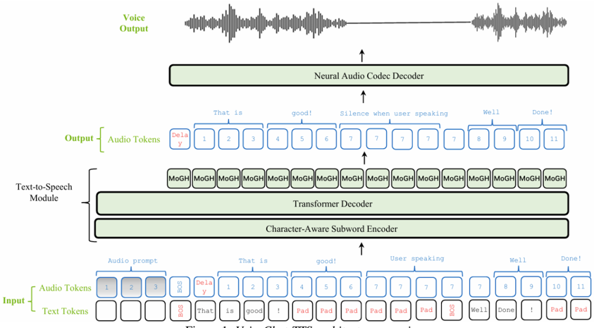

> [!abstract] arXiv · 2026 · Preprint
> **Edresson Casanova et al.** (NVIDIA) · [→ Paper](https://arxiv.org/abs/2608.13831) · Demo: ? · Code: ✓
>
> VoiceChat-TTS is a streaming TTS decoder that runs continuously over a whole conversation, consuming an LLM's text-token stream, emitting silence when no agent text arrives, and stopping on an explicit interruption token without resetting its KV cache, so a modular text LLM can serve as a full-duplex speech agent.

## Problem

End-to-end duplex speech-to-speech models reduce latency but, according to the authors, often degrade synthesis quality because ASR, interruption handling and speech generation must be optimized jointly in one network. Existing streaming TTS decoders (the Audio Flamingo 3-Chat speech decoder, VoXtream, SpeakStream, Qwen3-TTS) address incremental synthesis within a single response, but they do not model the always-on behaviour that full-duplex agents need: staying active across conversational time, producing silence while the user speaks, and stopping promptly on user barge-in.

## Method

VoiceChat-TTS extends the Audio Flamingo 3-Chat streaming speech decoder. A 778M-parameter Gemma 3-based Transformer decoder autoregressively predicts frames of discrete audio tokens from a fully causal convolutional codec (199M parameters) that the authors train to compress 22 kHz audio at 12.5 Hz with 31-codebook residual vector quantization, so each frame covers 80 ms. The total model has 977M parameters.

Text input is a time-aligned stream of LLM subword tokens from the Nemotron Nano 2 tokenizer (about 4.16 tokens per second on LibriTTS test-clean, roughly one text token per three audio frames), right-padded with PAD tokens to the acoustic length. Two control tokens are added: a BOS token marking the start of each assistant turn and an interruption token marking where the model must stop speaking and move to silence; both receive learnable boundary embeddings. The text stream leads the audio stream by one token, giving the model at least two subwords of lookahead.

Further changes to the base decoder:

- **Character-Aware Subword Encoder:** each subword is split into characters, encoded by a shallow Transformer and average-pooled, so that LLM subwords rare or absent in TTS data still get usable embeddings. A dedicated embedding marks subword-continuation tokens.
- **Mixture-of-Gaussians head (MoGH):** rather than decoding the 31 RVQ levels in 31 autoregressive steps, the head iteratively unmasks them by predicting continuous embeddings with a MoG estimate and quantizing them; 8 refinement iterations are used in all evaluations.
- **Audio prompt conditioning:** a 3-second reference clip prefills the acoustic sequence (loss-masked in training), replacing the base decoder's implicit speaker inference from preceding context.
- **Gated fusion** between text and acoustic embeddings, to avoid mixed-precision overflow from high-magnitude RVQ embeddings.

Training data combine about 70k hours of single-turn English TTS data (LibriTTS, HiFiTTS, a HiFiTTS-2 subset, a proprietary two-speaker set) plus a 32k-hour internal Creative Commons YouTube set; about 2.5k hours of synthetic multi-turn dialogues generated from LLM scripts and synthesized with Chatterbox and Koel-TTS, half of them simulating overlaps and barge-ins; word and proper-name lists; and real conversation from Fisher plus an internal set. Silence of 0.5 to 5.0 s is prepended to 50% of single-turn samples so the model cannot trivially tell TTS samples from duplex ones. Training is a 1.4M-step single-turn pretraining stage on 8 A100s followed by 200k fine-tuning steps on 32 H100s with the full mixture (40% single-turn, 15% word lists, 10% real conversation, 35% synthetic duplex). At inference, an optional Force Silence mode injects the most frequent codec frame of encoded pure silence at positions aligned with the interruption token.

## Key Results

All automatic metrics follow the Koel-TTS protocol: CER and WER from Parakeet-TDT, speaker similarity as TitaNet-Large cosine (SECS), and quality as Squim-MOS (predicted, not a listening test). Values are means over ten stochastic runs.

**Single and multi-turn TTS (Table 1, LibriTTS test-clean unseen speakers).** Against the closest architectural baseline, the Audio Flamingo 3-Chat streaming decoder, VoiceChat-TTS lowers WER from 4.51% to 2.00% and CER from 2.85% to 1.00%, and raises Squim-MOS from 3.60 to 4.380, with SECS roughly level (0.757 vs. 0.761). It does not match the conventional single-response systems on intelligibility or similarity: Qwen3-TTS-12Hz-1.7B reaches 1.01% WER, 0.34% CER and 4.45 Squim-MOS, and Chatterbox-TTS 1.24% WER and 0.887 SECS. VoiceChat-TTS's Squim-MOS (4.380) is above Chatterbox-TTS (4.27) but below Qwen3-TTS (4.45). Across one to four consecutive turns, unseen-speaker WER stays between 1.90% and 2.20% and Squim-MOS around 4.38, but SECS falls from 0.757 to 0.685. For seen speakers, SECS stays between 0.778 and 0.789 and WER between 1.80% and 2.40%.

**Resynthesis of a duplex model's text stream (Table 2).** Keeping PersonaPlex's predicted text-token stream and its timing (including PAD tokens while the user speaks) on the Smooth Turn Taking subset of Full-Duplex-Bench, and computing ASR on the untrimmed assistant output so speech leaked into intended silences counts as insertions, VoiceChat-TTS lowers CER from 4.06% to 2.05% and WER from 5.00% to 2.42% and raises Squim-MOS from 4.094 to 4.292 relative to PersonaPlex's own audio. Speaker similarity is not compared because voices differ.

**Interruption handling (Table 3).** On 200 controlled-interruption examples timed from the Full-Duplex-Bench User Interruption subset (the authors state this is not an official FDB score), the learned response alone stops the active segment within 320 ms in 96.8% of cases, with 228.3 ms mean stop latency and 169.1 ms of leakage in the first second. Force Silence raises this to 100.0%, 89.9 ms and 55.8 ms. CER on the following assistant turn, generated without resetting the KV cache, is 0.255% without and 0.095% with Force Silence.

**Latency (Table 4, RTX A6000, vLLM-Omni).** At concurrency 1, VoiceChat-TTS needs 7.16 ms acoustic inter-token latency plus 2.46 ms codec decoding (9.62 ms total per 80 ms frame) against 15.44 + 4.90 = 20.34 ms for the re-measured Qwen3-TTS-12Hz-1.7B; at concurrency 4 the totals are 15.24 ms and 22.08 ms. Both systems run faster than real time.

Ground truth is evaluated once while all systems are averaged over ten runs with 95% confidence intervals. The Qwen3-TTS latency was re-measured by the authors with their own codec-side optimizations for both models, so the latency comparison is controlled for hardware but not independently replicated.

## Novelty Assessment

The core decoder (AR transformer over RVQ frames with a MoG head, time-aligned text stream) is inherited from the Audio Flamingo 3-Chat speech decoder and earlier NVIDIA work. What is new is the reframing of the TTS decoder as a continuously running component: PAD-driven silence generation, an interruption control token handled without KV-cache reset, and a unified single-turn plus multi-turn training formulation with silence-prepending augmentation. The character-aware subword encoder for LLM tokenizer vocabularies and gated fusion are smaller architectural additions. The contribution is a mix of new inference and training formulation and system engineering; the authors state that no component-wise ablations were run, so the individual value of each change is not measured.

## Field Significance

Moderate — VoiceChat-TTS demonstrates that a modular, text-driven TTS decoder can handle silence and barge-in in a full-duplex loop, offering an alternative to jointly trained duplex speech LMs, which the authors argue trade synthesis quality against dialogue behaviour. Its resynthesis experiment shows a separately trained decoder improving the intelligibility and predicted quality of a duplex model's output under the same text timing, though all quality evidence is automatic and the component contributions are unablated.

## Claims

- **supports:** A streaming TTS decoder driven by an LLM's time-aligned text-token stream can be trained to generate silence during padded intervals and to stop on an explicit interruption token, providing duplex turn-taking behaviour without an end-to-end speech-to-speech model.
  > *Evidence:* On 200 controlled interruptions timed from the Full-Duplex-Bench User Interruption subset, the learned response alone ends the active speech segment within 320 ms in 96.8% of cases (228.3 ms mean stop latency); the next turn is generated without a KV-cache reset at 0.255% CER. *(§3.5, Table 3)*
- **supports:** Decoupling speech synthesis from a jointly trained duplex model and resynthesizing its text stream with a dedicated decoder can improve intelligibility and predicted quality while preserving content and timing.
  > *Evidence:* Resynthesizing PersonaPlex's text-token stream on the Full-Duplex-Bench Smooth Turn Taking subset lowers WER from 5.00% to 2.42% and CER from 4.06% to 2.05%, and raises Squim-MOS from 4.094 to 4.292, with ASR computed on the untrimmed output so leakage during silence counts as errors. *(§3.4, Table 2)*
- **complicates:** Prompt-based speaker identity for unseen speakers degrades as continuous multi-turn generation proceeds, while intelligibility and predicted quality stay stable.
  > *Evidence:* For unseen LibriTTS speakers, SECS falls from 0.757 at one turn to 0.685 at four turns while WER stays between 1.90% and 2.20% and Squim-MOS near 4.38; seen speakers keep SECS between 0.778 and 0.789. *(§3.4, Table 1)*
- **complicates:** Supporting continuous duplex operation in a streaming decoder costs single-response intelligibility and speaker similarity relative to TTS systems optimized for one-shot synthesis.
  > *Evidence:* At one turn, VoiceChat-TTS reaches 2.00% WER and 0.757 SECS on LibriTTS test-clean unseen speakers, against 1.01% WER and 0.827 SECS for Qwen3-TTS-12Hz-1.7B and 1.24% WER and 0.887 SECS for Chatterbox-TTS. *(§3.4, Table 1)*
- **refines:** Deterministic injection of a codec silence frame at the interruption point tightens barge-in compliance beyond a learned stop response without harming recovery on the next turn.
  > *Evidence:* Force Silence raises IOR@320ms from 96.8% to 100.0%, cuts mean stop latency from 228.3 ms to 89.9 ms and Leakage@1s from 169.1 ms to 55.8 ms, and lowers after-interruption CER from 0.255% to 0.095%. *(§3.5, Table 3)*

## Limitations and Open Questions

> [!warning] No ablations and no listening tests
> The authors state that the architectural changes (character-aware subword encoder, boundary embeddings, gated fusion, audio prompt, silence augmentation) were not ablated, so their individual contributions are unmeasured. All quality figures are automatic (ASR error rates, TitaNet SECS, Squim-MOS as a predicted score); no human ratings are reported.

- The model is not conditioned on user audio, so it cannot adapt its prosody to the user's acoustic cues (stated by the authors).
- Unseen-speaker similarity drops across turns; the authors suggest stronger prompt conditioning or explicit speaker-consistency objectives.
- The interruption benchmark is a controlled construction built on FDB timing annotations with generated assistant responses, not an official Full-Duplex-Bench score, and the authors note there are no standardized benchmarks for continuous duplex TTS; leakage during intended silence is measured only indirectly in Table 2 via ASR insertions.
- Evaluation is English only.
- Training relies on large proprietary and internal data (a 32k-hour YouTube set, a 62-hour two-speaker set, internal conversations), limiting reproduction of the full mixture even though code and checkpoint are released.

## Wiki Connections

- [[autoregressive-codec-tts|Autoregressive Codec TTS]] — The decoder autoregressively predicts frames of 31-level RVQ tokens from an in-house 12.5 Hz codec, using a MoG head to refine all levels of a frame in 8 iterations.
- [[streaming-tts|Streaming TTS]] — Consumes LLM subword tokens incrementally with a one-token lookahead and reports 9.62 ms per 80 ms frame at concurrency 1 on an RTX A6000.
- [[zero-shot-tts|Zero-Shot TTS]] — Clones unseen LibriTTS test-clean speakers from a 3-second prompt, with similarity degrading across consecutive turns.
- [[speech-to-speech|Speech-to-Speech]] — Serves as the speech decoder in a modular duplex pipeline and is evaluated by resynthesizing a duplex model's text stream on Full-Duplex-Bench.
- [[2507.08128|Audio Flamingo 3]] — Its AF3-Chat streaming speech decoder is the base architecture VoiceChat-TTS extends and the closest baseline in Table 1.
- [[2601.15621|Qwen3-TTS]] — Single-turn quality baseline in Table 1 that VoiceChat-TTS does not match on intelligibility, and latency comparison in Table 4 where VoiceChat-TTS is faster.
- [[2602.06053|PersonaPlex]] — Duplex speech-to-speech model whose predicted text stream VoiceChat-TTS resynthesizes in Table 2.
- [[2503.04721|Full-Duplex-Bench]] — Supplies the Smooth Turn Taking subset and the User Interruption audio and timing annotations used in Tables 2 and 3.
- [[2507.23159|Full-Duplex-Bench v1.5]] — Provides the stop-latency protocol and official Silero VAD timing scripts adopted for the interruption evaluation.
- [[1904.02882|LibriTTS]] — Training data and the source of the unseen-speaker test set and synthetic multi-turn test conversations.
- [[interspeech-2025-0989|HiFiTTS-2]] — A 36.7k-hour subset forms a large share of the single-turn training data.
