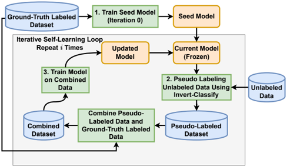

> [!abstract] arXiv · 2026 · Preprint
> **Sanders et al.** (University of Edinburgh) · [→ Paper](https://arxiv.org/abs/2608.15910) · Demo: ? · Code: ?
>
> Turns a flow-matching TTS model into its own expressive-label annotator: starting from a small labeled seed, the model repeatedly pseudo-labels unlabeled speech by gradient-based inversion of its conditioning embedding, then retrains on the enlarged set, which improves label accuracy and downstream emotion and prominence control in low-resource splits.

## Problem

Explicit expressive labels (emotion categories, word-level prominence tags) give direct and interpretable control in TTS, but speech corpora rarely carry them, and human annotation of perceptual categories is costly. The usual workaround trains a separate classifier or adapts a self-supervised representation per task and dataset, which adds an engineering stage outside the TTS model. Semi-supervised TTS work has instead targeted missing transcripts or missing speech, and does not address scarce discrete conditioning labels. Iterative pseudo-labeling works well for ASR, but in expressive TTS label quality and synthesis quality can decouple: the authors' earlier Invert-Classify work (ASRU 2023) found that a FastPitch model trained on random prominence labels came close in listener quality ratings to one trained on pseudo-labels.

## Method

The framework adopts the iterative pseudo-labeling protocol from ASR. A seed model is trained for 100 epochs on the small ground-truth labeled set. The model is then frozen and pseudo-labels the unlabeled set with Invert-Classify, a classifier-free method from the authors' prior work. Training continues on the union of labeled and pseudo-labeled data, and the label-retrain cycle repeats for a fixed number of iterations.

The backbone is Matcha-TTS, a mel-spectrogram acoustic model trained from scratch with optimal-transport conditional flow matching (OT-CFM), Monotonic Alignment Search for alignment, and auxiliary duration and encoder prior losses. Two expressive inputs are added. For word-level prominence, binary `<PROM>`/`<NOTPROM>` tags are interleaved with phoneme tokens at word boundaries and embedded in a separate table. For utterance-level emotion, a learned class embedding is concatenated to the text encoder outputs. A HiFi-GAN V1 vocoder trained on both datasets is held fixed across all systems. Model size is not reported.

Invert-Classify initialises the missing label embedding as the mean of all label embeddings. It then updates that embedding by gradient descent on the full training loss (OT-CFM plus duration and encoder losses) with the model frozen, and quantises the result to the nearest label embedding by cosine similarity. Random timesteps and noise in flow-matching training would make this inversion objective shift at every step. The paper therefore fixes the timestep at t = 0.9 and uses one fixed noise tensor per input during inversion. Emotion embeddings are optimised for 200 steps (learning rate 0.01) and prominence embeddings for 100 steps (learning rate 1e-4).

Because long self-training can reinforce label errors, the final systems use a Select-and-Retrain strategy. The iteration with the highest pseudo-label accuracy on a held-out validation set is chosen, and a fresh model is trained from scratch for 1000 epochs on that iteration's combined dataset. Experiments use the English subset of ESD (10 speakers, five emotions) and Naver Prosody Control (one female American English speaker, contrastive-focus groups of four), each with 0.5%, 1%, 5% and 20% seed splits. Per-iteration training of 3, 10 or 50 epochs is compared.

## Key Results

**Iteration dynamics (Figs. 2 and 3, values read from plots).** Training 50 epochs between pseudo-labeling rounds collapses label accuracy on both tasks: all emotion splits fall below the seed model's accuracy, and on the 1% prominence split binary F1 drops from about 0.45 to about 0.24. Ten epochs per iteration is the most consistent setting, although 3 epochs sometimes reaches higher late-stage accuracy. Emotion gains arrive mostly in the first iteration (5% split: about 0.35 to over 0.45 macro F1) and then saturate. Prominence improves more slowly over several iterations. Both tasks plateau or degrade after a peak.

**Data scarcity.** On the 1% emotion split, ISL raises pseudo-label F1 from about 0.33 to about 0.40. On the 0.5% emotion split accuracy stays flat, which the authors read as a minimum seed size for bootstrapping. At the 20% split neither task benefits from ISL. Synthesis experiments therefore use the 1% and 5% emotion splits and the 0.5% and 1% prominence splits.

**Emotion synthesis (Table II).** Emotion adherence measured by emotion2vec macro F1 improves over the single-pass control at both splits: 29.87 vs. 26.58 at 1%, and 49.58 vs. 39.38 at 5%. The 5% ISL model also scores above the fully supervised model (45.95). The authors decline to treat this as evidence, citing possible domain effects of emotion2vec on synthetic speech, and the listening test does not support it. Overall TTSDS2 rises from 88.70 to 89.90 at 1% and from 89.18 to 89.85 at 5%, with the largest gains in the prosody factors. Not every factor improves: at 1% the intelligibility average drops (87.58 vs. 88.01), and at 5% WeSpeaker similarity drops (83.20 vs. 83.75). The fully supervised model stays ahead on overall TTSDS2 (92.02).

**Prominence synthesis (Table III).** Overall TTSDS2 improves over the control at both splits: 93.15 vs. 91.37 at 0.5%, and 92.66 vs. 91.57 at 1%. The intelligibility average improves at both splits (93.16 vs. 90.69 at 0.5%, 94.61 vs. 91.44 at 1%), while prosody is mixed. At 0.5%, ISL improves both the prosody average (93.33 vs. 90.52) and pYIN F0 RMSE (2.57 vs. 2.66 semitones). At 1%, ISL is worse on both (prosody average 90.55 vs. 91.00, F0 RMSE 2.91 vs. 2.68), and HuBERT token speaking-rate similarity falls from 92.29 to 80.52. No pretrained prominence classifier was available, so prominence adherence rests on the listening test. The authors also find that the DIO pitch extractor inside TTSDS misses voiced frames below 72 Hz. That miss makes vocoded ground truth score below every TTS system on the TTSDS pitch factor, so they report pYIN-based F0 RMSE instead.

**Listening test (Table IV).** Thirty Prolific listeners ran A/B expressivity preference tests, scored with a Bradley-Terry model; a 95% interval that overlaps 0.5 counts as a tie. Listeners preferred ISL over the single-pass control for prominence at 0.5% (0.656 ± 0.117) and 1% (0.678 ± 0.078), and for emotion at 5% (0.633 ± 0.037). The two tied for emotion at 1% (0.500 ± 0.094). For both tasks, ISL at the two seed sizes tied with each other. For prominence, 1% ISL tied with the fully supervised model (0.629 ± 0.132). For emotion, listeners preferred the fully supervised model over 5% ISL (0.633 ± 0.042), so a gap to full supervision remains there.

## Novelty Assessment

Both ingredients have precedents. Iterative pseudo-labeling is standard in ASR, and Invert-Classify was introduced by the same first and last authors for single-pass prominence labeling. The new parts are three. The paper places inversion-based label recovery inside a self-training loop for a generative TTS model. It adapts inversion to flow matching by fixing the timestep and noise. It extends the method from word-level prominence to utterance-level emotion. The study of per-iteration training length, seed size and Select-and-Retrain is careful and reports where the method does not help. The evidence comes from one small backbone (Matcha-TTS), two datasets, and one emotion classifier. There is no comparison against an external-classifier pseudo-labeling pipeline, which the authors list as future work. The prominence adherence result rests on one listening test.

## Field Significance

Moderate — The paper shows that a TTS model's own reconstruction loss can bootstrap discrete expressive labels from a small seed. Iterating this improves label accuracy and controllability over single-pass labeling in a narrow low-resource band of seed sizes. It also gives practical guidance on per-iteration training length and stopping. A secondary finding is that the TTSDS pitch factor can misrank natural speech when voiced F0 falls below DIO's floor.

## Claims

- **supports:** Iterative self-training, in which a generative TTS model pseudo-labels unlabeled speech for its own expressive conditioning inputs and retrains on the result, can improve explicit expressive control over single-pass pseudo-labeling when labeled data is scarce.
  > *Evidence:* With Matcha-TTS and Invert-Classify pseudo-labels, ISL raises emotion2vec macro F1 over the single-pass control at the 1% (29.87 vs. 26.58) and 5% (49.58 vs. 39.38) ESD splits. Listeners prefer ISL for prominence at 0.5% and 1% and for emotion at 5%, but rate the two equal for emotion at 1%. *(§VI-D, Table II; §VI-E, Table IV)*
- **refines:** Self-training gains for expressive TTS labels appear only in a bounded low-resource regime: too little seed data cannot bootstrap the loop, and enough seed data makes it unnecessary.
  > *Evidence:* Pseudo-label accuracy stays flat on the 0.5% ESD split and shows no ISL benefit at the 20% split on either task. The useful range is 1-5% for emotion and 0.5-1% for prominence. *(§VI-C, Figs. 2 and 3)*
- **complicates:** Training too long between pseudo-labeling rounds causes self-training of expressive labels to collapse, so per-iteration training budget and checkpoint selection are critical hyperparameters.
  > *Evidence:* With 50 epochs per iteration, emotion pseudo-label accuracy falls below the seed model on all splits, and 1% prominence F1 drops from about 0.45 to about 0.24. Ten epochs per iteration is the most consistent setting. *(§VI-A, Figs. 2 and 3)*
- **complicates:** Distribution-based TTS metrics built on F0 extractors with a fixed pitch floor can rank natural speech below synthetic speech on prosody when the speaker's voiced F0 falls below that floor.
  > *Evidence:* 97.7% of Naver-Prosody ground-truth utterances contain voiced regions below DIO's 72 Hz floor. Vocoding shifts those regions upward (mean F0 129.4 Hz vs. 135.0 Hz), so vocoded ground truth scores below all TTS systems on the TTSDS pitch factor; pYIN F0 RMSE restores it as the ceiling (2.01 semitones). *(§VI-D, Table III)*
- **complicates:** Semi-supervised expressive labeling can still leave a perceptible gap to fully supervised training for global expressive attributes such as emotion, even where it matches full supervision on local attributes such as word prominence.
  > *Evidence:* Listeners prefer the 100% ground-truth model over 5% ISL for emotion (0.633 ± 0.042) but rate 1% ISL and the fully supervised model as tied for prominence (0.629 ± 0.132). *(§VI-E, Table IV)*

## Limitations and Open Questions

- ISL is tested only on Matcha-TTS, a small mel-spectrogram flow-matching model trained from scratch. Whether the dynamics carry over to large pretrained codec-LM or diffusion systems is left open (§VIII).
- There is no comparison against classifier-based or SSL-based pseudo-labeling under matched supervision budgets, so the paper does not show whether self-contained inversion labeling beats an external labeler (§VIII).
- Emotion adherence relies on one pretrained classifier (emotion2vec_plus_large), whose ranking of ISL above full supervision the authors themselves treat as unreliable. Prominence adherence has no objective measure, only the listening test.
- Results depend on tuned hyperparameters: inversion timestep t = 0.9, per-iteration epochs, and the inversion learning rate and step count for each task. Validation-set accuracy chooses the iteration used for Select-and-Retrain, so a labeled validation set is still needed.
- Labels are coarse: binary prominence and five emotion categories. The authors suggest continuous prominence or valence-arousal-dominance representations as future work.
- Gains are small and inconsistent at the margins: no benefit at 0.5% emotion or at 20% for either task, a listener tie at 1% emotion, and worse prosody metrics at 1% prominence.

## Wiki Connections

- [[flow-matching|Flow Matching]] — Adapts gradient-based conditioning inversion to an OT-CFM TTS model by fixing the timestep and noise during inversion.
- [[emotion-synthesis|Emotion Synthesis]] — Improves utterance-level emotion adherence from scarce emotion labels via iterative pseudo-labeling, evaluated with emotion2vec and A/B listening tests on ESD.
- [[prosody-control|Prosody Control]] — Applies the same loop to word-level binary prominence tags on Naver Prosody Control, where listeners prefer ISL over single-pass labels.
- [[subjective-evaluation|Subjective Evaluation]] — Uses Bradley-Terry analysis of A/B preference judgments from 30 Prolific listeners to measure perceived expressivity.
- [[iclr-2026-uGai5lYHlV|TTSDS2]] — Uses TTSDS2 factor scores as the main objective quality measure, and documents a DIO voicing failure that distorts its pitch factor on low-F0 speech.
- [[2312.15185|emotion2vec]] — Uses the emotion2vec_plus_large checkpoint as the objective emotion-adherence classifier for synthesized speech.
- [[2010.05646|HiFi-GAN]] — Uses a fixed HiFi-GAN V1 vocoder for all systems so that differences come from the acoustic models.
- [[2105.06337|Grad-TTS]] — Cited as the SDE-based diffusion predecessor whose inference cost Matcha-TTS's OT-CFM formulation reduces.
- [[2210.02747|Flow Matching for Generative Modeling]] — Provides the flow-matching formulation underlying the Matcha-TTS backbone.
